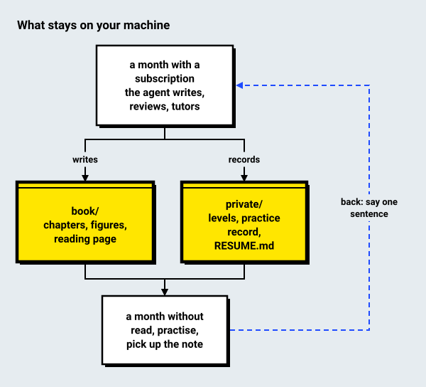
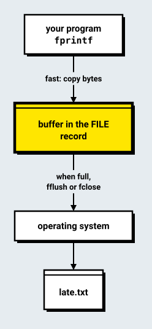
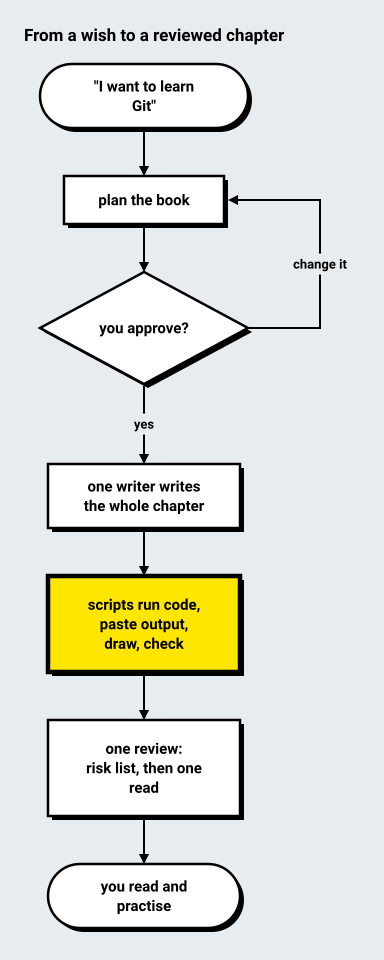
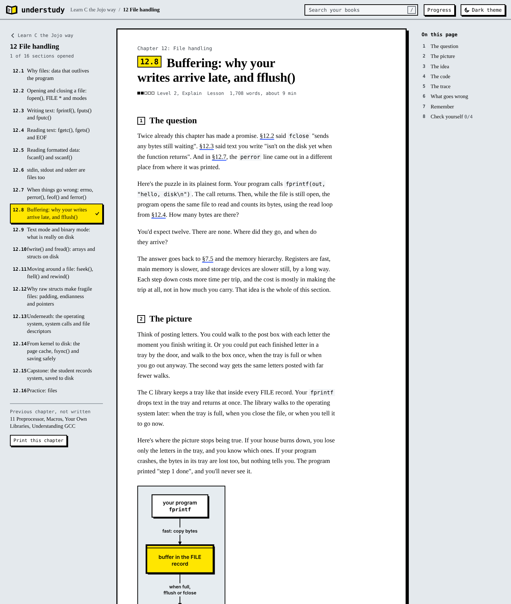

<div align="center">

<picture>
  <source media="(prefers-color-scheme: dark)" srcset="docs/brand/logo-dark.png">
  <source media="(prefers-color-scheme: light)" srcset="docs/brand/logo-light.png">
  
</picture>

**Your coding agent writes you a real textbook, teaches you from it, and never writes your code.**

Skills and scripts for Claude Code. One subject becomes one book on your own disk: numbered sections,
programs that were actually run, figures, hidden answers. When the subscription runs out, the book and
your progress stay.

It writes about five kinds of subject: a programming language, a tool, a framework, how a system works
(operating systems, networks, databases), and a professional skill with nothing to run (usability testing,
writing a bug report).

<a href="#a-page-from-a-real-chapter">See a page</a> ·
<a href="#start-in-a-minute">Start</a> ·
<a href="#how-a-chapter-gets-made">How it works</a> ·
<a href="#what-it-costs">Cost</a> ·
<a href="#a-month-with-no-ai">No AI</a> ·
<a href="#honest-limits">Limits</a>

</div>

---

## Who this is for

A student who wants to become a developer and pays for an AI subscription one month at a time, when
there is money for it.

Most AI help is gone when the chat closes. You asked good questions, got good answers, and a month later
none of it is anywhere you can open. understudy turns the month you paid for into something you keep:

- **A textbook, written for you, in plain files.** One subject is one book. Markdown you can read in any
  editor, a reading page for your browser, and its own git repository you can push to GitHub.
- **Your progress, on your machine.** What you have learnt, what you got wrong in practice and where you
  stopped live in a `private/` folder next to the book. Nothing is kept in a conversation.
- **A month off loses nothing.** You read, you practise with spaced repetition, and a note tells you the
  one sentence to say to the agent when your subscription is back.
- **You still write every line of your projects.** The agent explains, asks, reviews and points at the
  section that covers your problem. It does not type your code.

<p align="center">
<picture>
  <source media="(prefers-color-scheme: dark)" srcset="docs/readme/what-stays-with-you-dark.png">
  
</picture>
</p>

---

## A page from a real chapter

This is from [`examples/learn-c-chapter-12/12-file-handling.md`](examples/learn-c-chapter-12/12-file-handling.md),
"Chapter 12: File handling", written by the system for a C book. Section 12.8, cut down. A section opens
on a need, gives a picture, shows how the thing works, shows the real thing, shows what goes wrong, and
ends in "Check yourself" with the answers hidden. (This chapter is from an earlier version that used
fixed headings; today's headings are named after the content, and the shape follows the subject.)

> **The question.** Your program calls `fprintf(out, "hello, disk\n")`. The call returns. Then, while the
> file is still open, the program opens the same file to read and counts its bytes, using the read loop
> from §12.4. How many bytes are there?
>
> You'd expect twelve. There are none. Where did they go, and when do they arrive?

> **The picture.** Think of posting letters. You could walk to the post box with each letter the moment
> you finish writing it. Or you could put each finished letter in a tray by the door, and walk to the box
> once, when the tray is full or when you go out anyway. [...] Here's where the picture stops being true.
> If your house burns down, you lose only the letters in the tray, and you know which ones. If your
> program crashes, the bytes in its tray are lost too, but nothing tells you.

<p align="center">
<br>
<sub><i>Figure 12.8a, drawn by <code>scripts/us_draw.py</code> from a short text description.</i></sub>
</p>

**The code.** The program writes, then counts what another reader can see after each step. The output
under it was not typed by anyone: a script compiled and ran the program and pasted what it printed.

```c
    fprintf(out, "hello, disk\n");
    printf("after fprintf: %ld bytes in late.txt\n", bytes_in("late.txt"));

    fflush(out);
    printf("after fflush:  %ld bytes in late.txt\n", bytes_in("late.txt"));

    fprintf(out, "second line\n");
    printf("after fprintf: %ld bytes in late.txt\n", bytes_in("late.txt"));

    fclose(out);
    printf("after fclose:  %ld bytes in late.txt\n", bytes_in("late.txt"));
```
```text
after fprintf: 0 bytes in late.txt
after fflush:  12 bytes in late.txt
after fprintf: 12 bytes in late.txt
after fclose:  24 bytes in late.txt
```

**Check yourself** (one of four):

> A program prints `saving...` with `printf`, then crashes. Run in a terminal, you see `saving...`. Run as
> `./prog > log.txt`, `log.txt` is empty. Explain the difference.
>
> <details>
> <summary>Answer</summary>
>
> In the terminal, `stdout` is line buffered and the line (ending with `'\n'`) was passed on before the
> crash. To a file, `stdout` is fully buffered, so the line was still in the buffer when the crash ended
> the process, and it was lost.
>
> </details>

The whole chapter has 16 sections, 45 programs, 12 figures and 75 hidden answers. The full standard a
chapter is held to is [`rules/book-standard.md`](rules/book-standard.md).

---

## Start in a minute

You need [Claude Code](https://docs.anthropic.com/en/docs/claude-code), Python 3 and git. The scripts use
only Python's standard library: nothing to install. A book about C also needs a C compiler, and so on for
other subjects.

```bash
git clone https://github.com/persxn/understudy.git
cd understudy
claude
```

Then say what you want, in your own words:

```text
I want to learn Git.
```

There is nothing to memorise. "Teach me Docker", "quiz me on chapter 3", "I'm stuck on my project" and
"what should I learn next?" each load the right skill by themselves. On the first run the agent creates
`book/` (your book, its own git repository) and `private/` (your records, never pushed).

---

## How a chapter gets made

<table>
<tr>
<td width="44%" align="center">
<picture>
  <source media="(prefers-color-scheme: dark)" srcset="docs/readme/from-wish-to-chapter-dark.png">
  
</picture>
</td>
<td>

1. **Plan.** The agent maps the subject into parts, chapters and numbered sections, in the order a
   textbook teaches them, and shows you the contents page. Nothing is written until you approve it.
2. **Write.** One writer agent writes the whole chapter in one voice, from the book's one-page sheet
   (reader, promise, running project, pictures, names), a short guide for the kind of subject (a language,
   a tool, a framework, how a system works, or a professional skill) and one sample. What it is not sure
   of, it marks with a hidden risk note instead of stopping to look it up.
3. **Run, draw, check.** Scripts then run every program and terminal session and paste the real output,
   draw the figures from short descriptions, and check the chapter: a "Check yourself" in every section,
   nothing used before the section that teaches it, every reference pointing at a real section. A book
   with nothing to run (say, usability testing) sets `run: none` and teaches through worked cases.
4. **One review.** A fresh agent that did not write the chapter first settles a script-made list (the
   writer's risk notes, commands that can delete things, output that could not be run here), each item the
   cheapest sure way. Then it reads the chapter once, hunting five things a list cannot show: an example that
   disagrees with itself, something used before you have it, a page that shows what you would not see, too
   many new words at once, and repetition. Each fact it settles keeps a hidden mark saying how and when it
   was checked; your book's `FACTS.md` lists them all, and a later change to a checked passage is noticed.
   A script also re-checks every chapter against a list of mistakes that have been made before. At the end
   of each part of a book, one more read compares the chapters with each other, from a short digest. After
   that, you are the reviewer, and what you report is fixed in place and watched for in later chapters.
5. **Read and practise.** In your browser, with the tutor, or with no AI at all.

</td>
</tr>
</table>

The model writes only the teaching. Running code, pasting output, drawing, numbering, the contents page,
key terms and the index are done by scripts, which cost no tokens.

---

## What it costs

The current version was tested on three unlike subjects. In each, one Opus agent went from the learner's first
"hi" to a planned book, a written first chapter and its review, in a clean copy:

| First chapter of a book on | Kind | Words | Programs run | Time | Tokens |
|---|---|---|---|---|---|
| Python, for a spreadsheet user | language | about 7,800 | 33 of 33 | 11.8 min | 153,280 |
| Operating systems, before an exam | system | about 13,400 | 26 of 26 | 13.1 min | 188,742 |
| Usability testing, for a design intern | skill (nothing to run) | about 11,200 | none | 8.1 min | 139,542 |

That is 12 to 20 tokens per word of finished chapter, planning and review included. The three chapters, as they
came out, are in [`examples/final-validation/`](examples/final-validation/).

Is it good? An independent reader agent, given only the chapter, the contents page and a card describing the
learner, scores eight lines from 1 to 10 ([`tests/evals/RUBRIC.md`](tests/evals/RUBRIC.md)). The three chapters
scored **8.4, 8.1 and 8.9**: 9 on depth and on exercises in all three, 9 or 10 on practical relevance, 8 or 9 on
clarity and order, and 6 to 8 on accuracy. What costs points is small and real: one statement about a case nobody
ran (false, in the operating systems chapter, and since fixed by the product's own review), examples whose details
do not quite agree with each other, and more words than a busy learner needs. The older, costlier version is kept
for comparison in [`examples/learn-git/`](examples/learn-git/) (about 290,000 tokens a chapter, rated 4.17 of 5).

**Not measured yet:** how much of a Pro plan's usage one chapter takes. Write one chapter, look at your usage
meter, and set your pace from that.

---

## A month with no AI

Everything below runs on your machine with no subscription and no internet.

**Read.** `python3 scripts/us_reader.py --serve`, then open http://localhost:8765. The reading page is a
single offline file in your book: an expandable tree of the whole book (like `tree` on Linux), a graph of
which chapters lean on which, and a reading view for chapters.

<p align="center">
<picture>
  <source media="(prefers-color-scheme: dark)" srcset="docs/readme/reading-page-dark.png">
  
</picture>
</p>

**Practise.** `python3 scripts/us_practice.py` asks the "Check yourself" questions and practice exercises
from the chapters you have, one at a time. You answer on paper or in your head, see the hidden answer,
and say honestly whether you got it. Right answers come back later and later (1, 3, 7, 14, 30, 60 days);
missed ones come back tomorrow. The author's own 11-chapter C book gives 537 questions this way.
What is asked first is chosen for you: what you missed, what you were sure of and got wrong, what later
sections lean on, spread across all your books so none is forgotten. `--cards` does the same with each
book's key terms, and `check BOOK N.M` runs your own project against the chapter's finish line.

```text
[1/2] Learn C · §12.1 Why files: data that outlives the program · new

1. You run a program that sets `int best = 0;`, reads ten scores and keeps the
   highest in `best`. You run it again tomorrow. What is `best` when the second
   run starts, and why?

Answer:
It's 0 again. The second run is a new process with fresh memory, and line one of
`main` sets `best` to 0. [...]

Did you get it? (y)es (p)artly (n)o (q)uit
```

**Pick up where you left off.** `python3 scripts/us_resume.py` writes `private/RESUME.md` from your files
alone. A real one, after one practice round:

```markdown
## Today, with no AI
- Read chapter 12, File handling.
- Practice: 0 questions due today, 73 new waiting.

## Weak spots
- §12.1 Why files: data that outlives the program (missed 1)

## When your subscription is back, start with this sentence:

> I'm back after a break. I was at my book Learn C, chapter 12, §12.1 Why files: data that
> outlives the program. Read private/RESUME.md and private/practice.json, update my levels
> from my offline practice, then go over §12.1, and pick up from there.
```

---

## The skills

Nine skills. Claude Code loads the one that fits what you said; only that one costs tokens.

| Skill | Loads when you... |
|---|---|
| `us-start` | begin, come back, set a goal, ask about progress or what is next |
| `us-map` | need a subject planned as a book, or ask for a roadmap |
| `us-write` | ask for a chapter, several chapters, notes from your own lectures, or a cheat sheet |
| `us-draw` | ask for a diagram of something you are studying |
| `us-review` | report a mistake in your book, or a chapter has just been written |
| `us-teach` | want to study, ask a question, be quizzed or revise |
| `us-build` | build your own project, get stuck on it, or want it reviewed |
| `us-design` | practise system design or a mock interview |
| `us-compete` | practise algorithms and contest problems |

Writing and reviewing run in separate agents ([`.claude/agents/`](.claude/agents/)), so a chapter never
fills your main conversation.

Each skill is a short list of steps (under 1,000 tokens) with its own `references/` folder: one small file
per topic, read only at the step that needs it. For example `us-write` has a guide for each of the five
kinds of subject, one for each shape of section, pages on explaining, exercises and what to mark as
risky, a checklist and three sample sections; `us-map` has a plan pattern per kind, sizing, sources and
templates for the three files every book starts with. Each folder's `README.md` is the index.

## Commands you might type

| Command | What it does |
|---|---|
| `python3 scripts/us_reader.py --serve` | open your books in the browser |
| `python3 scripts/us_practice.py [BOOK] --due` | practise what is due today |
| `python3 scripts/us_practice.py --cards` | flashcards of your books' key terms |
| `python3 scripts/us_practice.py check BOOK 2.7 --in YOUR-FOLDER` | test your own project against the chapter's finish line, with no AI |
| `python3 scripts/us_practice.py --summary` | what you know in fifteen lines: wrong beliefs that return, weak foundations, what you can explain but not yet apply |
| `python3 scripts/us_practice.py --stats` | your practice record and weak spots |
| `python3 scripts/us_resume.py` | write the "where you left off" note |
| `python3 scripts/us_doctor.py [BOOK]` | check that this machine can do what the book teaches, before any usage is spent |
| `python3 scripts/us_plan.py cost BOOK` | hours of study and cost of writing, chapter by chapter |
| `python3 scripts/us_plan.py needs BOOK 4.6 5.6` | the few sections to write when you need something now |
| `python3 scripts/us_find.py WORDS --read` | find and print the section that teaches something |
| `python3 scripts/us_plan.py status BOOK` | what is written and reviewed, chapter by chapter |
| `python3 scripts/us_autopilot.py BOOK --chapters 3` | write chapters one after another with no conversation open |
| `python3 scripts/us_path.py index` | the routes the curriculum knows: contest programming, coding interviews, system design, full-stack web, DevOps, AI engineering |
| `python3 scripts/us_path.py goal system-design/foundations 1` | one goal of a route as a checked plan: its steps, how the book opens, the deep steps, the order, then the outline of those steps |
| `python3 scripts/us_plan.py brief BOOK 3` | what the writer of chapter 3 is handed: its plan lines, then the curriculum's notes for each of its steps in lesson order |
| `python3 scripts/us_path.py ready backend-engineer` | how ready your books and practice records say you are for a job, line by line, and what to start next |

A ready-made contents page ships for Git: [`plans/learn-git/PLAN.md`](plans/learn-git/PLAN.md), 6 parts,
17 chapters, 189 sections, with a [practice card](plans/learn-git/PRACTICES.md) of current Git habits and
their sources. When you ask to learn Git, the planner offers this plan first instead of drawing a new one.

For 34 subjects the planner also has a checked curriculum to draw on ([`curriculum/`](curriculum/FORMAT.md)): the
steps of each subject in the order a practitioner would teach them, and for every step how it lands: the question
the learner has just before it, one experiment that makes it undeniable (run on a real machine or quoted from a
named source, with its real output), the mechanism in a sentence, and two tasks to try. Each subject names its few
deep steps, the wrong beliefs and failures to teach against, and the words to own (others are only met in
passing). For common goals a route has a ready plan: what the goal cannot do without, how the book opens, which
steps go deep, and the order. The planner still plans your book for your goal, your hours and your own setting,
one book at a time: at most 16 chapters that reach your goal on their own; only a goal too large for that becomes a series. A script checks that
no step the goal needs was dropped. Each chapter is one problem carried through to finished work, and its practice
ends on something the chapter has not used. In the second design's blind tests the curriculum made a better
contest-programming book and a system-design book level with one planned without it. Third design (19 and 20 November): books planned with the curriculum beat books planned without it on the contents page in all six tested subjects (system design, contest programming, web, machine learning, coding interviews, DevOps; two blind judges each, 2 of 2, the last two after one round of fixes). First chapters: ahead in system design (8.71, 8.57 against 8.43, 8.29) and contest programming (8.86, 8.86 against 8.00, 8.43), level in web, slightly behind in the short extracts for machine learning, interviews and DevOps.

---

## Honest limits

- **Quality:** three first chapters (a language, a system, a professional skill) scored 8.1 to 8.9 out of 10
  from independent reader agents. Accuracy is the weakest line: expect a small slip or two in a chapter, and
  report it, because what you report is fixed in place. No person has rated a chapter yet; you are the first.
- **Only first chapters were measured in this version.** A chapter deep inside a book, which leans on earlier
  ones, was measured only in the older version.
- **Cost per session:** not measured (see above).
- **Tools that keep things outside a folder (Docker):** the runner now tracks and removes what a book's
  runs make in Docker, never touches anything else, can press Ctrl-C and type into a container, and
  refuses commands that would wipe your own containers. This is proven on small home-made images. A full
  Docker chapter with real downloads has **not** been written yet, because the build machine cannot reach
  Docker Hub. A ready-made Docker plan is in [`plans/learn-docker/`](plans/learn-docker/). Databases,
  Kubernetes and cloud tools have no such support yet.
- **When your machine cannot run something:** the machine check stops before a chapter is written and
  says why in plain words. What still cannot run is marked "not run" in the book and counted, never
  invented.
- **Windows:** the scripts need Linux, macOS or WSL (which is also what Docker needs on Windows).
- **Autopilot:** the script is tested with a stand-in for the agent. It has not yet written chapters of a
  real book unattended.
- **Other systems:** the books try to flag commands that differ on macOS and Windows, but every chapter
  so far was written and run on Linux.
- **Other agents:** `python3 scripts/install.py` makes the skills visible to Codex and Gemini CLI. Their
  format was checked against those tools' documentation; they have not been run there.

Still to be done by a person: read a whole chapter and say where it lost you; write a Docker or Spring Boot
chapter on a machine where downloads work; run a few chapters through the autopilot; read the usage meter after
one chapter on a Pro plan.

## Helping

- **Read a chapter and say where it lost you or what is wrong.** That is the review this system depends
  on. Open an issue with the section number.
- Run the tests before and after a change to a script: `python3 tests/book/run.py`, and the same for
  `tests/run`, `tests/draw`, `tests/tools` and `tests/offline`. After a change to a skill or a rule, re-run the
  three learner cases in [`tests/evals/`](tests/evals/) and have a fresh reader score them.
  [`examples/final-validation/`](examples/final-validation/README.md) records what was measured and what was found;
  [`tests/evals/README.md`](tests/evals/README.md) says how to re-test.
- Keep the agent's load small: a script beats an instruction, because a script costs no tokens.
- Before building on it, read [`docs/ARCHITECTURE.md`](docs/ARCHITECTURE.md) (how the parts fit and what each
  costs), [`docs/FEATURES.md`](docs/FEATURES.md) (every capability, where it lives and how it was checked),
  [`docs/SETUP.md`](docs/SETUP.md) and [`docs/OUTSTANDING.md`](docs/OUTSTANDING.md) (what is not built yet).

## Standing on

- **[persxn/learn-c-the-jojo-way](https://github.com/persxn/learn-c-the-jojo-way)**, the author's own C
  book (11 chapters, 284,695 words, 90 figures). It is the model every book here is measured against.
- **[persxn/jojocode-ui-skill](https://github.com/persxn/jojocode-ui-skill)**, the design language of the
  reading page.
- [DietrichGebert/ponytail](https://github.com/DietrichGebert/ponytail) for the rule of the smallest
  change that solves it; [emilkowalski/skills](https://github.com/emilkowalski/skills),
  [jakubkrehel/make-interfaces-feel-better](https://github.com/jakubkrehel/make-interfaces-feel-better),
  [addyosmani/web-quality-skills](https://github.com/addyosmani/web-quality-skills) and
  [vercel-labs/web-interface-guidelines](https://github.com/vercel-labs/web-interface-guidelines) for
  the interface work.
- The teaching, diagram and graph projects studied, and exactly what was and was not taken from each, are
  listed in [`docs/INTEGRATIONS.md`](docs/INTEGRATIONS.md).

---

<div align="center">

<picture>
  <source media="(prefers-color-scheme: dark)" srcset="docs/brand/mark-dark.png">
  
</picture>

For anyone learning to program on a budget · licence: [MIT](LICENSE)

</div>
