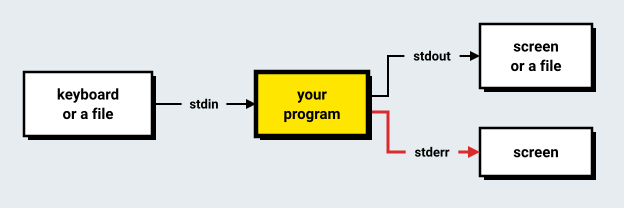
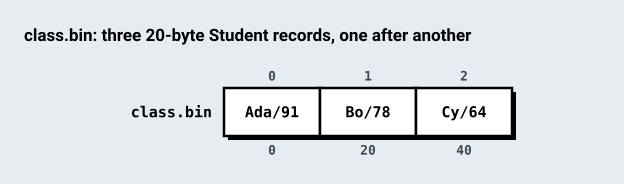
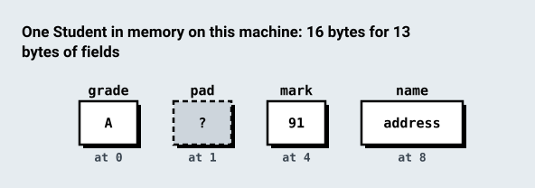

# Chapter 12: File handling

<!-- contents -->
- [12.1 Why files: data that outlives the program](#121-why-files-data-that-outlives-the-program)
- [12.2 Opening and closing a file: fopen(), FILE * and modes](#122-opening-and-closing-a-file-fopen-file--and-modes)
- [12.3 Writing text: fprintf(), fputs() and fputc()](#123-writing-text-fprintf-fputs-and-fputc)
- [12.4 Reading text: fgetc(), fgets() and EOF](#124-reading-text-fgetc-fgets-and-eof)
- [12.5 Reading formatted data: fscanf() and sscanf()](#125-reading-formatted-data-fscanf-and-sscanf)
- [12.6 stdin, stdout and stderr are files too](#126-stdin-stdout-and-stderr-are-files-too)
- [12.7 When things go wrong: errno, perror(), feof() and ferror()](#127-when-things-go-wrong-errno-perror-feof-and-ferror)
- [12.8 Buffering: why your writes arrive late, and fflush()](#128-buffering-why-your-writes-arrive-late-and-fflush)
- [12.9 Text mode and binary mode: what is really on disk](#129-text-mode-and-binary-mode-what-is-really-on-disk)
- [12.10 fwrite() and fread(): arrays and structs on disk](#1210-fwrite-and-fread-arrays-and-structs-on-disk)
- [12.11 Moving around a file: fseek(), ftell() and rewind()](#1211-moving-around-a-file-fseek-ftell-and-rewind)
- [12.12 Why raw structs make fragile files: padding, endianness and pointers](#1212-why-raw-structs-make-fragile-files-padding-endianness-and-pointers)
- [12.13 Underneath: the operating system, system calls and file descriptors](#1213-underneath-the-operating-system-system-calls-and-file-descriptors)
- [12.14 From kernel to disk: the page cache, fsync() and saving safely](#1214-from-kernel-to-disk-the-page-cache-fsync-and-saving-safely)
- [12.15 Capstone: the student records system, saved to disk](#1215-capstone-the-student-records-system-saved-to-disk)
- [12.16 Practice: files](#1216-practice-files)
<!-- /contents -->

## 12.1 Why files: data that outlives the program

### The question

In §9.9 you built a student records system. You typed in names and marks, the program sorted them, searched them and printed a neat table. It worked. Then the program ended, and every record was gone. The next time you ran it, the list was empty again, and you had to type everything in from the start.

That isn't a bug in your program. It's how a process works. In §10.1 you met the **process**: a running program, with its own memory, handed to it by the operating system (§12.13 looks at it closely) when it starts and taken back when it ends. Every variable you've ever made lives in that memory. When `main` returns, the memory goes back, and your variables go with it.

So here's the problem this chapter solves. How can a program remember something after it has finished? How can a marks program you run on Monday still know on Friday what you typed on Monday?

You already know one thing that survives. In §1.4 you met files and folders, and you've been making a file in every chapter since: the `.c` file that holds your program. You quit the editor, switch the machine off, come back next week, and your program is still there. Something kept it. This chapter is about getting your own programs to use that same something.

### The picture

Think of a teacher with a whiteboard and a notebook.

During a lesson, the teacher works on the whiteboard. It's fast: write, rub out, write again. But at the end of the lesson the board is wiped clean for the next class. Anything the teacher wants to keep has to be copied into the notebook first. The notebook goes home in the bag, and next week it still says what it said.

Your program's variables are the whiteboard. A file is the notebook. Writing to a file is copying from the board into the notebook; reading a file is opening the notebook at the start of the next lesson and copying back onto the board.

Here's where the picture stops being true. A teacher can glance at any page of the notebook at any moment. Your program can't. It can't point at a file the way it points at a variable in memory, because a file doesn't live in its memory at all. It has to ask the operating system for each piece, through a small set of library functions, and the bytes have to be copied in before your program can look at them. That asking is what the rest of this chapter teaches.

<!-- fig: id=board-and-notebook
kind: layers
title: What dies with the process, and what stays
layer proc: The process's memory @ wiped when main returns
in proc: v = `int visits`; r = records array
layer os: The operating system @ looks after files
in os: fs = files and folders
layer disk: The storage device @ kept with the power off
in disk: src = forgets.c; marks = marks.txt
hot: src marks
-->


*Figure 12.1a: Variables live in the process and vanish when it ends. Files live on the storage device, looked after by the operating system, and stay.*

### The idea

<!-- teaches: file = file, files -->
A **file** is a named sequence of bytes that the operating system keeps on a storage device, separate from any running program. You met files as icons and names in §1.4. Now you meet them from the inside: a file is just bytes (§1.8), one after another, with a name so you can find them again. The file doesn't know whether those bytes are a picture, a song or a C program. They're numbers in a row.

<!-- teaches: persistence = persistence, persistent -->
The property that makes files worth having has a name. **Persistence** is data surviving after the program that made it has ended. Variables aren't persistent: they last only as long as the process. A file is persistent: it lasts until somebody deletes it. When people say a program "saves its data", they mean it copies data from its variables (which won't last) into a file (which will).

Two kinds of file matter in this chapter. The first kind you've been making since chapter 1.

<!-- teaches: text-file = text file, text files -->
A **text file** is a file whose bytes are all character codes, arranged as lines, each line finished by the newline character `'\n'`. Your `.c` files are text files. So is any file you can open in a plain editor and read. Each byte is one character, using the same codes you saw in the ASCII table (§5.10): `'A'` is the byte 65, a space is 32, and `'\n'` is 10.

The second kind is everything else: files whose bytes aren't meant to be read as characters, like a compiled program. §12.9 opens that up. For now, text files are where you start, because you can read them yourself, check them with your own eyes, and edit them in the same editor you write C in.

So the plan for this chapter is:

- §12.2 opens a file from inside a C program and closes it again.
- §12.3 writes text into it, and §12.4 and §12.5 read text back out.
- §12.6 to §12.8 cover what happens around that: the screen as a file, errors, and why writes can arrive late.
- §12.9 to §12.12 leave text behind and write raw bytes.
- §12.13 and §12.14 go underneath, to the operating system and the disk.
- §12.15 brings your records system from §9.9 back, and this time it remembers.

### The code

First, here's the forgetting, so you can see it for yourself. This program counts how many times it has been run.

<!-- code: id=forgets -->
```c
#include <stdio.h>

int main(void)
{
    int visits = 0;

    visits = visits + 1;
    printf("This is visit number %d\n", visits);
    return 0;
}
```
```text
This is visit number 1
```

Now run it three times in a row, and then look inside a file that did survive: the program's own source file. The command `od -c` prints a file's bytes one character at a time; `-A d` numbers the bytes in ordinary decimal, and `-N 40` stops after the first 40 bytes.

<!-- code: id=forgets-runs -->
```console
$ ./forgets
This is visit number 1
$ ./forgets
This is visit number 1
$ ./forgets
This is visit number 1
$ od -A d -c -N 40 forgets.c
0000000   #   i   n   c   l   u   d   e       <   s   t   d   i   o   .
0000016   h   >  \n  \n   i   n   t       m   a   i   n   (   v   o   i
0000032   d   )  \n   {  \n
0000040
```

What to notice:

- Line 5 sets `visits` to 0 every time the program starts. That's the only value it could start with, because the process has no memory of any earlier run. Each run is a fresh process with fresh memory.
- Line 7 adds one, so every run prints 1. The program will never print 2, however many times you run it.
- The `od` output shows the start of `forgets.c`, byte by byte. `#include <stdio.h>` is there, then `\n` twice (the line end, then the empty line), then `int main(void)`. Your source file is nothing more than this: character codes in a row, with `\n` bytes where the lines break. That's a text file.
- The numbers down the left are byte positions: byte 0, byte 16, byte 32. A file has a first byte, a second byte, and so on, just like an array (§5.2). Keep that in mind; §12.11 uses it.

### The trace

Here's the life of `visits` across the three runs.

| Step | What happens | `visits` | Lasts? |
|---|---|---|---|
| 1 | Run 1 starts; the OS gives the process memory | not yet made | |
| 2 | Line 5: `int visits = 0;` | 0 | |
| 3 | Line 7: `visits = visits + 1;` | 1 | |
| 4 | Line 8 prints `This is visit number 1` | 1 | |
| 5 | `main` returns; the OS takes the memory back | gone | no |
| 6 | Run 2 starts with fresh memory | not yet made | |
| 7 | Lines 5 and 7 again | 1 | |
| 8 | Prints `This is visit number 1`; process ends | gone | no |
| 9 | Run 3: the same story | 1, then gone | no |
| 10 | `forgets.c` on disk, all this time | unchanged | yes |

Step 5 is the moment everything is lost. To count visits properly, the program would need to write the number into a file before step 5, and read it back at step 6. By §12.5 you'll be able to write exactly that program.

### What goes wrong

- **"I'll just make `visits` a global variable, then it'll stay."** A global variable lasts for the whole run, not beyond it. It lives in the process's memory like any other variable, and it goes when the process goes. Only a file outlives the process.
- **"A file holds lines of text."** A file holds bytes. A text file is bytes that happen to be character codes with `\n` at the line ends. "Lines" are an idea your program puts on top of the bytes, not something the disk keeps track of.
- **"If I can read it on the screen, it must be text."** The screen shows what a program chooses to print. A compiled program file like `forgets` is mostly bytes that aren't character codes; open it with `od -c` and you'll see mostly numbers and backslashes. Whether a file is text depends on the bytes in it, not its name.
- **"The `.txt` on the end makes it a text file."** The name is only a label for people. `marks.txt` could hold anything, and a text file can be called `marks` or `marks.dat`. C never looks at the name to decide what's inside.

### Remember

- A process's memory, and every variable in it, is taken back when the process ends (§10.1).
- A **file** is a named sequence of bytes the operating system keeps on a storage device.
- **Persistence** means data surviving after the program that made it has ended. Files have it; variables don't.
- A **text file** is bytes that are character codes, arranged in lines that end with `'\n'`.
- Your `.c` source files are text files, and `od -c` shows you their bytes.

**Check yourself**

1. You run a program that sets `int best = 0;`, reads ten scores and keeps the highest in `best`. You run it again tomorrow. What is `best` when the second run starts, and why?

<details>
<summary>Answer</summary>

It's 0 again. The second run is a new process with fresh memory, and line one of `main` sets `best` to 0. The value from yesterday's run was in yesterday's process's memory, which the operating system took back when that process ended.

</details>

2. In one sentence each, what is a file, and what is persistence?

<details>
<summary>Answer</summary>

A file is a named sequence of bytes that the operating system keeps on a storage device, separate from any running program. Persistence is data surviving after the program that made it has ended.

</details>

3. A text file holds the two lines `Hi` and `Yo`. How many bytes is it, and what are they as characters?

<details>
<summary>Answer</summary>

Six bytes: `H`, `i`, `\n`, `Y`, `o`, `\n`. Each line ends with its own newline character, and each character is one byte.

</details>

4. Your friend says, "I renamed `photo.jpg` to `photo.txt`, so now it's a text file." Are they right?

<details>
<summary>Answer</summary>

No. Renaming changes only the label. The bytes inside are still picture data, not character codes arranged in lines. Whether a file is a text file depends on the bytes it holds.

</details>

## 12.2 Opening and closing a file: fopen(), FILE * and modes

### The question

§12.1 left you wanting a program that writes its data into a file before it ends. But a file isn't a variable. It isn't in your program's memory, so you can't name it the way you name `visits`, and you can't take its address with `&`. It lives with the operating system, out on the storage device.

So before your program can put a single byte into a file, it has to get hold of the file somehow. It needs to say which file it means, by name. It needs to say what it plans to do: read what's there, or write something new. And it needs something to hold on to afterwards, so that every later call can say "that file, the one I opened".

You've met a thing that holds on to something that lives elsewhere: a pointer (§8.2). You've also met a pointer that holds on to nothing at all, `NULL`, the pointer to nothing (§8.2). Both come back here. And you'll need `#include <stdio.h>` (§1.5) again, because everything in this chapter comes from the same standard input and output library as `printf`.

### The picture

Think of a library that keeps its books in a back room. You can't walk in and take one. You go to the desk, give the title and say whether you want to read it or write in it. The librarian goes into the back, finds it, and hands you a ticket with a number. From then on, every time you want something from that book, you show the ticket. When you're done, you hand the ticket back, and the librarian files the book away properly.

If the book doesn't exist, you don't get a ticket. You get an empty hand, and if you don't notice and try to use your empty hand as a ticket, things go badly.

Here's where the picture stops being true. A real library ticket is just a number. The "ticket" C gives you is a pointer to a whole record the library keeps about your open file: where you are in it, what you're allowed to do, and a stash of bytes on their way in or out. You never look inside that record yourself, but it's real memory, and handing the ticket back (closing the file) is what lets that memory be freed and the stash of bytes reach the disk.

<!-- fig: id=file-ticket
kind: flow
dir: down
box prog: your program
box lib: C library\n`fopen`
store disk: diary.txt\non disk
box rec: FILE record\nposition, mode, bytes
prog -> lib: name + mode
lib -> disk: find or create
lib -> rec: fills in
rec ..> prog: FILE * (or NULL)
hot: rec
-->


*Figure 12.2a: `fopen` takes a name and a mode, finds the file, fills in a FILE record and hands your program a pointer to it.*

### The idea

<!-- teaches: fopen = fopen, fopen() -->
**`fopen`** is the library function that opens a file by name and gives back a pointer your program uses for every later operation on that file. You call it with two strings: the file's name, and a mode.

```c
FILE *out = fopen("diary.txt", "w");
```

<!-- teaches: file-pointer = file pointer, FILE * -->
A **file pointer** is a value of type `FILE *`: a pointer to the record the C library keeps about one open file. `FILE` (in capitals) is a type defined in `<stdio.h>`. It's a struct, much like the ones you defined in §9.2, but you never look at its fields. You just keep the pointer and pass it to other functions. That's the ticket.

<!-- teaches: file-mode = file mode, mode, modes -->
A **file mode** is the short string you give `fopen` to say what you'll do with the file. The three you need now are:

| Mode | Means | If the file exists | If it doesn't |
|---|---|---|---|
| `"r"` | read | open it, start at the beginning | fail: `NULL` |
| `"w"` | write | **empty it**, start at the beginning | create it, empty |
| `"a"` | append | keep it, add to the end | create it, empty |

Read that `"w"` row twice. Opening an existing file with `"w"` throws away everything in it, at once, before you write a single byte. §12.3 makes the difference between `"w"` and `"a"` its main job, and §12.11 adds a `+` to these modes for reading and writing the same file.

<!-- teaches: fclose = fclose, fclose() -->
**`fclose`** is the library function that finishes with an open file: it sends any bytes still waiting to the operating system, gives the FILE record back, and leaves the file pointer no longer usable. Every successful `fopen` should be matched by exactly one `fclose`. Why "bytes still waiting" matters is the story of §12.8.

<!-- teaches: fopen-null-check = check fopen for NULL, NULL check -->
Opening can fail. The file may not exist, you may not be allowed to read it, or the folder may not exist. When it fails, `fopen` returns `NULL`, the pointer to nothing from §8.2. The **check fopen for NULL** rule is: test the pointer `fopen` gave you against `NULL` straight away, before you use it for anything, and handle the failure there. Passing `NULL` to any other file function is using a pointer to nothing, and the program may crash.

The shape you'll write in every program from now on is:

1. `fopen` with a name and a mode.
2. If the result is `NULL`, say so and stop.
3. Use the file pointer.
4. `fclose` it.

### The code

This program opens one file to write (creating it), and tries to open a file that isn't there to read.

<!-- code: id=open-close -->
```c
#include <stdio.h>

int main(void)
{
    FILE *out = fopen("diary.txt", "w");
    if (out == NULL) {
        printf("Could not create diary.txt\n");
        return 1;
    }
    printf("diary.txt is open for writing\n");
    fclose(out);

    FILE *in = fopen("missing.txt", "r");
    if (in == NULL) {
        printf("missing.txt: fopen gave back NULL\n");
    } else {
        printf("missing.txt is open for reading\n");
        fclose(in);
    }
    return 0;
}
```
```text
diary.txt is open for writing
missing.txt: fopen gave back NULL
```

After the program has run, `wc -c` counts the bytes in the file it made.

<!-- code: id=open-close-check -->
```console
$ ./open-close
diary.txt is open for writing
missing.txt: fopen gave back NULL
$ wc -c diary.txt
0 diary.txt
```

What to notice:

- Line 5 declares `out` as a `FILE *` and opens `diary.txt` in mode `"w"`. The file didn't exist, so `fopen` created it.
- Line 6 is the NULL check, straight after the open. Line 8 returns 1 instead of 0. Any number but 0 tells whoever started the program that it failed; §12.7 says more about that number.
- Line 11 closes `out`. Nothing was written, so `wc -c` reports `0 diary.txt`: the file exists, and it's empty. Opening with `"w"` is enough to create it.
- Line 13 opens `missing.txt` with `"r"`. Reading a file that isn't there can't work, so `fopen` returns `NULL`, and line 15 reports it.
- Line 18 is inside the `else`: you close only what you actually opened. There's no `fclose` for a `NULL`.
- The file name is relative: `fopen` looks for it in the folder the program is run from, just as the terminal does in §1.4.

### The trace

| Step | Line | Call or test | Value | What's on disk |
|---|---|---|---|---|
| 1 | 5 | `fopen("diary.txt", "w")` | `out` = a real `FILE *` | `diary.txt` created, 0 bytes |
| 2 | 6 | `out == NULL`? | false | |
| 3 | 10 | `printf` | prints `diary.txt is open for writing` | |
| 4 | 11 | `fclose(out)` | `out` no longer usable | `diary.txt`, 0 bytes |
| 5 | 13 | `fopen("missing.txt", "r")` | `in` = `NULL` | nothing changes |
| 6 | 14 | `in == NULL`? | true | |
| 7 | 15 | `printf` | prints `missing.txt: fopen gave back NULL` | |
| 8 | 20 | `return 0` | process ends | `diary.txt` stays |

Step 8 is the point of the whole chapter: the process is gone, and `diary.txt` is still there for `wc` to count.

### What goes wrong

- **"I'll check for NULL later, once it's working."** Then the first missing file crashes your program, like this:

<!-- code: id=forgot-check mode=fragment -->
```c
FILE *in = fopen("missing.txt", "r");
fclose(in);
```

  If the file is missing, `in` is `NULL` and `fclose(in)` is handed a pointer to nothing. Check straight after `fopen`, every time.

- **"I opened my marks file with `"w"` to look at it, and now it's empty."** Mode `"w"` empties an existing file the moment it opens. To look, use `"r"`. To add, use `"a"`.
- **"I wrote `fopen("diary.txt", 'w')`."** The mode is a string, in double quotes, not a single `char`. `'w'` is a character (§1.9); `"w"` is a string (§5.12).
- **"I typed `file *out`."** The type is `FILE`, in capitals. C cares about case.
- **"I forgot `fclose`, and nothing seemed wrong."** On a normal exit the library closes open files for you, so a short program gets away with it. A long-running program that keeps opening files without closing them runs out: the operating system allows each process only so many open files at once. Close every file you open.
- **"I closed the same file twice."** After `fclose`, the pointer still holds an address, but the record it points to is gone. Using it again, even to close it, is like using memory after `free` (chapter 10). Close once.

### Remember

- **`fopen(name, mode)`** opens a file and returns a **file pointer**, a `FILE *`, or `NULL` if it can't.
- The **file mode** says what you'll do: `"r"` read, `"w"` write (empties the file first), `"a"` append.
- **Check fopen for NULL** straight after every open, and stop or recover there.
- **`fclose`** finishes with a file; match every successful `fopen` with exactly one `fclose`.
- The `FILE` record belongs to the library: keep the pointer, never look inside.

**Check yourself**

1. Which mode would you use to add a new line to the end of a log file without losing what's already in it?

<details>
<summary>Answer</summary>

`"a"`, append. It keeps what's there and adds to the end. `"w"` would empty the file first.

</details>

2. `fopen("scores.txt", "r")` returns `NULL`. Give two possible reasons.

<details>
<summary>Answer</summary>

The file doesn't exist in the folder the program was run from, or it exists but you aren't allowed to read it. (A misspelt name is the commonest form of the first.)

</details>

3. What is a file pointer, and what does it point at?

<details>
<summary>Answer</summary>

A value of type `FILE *`. It points at the record the C library keeps about one open file: where you are in it, what mode it's in, and bytes on their way in or out. You pass it to the other file functions and never look inside it.

</details>

4. A program opens `"notes.txt"` with `"w"`, writes nothing and closes it. `notes.txt` used to hold 300 bytes. How many does it hold now?

<details>
<summary>Answer</summary>

Zero. Opening with `"w"` empties an existing file straight away, whether or not you then write anything.

</details>

## 12.3 Writing text: fprintf(), fputs() and fputc()

### The question

After §12.2 you can open a file and close it again, and you've made an empty `diary.txt`. An empty file isn't much use. You want to put your data in it: names, marks, a line saying when the program last ran.

You already know how to turn data into text. Since §1.6 you've been doing it with `printf`, and since §1.10 you've been choosing how each value looks with a format specifier: `%d` for an `int`, `%s` for a string. The trouble is that `printf` always sends its text to the screen. There's nowhere to tell it "this file instead".

So the question is: how do you send text to a file instead of the screen? And once you can, what happens the second time the program runs? Does it add to what's there, or start again?

### The picture

Think of a letter-writer at a desk with two pads in front of them. One pad is the screen: whatever they write on it, people see straight away. The other pad is a file, and it goes in the post. The writing is the same handwriting either way. The only thing that changes is which pad the pen is on.

`printf` is the pen on the screen pad. The functions in this section are the same pen, but you name the pad: you hand them a file pointer from §12.2, and that's where the text goes.

Here's where the picture stops being true. Ink on a pad is there the moment you write it. Text you send to a file isn't on the disk yet when the function returns: the library collects it and passes it on later, at the latest when you call `fclose`. For now that only means "always close the file". §12.8 shows you the delay itself.

### The idea

<!-- teaches: fprintf = fprintf, fprintf() -->
**`fprintf`** is `printf` with a file pointer in front: it formats its values exactly as `printf` does and writes the text to the file you name. The `f` stands for file. Everything you know about format specifiers from §1.10 carries over unchanged:

```c
fprintf(out, "%s %d\n", "Ada", 91);   /* writes  Ada 91  and a newline to out */
```

Two smaller functions write text without any formatting at all. They're handy when there's nothing to fill in.

<!-- teaches: fputs = fputs, fputs() -->
**`fputs`** writes one string to a file, exactly as it is, and adds nothing: `fputs("name mark\n", out)` writes those ten characters and stops. Unlike `puts`, it doesn't add a newline for you, so if you want a line end, you write the `\n` yourself.

<!-- teaches: fputc = fputc, fputc() -->
**`fputc`** writes one character to a file: `fputc('\n', out)` writes a single newline byte. Note the order of the arguments in all three: for `fprintf` the file pointer comes first; for `fputs` and `fputc` it comes last. That's an old oddity of the library, and you just have to learn it.

| Function | Writes | File pointer goes |
|---|---|---|
| `fprintf(f, format, ...)` | formatted text, like `printf` | first |
| `fputs(string, f)` | one string, nothing added | last |
| `fputc(ch, f)` | one character | last |

Now the second half of the question: what happens next time?

<!-- teaches: write-vs-append = write versus append, write mode, append mode -->
**Write versus append** is the choice the mode in `fopen` makes for you on every run: `"w"` empties the file and writes from the start, so each run replaces the file; `"a"` keeps what's there and writes at the end, so each run adds to it. Neither is better. They answer different needs:

- A file that holds *the current state* (today's marks, the saved game) should be replaced each time: `"w"`. You don't want Monday's marks and Friday's marks jumbled together.
- A file that holds *a history* (a log, a diary) should grow: `"a"`. You never want to lose the earlier entries.

### The code

This program saves three marks to `marks.txt`, replacing it each run, and adds a line to `log.txt`, which grows each run.

<!-- code: id=write-text -->
```c
#include <stdio.h>

int main(void)
{
    char names[3][8] = {"Ada", "Bo", "Cy"};
    int marks[3] = {91, 78, 64};

    FILE *out = fopen("marks.txt", "w");
    if (out == NULL) {
        printf("Could not open marks.txt\n");
        return 1;
    }
    fputs("name mark\n", out);
    for (int i = 0; i < 3; i++) {
        fprintf(out, "%s %d\n", names[i], marks[i]);
    }
    fclose(out);

    FILE *log = fopen("log.txt", "a");
    if (log == NULL) {
        printf("Could not open log.txt\n");
        return 1;
    }
    fputs("saved 3 marks", log);
    fputc('\n', log);
    fclose(log);

    printf("Done.\n");
    return 0;
}
```
```text
Done.
```

Now start with no files, run it twice, and look at both files with `cat`, which prints a text file to the screen. The first command, `rm -f`, deletes the two files; the `-f` tells it not to complain if they aren't there yet.

<!-- code: id=write-text-runs -->
```console
$ rm -f log.txt marks.txt
$ ./write-text
Done.
$ ./write-text
Done.
$ cat marks.txt
name mark
Ada 91
Bo 78
Cy 64
$ cat log.txt
saved 3 marks
saved 3 marks
```

What to notice:

- Line 13 uses `fputs` for the heading line, because there's nothing to fill in. The `\n` is written by hand.
- Line 15 is the heart of it: `fprintf` with `out` first, then the same format string you'd give `printf`. Each pass of the loop writes one line.
- Line 19 opens `log.txt` with `"a"`, and lines 24 and 25 write the text, then the newline with `fputc`.
- After two runs, `marks.txt` still has four lines. The second run's `"w"` emptied it and wrote the same four lines again.
- After two runs, `log.txt` has two lines. The second run's `"a"` kept the first line and added another. Run it a third time and you'll get three.
- Line 28's `Done.` is the only thing that reaches the screen. Everything else went into files.

That last point is worth a moment. Your program has now done what §12.1 asked: it ran, ended, and left something behind that the next run can see.

### The trace

Here's what the two files hold after each step, starting with neither file existing.

| Step | Run | Line | Call | `marks.txt` | `log.txt` |
|---|---|---|---|---|---|
| 1 | 1 | 8 | `fopen("marks.txt", "w")` | created, empty | doesn't exist |
| 2 | 1 | 13 | `fputs` heading | `name mark` | |
| 3 | 1 | 15 | `fprintf` three times | 4 lines | |
| 4 | 1 | 19 | `fopen("log.txt", "a")` | 4 lines | created, empty |
| 5 | 1 | 24–25 | `fputs`, `fputc` | 4 lines | 1 line |
| 6 | 2 | 8 | `fopen("marks.txt", "w")` | **emptied** | 1 line |
| 7 | 2 | 13–15 | heading and three rows | 4 lines | 1 line |
| 8 | 2 | 19 | `fopen("log.txt", "a")` | 4 lines | 1 line, kept |
| 9 | 2 | 24–25 | `fputs`, `fputc` | 4 lines | 2 lines |

Step 6 and step 8 are the whole difference between `"w"` and `"a"`.

### What goes wrong

- **"I wrote `fprintf("%d\n", out, x)`."** The file pointer goes first in `fprintf`, before the format string. With it in the wrong place, gcc 13 warns and builds a program that will probably crash; gcc 14 and later refuse to build it at all. Write `fprintf(out, "%d\n", x)`.
- **"I wrote `fputs(out, "hello")`."** For `fputs` and `fputc` the file pointer goes last: `fputs("hello", out)`.
- **"All my lines came out joined together."** `fputs` adds no newline. `puts` does, but `fputs` doesn't. Put `\n` at the end of the string, or follow it with `fputc('\n', out)`.
- **"My log only ever has one line."** You opened it with `"w"`, so every run emptied it. A history wants `"a"`.
- **"My save file keeps getting longer and the old data comes back."** The opposite mistake: a file of current state opened with `"a"`. Use `"w"` to replace it.
- **"I wrote with `printf` and the file stayed empty."** `printf` always goes to the screen. Only the `f` functions with a file pointer write to a file.

### Remember

- **`fprintf(f, format, ...)`** is `printf` into a file; all the format specifiers from §1.10 work the same.
- **`fputs(s, f)`** writes a string exactly as it is, with no newline added; **`fputc(c, f)`** writes one character.
- The file pointer goes first in `fprintf` and last in `fputs` and `fputc`.
- **Write versus append**: `"w"` replaces the file each run; `"a"` adds to its end.
- Current state wants `"w"`; a history wants `"a"`.

**Check yourself**

1. Write one line of C that writes `Bo scored 78` and a newline into the open file `out`, using an `int` variable `mark` for the 78.

<details>
<summary>Answer</summary>

```c
fprintf(out, "Bo scored %d\n", mark);
```

</details>

2. A file `count.txt` is empty. A program opens it with `"a"`, writes `x` with `fputc`, and closes it. You run the program four times. What's in the file? What if the mode had been `"w"`?

<details>
<summary>Answer</summary>

With `"a"`: `xxxx`, four bytes, because each run adds one `x` at the end. With `"w"`: `x`, one byte, because each run empties the file first.

</details>

3. What's the difference between `puts("hi")` and `fputs("hi", out)`, apart from where the text goes?

<details>
<summary>Answer</summary>

`puts` adds a newline after the string; `fputs` adds nothing. `fputs("hi", out)` writes exactly two bytes.

</details>

4. You're writing a game that saves the player's current level and score. Should the save file be opened with `"w"` or `"a"`? Why?

<details>
<summary>Answer</summary>

`"w"`. The save holds the current state, and each save should replace the last one. With `"a"`, every save would pile up at the end and the file would hold every old score too.

</details>

## 12.4 Reading text: fgetc(), fgets() and EOF

### The question

§12.3 got your data into a file. That's half of persistence. The other half is the next run: open the file and get the data back out, so the program picks up where the last one left off.

You've read text before, from the keyboard. In §5.12 you used `fgets` to read a line the user typed into a string. You know a `char` is just a small number, a character code (§1.9), and you know how to repeat something with `while` (§3.4) until a condition stops being true.

But there's a new problem. When you read from the keyboard, you know how much to ask for: one line, then the user presses Enter. A file could hold three bytes or three million. You don't know in advance. So how does a program read a file it has never seen, all the way through, and know when it has reached the end?

### The picture

Think of reading a book aloud to someone who can't see it, one letter at a time. You keep your finger on the page. Each time you read a letter, your finger moves one place to the right. When you run out of words on the last page, you don't read out a letter at all. You say, "That's the end."

The C library keeps that finger for you, inside the FILE record from §12.2. Every read takes what's under the finger and moves it along. When there's nothing left, instead of a character you get a special answer that means "the end".

Here's where the picture stops being true. A person saying "the end" is plainly different from reading a letter. In C, the "end" answer has to come back through the same return value as the characters do, as a number. So C has to pick a number that can never be a character. That choice causes the commonest bug in this section, and you'll see it in "What goes wrong".

<!-- fig: id=read-finger
kind: memory
title: short.txt, with the read position after three fgetc calls
row file: 72 105 10 121 111 10 | at=0 step=1 | hot=3
-->
![Memory. file holds 72, 105, 10, 121, 111 and 10 at addresses 0 to 5. file\[3\] is highlighted.](fig/12-file-handling/read-finger.svg)

*Figure 12.4a: The six bytes of `short.txt`. Three have been read; the next `fgetc` returns byte 3, the 121 for `'y'`. After byte 5 there's nothing left, and `fgetc` returns EOF.*

### The idea

<!-- teaches: fgetc = fgetc, fgetc() -->
**`fgetc`** reads the next single byte from a file and returns it as an `int`, moving the read position on by one; when there are no more bytes, it returns `EOF` instead. It's the reading partner of `fputc` from §12.3.

<!-- teaches: eof = EOF, end of file -->
**`EOF`** (end of file) is a negative `int` constant from `<stdio.h>`, returned by reading functions to say there's nothing more to read. On this machine it's -1. The important thing isn't the exact value, it's that it's negative. Every byte `fgetc` can return is a value from 0 to 255, so a negative number can never be mistaken for real data. That's why `fgetc` returns an `int` rather than a `char`: an `int` has room for all 256 byte values *and* one extra value that means "the end".

Reading one byte at a time is precise, but text usually comes in lines. You already have a line reader.

<!-- teaches: fgets-file = fgets on a file, fgets from a file -->
**`fgets` on a file** reads one line from a file into your string, including its `'\n'`, and returns `NULL` once there are no more lines. It's the same `fgets` as in §5.12. There you passed `stdin` as the last argument (§12.6 shows what it really is); now you pass your file pointer:

```c
fgets(line, sizeof(line), in)
```

It stops at whichever comes first: the end of the line (it keeps the `'\n'`), the end of the file, or one less than the size you gave it (it saves one place for the `'\0'` that ends the string). If a line is longer than your array, you get it in pieces, one `fgets` call per piece.

Both functions fit the same shape, which you'll write so often it deserves a name.

<!-- teaches: read-loop = read loop -->
A **read loop** is a loop that reads one piece (a byte, a line), tests whether the read hit the end, and only if it didn't, uses the piece and goes round again. The order matters: read, then test, then use. Never use a piece before you've checked that the read gave you one.

```text
read the first piece
while the read did not hit the end:
    use the piece
    read the next piece
```

### The code

This program writes a two-line file, reads it back byte by byte with `fgetc`, then opens it again and reads it line by line with `fgets`.

<!-- code: id=read-text -->
```c
#include <stdio.h>

int main(void)
{
    FILE *out = fopen("short.txt", "w");
    if (out == NULL) {
        printf("Could not create short.txt\n");
        return 1;
    }
    fputs("Hi\nyo\n", out);
    fclose(out);

    FILE *in = fopen("short.txt", "r");
    if (in == NULL) {
        printf("Could not open short.txt\n");
        return 1;
    }
    int count = 0;
    int c = fgetc(in);
    while (c != EOF) {
        count = count + 1;
        printf("byte %d is %3d", count, c);
        if (c == '\n') {
            printf("  (newline)\n");
        } else {
            printf("  '%c'\n", c);
        }
        c = fgetc(in);
    }
    printf("then fgetc gave %d, which is EOF\n", c);
    fclose(in);

    in = fopen("short.txt", "r");
    if (in == NULL) {
        printf("Could not open short.txt\n");
        return 1;
    }
    char line[80];
    int n = 0;
    while (fgets(line, sizeof(line), in) != NULL) {
        n = n + 1;
        printf("line %d: %s", n, line);
    }
    printf("%d lines\n", n);
    fclose(in);
    return 0;
}
```
```text
byte 1 is  72  'H'
byte 2 is 105  'i'
byte 3 is  10  (newline)
byte 4 is 121  'y'
byte 5 is 111  'o'
byte 6 is  10  (newline)
then fgetc gave -1, which is EOF
line 1: Hi
line 2: yo
2 lines
```

What to notice:

- Line 19 declares `c` as an `int`, not a `char`. It has to be able to hold `EOF`.
- Lines 19 and 28 are the read; line 20 is the test; lines 21 to 27 are the use. That's the read loop exactly as in the pseudocode: one read before the loop, one at the bottom.
- The program counts bytes from 1, so its bytes 3 and 6 (positions 2 and 5 in Figure 12.4a, which counts from 0) are both 10: the newline at the end of each line. You see them as numbers here because the program prints `c` with `%d`.
- After byte 6, `fgetc` returned -1. That's `EOF` on this machine, and the loop stopped.
- Line 33 opens the file a second time. Reading moved the position to the end; opening again starts a fresh read position at byte 0. (§12.11 shows a way to move back without reopening.)
- Line 40 reads a whole line at a time and stops when `fgets` returns `NULL`. Line 42 prints `%s` with no `\n` of its own, because each `line` already ends with the newline `fgets` kept.

### The trace

The `fgetc` loop, step by step, on the six bytes of `short.txt`.

| Step | Line | Position before | `c` | `c != EOF`? | `count` | Printed |
|---|---|---|---|---|---|---|
| 1 | 19 | 0 | 72 | yes | 1 | `byte 1 is  72  'H'` |
| 2 | 28 | 1 | 105 | yes | 2 | `byte 2 is 105  'i'` |
| 3 | 28 | 2 | 10 | yes | 3 | `byte 3 is  10  (newline)` |
| 4 | 28 | 3 | 121 | yes | 4 | `byte 4 is 121  'y'` |
| 5 | 28 | 4 | 111 | yes | 5 | `byte 5 is 111  'o'` |
| 6 | 28 | 5 | 10 | yes | 6 | `byte 6 is  10  (newline)` |
| 7 | 28 | 6 (end) | -1 | **no** | 6 | loop ends |
| 8 | 30 | | -1 | | | `then fgetc gave -1, which is EOF` |

Seven reads for six bytes: the seventh is the one that discovers the end. A read loop always makes one more read than there are pieces.

### What goes wrong

- **"I stored `fgetc` in a `char`."**

<!-- code: id=char-trap mode=fragment -->
```c
char c = fgetc(in);
while (c != EOF) {
```

  A `char` can't hold all 256 byte values plus `EOF`. Depending on the machine, either a real byte 255 looks like `EOF` and the loop stops early, or `EOF` turns into 255 and the loop never stops. Always use `int c`.

- **"My loop printed a strange last character."** You used the piece before testing it: read, use, test. The last read was `EOF`, and you printed it as a character. Read, test, then use.
- **"I tested `while (c != 'EOF')`."** `EOF` is a name for a number, not a character. No quotes.
- **"My lines print with blank lines between them."** `fgets` keeps the `'\n'`, and you printed `"%s\n"`, adding a second one. Print with `"%s"`, or take the newline off the string first.
- **"The second read loop got nothing."** The first loop left the position at the end of the file. Close and open again (or wait for `rewind` in §12.11).
- **"I made the line array 10 characters and long lines came out broken."** `fgets` gave you each long line in pieces. Make the array bigger than any line you expect, such as 256 or 1024.

### Remember

- **`fgetc(f)`** returns the next byte as an `int` (0 to 255), or **`EOF`**, a negative constant, when there's nothing left.
- Keep `fgetc`'s result in an `int`, never a `char`.
- **`fgets(line, size, f)`** reads one line, keeping the `'\n'`, and returns `NULL` at the end of the file.
- A **read loop** reads, tests for the end, and only then uses the piece.
- Each read moves the position on; reopening starts again at byte 0.

**Check yourself**

1. Why does `fgetc` return an `int` and not a `char`?

<details>
<summary>Answer</summary>

It has to be able to return every one of the 256 possible byte values and also `EOF`, which must differ from all of them. That's 257 different answers, which a `char` can't hold. An `int` can.

</details>

2. A file holds `ab` and a newline. How many times does a correct `fgetc` read loop call `fgetc`, and what does each call return as a number?

<details>
<summary>Answer</summary>

Four times: 97 (`'a'`), 98 (`'b'`), 10 (newline), then `EOF` (-1 on this machine).

</details>

3. What does this print for a file holding the two lines `one` and `two`, and why does it look odd?

```c
while (fgets(line, sizeof(line), in) != NULL) {
    printf("[%s]\n", line);
}
```

<details>
<summary>Answer</summary>

```text
[one
]
[two
]
```

Each `line` ends with the `'\n'` that `fgets` kept, so the closing bracket lands on the next line.

</details>

4. Write a read loop, using `fgetc`, that counts the lines in an open file `in` by counting newline characters.

<details>
<summary>Answer</summary>

```c
int lines = 0;
int c = fgetc(in);
while (c != EOF) {
    if (c == '\n') {
        lines = lines + 1;
    }
    c = fgetc(in);
}
```

</details>

## 12.5 Reading formatted data: fscanf() and sscanf()

### The question

After §12.4 you can read a file's text, a byte or a line at a time. But a marks file isn't just text to you. A line like `Ada 91` is a name and a number, and you want them in a `char` array and an `int`, so you can add the numbers up, compare them, find the best.

Reading `"91"` gets you two characters, `'9'` and `'1'`. That isn't the number 91. You met this problem with the keyboard in §1.13, and `scanf` solved it: you gave it a format such as `"%d"` and it turned typed characters into an `int`. You also know from §5.12 that a string is a row of characters ending in `'\0'`.

So the question is: how do you do what `scanf` does, but from a file? And what happens when a line in the file isn't what you expected, like `Cy sixty` instead of `Cy 60`? Real files are typed by people, and people make mistakes.

### The picture

Think of a clerk going through a pile of paper forms, copying each one into a ledger. Each form should say a name and a mark. The clerk reads a form, writes the name in one column and the mark in the next, and counts each field as they copy it.

Now one form says "sixty" where a number should be. A careless clerk stops dead, with the bad form stuck halfway into the ledger, and doesn't touch the rest of the pile. A careful clerk does it differently: lift one whole form off the pile, try to copy it, and if it won't go, put that one form aside and lift the next.

`fscanf` is the first clerk. "Line then parse" is the second.

Here's where the picture stops being true. A clerk notices a bad form and says so. `fscanf` doesn't say anything. It reports what went wrong only through a number it returns, and if you don't look at that number, you'll never know. That number is the most important thing in this section.

### The idea

<!-- teaches: fscanf = fscanf, fscanf() -->
**`fscanf`** is `scanf` with a file pointer in front: it reads characters from the file, converts them according to the format, and stores the results through the addresses you pass. It skips spaces and newlines between fields, just as `scanf` does:

```c
fscanf(in, "%31s %d", name, &mark);
```

Two details from `scanf` matter here. You pass `&mark`, the address of the `int`, so `fscanf` can store into it; you pass `name` without `&`, because an array name already gives the address of its first element (§8.8). And the `31` in `%31s` is a width: read at most 31 characters, leaving the 32nd place in `name` for the `'\0'`. Without a width, a long word in the file would write past the end of your array.

<!-- teaches: fscanf-return = fscanf return value, return value of fscanf -->
The **fscanf return value** is the number of fields it successfully converted and stored, or `EOF` if the file ended before it converted any. For the format `"%31s %d"`:

| Returns | Means |
|---|---|
| 2 | both the name and the mark were read |
| 1 | the name was read, but the next characters weren't a number |
| `EOF` | the end of the file came first |

It can't return 0 with this format, because `%s` takes any run of characters that aren't spaces, so a name can always be read if anything is left. With a format that starts with `%d`, 0 is possible: the first field itself was bad.

So the read loop from §12.4 becomes: keep going while `fscanf` returns 2. That's the test, and it's the only safe one. Anything but 2 means `mark` may not hold a fresh value.

There's a trap in that table. When `fscanf` returns 1, it has stopped in front of the bad characters, `sixty`. They're still there, unread. Call `fscanf` again and it starts from `sixty`. With `"%31s %d"`, it takes `sixty` as the next *name*, and every field after it is out of step. With a format that starts with a number, such as `"%d"`, it's worse: it hits the same `sixty`, fails the same way, and gets nowhere, for ever. Either way, one bad field spoils what comes after it. The careful clerk avoids this.

<!-- teaches: sscanf = sscanf, sscanf() -->
**`sscanf`** works exactly like `fscanf`, but reads from a string in memory instead of a file: `sscanf(line, "%31s %d", name, &mark)`. The first `s` stands for string. It returns the same count of fields converted. Because it reads from a string you already have, a failure costs nothing: the string is still there, and the file has already moved on.

<!-- teaches: line-then-parse = line then parse -->
**Line then parse** is the pattern of reading each whole line with `fgets`, then pulling the fields out of that line with `sscanf`. It splits the job in two. `fgets` decides where one record ends (at the newline), so a bad line can never swallow the next one. `sscanf` decides whether the record is good, and if it isn't, you report it and carry on with the next line.

```text
while fgets gives a line:
    if sscanf finds every field in the line:
        use the fields
    else:
        report the line and skip it
```

### The code

This program writes a marks file with one bad line in it, reads it with `fscanf`, and then reads it again with line then parse.

<!-- code: id=read-formatted -->
```c
#include <stdio.h>

int main(void)
{
    FILE *out = fopen("marks.txt", "w");
    if (out == NULL) {
        printf("Could not create marks.txt\n");
        return 1;
    }
    fputs("Ada 91\nBo 78\nCy sixty\nDee 85\n", out);
    fclose(out);

    FILE *in = fopen("marks.txt", "r");
    if (in == NULL) {
        printf("Could not open marks.txt\n");
        return 1;
    }
    char name[32];
    int mark;
    int got = fscanf(in, "%31s %d", name, &mark);
    while (got == 2) {
        printf("fscanf: %s has %d\n", name, mark);
        got = fscanf(in, "%31s %d", name, &mark);
    }
    printf("fscanf stopped: it returned %d\n", got);
    fclose(in);

    in = fopen("marks.txt", "r");
    if (in == NULL) {
        printf("Could not open marks.txt\n");
        return 1;
    }
    char line[256];
    int total = 0;
    int count = 0;
    while (fgets(line, sizeof(line), in) != NULL) {
        if (sscanf(line, "%31s %d", name, &mark) == 2) {
            total = total + mark;
            count = count + 1;
        } else {
            printf("skipped: %s", line);
        }
    }
    fclose(in);
    if (count > 0) {
        printf("%d good lines, average %d\n", count, total / count);
    } else {
        printf("no good lines\n");
    }
    return 0;
}
```
```text
fscanf: Ada has 91
fscanf: Bo has 78
fscanf stopped: it returned 1
skipped: Cy sixty
3 good lines, average 84
```

What to notice:

- Line 10 puts four lines in the file, and the third has `sixty` where a number should be.
- Lines 20 to 24 are a read loop with `fscanf`. It reads Ada and Bo, then for the third line it reads `Cy` into `name` but can't make `sixty` into an `int`. It returns 1, and the loop stops. Dee is never read.
- Line 25 shows that 1. If you'd tested `got != EOF` instead of `got == 2`, the loop would have printed Cy with Bo's old mark, 78, then taken `sixty` as a name and printed it with 78 too, before landing back in step at Dee.
- Lines 36 to 43 are line then parse. `fgets` reads each full line; `sscanf` on line 37 tries to find a name and a mark *in that line*. Three lines give 2; `Cy sixty` gives 1 and is skipped with a message.
- Line 41 prints `line` with `%s` and no `\n`, because the line still ends with its own newline.
- Line 46 prints 84: the three good marks add to 254, and 254 / 3 with `int`s is 84, dropping the remainder. Line 45 checks `count` first, because dividing by 0 would crash the program if no line were good.

Now the program from §12.1 can be finished. Counting visits is: open `visits.txt` with `"r"`; if that works and `fscanf(f, "%d", &visits)` returns 1, you have last time's count; otherwise start at 0. Add one, then open with `"w"` and `fprintf` the new count. Exercise 3 in §12.16 asks you to write it.

### The trace

The line-then-parse loop, lines 36 to 43.

| Step | `line` from `fgets` | `sscanf` returns | `name`, `mark` | `total` | `count` | Printed |
|---|---|---|---|---|---|---|
| 1 | `Ada 91\n` | 2 | Ada, 91 | 91 | 1 | |
| 2 | `Bo 78\n` | 2 | Bo, 78 | 169 | 2 | |
| 3 | `Cy sixty\n` | 1 | Cy, 78 (old) | 169 | 2 | `skipped: Cy sixty` |
| 4 | `Dee 85\n` | 2 | Dee, 85 | 254 | 3 | |
| 5 | `fgets` returns `NULL` | | | 254 | 3 | loop ends |
| 6 | line 46 | | | | | `3 good lines, average 84` |

Look at step 3: `mark` still holds 78 from Bo. `sscanf` stored nothing new in it. That's exactly why you test the return value before you use the fields.

### What goes wrong

- **"I wrote `while (fscanf(in, "%d", &x) != EOF)`."** On a bad field `fscanf` returns 0, not `EOF`, so the loop never ends and keeps using the old `x`. Test for the exact number of fields: `== 1` here.
- **"I wrote `fscanf(in, "%d", x)`."** Without `&`, `fscanf` is given the value of `x` as if it were an address and writes somewhere random. Pass `&x`. (Arrays like `name` don't take `&`.)
- **"I used `%s` with no width and the program crashed on a long name."** `%s` keeps reading until a space, however long the word. Give the width: one less than the array's size.
- **"My names have spaces in them, like `Ada Lovelace`, and the marks came out wrong."** `%s` stops at the first space, so `Lovelace` is tried as the number. Put the number first, use a separator such as a comma, or read the line and split it yourself.
- **"One bad line and nothing after it was read."** That's `fscanf` stuck on the bad characters. Read whole lines with `fgets` and parse them with `sscanf`.

### Remember

- **`fscanf(f, format, ...)`** is `scanf` from a file; **`sscanf(s, format, ...)`** is `scanf` from a string.
- The **fscanf return value** counts the fields converted, or is `EOF` at the end. Test it against the exact number you asked for.
- After a failed field, `fscanf` stays stuck in front of the bad characters.
- **Line then parse**: `fgets` a line, `sscanf` the line, skip it if it's bad. It survives bad data.
- Give every `%s` a width one less than the array's size.

**Check yourself**

1. A file holds `7 x 9`. What does `fscanf(in, "%d %d", &a, &b)` return, and what's in `a`?

<details>
<summary>Answer</summary>

It returns 1. `a` gets 7; then `x` can't be read as a number, so `b` is left unchanged and `fscanf` stops in front of the `x`.

</details>

2. Why is `while (fscanf(in, "%d", &n) == 1)` safe, but `while (fscanf(in, "%d", &n) != EOF)` not?

<details>
<summary>Answer</summary>

With `== 1` the loop stops on any failure: a bad field (0) or the end (`EOF`). With `!= EOF`, a bad field gives 0, which isn't `EOF`, so the loop goes on, uses an old `n`, and calls `fscanf` again on the same bad characters, for ever.

</details>

3. What's the advantage of line then parse over calling `fscanf` straight on the file?

<details>
<summary>Answer</summary>

`fgets` always moves on by one whole line, so a bad line can be reported and skipped without stopping the read, and without spilling into the next line. `fscanf` can get stuck on bad characters and never reach the good lines after them.

</details>

4. `char word[10];` What width should `%s` have when reading into `word`, and why that number?

<details>
<summary>Answer</summary>

`%9s`. Nine characters plus the `'\0'` that ends the string fill all ten places.

</details>

## 12.6 stdin, stdout and stderr are files too

### The question

You've now written two kinds of input code. When the data came from the keyboard, you used `scanf` (§1.13) and `fgets(line, size, stdin)` (§5.12). When it came from a file, you used `fopen`, then `fgetc`, `fgets` and `fscanf` with a file pointer (§12.2 to §12.5). That's two versions of every program.

Look again at the keyboard version of `fgets`. Its last argument, `stdin`, sits in exactly the place where §12.4 put a file pointer. That's not a coincidence.

And there's a second puzzle. In §8.9 you met `argc` and `argv`, the words typed after a program's name. A good tool like `cat` lets you say which file to read: `cat marks.txt`. How would your own program do that? And when it can't open the file, where should the error message go, so that it doesn't get mixed up with the program's real output?

### The picture

Think of a kitchen with a hatch in the wall for orders coming in, a hatch for plates going out, and a small bell by the door for when something's wrong. The cook doesn't care who's on the other side of each hatch. Orders might come from a waiter, or from a ticket machine. Plates might go to a diner, or into a box for delivery. The cook just takes from one hatch and puts into the other.

The bell is separate on purpose. If the cook burns the soup, the bell rings in the dining room even if the plates are going out to the delivery box. Bad news isn't packed in with the food.

Your program is the cook. The three hatches are three files that are already open when `main` starts.

Here's where the picture stops being true. A kitchen has its hatches built into the wall. Your program's three streams are connected by whoever starts it, usually the shell, and the program can't see where they lead. It only sees three `FILE *` values. The shell is the program that reads the commands you type in the terminal and starts other programs for you; the terminal itself is just the window it runs in.

<!-- fig: id=three-streams
kind: flow
dir: right
box kb: keyboard\nor a file
box prog: your program
box scr: screen\nor a file
box err: screen
kb -> prog: stdin
prog -> scr: stdout
prog => err: stderr
hot: prog
-->


*Figure 12.6a: Every program starts with three streams open. The shell can point stdin and stdout at files; stderr still reaches the screen unless you redirect it too.*

### The idea

<!-- teaches: standard-streams = standard streams, stdin, stdout -->
The **standard streams** are three `FILE *` values that are already open when `main` starts: `stdin`, the standard input, which is the keyboard unless the shell says otherwise; `stdout`, the standard output, which is the screen unless the shell says otherwise; and `stderr`. They're declared in `<stdio.h>`, and you use them anywhere a file pointer goes. In fact you've been doing it all along: `printf(...)` is exactly `fprintf(stdout, ...)`, and `scanf(...)` is exactly `fscanf(stdin, ...)`.

<!-- teaches: stderr = stderr, standard error -->
**`stderr`**, the standard error, is the stream for error messages: it goes to the screen, and it stays separate from `stdout` so that errors are never mixed into a program's real output. You write to it with `fprintf(stderr, ...)`. Every error message from now on goes there.

<!-- teaches: redirection = redirection, redirect -->
**Redirection** is the shell connecting a program's standard streams to files instead of the keyboard and screen, when you start it: `< file` makes the file the program's `stdin`, `> file` makes the file its `stdout` (emptying it first, like `"w"`), and `2> file` makes the file its `stderr`. The `2` is stream number 2; §12.13 shows where that number comes from. The program itself doesn't change and doesn't know.

Because `stdin` is just a `FILE *`, one program can read from either a named file or the keyboard with the same loop. You choose which at the start.

<!-- teaches: filename-argument = filename argument, file name argument -->
A **filename argument** is a file name given on the command line, in `argv` (§8.9), naming the file the program should read. The usual rule, which `cat` and most tools follow, is: if a name is given, open that file; if not, read `stdin`. So the same program works as `./lines marks.txt` and as `./lines < marks.txt`, and you can even type lines at it yourself.

```text
in = stdin
if a name was given in argv[1]:
    in = fopen(argv[1], "r")
    if in is NULL: complain on stderr and stop
read from in
close in, unless it is stdin
```

### The code

This program counts the lines in a file named on the command line, or in its standard input if no name is given. Run with no name, it reads `stdin`; here three lines, `one`, `two` and `three`, were typed into it.

<!-- code: id=lines stdin=one\ntwo\nthree\n -->
```c
#include <stdio.h>

int main(int argc, char *argv[])
{
    FILE *in = stdin;
    if (argc > 1) {
        in = fopen(argv[1], "r");
        if (in == NULL) {
            fprintf(stderr, "lines: cannot open %s\n", argv[1]);
            return 1;
        }
    }

    int count = 0;
    int c = fgetc(in);
    while (c != EOF) {
        if (c == '\n') {
            count = count + 1;
        }
        c = fgetc(in);
    }
    printf("%d lines\n", count);

    if (in != stdin) {
        fclose(in);
    }
    return 0;
}
```
```text
3 lines
```

Here it is counting its own source file, first by name and then by redirection, and then with its output sent to a file.

<!-- code: id=lines-runs -->
```console
$ ./lines lines.c
28 lines
$ ./lines < lines.c
28 lines
$ ./lines lines.c > count.txt
$ cat count.txt
28 lines
```

Now the name is wrong. Its output is sent to `count.txt`, but the error message still arrives on the screen:

<!-- code: id=lines-missing exit=1 stderr=show -->
```console
$ ./lines nope.txt > count.txt
lines: cannot open nope.txt
```

`count.txt` was emptied by `>` and nothing went into it, so `cat` prints nothing:

<!-- code: id=lines-empty -->
```console
$ cat count.txt
```

Then `2>` sends the error itself to a file, and the screen stays quiet:

<!-- code: id=lines-quiet exit=1 stderr=show -->
```console
$ ./lines nope.txt 2> errors.txt
```

<!-- code: id=lines-errfile -->
```console
$ cat errors.txt
lines: cannot open nope.txt
```

What to notice:

- Line 5 starts `in` as `stdin`. If no name is given, that's where the program reads.
- Lines 6 to 12 are the filename argument: if `argc > 1`, open `argv[1]` instead, with the NULL check from §12.2.
- Line 9 sends the error to `stderr`. That's why it reached the screen even with `> count.txt`.
- Lines 14 to 21 are the read loop from §12.4. They don't know or care which file `in` is.
- Line 24 closes `in` only if the program opened it. `stdin` was opened for you, and it's not yours to close.
- `./lines lines.c` and `./lines < lines.c` print the same thing. In the first the program opened the file; in the second the shell did, and handed it over as `stdin`.

### The trace

Four ways to start the same program.

| Command | `argc` | `in` is | Output goes to | Error goes to | Seen on screen |
|---|---|---|---|---|---|
| `./lines lines.c` | 2 | `lines.c`, opened on line 7 | screen | screen | `28 lines` |
| `./lines < lines.c` | 1 | `stdin`, which is `lines.c` | screen | screen | `28 lines` |
| `./lines nope.txt > count.txt` | 2 | `NULL` at line 7 | `count.txt` | screen | the error |
| `./lines nope.txt 2> errors.txt` | 2 | `NULL` at line 7 | screen | `errors.txt` | nothing |

Note the second row: `argc` is 1, because `< lines.c` is read by the shell, not passed to the program. The program never sees the name `lines.c`.

### What goes wrong

- **"I printed my error with `printf`, and it ended up inside the output file."** `printf` goes to `stdout`, which `>` sent to the file. Errors go to `stderr`: `fprintf(stderr, ...)`.
- **"I wrote `fopen(argv[1], "r")` and it crashed when I gave no name."** With no name, `argc` is 1 and `argv[1]` isn't a file name. Check `argc > 1` first.
- **"I closed `stdin` at the end."** It wasn't yours to close. Close only what you opened.
- **"`./lines > lines.c` and my source file is gone."** `>` empties the file before the program even starts, just like mode `"w"`. Read the arrow: `<` is in, `>` is out.
- **"I expected `argv[1]` to be `lines.c` in `./lines < lines.c`."** Redirection is done by the shell. The program gets the file as `stdin`, but no name in `argv`.

### Remember

- The **standard streams** `stdin`, `stdout` and **`stderr`** are `FILE *` values, open before `main` starts.
- `printf` is `fprintf(stdout, ...)`; error messages go to `fprintf(stderr, ...)`.
- **Redirection** (`<`, `>`, `2>`) is done by the shell; the program doesn't change.
- A **filename argument** in `argv[1]` names a file to read; with none, read `stdin`.
- Close only files you opened, never the standard streams.

**Check yourself**

1. Write the line of C that is exactly the same as `printf("%d\n", n);`, using `fprintf`.

<details>
<summary>Answer</summary>

```c
fprintf(stdout, "%d\n", n);
```

</details>

2. A program prints its results with `printf` and its warnings with `fprintf(stderr, ...)`. You run `./prog > out.txt`. Where do the results go, and where do the warnings go?

<details>
<summary>Answer</summary>

The results go into `out.txt`. The warnings still appear on the screen, because `>` redirects only `stdout`.

</details>

3. What is `argc` when you run `./lines < data.txt`? Why?

<details>
<summary>Answer</summary>

1. The shell handles `< data.txt` itself and connects the file to `stdin`; the program receives only its own name in `argv`.

</details>

4. Why does the program on line 24 check `in != stdin` before calling `fclose`?

<details>
<summary>Answer</summary>

Because if no name was given, `in` is `stdin`, which the program didn't open and shouldn't close. It closes `in` only when it opened a file itself on line 7.

</details>

## 12.7 When things go wrong: errno, perror(), feof() and ferror()

### The question

So far, every time something failed, your programs have said something vague. From §12.2 on, when `fopen` gave back `NULL`, you printed something like "Could not open". But *why* couldn't it? Was the file missing? Were you not allowed to read it? Was the name a folder? Those need different fixes, and "could not open" doesn't help anyone choose.

There's a second, quieter problem. In §12.4 and §12.5 your read loops stopped when a read returned `EOF` or `NULL`. You took that to mean "the file ended". But a read can also stop because something broke: the disk failed, or a USB stick was pulled out halfway. Both give the same `NULL`. How does a program tell a normal ending from a failure?

And a third. Since §1.5 every `main` has ended with `return 0;`. In §12.2 and §12.6 you returned 1 when something failed. Who sees that number, and what do they do with it?

### The picture

Think of a parcel delivery that fails. A bad courier just brings the parcel back. A good courier brings it back with a card: "No such address", or "Nobody home", or "Refused". Same failure, but now you know what to do.

The C library is the good courier, but it's a little shy. It doesn't hand you the card. It pins the card on a noticeboard and leaves it there, and the next failure pins a new card over the old one. If you want to know why, you must look at the board straight away.

Here's where the picture stops being true. A courier pins up a card only when something fails. The C library's board is never cleared on success, and some successful calls even scribble on it. So the board only means something right after a call has told you, by its return value, that it failed.

### The idea

<!-- teaches: errno = errno -->
**`errno`** is an `int` variable, declared in `<errno.h>`, that library functions set to a code number saying why they failed. Each number has a meaning: on this machine, 2 means "no such file or directory", and 13 means "permission denied". You read `errno` only straight after a function has reported failure through its return value, such as `fopen` returning `NULL`. At any other time it may hold an old code, or rubbish.

Numbers aren't kind to people, so the library turns them into words for you.

<!-- teaches: perror = perror, perror() -->
**`perror`** prints, on `stderr`, the string you give it, a colon, and a sentence describing the current `errno`: `perror("nope.txt")` prints `nope.txt: No such file or directory`. Give it the file name, so the message says which file. It goes to `stderr` (§12.6), where errors belong.

Now the second problem: telling the end of a file from a failure. The FILE record from §12.2 keeps two flags, two yes-or-no marks, that tell you which happened.

<!-- teaches: ferror = ferror, ferror() -->
**`ferror(f)`** returns non-zero if a read or write on `f` has failed, and 0 if not. `feof(f)` is its partner: it returns non-zero if a read on `f` has tried to go past the end. After a read loop ends, check `ferror`: if it's set, the data you read may be incomplete, and you should say so rather than carry on as if all were well.

There's a trap with `feof`, and it's one of the most famous in C.

<!-- teaches: feof-trap = feof trap, while not feof -->
The **feof trap** is writing a read loop as `while (!feof(f))`, which runs the body once too often, because `feof` only becomes true *after* a read has failed at the end, never before. After the last line is read successfully, `feof` is still false. So the loop goes round once more, the read fails, and the body uses whatever was left in the variable from last time. The rule from §12.4 is the fix: test the read itself, and use `feof` and `ferror` only *after* the loop, to ask why it stopped.

Finally, the number `main` returns.

<!-- teaches: exit-status = exit status -->
The **exit status** is the number a program gives back to whoever started it when it ends: the value `main` returns. By rule, 0 means success and anything else means failure. The shell keeps the last program's exit status in `$?`, and scripts use it to decide whether to go on. `<stdlib.h>` names the two common values `EXIT_SUCCESS` and `EXIT_FAILURE`, if you prefer words to numbers. `EXIT_SUCCESS` means success, like 0; the value of `EXIT_FAILURE` is chosen by the system, and it's 1 here.

### The code

This program fails to open a file and asks why; falls into the feof trap; reads properly and asks why it stopped; and returns 1 because something failed.

<!-- code: id=errors exit=1 stderr=show -->
```c
#include <stdio.h>
#include <errno.h>

int main(void)
{
    int status = 0;

    FILE *f = fopen("nope.txt", "r");
    if (f == NULL) {
        int why = errno;
        perror("nope.txt");
        printf("errno is %d\n", why);
        status = 1;
    }

    f = fopen("two.txt", "w");
    if (f == NULL) {
        perror("two.txt");
        return 1;
    }
    fputs("first\nsecond\n", f);
    fclose(f);

    char line[64];
    f = fopen("two.txt", "r");
    if (f == NULL) {
        perror("two.txt");
        return 1;
    }
    printf("The feof trap:\n");
    while (!feof(f)) {
        fgets(line, sizeof(line), f);
        printf("  got %s", line);
    }
    fclose(f);

    f = fopen("two.txt", "r");
    if (f == NULL) {
        perror("two.txt");
        return 1;
    }
    printf("Test the read instead:\n");
    while (fgets(line, sizeof(line), f) != NULL) {
        printf("  got %s", line);
    }
    if (ferror(f)) {
        perror("two.txt");
        status = 1;
    } else if (feof(f)) {
        printf("stopped because the file ended\n");
    }
    fclose(f);
    return status;
}
```
```text
errno is 2
The feof trap:
  got first
  got second
  got second
Test the read instead:
  got first
  got second
stopped because the file ended
nope.txt: No such file or directory
```

In this book's listings, error messages are shown after normal output. On your screen the `perror` line comes first, right where it was printed. Now look at the exit status. `;` runs one command after another, and `$?` holds the last one's exit status. `/dev/null` is a special file that throws away everything written to it, so here both streams are silenced and only the `echo` line shows:

<!-- code: id=errors-status -->
```console
$ ./errors > /dev/null 2> /dev/null; echo "exit status: $?"
exit status: 1
```

What to notice:

- Line 2 includes `<errno.h>` so the program can see `errno`.
- Line 10 saves `errno` in `why` straight after `fopen` failed, before any other call can change it. It's 2: no such file or directory.
- Line 11 prints the same fact in words, on `stderr`, with the file name in front. Line 12 prints the saved number; printing `errno` itself there would risk a value changed by `perror`.
- Lines 31 to 34 are the feof trap. The file has two lines, but `got second` is printed twice.
- Lines 43 to 45 test the read itself and print each line once.
- Lines 46 to 51 run after the loop and ask why it stopped. `ferror` is 0, `feof` is non-zero: a normal end.
- Line 13 remembered the failure, and line 53 returns it, so the exit status is 1.

### The trace

The feof trap, lines 31 to 34, on a file holding `first\n` and `second\n`.

| Step | `feof(f)` before | `fgets` reads | `fgets` returns | `line` holds | Printed |
|---|---|---|---|---|---|
| 1 | 0 | `first\n` | `line` | `first\n` | `got first` |
| 2 | 0 | `second\n` | `line` | `second\n` | `got second` |
| 3 | **0** | nothing: end of file | `NULL` | `second\n` (unchanged) | `got second` again |
| 4 | non-zero | | | | loop ends |

Step 3 is the trap. After step 2, every byte has been read, but no read has yet *tried to go past* the end, so `feof` is still 0. The loop goes round. Only the failed `fgets` in step 3 sets the end flag, and by then the body has already printed the stale line.

### What goes wrong

- **"I printed `errno` at the start of the program to see if it was 0."** `errno` means nothing until a call has failed. Read it only straight after a failure.
- **"I called `printf` before `perror`, and the message was wrong."** `printf` can change `errno` too. Call `perror` (or save `errno` in your own variable) straight after the failing call, before anything else.
- **"I wrote `while (!feof(f))` and my last record was counted twice."** That's the feof trap. Loop on the read's own result: `while (fgets(...) != NULL)` or `while (fscanf(...) == 2)`.
- **"My read loop ended, so I assumed I had the whole file."** It may have ended on an error. Check `ferror(f)` after the loop.
- **"My program failed, printed an error and returned 0."** Then a script running it thinks it worked. Return non-zero on failure.

### Remember

- **`errno`** holds a code for why the last failing call failed; read it only straight after a failure.
- **`perror(name)`** prints `name: reason` on `stderr`.
- **`ferror(f)`** says a read or write failed; `feof(f)` says a read went past the end. Ask them after the loop.
- The **feof trap**: `while (!feof(f))` runs once too often. Test the read itself.
- The **exit status** is `main`'s return value: 0 for success, non-zero for failure; the shell keeps it in `$?`.

**Check yourself**

1. When is it safe to read `errno`, and when isn't it?

<details>
<summary>Answer</summary>

Straight after a function has said, through its return value, that it failed (such as `fopen` returning `NULL`). At any other time it can hold an old code from an earlier failure, or a value set by a call that went on to succeed.

</details>

2. A file holds three lines. A loop is written `while (!feof(f)) { fgets(line, 64, f); count++; }`. What is `count` afterwards, and why?

<details>
<summary>Answer</summary>

4. `feof` only becomes true after a read has failed at the end. The fourth `fgets` fails and returns `NULL`, but `count` is increased anyway, before the loop test sees the end flag.

</details>

3. Your read loop has ended. How do you tell whether it reached the end of the file normally or hit an error?

<details>
<summary>Answer</summary>

Call `ferror(f)`. If it's non-zero, a read failed and the data may be incomplete. Otherwise `feof(f)` will be non-zero, meaning the file simply ended.

</details>

4. A backup script runs your program and copies the result only if the program succeeded. Your program prints `cannot open data.txt` and ends with `return 0;`. What goes wrong?

<details>
<summary>Answer</summary>

The exit status is 0, which means success, so the script copies a result that was never made. On failure, `main` should return a non-zero value, such as 1 or `EXIT_FAILURE`.

</details>

## 12.8 Buffering: why your writes arrive late, and fflush()

### The question

Twice already this chapter has made a promise. §12.2 said `fclose` "sends any bytes still waiting". §12.3 said text you write "isn't on the disk yet when the function returns". And in §12.7, the `perror` line came out in a different place from where it was printed.

Here's the puzzle in its plainest form. Your program calls `fprintf(out, "hello, disk\n")`. The call returns. Then, while the file is still open, the program opens the same file to read and counts its bytes, using the read loop from §12.4. How many bytes are there?

You'd expect twelve. There are none. Where did they go, and when do they arrive?

The answer goes back to §7.5 and the memory hierarchy. Registers are fast, main memory is slower, and storage devices are slower still, by a long way. Each step down costs more time per trip, and the cost is mostly in making the trip at all, not in how much you carry. That idea is the whole of this section.

### The picture

Think of posting letters. You could walk to the post box with each letter the moment you finish writing it. Or you could put each finished letter in a tray by the door, and walk to the box once, when the tray is full or when you go out anyway. The second way gets the same letters posted with far fewer walks.

The C library keeps a tray like that inside every FILE record. Your `fprintf` drops text in the tray and returns at once. The library walks to the operating system later: when the tray is full, when you close the file, or when you tell it to go now.

Here's where the picture stops being true. If your house burns down, you lose only the letters in the tray, and you know which ones. If your program crashes, the bytes in its tray are lost too, but nothing tells you. The program printed "step 1 done", and you'll never see it.

<!-- fig: id=buffer-tray
kind: flow
box prog: your program\n`fprintf`
store buf: buffer in the FILE record
box os: operating system
store disk: late.txt
prog -> buf: fast: copy bytes
buf -> os: when full, fflush or fclose
os -> disk
hot: buf
-->


*Figure 12.8a: Writes land in the buffer first. Only a flush moves them on to the operating system, and only then can another reader see them.*

### The idea

<!-- teaches: stream-buffer = buffer, stream buffer -->
A **buffer** is a block of memory inside the FILE record where the library collects bytes on their way to or from the operating system, so that it can move many bytes in one trip instead of one byte per trip. Reading uses a buffer too: the first `fgetc` fetches a whole block from the file, and the next few thousand `fgetc` calls just take from memory. That's why reading a file byte by byte with `fgetc` isn't as slow as it sounds.

<!-- teaches: buffer-modes = buffer modes, fully buffered, line buffered, unbuffered -->
The **buffer modes** are the three rules for when a stream's buffer is passed on. **Fully buffered**: only when the buffer is full (a few thousand bytes), on a flush, or on close; on this system, files you open with `fopen` work this way. **Line buffered**: also at every `'\n'`; `stdout` works this way when it goes to a terminal, so your `printf` lines appear as you finish them. **Unbuffered**: at once, every time; `stderr` works this way here, so error messages are never held back. And when `stdout` is redirected to a file (§12.6), it becomes fully buffered, like any other file. The C standard itself promises less: only that `stderr` is never fully buffered. What's described here is what this system, like most, actually does.

<!-- teaches: fflush = fflush, fflush(), flush -->
**`fflush(f)`** passes everything waiting in `f`'s buffer to the operating system now, and returns 0 if that worked. To **flush** is to do this. `fclose` flushes before it closes, and a normal return from `main` closes every open stream, so in a program that ends normally nothing is lost. The trouble is programs that don't end normally.

<!-- teaches: lost-output = lost output -->
**Lost output** is text a program wrote that never appears, because it was still in a buffer when the program crashed. A crash, such as using a `NULL` pointer (§8.2), ends the process at once (§10.1). Its memory is taken back, buffers and all, without a flush. That can make debugging confusing: you print "got here", the program crashes after that line, and because "got here" was never flushed, you wrongly decide it crashed earlier.

### The code

This program writes to `late.txt` and, after each step, counts how many bytes another reader can see in that file.

<!-- code: id=late-writes -->
```c
#include <stdio.h>

long bytes_in(char *name)
{
    FILE *f = fopen(name, "r");
    if (f == NULL) {
        return -1;
    }
    long n = 0;
    while (fgetc(f) != EOF) {
        n = n + 1;
    }
    fclose(f);
    return n;
}

int main(void)
{
    FILE *out = fopen("late.txt", "w");
    if (out == NULL) {
        perror("late.txt");
        return 1;
    }
    fprintf(out, "hello, disk\n");
    printf("after fprintf: %ld bytes in late.txt\n", bytes_in("late.txt"));

    fflush(out);
    printf("after fflush:  %ld bytes in late.txt\n", bytes_in("late.txt"));

    fprintf(out, "second line\n");
    printf("after fprintf: %ld bytes in late.txt\n", bytes_in("late.txt"));

    fclose(out);
    printf("after fclose:  %ld bytes in late.txt\n", bytes_in("late.txt"));
    return 0;
}
```
```text
after fprintf: 0 bytes in late.txt
after fflush:  12 bytes in late.txt
after fprintf: 12 bytes in late.txt
after fclose:  24 bytes in late.txt
```

What to notice:

- Line 24 writes 12 bytes. Line 25 counts 0 in the file. The bytes are in the buffer, in this process's memory, where the reader on line 5 can't see them.
- Line 27 flushes, and now the file has 12 bytes.
- Line 30 writes 12 more, and the file still has 12. The new line is in the buffer again.
- Line 33 closes the file, which flushes it: 24 bytes.
- Lines 25, 28, 31 and 34 go to `stdout`. They appear in order because they all go through the same buffer.

Now the crash. This program prints a line, then uses a `NULL` pointer:

<!-- code: id=lost mode=compile -->
```c
#include <stdio.h>

int main(void)
{
    printf("step 1 done\n");
    int *p = NULL;
    *p = 42;
    printf("step 2 done\n");
    return 0;
}
```

Run it with `stdout` sent to a file, and look at the file. The shell reports the crash, and the line is gone:

<!-- code: id=lost-runs exit=139 varies -->
```console
$ ./lost > steps.txt
bash: line 2:  2916 Segmentation fault      ./lost > steps.txt
```

The number before `Segmentation fault` is the number the operating system gave this process, which is different on every run. The exit status is 139: when a program is killed by the system, the shell reports 128 plus the number of the signal that killed it, and a segmentation fault is signal 11. Add `fflush(stdout);` straight after the first `printf`:

<!-- code: id=lost-flushed mode=compile -->
```c
#include <stdio.h>

int main(void)
{
    printf("step 1 done\n");
    fflush(stdout);
    int *p = NULL;
    *p = 42;
    printf("step 2 done\n");
    return 0;
}
```

<!-- code: id=lost-flushed-runs exit=139 varies -->
```console
$ cat steps.txt
$ ./lost-flushed > steps.txt
bash: line 4:  2924 Segmentation fault      ./lost-flushed > steps.txt
```

<!-- code: id=lost-flushed-see -->
```console
$ cat steps.txt
step 1 done
```

This time the line was flushed before the crash, so it reached the file. The first `cat` shows the `steps.txt` from the first crash: empty.

### The trace

The buffer and the file during `late-writes`.

| Step | Line | Call | In the buffer | In `late.txt` | Counted |
|---|---|---|---|---|---|
| 1 | 19 | `fopen("late.txt", "w")` | 0 | 0 | |
| 2 | 24 | `fprintf` 12 bytes | 12 | 0 | |
| 3 | 25 | `bytes_in` | 12 | 0 | 0 |
| 4 | 27 | `fflush(out)` | 0 | 12 | |
| 5 | 28 | `bytes_in` | 0 | 12 | 12 |
| 6 | 30 | `fprintf` 12 bytes | 12 | 12 | |
| 7 | 31 | `bytes_in` | 12 | 12 | 12 |
| 8 | 33 | `fclose(out)` | gone | 24 | |
| 9 | 34 | `bytes_in` | | 24 | 24 |

Steps 4 and 8 are the only moments when bytes move from the program to the file.

### What goes wrong

- **"My program crashed, and my debug `printf` didn't appear, so the crash must be earlier."** Not necessarily. If `stdout` is going to a file or a pipe (the `|` in `./prog | sort`, which feeds one program's output straight into another), the line may be sitting in the buffer. Print debug messages to `stderr`, which is unbuffered, or `fflush(stdout)` after them.
- **"I wrote `printf("Enter a number: ")` and the prompt didn't show before `scanf`."** A prompt with no `'\n'` may sit in a line buffer. Most systems flush `stdout` before reading `stdin`, but not all do. `fflush(stdout)` after a prompt is always safe.
- **"I wrote to a file, and another program read it before I closed it, and got nothing."** The bytes were in your buffer. Flush or close before anyone else reads.
- **"I'll call `fflush` after every write, to be safe."** That throws away the point of the buffer and can make a program many times slower. Flush when someone needs to see the data now, not after every byte.
- **"I wrote `fflush(stdin)` to clear typed input."** `fflush` is for output streams. On an input stream it's undefined behaviour in standard C: some systems clear the input, others do nothing. Read and throw away the rest of the line instead.

### Remember

- A **buffer** collects bytes in the FILE record so they move to the operating system in few, large trips.
- **Buffer modes** on this system: files are fully buffered; `stdout` to a terminal is line buffered; `stderr` is unbuffered.
- **`fflush(f)`** passes waiting bytes on now; `fclose` and a normal end of `main` flush for you.
- **Lost output** is buffered text that dies with a crashed process.
- Debug messages go to `stderr`, so they're never lost.

**Check yourself**

1. A program writes 100 bytes to an open file with `fprintf`, then another program counts the bytes in that file. Name two things the first program could do so that the count is 100.

<details>
<summary>Answer</summary>

Call `fflush` on the file, or `fclose` it. Either passes the buffered bytes to the operating system, where any reader can see them.

</details>

2. Why does `printf("hello\n")` usually appear straight away on the screen, but not when `stdout` is redirected to a file?

<details>
<summary>Answer</summary>

On a terminal `stdout` is line buffered, so the `'\n'` makes it pass the line on. Redirected to a file, `stdout` is fully buffered, so the line waits until the buffer fills, is flushed, or the program ends.

</details>

3. Why is `stderr` unbuffered?

<details>
<summary>Answer</summary>

So error messages appear at once and can't be lost in a buffer if the program crashes right afterwards. Error messages are the ones you most need when things go wrong.

</details>

4. A program prints `saving...` with `printf`, then crashes. Run in a terminal, you see `saving...`. Run as `./prog > log.txt`, `log.txt` is empty. Explain the difference.

<details>
<summary>Answer</summary>

In the terminal, `stdout` is line buffered and the line (ending with `'\n'`) was passed on before the crash. To a file, `stdout` is fully buffered, so the line was still in the buffer when the crash ended the process, and it was lost.

</details>

## 12.9 Text mode and binary mode: what is really on disk

### The question

Every file you've written so far was a text file (§12.1). When you saved the mark 91 with `fprintf` in §12.3, the file didn't get the number 91. It got two bytes, the character codes for `'9'` and `'1'`: 57 and 49, from the ASCII table in §5.10. And when you read it back in §12.5, `fscanf` had to turn those characters back into a number.

That's fine for a person reading the file. But think about what it costs. A big number like 1000000 takes seven bytes as text, while an `int` in memory takes four on this machine (§1.9 showed you `sizeof(int)`, and §12.12 comes back to it). Every save converts numbers to characters; every load converts them back.

And you know from §1.8 that a byte is just a number from 0 to 255. Couldn't a program simply put the `int`'s own bytes in the file, exactly as they sit in memory, with no converting at all? It can. But then the file is no longer text, and that raises the question this section answers: what *is* on the disk, and does C ever change it on the way?

### The picture

Think of sending a recipe to a friend. You could write it out in words: "two hundred and sixty-six grams of flour". Anyone can read that, but it's long, and your friend has to read and understand it. Or you could send the exact weight on a slip from your kitchen scales' printer, in the scales' own code. It's short and exact, but only the same model of scales can read it.

Text is the recipe in words. Binary is the slip from the scales.

Here's where the picture stops being true. Words on paper go to your friend exactly as written. A text file in C may not. On some systems the library quietly changes certain bytes on the way to and from the disk, to fit that system's idea of a line ending. Raw bytes can't survive that. That's why C has a separate mode for them.

<!-- fig: id=text-vs-bytes
kind: memory
title: The int 266, saved two ways
row num.txt: 50 54 54 | at=0 step=1
row num.bin: 10 1 0 0 | at=0 step=1 | hot=0
-->
![Memory. num.txt holds 50, 54 and 54 at addresses 0 to 2. num.bin holds 10, 1, 0 and 0 at addresses 0 to 3. num.bin\[0\] is highlighted.](fig/12-file-handling/text-vs-bytes.svg)

*Figure 12.9a: As text, 266 is three character codes, `'2'`, `'6'`, `'6'`. As raw bytes it's four bytes, 10 + 1 × 256, and the first byte happens to be 10, the code for `'\n'`.*

### The idea

<!-- teaches: text-vs-binary = text versus binary, binary file, binary files -->
**Text versus binary** is the choice between storing values as the characters that spell them out (text, readable by people and by any program, but bigger and needing conversion) and storing the bytes that hold them in memory (a **binary file**: compact and exact, but meaningless to a person, and readable only by a program that knows the layout). Neither is better. A settings file you want to edit by hand should be text. Ten million measurements from a sensor should probably be binary.

<!-- teaches: binary-mode = binary mode, "rb", "wb" -->
**Binary mode** is opening a file with `b` added to the mode, such as `"rb"`, `"wb"` or `"ab"`, which tells the library to pass every byte through exactly as it is. Without the `b`, a file is opened in text mode.

What would text mode change? Line endings.

<!-- teaches: newline-translation = newline translation, line ending -->
**Newline translation** is a text-mode stream changing the system's line ending to `'\n'` when reading, and `'\n'` back to the system's line ending when writing. On Linux and macOS a line ending already is the single byte 10, `'\n'`, so there's nothing to change, and text mode and binary mode behave the same. On Windows a line ending is two bytes, 13 and 10 (carriage return, then newline), so in text mode every byte 10 you write becomes the two bytes 13 and 10, and every 13 10 read becomes a single 10.

For text that's helpful: your program always sees `'\n'`, wherever it runs. For binary data it's a disaster. Look at Figure 12.9a: the first byte of 266 is 10. Written in text mode on Windows, the file would get 13, 10, 1, 0, 0: five bytes, and the wrong number. So the rule is simple. Whenever the bytes are not text, open with `b`. It costs nothing on Linux and saves the file on Windows.

### The code

This program saves the `int` 266 as text, then as its four raw bytes (lowest first), then reads the raw bytes back and rebuilds the number.

<!-- code: id=text-or-binary -->
```c
#include <stdio.h>

int main(void)
{
    int n = 266;

    FILE *t = fopen("num.txt", "w");
    if (t == NULL) {
        perror("num.txt");
        return 1;
    }
    fprintf(t, "%d", n);
    fclose(t);

    FILE *b = fopen("num.bin", "wb");
    if (b == NULL) {
        perror("num.bin");
        return 1;
    }
    int rest = n;
    for (int i = 0; i < 4; i++) {
        fputc(rest % 256, b);
        rest = rest / 256;
    }
    fclose(b);

    b = fopen("num.bin", "rb");
    if (b == NULL) {
        perror("num.bin");
        return 1;
    }
    long value = 0;
    long place = 1;
    for (int i = 0; i < 4; i++) {
        int c = fgetc(b);
        printf("byte %d: %d\n", i, c);
        value = value + c * place;
        place = place * 256;
    }
    fclose(b);
    printf("read back: %ld\n", value);
    return 0;
}
```
```text
byte 0: 10
byte 1: 1
byte 2: 0
byte 3: 0
read back: 266
```

`od -t u1` prints each byte as a number from 0 to 255. Here are both files:

<!-- code: id=text-or-binary-od -->
```console
$ od -A d -t u1 num.txt
0000000  50  54  54
0000003
$ od -A d -c num.txt
0000000   2   6   6
0000003
$ od -A d -t u1 num.bin
0000000  10   1   0   0
0000004
```

What to notice:

- Line 12 writes 266 as text: three bytes, 50 54 54, which `od -c` shows are the characters `2`, `6`, `6`.
- Line 15 opens with `"wb"`, binary mode.
- Lines 21 to 24 write the four bytes of 266 yourself, lowest first. `266 % 256` is 10, and `266 / 256` is 1, so the bytes are 10, 1, 0, 0. That's the same order a little-endian machine keeps an `int` in memory (§7.5), which §12.12 comes back to.
- Line 27 opens with `"rb"`. Lines 34 to 39 rebuild the number: each byte is worth 256 times the one before it.
- Byte 0 of `num.bin` is 10, the code for `'\n'`. A text-mode stream on Windows would have turned that one byte into two.
- The binary file is 4 bytes for any `int`. The text file grows with the number of digits.

### The trace

Rebuilding the number, lines 34 to 39.

| Step | `i` | `c` read | `place` | `c * place` | `value` after |
|---|---|---|---|---|---|
| 1 | 0 | 10 | 1 | 10 | 10 |
| 2 | 1 | 1 | 256 | 256 | 266 |
| 3 | 2 | 0 | 65536 | 0 | 266 |
| 4 | 3 | 0 | 16777216 | 0 | 266 |

After step 4, `place` is multiplied once more, to 4294967296. That number is too big for an `int` on this machine, which is why lines 32 and 33 make `value` and `place` a `long`: on this machine a `long` is 8 bytes and holds it easily.

### What goes wrong

- **"I opened my binary file with `"w"` and it worked on my machine but was broken on my friend's Windows laptop."** On Windows, text mode turned every byte 10 into 13 10. Open binary files with `"wb"` and `"rb"`, always.
- **"I opened the binary file in my editor and it was rubbish, so the program must be wrong."** A binary file isn't meant to be read as characters. Use `od -t u1` to see its bytes as numbers.
- **"I used `fprintf(b, "%d", n)` on my `"wb"` file and expected raw bytes."** The mode doesn't change what you write. `fprintf` always writes characters. Binary mode only stops the library from changing bytes.
- **"I read a Windows text file on Linux and every line ended with a strange extra character."** That's the 13 from the Windows 13 10 ending. Linux does no translation, so you get it. Strip a `'\r'` (byte 13) at the end of each line if it's there.
- **"Binary is always better because it's smaller."** It's smaller and faster, but no person can read it or fix it by hand, and §12.12 shows how easily it breaks between machines.

### Remember

- **Text versus binary**: text stores characters that spell values; a **binary file** stores the values' own bytes.
- **Binary mode** (`"rb"`, `"wb"`, `"ab"`) passes every byte through unchanged.
- **Newline translation** in text mode turns `'\n'` into the system's line ending; on Windows that's 13 10.
- On Linux and macOS text mode and binary mode behave the same, but write the `b` anyway for binary data.
- Look at any file's real bytes with `od -t u1`.

**Check yourself**

1. How many bytes does the number 40000 take in a text file written with `fprintf("%d")`? How many as a raw `int` on this machine?

<details>
<summary>Answer</summary>

As text, five bytes: `'4'`, `'0'`, `'0'`, `'0'`, `'0'`. As a raw `int`, four bytes, because `sizeof(int)` is 4 on this machine.

</details>

2. On Windows, a program writes the three bytes 65, 10, 66 to a file opened with `"w"`. What ends up in the file? What if it were opened with `"wb"`?

<details>
<summary>Answer</summary>

With `"w"`: 65, 13, 10, 66, because text mode turns the 10 into 13 10. With `"wb"`: exactly 65, 10, 66.

</details>

3. What bytes, lowest first, would the loop in lines 21 to 24 write for the number 513?

<details>
<summary>Answer</summary>

1, 2, 0, 0. `513 % 256` is 1; `513 / 256` is 2; then `2 % 256` is 2 and `2 / 256` is 0; then two zeros.

</details>

4. Give one good reason to save a program's settings as text, and one good reason to save a million readings as binary.

<details>
<summary>Answer</summary>

Settings as text: a person can open the file, read it and fix a value with any editor. Readings as binary: every reading takes a fixed, small number of bytes, and saving and loading need no conversion, so it's smaller and faster.

</details>

## 12.10 fwrite() and fread(): arrays and structs on disk

### The question

In §12.9 you saved one `int` as raw bytes, and it took a loop: split the number into four bytes with `%` and `/`, write them one by one with `fputc`, then read them one by one and rebuild the number. That's a lot of work for one `int`.

Now think about your records system from §9.9. Each student is a struct (§9.2), with a name in a `char` array and a mark in an `int`. You keep them in an array of structs (§5.2, §9.5). With what you have so far, saving that array means a loop over the students and, for each one, a loop over the name's bytes and a loop over the mark's bytes. Loading means the same again, backwards.

But you also know `sizeof` (§1.9). An array of three structs is just a block of memory, `3 * sizeof(Student)` bytes long, sitting at one address. Couldn't you hand that whole block to the library and say "put these bytes in the file", in one call? That's exactly what this section gives you.

### The picture

Think of moving house. You could carry each spoon, plate and cup to the van one at a time. Or you could pack the whole drawer into a box, carry the box, and unpack it into a drawer of the same shape in the new house. Everything lands in the same place it was.

`fwrite` packs a block of memory into the file. `fread` unpacks it into memory again. You tell each one how big one item is and how many items there are.

Here's where the picture stops being true. A box arrives in the new house the same however the drawer was built. Bytes don't. They land correctly only if the new "drawer", the struct you read into, is laid out in exactly the same way as the one you wrote from: same fields, same order, same sizes, same machine. §12.12 is all about what happens when it isn't.

<!-- fig: id=structs-on-disk
kind: memory
title: class.bin: three 20-byte Student records, one after another
row class.bin: Ada/91 Bo/78 Cy/64 | at=0 step=20
-->


*Figure 12.10a: `fwrite` copies the array's 60 bytes into the file in order. Record `i` starts at byte `i * 20`.*

### The idea

<!-- teaches: fwrite = fwrite, fwrite() -->
**`fwrite(address, size, count, f)`** copies `count` items, each `size` bytes, from memory starting at `address` into the file `f`, byte for byte, and returns how many whole items it wrote. No converting, no formatting: it writes the bytes exactly as they sit in memory. Use it with a file opened in binary mode (§12.9).

<!-- teaches: fread = fread, fread() -->
**`fread(address, size, count, f)`** is the reverse: it reads up to `count` items of `size` bytes each from `f` into memory starting at `address`, and returns how many whole items it read. It never writes more than `count * size` bytes, so the memory you give it must have room for that many.

Both take the same four things in the same order: where in memory, how big one item is, how many items, which file. The size is almost always `sizeof` something, so you never have to count bytes yourself.

<!-- teaches: struct-on-disk = struct on disk, raw struct -->
A **struct on disk** is a struct's bytes written to a file exactly as they sit in memory, with `fwrite`, and read back into a struct of the same type with `fread`. The file has no names, no spaces, no line ends: just one record's bytes, then the next, then the next. A program can only make sense of it by knowing the struct's layout, which is why it must be read back as the same type.

<!-- teaches: item-count = item count -->
The **item count** is the return value of `fread` and `fwrite`: the number of *whole items* moved, which is your check that the call did what you asked. For `fwrite`, anything less than `count` means a write error. For `fread`, less than `count` means it reached the end of the file (or hit an error, and `ferror` from §12.7 tells you which). That makes `fread` handy for loading a file you don't know the length of: ask for as many items as your array can hold, and the item count tells you how many there were.

`size_t` is the type `sizeof` gives, an unsigned whole-number type, and it's what these functions return. You print it with `%zu`.

### The code

This program saves an array of three `Student` structs in one `fwrite`, then loads them in one `fread` into a bigger array.

<!-- code: id=raw-structs -->
```c
#include <stdio.h>

typedef struct {
    char name[16];
    int mark;
} Student;

int main(void)
{
    Student saved[3] = {{"Ada", 91}, {"Bo", 78}, {"Cy", 64}};

    FILE *f = fopen("class.bin", "wb");
    if (f == NULL) {
        perror("class.bin");
        return 1;
    }
    size_t written = fwrite(saved, sizeof(Student), 3, f);
    printf("fwrite wrote %zu items of %zu bytes\n", written, sizeof(Student));
    fclose(f);

    Student loaded[10];
    f = fopen("class.bin", "rb");
    if (f == NULL) {
        perror("class.bin");
        return 1;
    }
    size_t got = fread(loaded, sizeof(Student), 10, f);
    printf("asked fread for 10 items, got %zu\n", got);
    fclose(f);

    for (size_t i = 0; i < got; i++) {
        printf("%-4s %d\n", loaded[i].name, loaded[i].mark);
    }
    return 0;
}
```
```text
fwrite wrote 3 items of 20 bytes
asked fread for 10 items, got 3
Ada  91
Bo   78
Cy   64
```

The file is exactly the array's bytes. Here's its size, and its first record, one character per byte:

<!-- code: id=raw-structs-size -->
```console
$ wc -c class.bin
60 class.bin
$ od -A d -c -N 20 class.bin
0000000   A   d   a  \0  \0  \0  \0  \0  \0  \0  \0  \0  \0  \0  \0  \0
0000016   [  \0  \0  \0
0000020
```

What to notice:

- Line 17 writes the whole array in one call: from `saved`, items of `sizeof(Student)` bytes, 3 of them. The item count is 3.
- `sizeof(Student)` is 20 here: 16 bytes of name, then 4 bytes of `int`. Three of them make the 60 bytes `wc` counts.
- The first 20 bytes of the file are `Ada`, then 13 zero bytes (`\0`) filling the rest of `name`, then the `int` 91 as four bytes. The first of those is 91, which happens to be the code for `[`, so `od -c` shows a `[`. That's not a character in the data; it's a number that `od -c` is trying to show as one.
- Line 27 asks for 10 items, because `loaded` has room for 10. The file holds only 3, so `fread` returns 3. That's the item count telling you how many records the file had.
- Line 31 loops only up to `got`. `loaded[3]` to `loaded[9]` were never filled, so they hold rubbish.
- Line 32's `%-4s` prints the name in at least 4 places, lined up on the left, so the marks form a column.

### The trace

| Step | Line | Call | Item count | Bytes moved | State afterwards |
|---|---|---|---|---|---|
| 1 | 12 | `fopen("class.bin", "wb")` | | | file created, 0 bytes |
| 2 | 17 | `fwrite(saved, 20, 3, f)` | 3 | 60 | 60 bytes waiting in the buffer |
| 3 | 19 | `fclose(f)` | | | flushed: file has 60 bytes |
| 4 | 22 | `fopen("class.bin", "rb")` | | | position 0 |
| 5 | 27 | `fread(loaded, 20, 10, f)` | 3 | 60 | `loaded[0]`–`loaded[2]` filled; end of file reached |
| 6 | 31–33 | loop `i` = 0, 1, 2 | | | prints three lines |

Step 5 asked for 200 bytes and got 60. The item count, 3, is how the program knows.

### What goes wrong

- **"I wrote `fwrite(saved, 3, sizeof(Student), f)`."** Size and count are the wrong way round. Here it happens to write the same 60 bytes, but it counts them as 20 items of 3 bytes, so the item count comes back as 20, not 3, and no longer tells you how many records were written. Always size first, then count.
- **"I wrote `fwrite(&saved, ...)` / `fwrite(saved, ...)` and I'm not sure which."** For an array, `saved` is already the address of the first element. For a single struct `s`, you need `&s`. Pass the address of the first byte you want written.
- **"I ignored the item count and printed 10 students."** Seven of them were rubbish. Use the count `fread` returns.
- **"I opened with `"w"` and `"r"`."** On Linux that works, because there the `b` makes no difference (§12.9). On Windows it does, and your structs would be changed on the way. Raw structs are binary: `"wb"` and `"rb"`.
- **"I gave `fread` an array of 3 and asked for 10."** `fread` will write up to 200 bytes into a 60-byte array, past its end. The count you ask for must fit in the memory you give.
- **"I saved a struct with a `char *name` in it, and next time the names were rubbish."** `fwrite` saved the pointer, an address, not the characters it pointed at. §12.12 explains why that can't work.

### Remember

- **`fwrite(addr, size, count, f)`** writes `count` items of `size` bytes from memory to a file, exactly as they are.
- **`fread(addr, size, count, f)`** reads up to `count` items into memory.
- Both return the **item count**: the number of whole items moved. Always check it.
- A **struct on disk** must be read back into the same struct type, on the same kind of machine.
- Use `sizeof` for the size, and binary mode for the file.

**Check yourself**

1. Write the one call that saves an array `double readings[500];` to the open binary file `out`.

<details>
<summary>Answer</summary>

```c
fwrite(readings, sizeof(double), 500, out);
```

It should return 500.

</details>

2. A file holds 7 `Student` records. `fread(buf, sizeof(Student), 5, f)` is called twice. What does each call return?

<details>
<summary>Answer</summary>

5, then 2. The first call reads five whole records; the second asks for five but only two are left before the end of the file.

</details>

3. `sizeof(Student)` is 20 and a file of `Student` records is 140 bytes. How many records does it hold, and at which byte does record number 4 (counting from 0) start?

<details>
<summary>Answer</summary>

140 / 20 = 7 records. Record 4 starts at byte 4 × 20 = 80.

</details>

4. Why does `od -c` show a `[` in the first record of `class.bin`, when no name has a `[` in it?

<details>
<summary>Answer</summary>

The bytes after the name are the `int` 91, stored raw. Its first byte is 91, and 91 is the ASCII code for `[`. `od -c` shows every byte as a character if it can, even bytes that are really parts of a number.

</details>

## 12.11 Moving around a file: fseek(), ftell() and rewind()

### The question

§12.10 saved a class as an array of structs (§9.5) in one file of fixed-size records. Now Cy's mark was entered wrongly: it should be 70, not 64. How do you fix one record?

With what you have, you'd read the whole file into an array, change one element, and write the whole file out again. For three students that's nothing. For a school's worth of records, or a file of a million readings, it's a lot of copying to change four bytes.

But look at Figure 12.10a again. Every record is exactly `sizeof(Student)` bytes, so record 2 always starts at byte `2 * sizeof(Student)`. You know *where* Cy is, to the byte. And since §12.4 you've known that a read or write happens at a position that moves along the file. If only you could pick that position up and put it down where you want, you could read record 2, change it, and write it back in the same place, without touching anything else.

You've also had to close and reopen a file twice now (§12.4, §12.7) just to read it again from the start. There must be a better way.

### The picture

Think of a long cassette tape, or a video you're watching online. Normally it plays from start to end. But you can jump: skip to minute 40, check the time, skip back ten seconds, or go right back to the start. The thing you're moving is your place in the recording, not the recording itself.

A file's position is that place. The functions in this section are the skip, the clock and the back-to-start button.

Here's where the picture stops being true. On a tape, jumping takes time proportional to the distance. In a file on a disk, jumping to byte 40 or byte 40 million costs about the same: the library just changes a number in the FILE record, and the next read starts there. That's what makes it worth doing.

<!-- fig: id=seek-record-2
kind: memory
title: fseek to record 2, at byte 2 × 20 = 40
row class.bin: Ada/91 Bo/78 Cy/64 Dee/85 | at=0 step=20 | hot=2
-->
![Memory. class.bin holds Ada/91, Bo/78, Cy/64 and Dee/85 at addresses 0 to 60. class.bin\[2\] is highlighted.](fig/12-file-handling/seek-record-2.svg)

*Figure 12.11a: Records are 20 bytes each, so record 2 starts at byte 40. `fseek` puts the position there; `fread` then reads Cy.*

### The idea

<!-- teaches: file-position = file position -->
The **file position** is the number of bytes from the start of the file to where the next read or write will happen. It starts at 0 when you open a file (or at the end, with `"a"`), and every read or write moves it on by the number of bytes moved. It's the finger from §12.4, given a number.

<!-- teaches: fseek = fseek, fseek(), SEEK_SET, SEEK_CUR, SEEK_END -->
**`fseek(f, offset, whence)`** sets `f`'s file position to `offset` bytes from a starting point, `whence`: `SEEK_SET` counts from the start of the file, `SEEK_CUR` from the current position, and `SEEK_END` from the end. The offset is a `long` and may be negative, to move backwards. `fseek` returns 0 if it worked.

<!-- teaches: ftell = ftell, ftell() -->
**`ftell(f)`** returns the current file position of `f` as a `long`, or -1 if it can't. A common use: `fseek` to the end with offset 0, then `ftell`, and you have the file's size in bytes. That's fine for an ordinary file on this system, but not every stream can seek (the keyboard can't), so check that `ftell` didn't return -1.

<!-- teaches: rewind = rewind, rewind() -->
**`rewind(f)`** sets the file position back to 0, the start of the file, and clears both the end-of-file flag and the error flag (§12.7). It returns nothing, so there's nothing to check. It's like `fseek(f, 0, SEEK_SET)`, but tidier, and it's the answer to "read the file again" that doesn't need a second `fopen`.

<!-- teaches: random-access = random access, sequential access -->
**Random access** is reading or writing a file at any position you choose, in any order, instead of from start to end. Start-to-end reading is **sequential access**, and it's all you've done until now. Random access works best with fixed-size records, because then record `i` is always at byte `i * size`, and you can go straight to it.

To change a record you need to read it *and* write it back, in the same open file. None of the modes from §12.2 allow both.

<!-- teaches: update-mode = update mode, "r+", "r+b" -->
**Update mode** is a mode with a `+` that allows both reading and writing on one open file: `"r+"` opens an existing file for both, keeping its contents and starting at byte 0; `"w+"` empties or creates a file for both; `"a+"` reads anywhere but always writes at the end. Add `b` for binary: `"r+b"`. One rule comes with it. After writing, before you read, call `fflush` or a positioning call: `fseek`, `rewind`, or `fsetpos` (a cousin of `fseek` that this chapter doesn't need). After reading, before you write, you need a positioning call; `fflush` isn't enough there. The library uses one buffer for both directions, and that call is what lets it switch cleanly.

### The code

This program writes four records, then opens the file in update mode, finds its size, reads record 2, changes its mark, writes it back in place, and reads the whole file again from the start.

<!-- code: id=seek-records -->
```c
#include <stdio.h>

typedef struct {
    char name[16];
    int mark;
} Student;

int main(void)
{
    Student start[4] = {{"Ada", 91}, {"Bo", 78}, {"Cy", 64}, {"Dee", 85}};
    FILE *f = fopen("class.bin", "wb");
    if (f == NULL) {
        perror("class.bin");
        return 1;
    }
    fwrite(start, sizeof(Student), 4, f);
    fclose(f);

    f = fopen("class.bin", "r+b");
    if (f == NULL) {
        perror("class.bin");
        return 1;
    }
    fseek(f, 0, SEEK_END);
    long size = ftell(f);
    printf("file is %ld bytes: %ld records\n", size, size / (long) sizeof(Student));

    Student s;
    fseek(f, 2 * (long) sizeof(Student), SEEK_SET);
    printf("at byte %ld\n", ftell(f));
    fread(&s, sizeof(Student), 1, f);
    printf("record 2 is %s %d\n", s.name, s.mark);

    s.mark = 70;
    fseek(f, -(long) sizeof(Student), SEEK_CUR);
    fwrite(&s, sizeof(Student), 1, f);
    printf("rewrote record 2, now at byte %ld\n", ftell(f));

    rewind(f);
    printf("after rewind, at byte %ld\n", ftell(f));
    while (fread(&s, sizeof(Student), 1, f) == 1) {
        printf("  %-4s %d\n", s.name, s.mark);
    }
    fclose(f);
    return 0;
}
```
```text
file is 80 bytes: 4 records
at byte 40
record 2 is Cy 64
rewrote record 2, now at byte 60
after rewind, at byte 0
  Ada  91
  Bo   78
  Cy   70
  Dee  85
```

What to notice:

- Line 19 opens with `"r+b"`: an existing binary file, for reading and writing, without emptying it.
- Lines 24 and 25 find the size: `fseek` to the end, then `ftell`. 80 bytes is 4 records of 20.
- `(long)` in front of `sizeof` turns the size into a `long`, the type `fseek` wants. That matters on line 35, where the offset is negative: a `size_t` can't be negative.
- Line 29 jumps straight to record 2, at byte 40, and line 31 reads it. Records 0 and 1 are never read.
- After the read the position is 60, past Cy. Line 35 moves back by one record, to 40, with `SEEK_CUR`. That `fseek` also does the read-to-write switch the update-mode rule needs.
- Line 36 overwrites Cy's 20 bytes in place. The file doesn't grow: it's still 80 bytes, with one record changed.
- Line 39 rewinds, which also counts as the write-to-read switch, and lines 41 to 43 read every record to show Cy now has 70.

### The trace

The file position through the program, from line 19.

| Step | Line | Call | Position after | Item count | Notes |
|---|---|---|---|---|---|
| 1 | 19 | `fopen(..., "r+b")` | 0 | | contents kept |
| 2 | 24 | `fseek(f, 0, SEEK_END)` | 80 | | at the end |
| 3 | 25 | `ftell(f)` | 80 | | `size` = 80 |
| 4 | 29 | `fseek(f, 40, SEEK_SET)` | 40 | | start of record 2 |
| 5 | 31 | `fread(&s, 20, 1, f)` | 60 | 1 | `s` = Cy, 64 |
| 6 | 34 | `s.mark = 70` | 60 | | only in memory so far |
| 7 | 35 | `fseek(f, -20, SEEK_CUR)` | 40 | | back to record 2 |
| 8 | 36 | `fwrite(&s, 20, 1, f)` | 60 | 1 | Cy, 70 written over Cy, 64 |
| 9 | 39 | `rewind(f)` | 0 | | |
| 10 | 41–43 | `fread` four times, then a fifth | 80 | 1, 1, 1, 1, 0 | the fifth returns 0: the end |

Step 7 is the step people forget. Without it, step 8 would write over Dee, at byte 60.

### What goes wrong

- **"I read record 2, changed it, and wrote it back, but record 3 changed instead."** The read moved the position past record 2. Seek back one record before writing.
- **"I read and then wrote straight away, and got strange results."** In update mode, between a read and a write you must call `fseek`, `fsetpos` or `rewind`; `fflush` only covers a write followed by a read. Seeking back to the record does it for you.
- **"I opened with `"w+b"` to update my records, and they were all gone."** `"w+"` empties the file, just like `"w"`. To update an existing file, use `"r+b"`.
- **"I wrote `fseek(f, -sizeof(Student), SEEK_CUR)` and it seemed to work."** `sizeof` gives an unsigned `size_t`, and minus an unsigned number wraps round to a huge positive one, 18446744073709551596 here. On this machine, turning that into `fseek`'s `long` happens to wrap it back to -20, so it works, but that isn't something to rely on. Turn it into a `long` first: `-(long) sizeof(Student)`.
- **"I used `fseek` to jump to line 5 of my text file."** Positions count bytes, not lines. Text lines have different lengths, so you can't compute where line 5 starts. Random access needs fixed-size records.
- **"I didn't check `fseek`."** Seeking can fail, for example on `stdin` when it's the keyboard. In real programs, check that it returns 0.

### Remember

- The **file position** is where the next read or write happens, counted in bytes from the start.
- **`fseek(f, offset, whence)`** moves it, from `SEEK_SET`, `SEEK_CUR` or `SEEK_END`; **`ftell`** reports it; **`rewind`** goes back to 0.
- **Random access** works with fixed-size records: record `i` is at byte `i * sizeof(record)`.
- **Update mode** (`"r+b"`) reads and writes one file; seek between reading and writing.
- To change a record in place: seek, read, change, seek back, write.

**Check yourself**

1. Records are 32 bytes each. Write the `fseek` call that puts the position at the start of record 9.

<details>
<summary>Answer</summary>

```c
fseek(f, 9 * 32L, SEEK_SET);
```

Record 9 starts at byte 288. (`32L` makes the number a `long`, the type `fseek` wants; `9 * 32` would also work for a number this small.)

</details>

2. How do you find a file's size in bytes using only `fseek` and `ftell`?

<details>
<summary>Answer</summary>

`fseek(f, 0, SEEK_END)`, then `ftell(f)`. The position at the end is the number of bytes in the file.

</details>

3. A program opens a file with `"r+b"`, reads one 20-byte record from the start, then calls `fwrite` for a changed copy without seeking. Name two things wrong.

<details>
<summary>Answer</summary>

The position is now 20, so the write would land on the second record, not the first. And there's no `fseek` (or `rewind`) between the read and the write, which update mode requires. `fflush` wouldn't do here: after a read, only a positioning call counts.

</details>

4. Why can't you use `fseek` to jump to "line 100" of a text file?

<details>
<summary>Answer</summary>

`fseek` works in bytes. Text lines have different lengths, so the byte where line 100 starts can't be computed. You have to read through the lines before it to find it.

</details>

## 12.12 Why raw structs make fragile files: padding, endianness and pointers

### The question

§12.10 and §12.11 made saving look easy: one `fwrite` for a whole array of structs, one `fread` to get it back, and `fseek` to fix a record in place. Both of those sections also carried a warning: it works only if the struct you read into has exactly the same layout, on the same kind of machine.

You already know three reasons why that's a real worry. In §9.3 you saw padding: the compiler puts unused bytes between a struct's fields so each field sits at an address it likes, and different compilers may pad differently. In §7.5 you saw that machines disagree about which byte of an `int` goes first. And since chapter 8 you've known a pointer is an address in *this* process's memory, and §10.1 told you each process gets its own.

So imagine you send your `class.bin` to a friend whose computer is built differently, or you add one field to `Student` next month and run the new program on last month's file. What does `fread` give you? And if raw structs are fragile, how do serious programs save data so that any program, on any machine, can read it back?

### The picture

Think of a parcel packed by someone who has a particular cupboard. They put things in the box in the exact pattern of their cupboard's shelves, with gaps where the shelves have brackets. If you have the same cupboard, you unpack it perfectly. If your cupboard's shelves are spaced even slightly differently, everything lands one shelf off. And if they packed a note saying "the rest is in my garage", that's no use to you at all.

A good packer writes a packing list instead: "first, one cup; then four plates, largest first; then the name of the owner, three letters long". Anyone can unpack that, whatever their cupboards look like.

Here's where the picture stops being true. A person unpacking a confusing box would notice something was wrong. `fread` never notices anything. It copies the bytes into place, and a wrong layout gives you wrong numbers with no error at all.

<!-- fig: id=student-padding
kind: memory
title: One Student in memory on this machine: 16 bytes for 13 bytes of fields
vars: grade=A@0 pad=?@1 mark=91@4 name=address@8 | shade=pad
-->


*Figure 12.12a: `grade` at byte 0, three bytes of padding, `mark` at byte 4, then an 8-byte pointer at byte 8. `fwrite` would save all 16 bytes, padding and address included.*

### The idea

<!-- teaches: portability-traps = portability traps, portable -->
The **portability traps** of raw structs are the four ways a struct's bytes can mean something different to another program or machine: **padding** (other compilers may put the gaps in other places); **byte order** (a big-endian machine reads the bytes of an `int` the other way round, §7.5); **type sizes** (an `int` or a `long` isn't the same size everywhere, and a pointer is 4 bytes on some machines and 8 on this one); and **pointers** (an address means something only inside the process that made it, so a saved `char *` points at nothing next time). A file without these problems is called **portable**.

Pointers are the worst of the four, because the other three at least save the data. A `Student` with `char *name` saves the *address* of the name, not its letters. The next run is a different process with different memory (§10.1). The address is meaningless, and following it is following a wild pointer.

The cure is to decide, once, exactly what the file holds, and write it down.

<!-- teaches: file-format = file format -->
A **file format** is the exact rule for which bytes a file holds, in what order, how big each field is and which byte goes first, written so that any program on any machine can read or write it. A good format starts with a few fixed bytes that identify it (often called a **magic number**) and a version number, so a reader can refuse a file that isn't what it expects, and so the format can change later without old files being misread.

Here's the format this section's program uses for one student:

| Bytes | Field | Rule |
|---|---|---|
| 4 | magic | the characters `M`, `A`, `R`, `K` |
| 1 | version | 1 |
| 1 | grade | one character |
| 4 | mark | unsigned, lowest byte first |
| 1 | name length | 0 to 255 |
| length | name | that many characters, no `'\0'` |

No padding, because the program writes one field at a time. A fixed byte order, because the program builds the bytes with `%` and `/` (as in §12.9), which gives the same answer on any machine. Fixed sizes, because the table says so. And no pointers: the name's letters are written, not its address.

<!-- teaches: serialise = serialise, serialisation, deserialise -->
To **serialise** data is to turn it from its in-memory form into a sequence of bytes that follows a file format, one field at a time. To **deserialise** is the reverse: read the bytes by the same rules and build the in-memory values again. It's more code than one `fwrite`, and that's the price of a file that lasts.

### The code

This program shows the size of a `Student` with padding, then serialises one student to `ada.mark` in the format above, and deserialises it.

<!-- code: id=serialise -->
```c
#include <stdio.h>
#include <string.h>

typedef struct {
    char grade;
    int mark;
    const char *name;
} Student;

void put_u32(FILE *f, unsigned int x)
{
    for (int i = 0; i < 4; i++) {
        fputc(x % 256, f);
        x = x / 256;
    }
}

int get_u32(FILE *f, unsigned int *out)
{
    unsigned int x = 0;
    unsigned int place = 1;
    for (int i = 0; i < 4; i++) {
        int c = fgetc(f);
        if (c == EOF) {
            return 0;
        }
        x = x + (unsigned int) c * place;
        if (i < 3) {
            place = place * 256;
        }
    }
    *out = x;
    return 1;
}

int main(void)
{
    Student s = {'A', 91, "Ada"};
    printf("fields: %zu + %zu + %zu = %zu bytes; sizeof(Student) = %zu\n",
           sizeof(char), sizeof(int), sizeof(char *),
           sizeof(char) + sizeof(int) + sizeof(char *), sizeof(Student));

    FILE *f = fopen("ada.mark", "wb");
    if (f == NULL) {
        perror("ada.mark");
        return 1;
    }
    fputs("MARK", f);
    fputc(1, f);
    fputc(s.grade, f);
    put_u32(f, (unsigned int) s.mark);
    size_t len = strlen(s.name);
    fputc((int) len, f);
    fwrite(s.name, 1, len, f);
    fclose(f);

    f = fopen("ada.mark", "rb");
    if (f == NULL) {
        perror("ada.mark");
        return 1;
    }
    char magic[5] = "";
    int version = EOF;
    if (fread(magic, 1, 4, f) == 4) {
        version = fgetc(f);
    }
    if (strcmp(magic, "MARK") != 0 || version != 1) {
        fprintf(stderr, "ada.mark: not a version 1 MARK file\n");
        fclose(f);
        return 1;
    }
    char name[256];
    unsigned int mark = 0;
    int grade = fgetc(f);
    int ok = grade != EOF && get_u32(f, &mark);
    int n = fgetc(f);
    if (!ok || n == EOF || fread(name, 1, (size_t) n, f) != (size_t) n) {
        fprintf(stderr, "ada.mark: file is cut short\n");
        fclose(f);
        return 1;
    }
    name[n] = '\0';
    fclose(f);
    printf("loaded: %s, grade %c, mark %u\n", name, grade, mark);
    return 0;
}
```
```text
fields: 1 + 4 + 8 = 13 bytes; sizeof(Student) = 16
loaded: Ada, grade A, mark 91
```

Here's every byte of the file, as numbers and as characters:

<!-- code: id=serialise-od -->
```console
$ od -A d -t u1 ada.mark
0000000  77  65  82  75   1  65  91   0   0   0   3  65 100  97
0000014
$ od -A d -c ada.mark
0000000   M   A   R   K 001   A   [  \0  \0  \0 003   A   d   a
0000014
```

What to notice:

- The first line shows the padding: 13 bytes of fields, but `sizeof(Student)` is 16. Three bytes after `grade` are padding.
- Line 8 makes `name` a `const char *`, because it points at the string literal `"Ada"`, which a program must never change.
- Lines 10 to 16 write an `unsigned int` lowest byte first, whatever the machine. Lines 18 to 34 read it back by the same rule, and return 0 if the file ends before all four bytes arrive. The `if (i < 3)` on line 28 stops `place` growing after the last byte: it isn't needed again, and one more × 256 would be too big for an `unsigned int`.
- Lines 48 and 49 write the magic and the version. Lines 62 to 71 read and check them, and refuse the file if they're wrong.
- Line 51 writes the mark as exactly 4 bytes, `91 0 0 0`. Line 53 writes the name's length, 3, and line 54 writes its letters: the characters, not the pointer.
- The file is 14 bytes: 4 + 1 + 1 + 4 + 1 + 3. Every byte has a job, and the table says which.
- Lines 74 to 81 check every read before trusting it. A file cut short makes `fgetc` return `EOF`, which is -1; used as a length, that would write far outside `name`. So a short or bad file is refused with a message, never half-loaded.
- Line 82 adds the `'\0'` the file doesn't store, so `name` is a proper string (§5.12).

### The trace

Reading `ada.mark` back, from line 64.

| Step | Line | Reads | Bytes | Value |
|---|---|---|---|---|
| 1 | 64 | 4 bytes into `magic` | 77 65 82 75 | `"MARK"` |
| 2 | 65 | 1 byte | 1 | `version` = 1 |
| 3 | 67 | check | | magic and version match, carry on |
| 4 | 74 | 1 byte | 65 | `grade` = `'A'` |
| 5 | 75 | 4 bytes, lowest first | 91 0 0 0 | `mark` = 91 + 0 + 0 + 0 = 91; `ok` = 1 |
| 6 | 76 | 1 byte | 3 | `n` = 3 |
| 7 | 77 | 3 bytes into `name` | 65 100 97 | `A`, `d`, `a`; all reads worked, carry on |
| 8 | 82 | | | `name[3] = '\0'`: `"Ada"` |

Fourteen bytes read, in exactly the order the table lists them. A program in another language, on a big-endian machine, could follow the same table and get the same student.

### What goes wrong

- **"I saved a struct with a `char *` in it and the names were rubbish next time."** The file held an address, not letters. Write the characters, with their length, or use a fixed-size `char` array in the struct.
- **"I added a field to my struct and my old save files stopped loading."** The struct's size and layout changed, so `fread` puts old bytes in new places. A version number in the file lets the program spot an old file and read it the old way.
- **"My friend's program read my file and got 1526726656 instead of 91."** Their machine read the `int`'s bytes the other way round. A format with a stated byte order, written byte by byte, fixes that.
- **"I wrote the whole struct with `fwrite`, and the file had bytes I never set."** Those were padding bytes, holding whatever was in memory. They can even contain leftovers from other data.
- **"Raw structs are always wrong."** No: for a scratch file your own program writes and reads on the same machine, `fwrite` of a struct with no pointers is fine and fast. The traps matter when a file must outlive the program version, or travel.
- **"I'll just use text."** Often the right choice: a text format, like the marks file in §12.5, has no padding and no byte order. It still needs written rules, though: what's on each line, what separates the fields.

### Remember

- The **portability traps** of raw structs are padding, byte order, type sizes and pointers.
- A saved pointer is an address in a dead process: always meaningless.
- A **file format** states exactly which bytes go where; start it with a magic number and a version.
- To **serialise** is to write data field by field by the format's rules; to deserialise is to read it back by the same rules.
- Raw `fwrite` of structs is fine for scratch files; anything that must last or travel needs a format.

**Check yourself**

1. `struct { char c; double d; }` has 9 bytes of fields, but `sizeof` gives 16 on this machine. Where are the other 7 bytes, and what's in them if you `fwrite` the struct?

<details>
<summary>Answer</summary>

They're padding, between `c` and `d`, so that `d` starts at a multiple of 8. `fwrite` saves them too, holding whatever bytes happened to be in that memory.

</details>

2. Why is saving a pointer worse than the other three traps?

<details>
<summary>Answer</summary>

Padding, byte order and type sizes save the data in an awkward layout, but the data is in the file. A pointer saves only an address in the memory of a process that has ended. The data it pointed at isn't in the file at all.

</details>

3. What two things does the start of `ada.mark` let a reader check, and why do they matter?

<details>
<summary>Answer</summary>

The magic `MARK` says it's the right kind of file, so the program doesn't misread a picture or a text file as a student. The version says which set of rules it was written by, so a later program can read old files correctly, or refuse them clearly.

</details>

4. Using the format table, write out the bytes, as numbers, of a version 1 file for grade `'B'`, mark 300, name `"Bo"`.

<details>
<summary>Answer</summary>

`77 65 82 75` (MARK), `1` (version), `66` (`'B'`), `44 1 0 0` (300 = 44 + 1 × 256, lowest first), `2` (length), `66 111` (`B`, `o`). Thirteen bytes.

</details>

## 12.13 Underneath: the operating system, system calls and file descriptors

### The question

Everything you've used in this chapter, from `fopen` to `fseek`, comes from the C library, `<stdio.h>`. But the library is just code. It's linked with your program like your own functions (§11.6); on this machine it's a shared library, loaded when the program starts. It runs inside your process, with your process's memory (§10.1). And in §10.1 you also saw that a process can't touch the hardware or any other process's memory: virtual memory keeps each one in its own space.

So how does `fclose` actually get bytes onto a disk? The disk is a device (§7.7), shared by every program on the machine. Your process isn't allowed near it. Something else has to do it on your behalf.

And there's a loose end from §12.6. When you redirected errors with `2> errors.txt`, the `2` was "stream number 2". What numbers? Where do they come from, and what are 0 and 1?

### The picture

Think of a bank. Customers don't walk into the vault. They go to the counter, fill in a form ("withdraw 50 from account 3"), and a cashier, who *is* allowed in the vault, does it and passes back the result. Each customer's accounts have small numbers on their own card: their account 3 is not your account 3.

Your process is a customer. The operating system is the cashier. The vault is the disk. And a filled-in form is a system call.

The C library is like a friend who comes to the bank with you and saves trips: they collect all your small requests on one form, so instead of a thousand visits to the counter, you make one.

Here's where the picture stops being true. Visiting a bank counter takes minutes, and waiting a few seconds more for a friend to collect your requests seems silly. For a computer, the trip to the operating system really is the expensive part: the processor stops your program, switches into a protected mode (a setting of the processor in which it may touch the hardware, kept for the operating system alone), checks your request and does the work. Saving trips is the whole reason the library's buffer from §12.8 exists.

<!-- fig: id=stdio-layers
kind: layers
title: Who does what when you call fputc
layer you: Your process @ user space
in you: prog = your code; lib = C library: `fputc` and the buffer
lib -> sc
layer kern: The operating system kernel @ protected
in kern: sc = `write` system call; fdt = descriptor table: 0, 1, 2, 3
sc -> disk
layer dev: Devices
in dev: disk = disk; scr = screen
hot: sc
-->


*Figure 12.13a: Your code calls the library; the library makes a system call; only the operating system touches the devices.*

### The idea

<!-- teaches: operating-system = operating system, kernel -->
The **operating system** is the program that runs the machine on behalf of all other programs: it starts and ends processes, gives them memory, and is the only program allowed to touch devices such as disks and screens. Its central part, the part that runs in the processor's protected mode, is called the **kernel**. Everything else, your program and the C library included, runs in user space: the ordinary mode, where touching the hardware isn't allowed. You've been using the kernel since §1.4 without asking it anything directly.

<!-- teaches: system-call = system call -->
A **system call** is a request from a process to the operating system kernel to do something the process isn't allowed to do itself, such as reading a file. It looks like a C function call, but the processor switches into the kernel, the kernel checks and does the work, and then switches back. That switch costs far more than an ordinary function call.

<!-- teaches: file-descriptor = file descriptor -->
A **file descriptor** is a small non-negative `int` that the kernel gives a process to stand for one file it has open; the process uses it in every later system call on that file. Each process has its own numbering, kept in a table in the kernel. By a convention your shell follows, every process it starts has three already open: 0 is standard input, 1 is standard output, and 2 is standard error. So `2> errors.txt` in §12.6 meant "connect descriptor 2 to `errors.txt`". The next file a process opens usually gets 3, the lowest free number.

<!-- teaches: open-read-write = open, read, write, close -->
**`open`, `read`, `write` and `close`** are the system calls for files on Linux and macOS, declared in `<fcntl.h>` and `<unistd.h>`. `open(name, flags, permissions)` returns a file descriptor, or -1 on failure (with `errno` set, §12.7). `read(fd, address, n)` copies up to `n` bytes from the file into memory and returns how many it got, 0 at the end of the file. `write(fd, address, n)` copies up to `n` bytes from memory to the file and returns how many it wrote, or -1; like `read`, it may do fewer than you asked, so careful code checks. `close(fd)` gives the descriptor back. There's no formatting, no buffer, and no `FILE`: just bytes and numbers.

<!-- teaches: stdio-on-syscalls = stdio on system calls -->
**Stdio on system calls** is how the C library is built: a `FILE` record holds a file descriptor and a buffer, and functions like `fprintf` and `fputc` fill the buffer, making a `write` system call only when it must be emptied. `fopen` calls `open` (on this Linux system, its newer form, `openat`); `fclose` calls `write` for what's left, then `close`. Everything in §12.2 to §12.11 is a convenient, buffered layer over these four calls. That's also why `<stdio.h>` works on Windows too: there, the library sits on Windows' own system calls instead.

### The code

This program uses the system calls directly: it writes a file, reads it back, and writes to descriptor 1, standard output, with no `FILE` involved.

<!-- code: id=syscalls -->
```c
#include <stdio.h>
#include <fcntl.h>
#include <unistd.h>

int main(void)
{
    int fd = open("raw.txt", O_WRONLY | O_CREAT | O_TRUNC, 0644);
    if (fd == -1) {
        perror("raw.txt");
        return 1;
    }
    write(fd, "Hi\n", 3);
    close(fd);

    fd = open("raw.txt", O_RDONLY);
    if (fd == -1) {
        perror("raw.txt");
        return 1;
    }
    char buf[100];
    ssize_t n = read(fd, buf, sizeof(buf));
    if (n == -1) {
        perror("raw.txt");
        close(fd);
        return 1;
    }
    close(fd);

    printf("open gave descriptor %d; read got %zd bytes\n", fd, n);
    fflush(stdout);
    write(1, buf, (size_t) n);
    printf("stdin is %d, stdout is %d, stderr is %d\n",
           fileno(stdin), fileno(stdout), fileno(stderr));
    return 0;
}
```
```text
open gave descriptor 3; read got 3 bytes
Hi
stdin is 0, stdout is 1, stderr is 2
```

What to notice:

- Line 7 opens with flags joined by `|` (bitwise OR): write only, create the file if needed, and empty it if it exists. Together that's mode `"w"`. The `0644` says who may use a newly created file: you may read and write it; others may only read. In C a number that starts with 0 is written in octal, base 8. Each digit after it is one group, you, your group of users, then everyone else, and is a sum: 4 for read, 2 for write, 1 for run. So 6 is read and write, and 4 is read only.
- Line 12 writes exactly 3 bytes. No format string: you give an address and a count.
- Line 15's descriptor is 3, as the printout shows: 0, 1 and 2 were taken.
- Line 21 asks for up to 100 bytes and gets 3, because that's all there is. `ssize_t` is a signed size, so `read` can return -1 on error, and lines 22 to 26 check for that before `n` is ever used as a length. `%zd` is the `printf` specifier for a `ssize_t`, as `%zu` is for a `size_t`.
- Line 30 flushes `stdout` before line 31 writes to descriptor 1 directly. Without it, `Hi` could come out before the `printf` line, which is still sitting in the library's buffer (§12.8).
- Line 33's `fileno` gives the descriptor inside a `FILE`. `stdin`, `stdout` and `stderr` hold 0, 1 and 2. Like `open`, `fileno` isn't standard C: it comes from POSIX, the standard that Linux and macOS follow.

Now the proof that the library saves trips. This program calls `fputc` a thousand times:

<!-- code: id=count-calls -->
```c
#include <stdio.h>

int main(void)
{
    FILE *f = fopen("xs.txt", "w");
    if (f == NULL) {
        perror("xs.txt");
        return 1;
    }
    for (int i = 0; i < 1000; i++) {
        fputc('x', f);
    }
    fclose(f);
    printf("1000 calls to fputc\n");
    return 0;
}
```
```text
1000 calls to fputc
```

`strace` runs a program and records every system call it makes; `-e trace=write` keeps only the `write` calls, and `-o` saves the list in a file:

<!-- code: id=count-calls-strace -->
```console
$ strace -o calls.txt -e trace=write ./count-calls
1000 calls to fputc
$ cat calls.txt
write(3, "xxxxxxxxxxxxxxxxxxxxxxxxxxxxxxxx"..., 1000) = 1000
write(1, "1000 calls to fputc\n", 20)   = 20
+++ exited with 0 +++
```

A thousand `fputc` calls became *one* `write` of 1000 bytes to descriptor 3, made by `fclose`. The `printf` became one `write` to descriptor 1.

### The trace

`count-calls`, seen from both sides.

| Step | Your code calls | Library does | System calls | Bytes passed to the kernel |
|---|---|---|---|---|
| 1 | `fopen("xs.txt", "w")` | makes a `FILE`, calls `open` | `openat` → 3, `fstat(3)` | 0 |
| 2 | `fputc('x', f)` 1st time | puts `x` in the buffer | none | 0 |
| 3 | `fputc` 2nd to 1000th | adds to the buffer | none | 0 |
| 4 | `fclose(f)` | empties the buffer, then closes | `write(3, ..., 1000)`, `close(3)` | 1000 |
| 5 | `printf(...)` | asks what `stdout` is, then buffers 20 bytes (here `stdout` wasn't a terminal, so it's fully buffered, §12.8) | `fstat(1)` | |
| 6 | `main` returns | flushes `stdout` | `write(1, ..., 20)` | |

After step 4 the 1000 bytes are with the operating system, not yet certainly on the disk; §12.14 explains the difference. A full `strace`, without `-e`, shows the whole picture. Apart from a few dozen calls that load the program and the C library before `main` starts, the 1003 library calls (`fopen`, 1000 `fputc`, `fclose`, `printf`) became a handful of system calls: `openat`, which is what `fopen` really calls here, an `fstat` on each descriptor to see what kind of file it is, `close`, and just two `write`s. When `stdout` is a terminal, the library also makes an `ioctl` call to find that out. Two `write`s for 1001 bytes of output: that ratio is what buffering buys.

### What goes wrong

- **"I mixed `printf` and `write(1, ...)` and the lines came out in the wrong order."** `printf` waits in the library's buffer; `write` goes straight to the kernel. Flush `stdout` before using `write` on descriptor 1.
- **"I used `read` and `write` everywhere because they're 'lower level' and must be faster."** One `write` per byte is a system call per byte, far slower than `fputc`, which buffers. Use stdio unless you have a reason not to.
- **"I treated a file descriptor like a `FILE *`."** They're different things: an `int` for the kernel, and a pointer to a library record. `fprintf` can't take a descriptor, and `write` can't take a `FILE *`.
- **"`read` returned fewer bytes than I asked for, so it failed."** Not necessarily: fewer bytes is normal near the end of a file, and 0 means the end. Only -1 means failure. `write` can also write fewer bytes than you asked, for example when a disk fills up; check its result too, and write the rest.
- **"I expected my program to work on Windows with `open` and `read`."** These calls belong to Linux and macOS. `<stdio.h>` is the portable layer.

### Remember

- The **operating system**'s **kernel** is the only program allowed to touch devices.
- A **system call** asks the kernel to act for your process; it's far costlier than a normal call.
- A **file descriptor** is the kernel's small `int` for an open file: 0 `stdin`, 1 `stdout`, 2 `stderr`, then 3 and up.
- **`open`, `read`, `write`, `close`** are the raw file system calls: bytes and counts, no buffer.
- **Stdio on system calls**: a `FILE` is a descriptor plus a buffer, which turns many small calls into few system calls.

**Check yourself**

1. A program has only the standard streams open and opens two files. Which descriptors do they usually get?

<details>
<summary>Answer</summary>

3 and 4. 0, 1 and 2 are already taken, and the kernel gives the lowest free number each time.

</details>

2. Why does `fputc` called a million times run much faster than `write` called a million times with one byte each?

<details>
<summary>Answer</summary>

`fputc` only puts the byte in the library's buffer, an ordinary memory copy; system calls happen only when the buffer is full, a few thousand bytes at a time. One-byte `write`s make a million system calls, each switching into the kernel and back.

</details>

3. In `./prog 2> log.txt`, what does the `2` mean, in terms of this section?

<details>
<summary>Answer</summary>

File descriptor 2, standard error. The shell connects descriptor 2 of the new process to `log.txt` before the program starts.

</details>

4. In one or two sentences, what is a `FILE` really, underneath?

<details>
<summary>Answer</summary>

A record kept by the C library holding a file descriptor, a buffer and some bookkeeping such as the mode and the error and end flags. The library functions work on the buffer and make system calls on the descriptor when they must.

</details>

## 12.14 From kernel to disk: the page cache, fsync() and saving safely

### The question

§12.8 showed that `fprintf` puts bytes in a buffer in your process, and §12.13 showed that `fclose` hands them to the kernel with a `write` system call. So after `fclose` returns, your data is on the disk. Isn't it?

Not yet. The kernel plays the same trick the library does. A disk is the slowest thing in the memory hierarchy (§7.5), so the kernel doesn't make it wait for every `write`. It keeps the bytes in memory and writes them out a little later, often several seconds later. If the power fails in those seconds, data your program "saved" is gone, even though every call reported success.

There's a worse problem hiding in every save you've written. In §12.3 you saved state with mode `"w"`, which empties the file first and then writes the new contents. What if the power fails, or the program crashes (§12.8), halfway through? The old contents are already gone, and the new ones are only half there. One bad moment, and the user loses both versions of their work.

How do real programs, like a word processor or a database, make a save that can't be half-done?

### The picture

Think of a shop that takes in letters to post. You hand over your letter; the shop says "done!" But it's sitting in the shop's own sack until the post van comes at five o'clock. If the shop burns down at four, your letter is lost, though you were told it was done. If it matters, you ask: "please hand this straight to the van, and tell me when it's in". That's slower, and you only do it for letters that matter.

And for the half-done save, think of updating a noticeboard. You could take the old notice down and then start writing the new one on the board, while people watch. Or you could write the new notice on a fresh sheet at your desk, check it, and then, in one movement, pin it up in place of the old one. Anyone looking sees either the old notice or the new one, never half of each.

Here's where the picture stops being true. Pinning a sheet takes a moment in which a hand covers the board. The swap on a disk really has no in-between: the operating system promises that anyone opening the file finds either the whole old file or the whole new one.

<!-- fig: id=fsync-sequence
kind: sequence
title: write returns at once; fsync waits for the disk
actor prog: your program
actor kern: kernel page cache
actor disk: disk
prog -> kern: write 1000 bytes
kern ..> prog: done (in memory only)
prog -> kern: fsync
kern -> disk: write the cached pages
disk ..> kern: stored
kern ..> prog: fsync returns 0
note over kern,disk: without fsync this happens seconds later
-->


*Figure 12.14a: `write` returns as soon as the bytes are in the kernel's memory. `fsync` doesn't return until the disk has them.*

### The idea

<!-- teaches: page-cache = page cache -->
The **page cache** is memory the kernel uses to hold recently read and written parts of files, so that repeated reads come from memory and writes can go to the disk later, in large, efficient batches. A `write` system call copies your bytes into the page cache and returns at once; the kernel writes them to the disk afterwards. Every other program reading the file sees the new bytes straight away, because they read from the page cache too. Only a power cut or a kernel crash reveals that the disk didn't have them yet.

<!-- teaches: fsync = fsync, fsync() -->
**`fsync(fd)`** is the system call that asks the kernel to write everything it holds for a file descriptor to the disk, and on Linux doesn't return until the device reports the data is stored; it returns 0 on success. On macOS it hands the data to the drive, which may still keep it in its own memory for a while, and a full guarantee needs an extra step. Like `fileno`, `fsync` isn't standard C: it comes from POSIX, and it's declared in `<unistd.h>` on Linux and macOS. To use it on a `FILE *`, first `fflush` the library's buffer into the kernel, then `fsync(fileno(f))`: two layers of buffering, two flushes. It's slow, often thousands of times slower than a `write`, so you call it when a save must survive, not after every line.

Now the half-done save.

<!-- teaches: atomic-save = atomic save, safe save -->
An **atomic save** is a way of saving a file so that, whatever happens during it, the file afterwards holds either the complete old contents or the complete new contents, never a mix and never a part. "Atomic" means it can't be split. The recipe is:

1. Write the new contents to a *different* file, a temporary one, next to the real one.
2. `fflush` and `fsync` it, so it's really on the disk, and check every step.
3. Close it.
4. Replace the real file with the temporary one in a single step.

Step 4 needs one more tool.

<!-- teaches: remove-rename = remove, rename -->
**`remove(name)`** deletes a file, and **`rename(old, new)`** gives a file a new name; both are in `<stdio.h>` and return 0 on success. On Linux and macOS, `rename` replaces any file already called `new`. Standard C leaves that choice to the system, and on Windows `rename` fails if `new` already exists. On Linux and macOS, `rename` within one folder is atomic: there's no moment when `new` is missing or half-replaced. That's what makes step 4 safe. If anything fails before it, the real file is untouched, and `remove` cleans up the temporary one.

### The code

This program saves the same four lines two ways, in place (`"w"` on the real file) and safely (temporary file, `fsync`, `rename`). Then it pretends the power fails halfway through saving version 2, and shows what each file holds. The pretence is gentler than the real thing: the save stops after two lines, but the file is still closed, so those two lines are flushed. A real power cut flushes nothing, and even bytes in the page cache can be lost, so `risky.txt` might be left with fewer lines, or none. What the demo does show truly is the part that matters: the in-place save has already lost version 1, and the safe save hasn't.

<!-- code: id=safe-save -->
```c
#include <stdio.h>
#include <string.h>
#include <unistd.h>

/* Writes `count` lines, but stops after `cut` lines, as if the power failed. */
int write_lines(FILE *f, int version, int count, int cut)
{
    for (int i = 0; i < count; i++) {
        if (i == cut) {
            return 0;
        }
        fprintf(f, "version %d, line %d\n", version, i + 1);
    }
    return 1;
}

int save_in_place(char *name, int version, int cut)
{
    FILE *f = fopen(name, "w");
    if (f == NULL) {
        perror(name);
        return 0;
    }
    int finished = write_lines(f, version, 4, cut);
    fclose(f);
    return finished;
}

int save_safely(char *name, char *tmp, int version, int cut)
{
    FILE *f = fopen(tmp, "w");
    if (f == NULL) {
        perror(tmp);
        return 0;
    }
    if (!write_lines(f, version, 4, cut)) {
        fclose(f);
        return 0;
    }
    if (fflush(f) != 0 || fsync(fileno(f)) != 0) {
        perror(tmp);
        fclose(f);
        remove(tmp);
        return 0;
    }
    if (fclose(f) != 0) {
        perror(tmp);
        remove(tmp);
        return 0;
    }
    if (rename(tmp, name) != 0) {
        perror(name);
        return 0;
    }
    return 1;
}

void show(char *name)
{
    FILE *f = fopen(name, "r");
    if (f == NULL) {
        printf("%-9s missing\n", name);
        return;
    }
    char line[100];
    char last[100] = "(none)\n";
    int n = 0;
    while (fgets(line, sizeof(line), f) != NULL) {
        n = n + 1;
        strcpy(last, line);
    }
    fclose(f);
    printf("%-9s %d lines, last: %s", name, n, last);
}

int main(void)
{
    save_in_place("risky.txt", 1, 4);
    save_safely("safe.txt", "safe.tmp", 1, 4);
    printf("After saving version 1 completely:\n");
    show("risky.txt");
    show("safe.txt");

    save_in_place("risky.txt", 2, 2);
    save_safely("safe.txt", "safe.tmp", 2, 2);
    printf("After the power fails halfway through saving version 2:\n");
    show("risky.txt");
    show("safe.txt");
    show("safe.tmp");

    save_safely("safe.txt", "safe.tmp", 2, 4);
    printf("After saving version 2 safely, to the end:\n");
    show("safe.txt");
    show("safe.tmp");
    return 0;
}
```
```text
After saving version 1 completely:
risky.txt 4 lines, last: version 1, line 4
safe.txt  4 lines, last: version 1, line 4
After the power fails halfway through saving version 2:
risky.txt 2 lines, last: version 2, line 2
safe.txt  4 lines, last: version 1, line 4
safe.tmp  2 lines, last: version 2, line 2
After saving version 2 safely, to the end:
safe.txt  4 lines, last: version 2, line 4
safe.tmp  missing
```

What to notice:

- Lines 6 to 15 write the lines, but stop after `cut` lines. A `cut` of 4 means no failure; a `cut` of 2 is the pretend power cut.
- Line 19 opens the real file with `"w"`. From that moment, version 1 is gone.
- After the pretend power cut, `risky.txt` has 2 lines of version 2: neither the old file nor the new one. That's the disaster.
- Line 31 writes to `safe.tmp` instead. When the cut comes, line 38 gives up *before* the `rename`, and `safe.txt` still has all 4 lines of version 1. The half-written `safe.tmp` is left behind, as it would be after a real power cut.
- Line 40 pushes the bytes through both layers: `fflush` from the library to the kernel, `fsync` from the kernel to the disk. Each is checked; on failure, line 43 removes the temporary file.
- Line 46 checks `fclose` too: it's the last flush, and it can fail. Line 51 is the atomic step. The last save shows `safe.txt` with version 2 and `safe.tmp` gone: `rename` moved it into place.

### The trace

The safe save of version 2 to the end (line 91), and what's true at each moment if the power fails then.

| Step | Line | Call | `safe.txt` holds | `safe.tmp` holds | Power fails here → |
|---|---|---|---|---|---|
| 1 | 31 | `fopen("safe.tmp", "w")` | version 1 | empty | version 1 kept |
| 2 | 36 | `write_lines` | version 1 | 4 lines, in buffers | version 1 kept |
| 3 | 40 | `fflush` | version 1 | 4 lines in page cache | version 1 kept |
| 4 | 40 | `fsync` | version 1 | 4 lines on disk | version 1 kept |
| 5 | 46 | `fclose` | version 1 | closed | version 1 kept |
| 6 | 51 | `rename` | **version 2** | gone | version 2 kept |

There's no row where `safe.txt` is half one version and half the other. That's the meaning of atomic.

One more step goes beyond this book: a fully careful save also calls `fsync` on the *folder* after the `rename`, so that the new name itself is on the disk, and some file systems need more. The recipe above is the core that every careful program shares.

### What goes wrong

- **"`fclose` returned 0, so my data is safe on disk."** It's safe in the kernel's page cache. Only `fsync` waits for the disk.
- **"I called `fsync(fileno(f))` without `fflush` first."** The bytes still in the library's buffer weren't in the kernel yet, so `fsync` didn't write them. Flush, then sync.
- **"I `fsync` after every line, to be safe."** Each one waits for the disk. Sync once, at the end of a save.
- **"I wrote my temporary file in `/tmp` and renamed it into my folder."** `rename` is atomic only within one file system, the part of a disk (or a whole disk) that the system manages as one set of folders, and `/tmp`, a folder for temporary files that every program may use, is often on a different one; then it can fail. Put the temporary file next to the real one.
- **"I didn't check `rename`."** If it fails, the new data is still in the temporary file and the user must be told. Check every step of a save.
- **"I opened the real file with `"w"` to save a user's work."** One crash at the wrong moment destroys both versions. Save to a temporary file and rename.

### Remember

- The **page cache** holds file data in the kernel's memory; `write` returns before the disk has it.
- **`fsync(fd)`** waits until the disk has a file's data; on a `FILE *`, `fflush` first, then `fsync(fileno(f))`.
- An **atomic save** leaves either the whole old file or the whole new one, never part of either.
- The recipe: write a temporary file, `fflush`, `fsync`, close, then **`rename`** it over the real one.
- **`remove`** deletes a file; use it to clean up a temporary file after a failure.

**Check yourself**

1. A program calls `fprintf`, then `fclose`, which returns 0. The power fails one second later. Is the data certainly lost, certainly safe, or neither? Why?

<details>
<summary>Answer</summary>

Neither. `fclose` handed the bytes to the kernel's page cache; the kernel may or may not have written them to the disk in that second. Only `fsync` before the close would make it certain.

</details>

2. Why does the safe save write to a temporary file instead of straight to the real one?

<details>
<summary>Answer</summary>

So the real file is never emptied or half-written. Until the final `rename`, the real file holds the complete old version; after it, the complete new one.

</details>

3. Put these in the right order for an atomic save: `rename`, `fopen` the temporary file, `fsync`, write the data, `fclose`, `fflush`.

<details>
<summary>Answer</summary>

`fopen` the temporary file, write the data, `fflush`, `fsync`, `fclose`, `rename`.

</details>

4. Explain to a friend, in two or three sentences, why saving with `fopen(name, "w")` can lose both the old and the new version of their work.

<details>
<summary>Answer</summary>

Opening with `"w"` empties the file at once, so the old version is gone before the new one is written. If the program crashes or the power fails during the writing, the file is left with only part of the new version. Neither version survives whole.

</details>

## 12.15 Capstone: the student records system, saved to disk

### The question

This chapter began in §12.1 with a broken promise. Your records system from §9.9 kept students in an array of structs, printed them and searched them, and then forgot every one of them the moment it ended. In §10.9 you built a vector, an array that grows with `realloc` as you add to it, so the number of students no longer had to be fixed in advance. But it still lived in the process's memory, and it still died with the process.

You now have every piece you need to fix that, properly:

- a text file format you can read with your own eyes (§12.1, §12.12);
- `fprintf` to write it (§12.3) and line then parse to read it back, surviving bad lines (§12.5);
- a filename and command-line arguments (§12.6), errors on `stderr` and an honest exit status (§12.7);
- buffering and `fflush` (§12.8);
- and a save that can't be half-done (§12.14).

So here's the job. Build a small program, `records`, that you run again and again from the terminal. `./records add Ada 91` adds a student. `./records list` shows them all. Between runs, nothing is kept in memory, because there *is* no memory between runs. Everything lives in `students.txt`. Can you make it so that no crash, bad line or full disk ever loses a record that was saved?

### The picture

Think of a shop's stock book. Each morning the shopkeeper opens it and copies the stock list onto a whiteboard to work from (load). During the day they work on the board: sell, add, cross out. Before they go home, they write a fresh, clean copy of the list on a new page, check it, and only then tear out the old page (save). If they're interrupted while copying, the old page is still in the book. Tomorrow starts from whichever page is complete.

That's the whole shape of the program: load from the file into a vector, change the vector, save the vector back atomically.

Here's where the picture stops being true. A shopkeeper loads the book once in the morning and saves once at night. Your program is so short-lived that it does the whole day in a blink: load, one change, save, end, every single time you run it. That's the price of keeping nothing in memory, and for a few thousand students it costs well under a second.

<!-- fig: id=records-flow
kind: flow
round start: `./records add Eve 88`
box load: load: students.txt → vector
diamond ok: file read?
box change: push Eve onto the vector
box save: save: write students.tmp, fsync, rename
store disk: students.txt
round fail: exit 1
start -> load -> ok
ok -> change: yes
ok -> fail: no
change -> save
save => disk
hot: save
-->


*Figure 12.15a: Every run loads the whole file into a vector, makes one change, and saves the whole vector back with an atomic save.*

### The idea

<!-- teaches: records-file-capstone = records file, load-change-save -->
A **records file** program keeps its data in a file rather than in memory, and follows the **load-change-save** cycle on every run: load the whole file into a data structure, make the change, then save the whole structure back atomically. Nothing new is taught here. What's new is putting it together so that each part protects the others.

The file format is a text format with a header line, chosen for the reasons in §12.9 and §12.12: a person can read it, fix it in an editor, and it has no padding or byte order to worry about.

```text
records 1
Ada 91
Bo 78
```

The first line, `records 1`, plays the part of the magic number and version from §12.12. Each line after it is one student: a name with no spaces, one space, a mark.

The program is split into three functions, each with one job:

| Function | Job | Uses |
|---|---|---|
| `push` | add one `Student` to the vector, growing it if full | §10.9 |
| `load` | read `students.txt` into the vector, skipping bad lines | §12.2, §12.5, §12.7 |
| `save` | write the vector to `students.tmp`, `fsync`, then `rename` | §12.3, §12.8, §12.14 |

One detail in `load` is new. When there's no `students.txt` yet, the very first time, that isn't an error: it just means no students. `fopen` sets `errno` (§12.7) to the constant `ENOENT`, from `<errno.h>`, meaning "no such file". The program checks for exactly that and starts with an empty vector. Any other failure, such as not being allowed to read the file, is reported and stops the program.

### The code

<!-- code: id=records exit=1 stderr=show -->
```c
#include <stdio.h>
#include <stdlib.h>
#include <string.h>
#include <errno.h>
#include <unistd.h>

#define DATA "students.txt"
#define TEMP "students.tmp"
#define HEADER "records 1\n"

typedef struct {
    char name[32];
    int mark;
} Student;

typedef struct {
    Student *items;
    size_t count;
    size_t capacity;
} Vector;

int push(Vector *v, Student s)
{
    if (v->count == v->capacity) {
        size_t bigger = 4;
        if (v->capacity > 0) {
            bigger = v->capacity * 2;
        }
        Student *p = realloc(v->items, bigger * sizeof(Student));
        if (p == NULL) {
            return 0;
        }
        v->items = p;
        v->capacity = bigger;
    }
    v->items[v->count] = s;
    v->count = v->count + 1;
    return 1;
}

int load(Vector *v)
{
    FILE *f = fopen(DATA, "r");
    if (f == NULL) {
        if (errno == ENOENT) {
            return 1;
        }
        perror(DATA);
        return 0;
    }
    char line[256];
    if (fgets(line, sizeof(line), f) == NULL || strcmp(line, HEADER) != 0) {
        fprintf(stderr, "%s: not a records file\n", DATA);
        fclose(f);
        return 0;
    }
    int number = 1;
    while (fgets(line, sizeof(line), f) != NULL) {
        number = number + 1;
        Student s;
        if (sscanf(line, "%31s %d", s.name, &s.mark) != 2) {
            fprintf(stderr, "%s line %d skipped: %s", DATA, number, line);
        } else if (!push(v, s)) {
            fprintf(stderr, "out of memory\n");
            fclose(f);
            return 0;
        }
    }
    int failed = ferror(f);
    fclose(f);
    if (failed) {
        fprintf(stderr, "%s: read error\n", DATA);
        return 0;
    }
    return 1;
}

int save(Vector *v)
{
    FILE *f = fopen(TEMP, "w");
    if (f == NULL) {
        perror(TEMP);
        return 0;
    }
    fputs(HEADER, f);
    for (size_t i = 0; i < v->count; i++) {
        fprintf(f, "%s %d\n", v->items[i].name, v->items[i].mark);
    }
    if (fflush(f) != 0 || fsync(fileno(f)) != 0 || ferror(f)) {
        perror(TEMP);
        fclose(f);
        remove(TEMP);
        return 0;
    }
    if (fclose(f) != 0) {
        perror(TEMP);
        remove(TEMP);
        return 0;
    }
    if (rename(TEMP, DATA) != 0) {
        perror(DATA);
        fprintf(stderr, "the new data is still in %s\n", TEMP);
        return 0;
    }
    return 1;
}

int main(int argc, char *argv[])
{
    Vector v = {NULL, 0, 0};
    if (!load(&v)) {
        return 1;
    }
    int status = 0;

    if (argc == 2 && strcmp(argv[1], "list") == 0) {
        for (size_t i = 0; i < v.count; i++) {
            printf("%-6s %3d\n", v.items[i].name, v.items[i].mark);
        }
        printf("records: %zu\n", v.count);
    } else if (argc == 4 && strcmp(argv[1], "add") == 0) {
        Student s;
        char extra;
        if (sscanf(argv[2], "%31s%c", s.name, &extra) != 1
            || sscanf(argv[3], "%d%c", &s.mark, &extra) != 1) {
            fprintf(stderr, "usage: records add NAME MARK\n");
            status = 1;
        } else if (!push(&v, s)) {
            fprintf(stderr, "out of memory\n");
            status = 1;
        } else if (save(&v)) {
            printf("saved; records now: %zu\n", v.count);
        } else {
            status = 1;
        }
    } else {
        fprintf(stderr, "usage: records list | records add NAME MARK\n");
        status = 1;
    }

    free(v.items);
    return status;
}
```
```text
usage: records list | records add NAME MARK
```

Run with no command, it prints how to use it and returns 1. Here it is used properly, starting from no file at all: `rm -f`, as in §12.3, clears away any old `students.txt`. Partway through, a bad line is added to the end of the file by hand: `>>` is the shell's append redirection, like mode `"a"`.

<!-- code: id=records-runs -->
```console
$ rm -f students.txt
$ ./records list
records: 0
$ ./records add Ada 91
saved; records now: 1
$ ./records add Bo 78
saved; records now: 2
$ ./records add Cy 64
saved; records now: 3
$ ./records list
Ada     91
Bo      78
Cy      64
records: 3
$ cat students.txt
records 1
Ada 91
Bo 78
Cy 64
$ echo "Dee eighty" >> students.txt
$ ./records add Eve 88
students.txt line 5 skipped: Dee eighty
saved; records now: 4
$ ./records list
Ada     91
Bo      78
Cy      64
Eve     88
records: 4
$ cat students.txt
records 1
Ada 91
Bo 78
Cy 64
Eve 88
```

What to notice:

- Lines 7 to 9 name the two files and the header with `#define`, so each is spelled once.
- Lines 22 to 39 are the vector's `push`: double the capacity with `realloc` when it's full, and report failure instead of losing the record.
- Line 45 treats a missing file as an empty list. That's why the first `list` says `records: 0` instead of an error.
- Line 52 checks the header. A file that doesn't start `records 1` is refused rather than misread.
- Lines 58 to 68 are line then parse (§12.5). The bad line `Dee eighty` is reported on `stderr` with its line number and skipped; the program carries on.
- Line 69 checks `ferror` after the loop (§12.7). A read error is not quietly treated as the end of the file.
- Lines 80 to 104 are the atomic save from §12.14, with every step checked: `fflush`, `fsync`, `ferror`, `fclose` and `rename`. If a step before the `rename` fails, the temporary file is removed and `students.txt` is untouched. If the `rename` itself fails, the complete new file is kept in `students.tmp`, and the message says so. (Replacing an existing `students.txt` this way is what Linux and macOS do; on Windows, `rename` would refuse, §12.14.)
- Lines 124 and 125 check the user's input before it's used, and accept only what `load` can read back. The name is read with the same `%31s` that `load` uses, and the `%c` after it catches anything left over: a space, as in `"Ann Lee"`, or a name too long for 31 characters. The `%c` after `%d` does the same for the mark, so `91abc` is refused, not saved as 91. Without these checks, `add` could save a line that the next `load` skips, and a record would be lost.
- Every failure path sets `status` to 1 and prints a message, so line 142's exit status tells the truth.

Look at the last `cat`. The bad line `Dee eighty` is gone: `load` skipped it, so `save` didn't write it back. That's a design decision, and it's worth questioning. Exercise 14 in §12.16 asks you to argue the other side.

### The trace

`./records add Eve 88`, with `students.txt` holding the header, three good students and `Dee eighty`.

| Step | Line | What happens | `v.count` | `v.capacity` | On disk |
|---|---|---|---|---|---|
| 1 | 110 | empty vector | 0 | 0 | `students.txt`: 5 lines |
| 2 | 43 | `fopen(DATA, "r")` works | 0 | 0 | |
| 3 | 52 | header `records 1` matches | 0 | 0 | |
| 4 | 58–67 | `Ada 91`: `push` grows to 4 | 1 | 4 | |
| 5 | 58–67 | `Bo 78`, `Cy 64` | 3 | 4 | |
| 6 | 58–67 | `Dee eighty`: `sscanf` returns 1, skipped | 3 | 4 | |
| 7 | 121–125 | `add`: name is one word, mark is 88 | 3 | 4 | |
| 8 | 128 | `push` Eve | 4 | 4 | |
| 9 | 80–88 | write `students.tmp`: header and 4 students | 4 | 4 | `students.tmp` in buffer |
| 10 | 89 | `fflush`, `fsync` | 4 | 4 | `students.tmp` on disk |
| 11 | 95–100 | `fclose`, `rename` | 4 | 4 | `students.txt`: header + 4 |
| 12 | 131–142 | print, `free`, return 0 | | | |

If the program had crashed anywhere before step 11, `students.txt` would still have its old five lines.

### What goes wrong

- **"I loaded the file, added a record, and appended just that record with `"a"`."** It's faster, and fine for a log. But an append can be half-done by a crash, leaving a broken last line, and it can't remove or change a record. For state, rewrite the whole file atomically.
- **"My program crashed the first time because the file didn't exist."** A missing data file usually means "no data yet". Check `errno == ENOENT` and start empty.
- **"I trusted the mark from the command line."** `argv[3]` might be `ninety`. Check `sscanf`'s return value before using it, exactly as with a file.
- **"I copied the name with `strcpy` without checking its length."** A long name would write past the end of `s.name`. Line 124 reads it with `%31s` instead, which can't overflow, and refuses a name that's too long.
- **"My save failed, but the program said `saved` and returned 0."** Every step of a save can fail: a full disk makes `fflush` or `fclose` fail. Check each one and set the exit status.
- **"I forgot `free(v.items)`."** The operating system takes the memory back when the process ends, but get into the habit. In a longer-running program it would be a leak (chapter 10).

### Remember

- A **records file** program follows **load-change-save** on every run; nothing survives in memory between runs.
- Use a text format with a header line that names the format and its version.
- Load with line then parse; report bad lines on `stderr`; check `ferror` after the loop.
- Treat a missing file (`errno == ENOENT`) as empty, and any other open failure as an error.
- Save atomically and check every step; the exit status must say whether it worked.

**Check yourself**

1. Why does `load` treat `ENOENT` differently from other failures of `fopen`?

<details>
<summary>Answer</summary>

`ENOENT` means the file doesn't exist, which is normal the very first time the program runs: there are simply no students yet. Other failures, such as permission denied, mean the data exists but can't be read, and carrying on with an empty list would then overwrite it on the next save.

</details>

2. What would `./records list` print if `students.txt` started with the line `records 2`?

<details>
<summary>Answer</summary>

Nothing on `stdout`. `load` would print `students.txt: not a records file` on `stderr` and return 0, and `main` would return 1. The header check refuses a format the program doesn't know.

</details>

3. The program is killed during step 9 of the trace. What do `students.txt` and `students.tmp` hold afterwards?

<details>
<summary>Answer</summary>

`students.txt` still holds the old five lines, untouched. `students.tmp` holds whatever part of the new contents had reached the kernel, possibly nothing; it's left behind and will be replaced by the next successful save.

</details>

4. Why does `save` write the whole vector every time, instead of appending the new student?

<details>
<summary>Answer</summary>

So that every save produces one complete, consistent file, done atomically with `rename`. Appending can't remove or change records, and a crash during an append can leave a broken last line in the real file.

</details>

## 12.16 Practice: files

<!-- teaches: file-practice = practice with files -->
These exercises are your **practice with files**: fifteen problems that rise from choosing a mode to designing a format and explaining it to someone else. Try each one before you open its answer. Where the answer is a program, type it in, run it, and change it until you could have written it yourself.

**1.** For each job, choose `"r"`, `"w"` or `"a"`, and say why in a few words: (a) reading a settings file; (b) adding today's entry to a diary; (c) saving a game's current level and score.

<details>
<summary>Answer</summary>

(a) `"r"`: you only read, and the file must already exist. (b) `"a"`: a diary is a history, so new entries go at the end and old ones stay. (c) `"w"`: the save is current state, so each save replaces the last (§12.3), ideally through an atomic save (§12.14).

</details>

**2.** Find the two mistakes:

```c
FILE *f = fopen("log.txt", "a");
fputs(f, "started\n");
fclose(f);
```

<details>
<summary>Answer</summary>

There's no NULL check after `fopen` (§12.2), and `fputs` takes the file pointer last: `fputs("started\n", f)` (§12.3).

```c
FILE *f = fopen("log.txt", "a");
if (f == NULL) {
    perror("log.txt");
    return 1;
}
fputs("started\n", f);
fclose(f);
```

</details>

**3.** In §12.1, `forgets` printed `This is visit number 1` every time. Write `visits`, which really counts: it reads the count from `visits.txt` if there is one, adds one, writes it back, and prints it.

<details>
<summary>Answer</summary>

<!-- code: id=visits mode=compile -->
```c
#include <stdio.h>

int main(void)
{
    int visits = 0;

    FILE *f = fopen("visits.txt", "r");
    if (f != NULL) {
        if (fscanf(f, "%d", &visits) != 1) {
            visits = 0;
        }
        fclose(f);
    }

    visits = visits + 1;

    f = fopen("visits.txt", "w");
    if (f == NULL) {
        perror("visits.txt");
        return 1;
    }
    fprintf(f, "%d\n", visits);
    fclose(f);

    printf("This is visit number %d\n", visits);
    return 0;
}
```

<!-- code: id=visits-runs -->
```console
$ rm -f visits.txt
$ ./visits
This is visit number 1
$ ./visits
This is visit number 2
$ ./visits
This is visit number 3
$ cat visits.txt
3
```

A missing file is fine: `fopen` returns `NULL`, and `visits` stays 0. A file with rubbish in it is fine too: `fscanf` doesn't return 1, and the count starts again (§12.5).

</details>

**4.** Predict what this prints, then explain it.

<!-- code: id=predict-feof answer -->
```c
#include <stdio.h>

int main(void)
{
    FILE *f = fopen("three.txt", "w");
    if (f == NULL) {
        perror("three.txt");
        return 1;
    }
    fputs("10\n20\n30\n", f);
    fclose(f);

    f = fopen("three.txt", "r");
    if (f == NULL) {
        perror("three.txt");
        return 1;
    }
    int n = 0;
    int sum = 0;
    int count = 0;
    while (!feof(f)) {
        fscanf(f, "%d", &n);
        sum = sum + n;
        count = count + 1;
    }
    fclose(f);
    printf("%d numbers, sum %d\n", count, sum);
    return 0;
}
```

<details>
<summary>Answer</summary>

```text
4 numbers, sum 90
```

It counts 4 numbers and adds 30 twice. After `fscanf` reads `30`, the `'\n'` after it is still unread, so `feof` is still false. The fourth `fscanf` fails, leaves `n` at 30, and the body adds it again. That's the feof trap (§12.7). The fix is `while (fscanf(f, "%d", &n) == 1)`.

</details>

**5.** A file holds `abc` and a newline, with nothing after. How many times does a correct `fgetc` read loop call `fgetc`, and what's the last value it returns?

<details>
<summary>Answer</summary>

Five times: 97, 98, 99, 10, then `EOF`, a negative `int` (-1 on this machine). The last call is the one that discovers the end (§12.4).

</details>

**6.** Write `sum-pairs`, which reads lines like `3,4` from `stdin` and prints the total of every number, reporting each bad line on `stderr` by its line number and carrying on.

<details>
<summary>Answer</summary>

Line then parse (§12.5), with a comma in the format:

<!-- code: id=sum-pairs stdin=3,4\n10,-2\noops\n5,5\n stderr=show -->
```c
#include <stdio.h>

int main(void)
{
    char line[256];
    int total = 0;
    int number = 0;
    while (fgets(line, sizeof(line), stdin) != NULL) {
        int x;
        int y;
        number = number + 1;
        if (sscanf(line, "%d,%d", &x, &y) == 2) {
            total = total + x + y;
        } else {
            fprintf(stderr, "line %d skipped\n", number);
        }
    }
    printf("total %d\n", total);
    return 0;
}
```
```text
total 25
line 3 skipped
```

The input was `3,4`, `10,-2`, `oops`, `5,5`. In this book's listings, error messages are shown after normal output; when you run it, `line 3 skipped` appears first, as soon as the bad line is read. Because it reads `stdin`, you can also run it as `./sum-pairs < pairs.txt` (§12.6).

</details>

**7.** Write `copy FROM TO`, which copies any file, text or not, byte for byte. Errors go to `stderr`, and the exit status says whether it worked.

<details>
<summary>Answer</summary>

<!-- code: id=copy mode=compile -->
```c
#include <stdio.h>

int main(int argc, char *argv[])
{
    if (argc != 3) {
        fprintf(stderr, "usage: copy FROM TO\n");
        return 1;
    }
    FILE *in = fopen(argv[1], "rb");
    if (in == NULL) {
        perror(argv[1]);
        return 1;
    }
    FILE *out = fopen(argv[2], "wb");
    if (out == NULL) {
        perror(argv[2]);
        fclose(in);
        return 1;
    }
    long count = 0;
    int c = fgetc(in);
    while (c != EOF) {
        fputc(c, out);
        count = count + 1;
        c = fgetc(in);
    }
    int failed = ferror(in) || ferror(out);
    fclose(in);
    if (fclose(out) != 0) {
        failed = 1;
    }
    if (failed) {
        fprintf(stderr, "copy: something went wrong\n");
        return 1;
    }
    printf("copied %ld bytes\n", count);
    return 0;
}
```

Here it copies its own source, and `cmp` (which compares two files and prints nothing if they're the same) checks the copy. `&&` runs the second command only if the first succeeded:

<!-- code: id=copy-runs -->
```console
$ ./copy copy.c backup.c
copied 803 bytes
$ cmp copy.c backup.c && echo same
same
```

Binary mode (§12.9) makes it safe for any file, on any system. `fclose(out)` is checked because it's the call that flushes the last buffer (§12.8).

</details>

**8.** A program prints `loading...` with `printf` and then crashes. On the terminal you see `loading...`. With `./prog > out.txt`, `out.txt` is empty. Why, and name two ways to make sure the message is never lost?

<details>
<summary>Answer</summary>

On a terminal, `stdout` is line buffered, so the `'\n'` sent the line out before the crash. Redirected to a file it's fully buffered, so the line was still in the buffer when the crash ended the process (§12.8). Fixes: call `fflush(stdout)` after the `printf`, or print the message to `stderr`, which is unbuffered.

</details>

**9.** Write the bytes, as numbers, of the `int` 1000 saved (a) as text with `fprintf(f, "%d", n)`, and (b) as raw bytes, lowest first, as in §12.9.

<details>
<summary>Answer</summary>

(a) `49 48 48 48`: the character codes of `1`, `0`, `0`, `0`. (b) `232 3 0 0`, because 1000 = 232 + 3 × 256.

</details>

**10.** Write `size FILE`, which prints a file's size in bytes using `fseek` and `ftell`, without reading the file.

<details>
<summary>Answer</summary>

<!-- code: id=file-size mode=compile -->
```c
#include <stdio.h>

int main(int argc, char *argv[])
{
    if (argc != 2) {
        fprintf(stderr, "usage: size FILE\n");
        return 1;
    }
    FILE *f = fopen(argv[1], "rb");
    if (f == NULL) {
        perror(argv[1]);
        return 1;
    }
    if (fseek(f, 0, SEEK_END) != 0) {
        perror(argv[1]);
        fclose(f);
        return 1;
    }
    long size = ftell(f);
    if (size == -1) {
        perror(argv[1]);
        fclose(f);
        return 1;
    }
    fclose(f);
    printf("%s: %ld bytes\n", argv[1], size);
    return 0;
}
```

<!-- code: id=file-size-runs -->
```console
$ ./file-size file-size.c
file-size.c: 552 bytes
$ wc -c file-size.c
552 file-size.c
```

`wc -c` agrees. Jumping to the end costs the same however big the file is (§12.11). The program checks `ftell` as well as `fseek`, because this trick works for ordinary files but not for every stream, and -1 is how `ftell` says no.

</details>

**11.** Write a function `set_mark(file, index, mark)` that changes the mark of one `Student` record in a binary file of records, in place, without reading the rest of the file. It must report a record that doesn't exist.

<details>
<summary>Answer</summary>

<!-- code: id=set-mark stderr=show -->
```c
#include <stdio.h>

typedef struct {
    char name[16];
    int mark;
} Student;

int set_mark(char *file, long index, int mark)
{
    FILE *f = fopen(file, "r+b");
    if (f == NULL) {
        perror(file);
        return 0;
    }
    Student s;
    if (fseek(f, index * (long) sizeof(Student), SEEK_SET) != 0
        || fread(&s, sizeof(Student), 1, f) != 1) {
        fprintf(stderr, "%s: no record %ld\n", file, index);
        fclose(f);
        return 0;
    }
    s.mark = mark;
    fseek(f, -(long) sizeof(Student), SEEK_CUR);
    int ok = fwrite(&s, sizeof(Student), 1, f) == 1;
    if (fclose(f) != 0) {
        ok = 0;
    }
    return ok;
}

int main(void)
{
    Student start[3] = {{"Ada", 91}, {"Bo", 78}, {"Cy", 64}};
    FILE *f = fopen("set.bin", "wb");
    if (f == NULL) {
        perror("set.bin");
        return 1;
    }
    fwrite(start, sizeof(Student), 3, f);
    fclose(f);

    set_mark("set.bin", 1, 80);
    set_mark("set.bin", 7, 50);

    f = fopen("set.bin", "rb");
    if (f == NULL) {
        perror("set.bin");
        return 1;
    }
    Student s;
    while (fread(&s, sizeof(Student), 1, f) == 1) {
        printf("%s %d\n", s.name, s.mark);
    }
    fclose(f);
    return 0;
}
```
```text
Ada 91
Bo 80
Cy 64
set.bin: no record 7
```

Seek to `index * sizeof(Student)`, read the record, change it, seek back one record, write it (§12.11). Asking for record 7 of a three-record file makes `fread` return 0, and the function says so. In this book's listings, error messages are shown after normal output; when you run it, `set.bin: no record 7` appears before the listing. Bo's mark changed in place; Ada and Cy were never read until the final listing.

</details>

**12.** A program has to save a list of books:

```c
typedef struct {
    char *title;
    int year;
    double price;
} Book;
```

Explain why `fwrite(books, sizeof(Book), n, f)` won't work, and design a text format that will. Write two example lines.

<details>
<summary>Answer</summary>

`title` is a pointer: `fwrite` would save an address in a process that will have ended, not the title's letters. The struct also has padding, and `double` and `int` layouts may differ between machines (§12.12). A text format: a header line `books 1`, then one book per line as year, price, then the title last, so the title may contain spaces:

```text
books 1
1978 24.50 The C Programming Language
1990 9.99 A Short Book
```

Read each line with `fgets`, take the year and price with `sscanf(line, "%d %lf", &year, &price)`, find the title by stepping past the second space, and copy the rest of the line, without its `'\n'`, into newly allocated memory for `title`.

</details>

**13.** A program prints 10 lines with `printf`. How many `write` system calls does it make when `stdout` is the terminal, and how many when it's redirected to a file? Use §12.8 and §12.13 to explain.

<details>
<summary>Answer</summary>

To the terminal, about 10: `stdout` is line buffered, so each `'\n'` passes its line to the kernel in a `write`. To a file, 1: `stdout` is fully buffered, the ten short lines fit in one buffer, and it's written once when the program ends. You can check both with `strace -e trace=write`.

</details>

**14.** In §12.15, a bad line in `students.txt` is skipped on load, and so it disappears at the next save. Argue the other side: why might a program refuse to save when it has skipped lines? What would you do instead?

<details>
<summary>Answer</summary>

The bad line was probably a real student with a typing mistake, such as `Dee eighty`. Silently dropping it loses data the user never agreed to lose, and they may not notice the message on `stderr` until long afterwards. A safer design refuses to save while any line is bad, prints which lines and why, and returns a non-zero exit status, so the user fixes the file by hand first. Another choice keeps bad lines as they were and writes them back unchanged. Either way, the program should never destroy something it doesn't understand.

</details>

**15.** Teach it. In a short paragraph for a friend who has just finished §12.3, explain why saving with `fopen(name, "w")` can lose their work, and what an atomic save does differently. Don't use the words "page cache" or "atomic" without explaining them.

<details>
<summary>Answer</summary>

One good version: "When you open your save file with `"w"`, C empties it straight away, before you've written anything new. If your program crashes or the power goes off while it's still writing, you're left with half a file: the old version is already gone and the new one isn't finished. A safer way is to write the new version into a different file first, make sure it has really reached the disk (the computer keeps recent writes in memory for a few seconds, and `fsync` waits until they're truly stored), and only then swap the new file into the old one's name with `rename`. That swap happens in one step that can't be half-done, so whenever you look, you find either the whole old file or the whole new one."

</details>

This chapter closed the gap that every earlier program had: your data now outlives the process that made it. You can open, write, read and parse files; tell an end from an error; control when bytes leave your program; store raw bytes and records, and move around them; see the system calls and the disk underneath; and save so that nothing is lost when things go wrong. That's the last chapter of this book, and it opens the door to everything outside it: real programs are mostly about reading data that someone else wrote, and writing data someone else will read. Start with a program that keeps something of your own, and give it a file format worth keeping.
