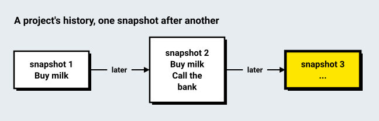
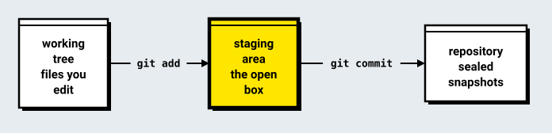
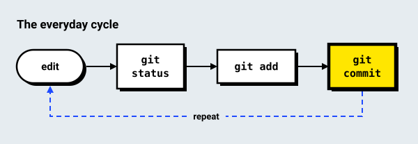

# Chapter 1: Getting started: your first repository

<!-- contents -->
- [1.1 Life without version control](#11-life-without-version-control)
- [1.2 What version control does for you](#12-what-version-control-does-for-you)
- [1.3 Installing Git and checking it works](#13-installing-git-and-checking-it-works)
- [1.4 Telling Git who you are](#14-telling-git-who-you-are)
- [1.5 Making a repository](#15-making-a-repository)
- [1.6 Asking Git what it sees](#16-asking-git-what-it-sees)
- [1.7 Your first commit](#17-your-first-commit)
- [1.8 Reading the history](#18-reading-the-history)
- [1.9 The second commit: the everyday cycle](#19-the-second-commit-the-everyday-cycle)
- [1.10 Getting help from Git itself](#110-getting-help-from-git-itself)
- [1.11 Three places your work can be](#111-three-places-your-work-can-be)
- [1.12 Practice: your first repository](#112-practice-your-first-repository)
<!-- /contents -->

## 1.1 Life without version control

Picture a folder you've worked in for a month. It holds `report.txt`, `report-old.txt`, `report-final.txt`, `report-final-2.txt` and `report-final-REALLY.txt`. Which one did you send to your teacher? Which one has the paragraph you deleted on Tuesday and now want back? You can't tell from the names, and opening each file to compare them takes longer than rewriting the paragraph.

Now add a second person. You email each other zip files of the project. You both change the same file on the same evening, and whoever saves last wins: the other person's work is gone, and nobody notices until a week later.

Programmers lived with exactly this for years, and they built tools to escape it. In the 1970s and 1980s the first tools kept a history of changes to single files on one shared machine. Later tools kept a whole project's history on a central server that everyone checked their work in and out of. Each step helped, but each had a weak spot: if the server was down, or slow, or lost, so was the history.

In 2005 the people working on the Linux kernel, one of the largest shared programs in the world, lost the right to use the tool they had relied on. Linus Torvalds, who started Linux, wrote a replacement in a few weeks and called it Git. He wanted it fast, he wanted every developer to hold the whole history on their own machine, and he wanted it to be impossible to change old history without everyone noticing.

Git is now the tool almost every software team uses. By the end of this chapter you'll have a project of your own whose every saved step is kept, named, dated and signed with your name, and you'll never need a file called `final-REALLY` again.

## 1.2 What version control does for you

### The question

§1.1 left you with a folder full of `report-final-2.txt` files. Before you learn any Git, it's worth asking what you'd actually need to escape that mess. Suppose you're writing a to-do list and you want to be able to get back any earlier state of it, without guessing from file names. What would you have to do, by hand, every time you reached a point worth keeping? And what would go wrong?

Answering that by hand, once, shows you exactly what Git automates.

### The picture

Think of a photo album for your project. Every time things look right, you take a photo of the whole project and stick it on the next page. You never paint over an old photo; you only add pages. Later, you can flip back to any page and see exactly how things looked.

The picture stops being true in one place: a photo only shows you the past. A version-control tool can also hand the past back to you as real files you can keep working on.

<!-- fig: id=album
kind: flow
dir: right
title: A project's history, one snapshot after another
box s1: snapshot 1\nBuy milk
box s2: snapshot 2\nBuy milk\nCall the bank
box s3: snapshot 3\n...
s1 -> s2: later
s2 -> s3: later
hot: s3
-->

*Figure 1.2a: Each snapshot is a full copy of the project at one moment. New ones are added at the end; old ones are never changed.*

### The idea

<!-- teaches: version-control = version control -->
**Version control** is a way of recording the changes to a set of files over time, so that you can look at or bring back any earlier state of them later. A tool that does this is called a version-control system, and Git is one.

<!-- teaches: snapshot = snapshot, snapshots -->
The thing it records is a **snapshot**: a complete copy of the state of every file in the project at one moment, saved together with a note of when it was taken. The word matters: a snapshot isn't "the line I changed". It's the whole project, frozen.

<!-- teaches: project-history = project history, history -->
Line the snapshots up in the order they were taken, and you have the **project history**: the ordered list of every snapshot ever saved for a project, oldest first. Version control is the job of adding to that history safely, and of letting you read it.

That's all three ideas. Everything else in this book is about doing them well: taking snapshots cheaply, describing them, finding the one you want, and sharing a history with other people.

### The code

You can do version control with nothing but a few terminal commands. Here is a by-hand version, so you can feel each step. Four commands may be new to you:

- `echo 'text' > file` writes one line of text into a file, replacing whatever was there. `>>` instead of `>` adds the line to the end of the file.
- `cp -r from to` copies a folder and everything in it; `-r` stands for "recursive", meaning "go into the folder too".
- `ls -1` lists a folder's contents one name per line, which is easier to read here than the usual layout.

You'll make a project folder called `notes` holding a to-do list, and a `snapshots` folder to keep copies in. Each copy is one snapshot. The other commands you've likely met: `mkdir` makes folders (here two at once), `cat` prints a file's contents, and `ls` lists what's in a folder.

<!-- code: id=by-hand -->
```console
$ mkdir notes snapshots
$ echo 'Buy milk' > notes/todo.txt
$ cp -r notes snapshots/1
$ echo 'Call the bank' >> notes/todo.txt
$ cp -r notes snapshots/2
$ echo 'oops' > notes/todo.txt
$ cat notes/todo.txt
oops
$ ls -1 snapshots
1
2
$ cat snapshots/2/todo.txt
Buy milk
Call the bank
$ cp snapshots/2/todo.txt notes/todo.txt
$ cat notes/todo.txt
Buy milk
Call the bank
```

Here is what to notice.

- line 3 takes snapshot 1: a copy of the whole `notes` folder, frozen as it was.
- line 6 is an accident. The single `>` replaced the whole file, and both tasks vanished.
- line 12 shows the second snapshot is still safe, because nothing ever writes into a snapshot after it's taken.
- line 15 brings the past back as a real file you can keep working on. That is the part a photo album can't do.

### The trace

Here's the state of everything after each step of that session.

| Step | Command | `notes/todo.txt` holds | Snapshots kept |
| --- | --- | --- | --- |
| 1 | `mkdir notes snapshots` | (no file yet) | none |
| 2 | `echo 'Buy milk' > ...` | Buy milk | none |
| 3 | `cp -r notes snapshots/1` | Buy milk | 1: Buy milk |
| 4 | `echo 'Call the bank' >> ...` | Buy milk, Call the bank | 1 |
| 5 | `cp -r notes snapshots/2` | Buy milk, Call the bank | 1, 2: Buy milk, Call the bank |
| 6 | `echo 'oops' > ...` | oops | 1, 2 |
| 7 | `cp snapshots/2/todo.txt ...` | Buy milk, Call the bank | 1, 2 |

The project history after step 5 is snapshot 1 then snapshot 2, and it never changes after that, even while the working file is wrecked in step 6.

### What goes wrong

Doing this by hand works, but every step is a chance to slip. Here's one slip, tried for real: you add a task and take "snapshot 2" again, forgetting that a folder called `snapshots/2` already exists.

<!-- code: id=by-hand-nested -->
```console
$ echo 'Pay rent' >> notes/todo.txt
$ cp -r notes snapshots/2
$ ls -1 snapshots/2
notes
todo.txt
```

**"`cp -r` will replace the old snapshot 2."** It didn't. Because `snapshots/2` already existed, `cp` put a copy of `notes` *inside* it, so snapshot 2 now holds a mix of two moments. A history you can quietly change by mistake isn't a history you can trust. Git never reuses a snapshot's name, and you'll see in §1.8 how it names them.

**"I'll remember what each snapshot was for."** You won't. After a week, `snapshots/7` means nothing. A real snapshot needs a short note saying why it was taken, and who took it and when. §1.7 shows Git asking you for exactly that note.

**"I'll take a snapshot whenever I remember to."** Then the one you need is the one you forgot. Version control only helps if taking a snapshot is quick enough that you do it often, every time something works.

**"Copying the whole folder each time will fill my disk."** With `cp`, it can: each copy really is a full copy. Git is cleverer: a file that didn't change between two snapshots is stored once and shared. You don't need to know how yet; chapter 12 opens that up.

### Remember

- Version control records the state of a set of files over time, so you can see or bring back any earlier state.
- A snapshot is the whole project at one moment, not just the part that changed.
- The project history is the ordered list of snapshots, and old snapshots are never changed.
- A snapshot is only useful with a note of what it was, who made it, and when.
- Doing it by hand is slow and easy to get wrong; Git does every step for you.

**Check yourself**

1. In the session above, what would `cat snapshots/1/todo.txt` print after step 7?

<details>
<summary>Answer</summary>

`Buy milk`, and nothing else. Snapshot 1 was taken at step 3, before the second task was added, and nothing ever wrote into it afterwards.

</details>

2. You run `echo 'Water plants' > notes/todo.txt` when you meant to add a task. What did you do wrong, and which command fixes it if snapshot 2 is safe?

<details>
<summary>Answer</summary>

A single `>` replaces the whole file, so only "Water plants" is left. Use `>>` to add a line. To recover, copy the snapshot back: `cp snapshots/2/todo.txt notes/todo.txt`, then add the task again with `>>`.

</details>

3. A friend says "a snapshot is a list of what I changed since last time." What's wrong with that, by this section's definition?

<details>
<summary>Answer</summary>

A snapshot is the complete state of every file in the project at one moment, not a list of changes. You can always work out the changes by comparing two snapshots, but each snapshot stands on its own.

</details>

4. Write the one command that would take snapshot 3 of `notes` correctly, assuming `snapshots/3` doesn't exist yet.

<details>
<summary>Answer</summary>

`cp -r notes snapshots/3`. Because `snapshots/3` doesn't exist, `cp` creates it as a copy of `notes`, rather than putting `notes` inside it.

</details>

## 1.3 Installing Git and checking it works

### The question

§1.2 showed version control done by hand with `cp`, and how easily that goes wrong. Git does the same job without the slips. But Git is a program, and it has to be on your computer before you can use it. How do you get it, and how can you tell, for certain, that the terminal can find it and which version you have?

### The picture

Installing a program is like hiring someone and giving them a desk in your building. Typing its name in the terminal is calling their name down the corridor: if they've got a desk, they answer; if not, the shell tells you nobody of that name works here.

Where the picture stops being true: Git doesn't sit waiting at its desk. It starts when you call it, does one job, and stops.

### The idea

Git is a program you run from the terminal. Install it once:

- **Windows.** Download "Git for Windows" from the official site, git-scm.com, and run the installer, keeping the suggested choices. It also installs **Git Bash**, a terminal that understands every command in this book. Use Git Bash for everything that follows.
- **macOS.** Open Terminal and type `git --version`, the check explained below. If Git isn't there yet, macOS offers to install Apple's "command line developer tools", which include it. Accept, wait, and type the command again.
- **Linux.** Use your system's package manager. On Debian or Ubuntu that is the first line below; on Fedora, the second. `sudo` runs a command with administrator rights, so it asks for your password.

<!-- code: id=install-linux mode=fragment -->
```console
$ sudo apt install git
$ sudo dnf install git
```

Once it's installed, everything you ask Git to do has the same shape.

<!-- teaches: git-command = git command, subcommand -->
A **git command** is a line you type that starts with the word `git`, followed by the name of one job for Git to do, called the subcommand, and then any options or names that job needs. In `git version`, the subcommand is `version`. In `git status` (§1.6), it's `status`. Options start with one or two dashes. Every Git command in this book has this shape, and every one runs the same program, `git`; only the subcommand changes.

<!-- teaches: git-version = git --version -->
The first command to learn checks the install. **`git --version`** prints the version number of the Git program the terminal finds, as `git version` followed by three numbers: the major, minor and patch release, such as 2.43.0. On Windows and macOS a few more words may follow them, such as `.windows.1`; the first three numbers are the version. A bigger number is a newer Git. The examples in this book need Git 2.28 or newer; if yours is older, update it the same way you installed it.

> **Simplified here.** Not every Git command fits "git, subcommand, options" exactly: `git --version` is an option given to `git` itself, with no subcommand. Git also accepts `git version`, which fits the pattern and does the same thing.

### The code

Here's a check you can type right now. `command -v git` is a shell command, not a Git command: `command` asks the shell about a program, and its option `-v` means "don't run it, just say where it is". It prints where the shell found the program called `git`, which proves the terminal can see it.

<!-- code: id=git-version -->
```console
$ git --version
git version 2.43.0
$ git version
git version 2.43.0
$ command -v git
/usr/bin/git
```

Here is what to notice.

- line 1 printed `git version 2.43.0`. That is the version on this machine; yours will likely be the same or newer, and any version from 2.28 up works with this book.
- line 3 does exactly the same job, written as a subcommand.
- line 5 found Git in `/usr/bin/git` on this machine. On a Mac with Git from another installer, or on Windows, the folder differs. What matters is that it printed a path at all.

### The trace

Here is what happens, step by step, when you press Enter on `git --version`.

| Step | Who acts | What happens |
| --- | --- | --- |
| 1 | the shell | splits the line into words: `git` and `--version` |
| 2 | the shell | searches its list of program folders for a program called `git`, and finds `/usr/bin/git` here |
| 3 | the shell | starts that program, handing it the word `--version` |
| 4 | Git | sees the option `--version`, so it needs no subcommand |
| 5 | Git | prints `git version 2.43.0` and stops |
| 6 | the shell | shows its `$` prompt again, ready for the next line |

The same steps happen for every Git command; only steps 4 and 5 change.

### What goes wrong

**"I typed the subcommand and nothing happened."** A mistyped subcommand is caught by Git itself, at step 4 of the trace. It names the closest real one.

<!-- code: id=git-typo exit=1 -->
```console
$ git versoin
git: 'versoin' is not a git command. See 'git --help'.

The most similar command is
        version
```

Read the suggestion, then retype the line: `git version`.

**"I mistyped `git` itself."** Now the shell can't find any program by that name, at step 2, so Git never runs and the message comes from `bash`, the shell.

<!-- code: id=git-missing exit=127 -->
```console
$ gti --version
bash: gti: command not found
```

That same `command not found` is what you'd see if Git weren't installed at all. If you see it for a correctly spelled `git`, go back to the install step, and on Windows check that you're typing in Git Bash.

**"I left `git` off the front."** Without it, the shell looks for a program called `version`, and there isn't one.

<!-- code: id=git-nogit exit=127 -->
```console
$ version
bash: version: command not found
```

Every Git command starts with `git`.

**"I installed Git but the terminal still can't find it."** That can happen when a terminal window was already open during the install: it may still be using the old list of program folders. Close it, open a new one, and try `git --version` again.

### Remember

- Git is a program you run from the terminal; install it once per computer.
- A git command is `git`, then a subcommand naming the job, then options and names.
- `git --version` (or `git version`) proves Git is installed and shows which version.
- `command not found` comes from the shell, and means it found no program by that name.
- A Git message that says "is not a git command" means Git ran, but the subcommand was misspelled.

**Check yourself**

1. In `git init --quiet`, a command you'll use in §1.5, which word is the subcommand, and which part is an option?

<details>
<summary>Answer</summary>

The subcommand is `init`, the job. `--quiet` is an option, because it starts with dashes. §1.5 explains both.

</details>

2. Predict what the terminal prints for `git stauts`, and say which program prints it.

<details>
<summary>Answer</summary>

Git prints it, because the shell found `git` without trouble. It says `git: 'stauts' is not a git command. See 'git --help'.`, then suggests the most similar command, `status`.

</details>

3. Your friend types `git --version` and sees `bash: git: command not found`. Name two likely causes.

<details>
<summary>Answer</summary>

Git isn't installed, or it was installed while that terminal was open and the terminal hasn't picked it up yet. On Windows, a third cause is typing in a terminal other than Git Bash, if Git wasn't added to its list of program folders.

</details>

4. Your friend's Git prints `git version 2.17.1`. Can they follow this book as it stands? What should they do?

<details>
<summary>Answer</summary>

No: 2.17 is older than 2.28, the oldest version this book's examples need (17 is less than 28 in the minor number). They should update Git the same way they installed it, then check again with `git --version`.

</details>

## 1.4 Telling Git who you are

### The question

§1.2 ended with a demand: a snapshot is only useful with a note of who took it and when. Git can read the time from your computer's clock. But your name? Git has just been installed (§1.3) and knows nothing about you. If you share a project with three people, and one snapshot broke everything, how would anyone know whose it was, unless each person told Git their name first?

### The picture

It's like the name badge you fill in at the start of a conference. You write it once, at the door, and from then on everything you sign, every form, every vote, carries that name without your writing it again.

Where the picture stops being true: nobody checks the badge. Git believes whatever name you give it, so the name in a snapshot says who *claimed* to make it, not who proved it.

### The idea

<!-- teaches: git-config = git config, configuration -->
**`git config`** reads and writes Git's settings: each setting has a name made of a section and a key joined by a dot, such as `user.name`, and one value. Give it a name and a value and it stores the setting; give it just a name and it prints the stored value. With the option `--global`, it uses your personal settings file, which applies to every project you work on with this computer account.

That settings file lives in your **home folder**, the folder that belongs to your account on the computer. The shell lets you write the home folder as `~` (a tilde), so the file is `~/.gitconfig`. The dot at the start of its name makes it a hidden file: plain `ls` doesn't list it.

<!-- teaches: user-identity = user identity, user.name, user.email -->
Your **user identity** is the pair of settings `user.name` and `user.email`: the name and email address Git writes into every snapshot you make, as its author. Git refuses to take a snapshot until it has both. You set them once per computer.

Two things about the email address. First, it is copied into every snapshot, and if you ever share your project publicly, anyone can read it there. Use an address you're happy to show. Hosting services, which chapter 7 introduces, can give you a private address for this. Second, Git never sends any email; the address is only a label.

While you're here, set one more thing. `init.defaultBranch` is the name Git gives to the first line of history in each new project. Without this setting, Git 2.43 uses an old name and prints an eleven-line hint about it every time you start a project. Today the usual name is `main`, so set that. Chapter 4 explains what a branch is; for now it's only a name.

> **Simplified here.** `--global` isn't the only place settings live: a single project can have its own settings that override yours, and the whole computer can have settings too. Chapter 16 shows all three and how they stack.

### The code

Type these lines with your own name and address in place of Sam's. The quotes matter; you'll see why under "What goes wrong".

<!-- code: id=cfg -->
```console
$ git config --global user.name "Sam Rivera"
$ git config --global user.email "sam@example.com"
$ git config --global init.defaultBranch main
$ git config --global user.name
Sam Rivera
$ git config --global --list
user.name=Sam Rivera
user.email=sam@example.com
init.defaultbranch=main
$ cat ~/.gitconfig
[user]
        name = Sam Rivera
        email = sam@example.com
[init]
        defaultBranch = main
```

Here is what to notice.

- line 1 and the two lines after it print nothing at all. Silence is how Git says "done": a setting that was stored without trouble isn't news.
- The line after those three gives the same setting name, `user.name`, and no value, so Git reads the setting back.
- line 6 prints every setting in the file, one `name=value` per line. It shows `init.defaultbranch` in lower case: the section name (before the dot) and the key (after it) are not case-sensitive, so Git writes them all in lower case when it lists them, and either spelling works when you type them.
- line 10 shows the file itself. It's ordinary text: each section name in square brackets, and its keys indented beneath it. You could edit it by hand, but `git config` won't make typing mistakes in the format.

### The trace

Here's the settings file after each line of the session. At the start, on this machine, it didn't exist.

| Step | Command | What `~/.gitconfig` holds afterwards |
| --- | --- | --- |
| 1 | `... user.name "Sam Rivera"` | `[user]` with `name = Sam Rivera` |
| 2 | `... user.email "sam@example.com"` | `[user]` with name and email |
| 3 | `... init.defaultBranch main` | the same, plus `[init]` with `defaultBranch = main` |
| 4 | `... user.name` | unchanged: this one only reads, and prints `Sam Rivera` |
| 5 | `... --list` | unchanged: prints all three settings |
| 6 | `cat ~/.gitconfig` | unchanged: prints the file |

Only the first three steps write. Steps 4 to 6 read, which is why you can run them as often as you like to check.

### What goes wrong

**"I don't need quotes around my name."** You do, if it has a space. Here's what happens without them.

<!-- code: id=cfg-noquotes -->
```console
$ git config --global user.name Sam Rivera
$ git config --global --list
user.name=Sam
user.email=sam@example.com
init.defaultbranch=main
```

No error, but the name is now just `Sam`. The shell split `Sam Rivera` into two words, and Git took `Rivera` as an extra instruction rather than part of the name. Every snapshot from now on would say "Sam". The fix is to run the line again with quotes; that replaces the value.

**"Git will tell me if I misspell a setting name."** It won't. Git accepts any name with a dot in it, because tools and people add settings of their own. Here `user.nmae` is stored as a brand new, useless setting, next to the real one.

<!-- code: id=cfg-typo exit=1 -->
```console
$ git config --global user.nmae "Sam Rivera"
$ git config --global user.name "Sam Rivera"
$ git config --global --list
user.name=Sam Rivera
user.email=sam@example.com
user.nmae=Sam Rivera
init.defaultbranch=main
$ git config --global user.nmae
Sam Rivera
$ git config --global --unset user.nmae
$ git config --global user.nmae
```

The second line puts the real name right. `--unset` deletes one setting from the file, so it clears away the typo. The last line, asking for `user.nmae` again, prints nothing and fails, which is how you know it's gone. Check `--list` after you change settings: it's the only way to catch a misspelled one.

**"I'll set this later."** Then your first snapshot fails. When you try to take one, in §1.7, Git stops with a message that begins `Author identity unknown` and tells you to run these same two `git config` lines. It is not an error in your project; set your identity and try again.

**"The name has to match my account somewhere."** It doesn't. Git takes whatever you type. A hosting site may use the email address to link snapshots to your account there (chapter 7), but Git itself checks nothing.

### Remember

- `git config --global NAME VALUE` stores a setting for every project you work on; `git config --global NAME` reads it back.
- Your user identity is `user.name` and `user.email`. Git needs both before it will save a snapshot.
- Quote any value with a space in it.
- Git accepts misspelled setting names without complaint; check with `git config --global --list`.
- Set `init.defaultBranch` to `main` once, so new projects use today's usual name.

**Check yourself**

1. After the session above, what does `git config --global user.email` print?

<details>
<summary>Answer</summary>

`sam@example.com`, the value stored at step 2. Giving `git config` a name with no value reads the setting.

</details>

2. On a new computer where no name is set yet, you type `git config --global user.name Lee Chen`. What name will your snapshots carry, and what single command puts it right?

<details>
<summary>Answer</summary>

`Lee`. Without quotes, `Chen` is a separate word that Git doesn't treat as part of the name. Fix it with `git config --global user.name "Lee Chen"`.

</details>

3. Your `--list` shows `user.name=Lee Chen` and `user.mail=lee@example.com`. What's wrong, and what two commands fix it?

<details>
<summary>Answer</summary>

The email was stored under the misspelled name `user.mail`, so Git still has no `user.email`. Fix it with `git config --global user.email "lee@example.com"`, then delete the stray one with `git config --global --unset user.mail`.

</details>

4. Explain to a friend why it's harmless that `git config --global user.name "Sam Rivera"` printed nothing.

<details>
<summary>Answer</summary>

Git, like most terminal programs, prints nothing when a command did what you asked. It only speaks up when something went wrong, or when you asked it to show you something, as with `git config --global user.name` on its own.

</details>

## 1.5 Making a repository

### The question

You have Git installed (§1.3) and it knows your name (§1.4). Now you want it to start keeping snapshots of a project, the way the `snapshots` folder did by hand in §1.2. But your computer is full of folders, and Git can't keep the history of all of them. How do you tell Git "this folder is a project; keep its history", and where does Git put that history?

### The picture

Picture a workshop with a small locked cupboard in the corner. The workbench is where you build things, and it can be as messy as you like. The cupboard is where finished stages go to be kept: you put a copy in, close the door, and it stays exactly as it was. The cupboard belongs to this workshop only.

Where the picture stops being true: the cupboard isn't separate from the workshop. It's a folder sitting *inside* your project folder, and if you throw the project folder away, the cupboard goes with it.

<!-- fig: id=repo-layout
kind: tree
title: A project folder after git init
box tc: `tipcalc/`\nthe working tree
box tip: `tip.py`
box git: `.git/`\nthe repository
box heads: `config`, `refs/`, ...
box objs: `objects/`\nwhere snapshots go
tc -> tip
tc -> git
git -> heads
git -> objs
hot: git
shade: tip
-->

*Figure 1.5a: `git init` adds one hidden folder, `.git`, inside your project. Everything else in the project folder is the working tree.*

### The idea

<!-- teaches: git-init = git init -->
**`git init`** turns the folder you're in into a Git project, by creating inside it a new, empty place for the history to go. It touches none of your files. You run it once per project, in the project's top folder.

<!-- teaches: repository = repository, repo -->
That place is the **repository**: the store where Git keeps a project's whole history, every snapshot ever taken and the notes that go with them. People shorten it to "repo". When someone says "the Git repo for this project", they usually mean the project folder together with its history.

<!-- teaches: dot-git-folder = .git folder, .git -->
On disk, the repository is the **`.git` folder**: a hidden folder named `.git` that `git init` creates at the top of the project, and that holds everything Git knows about the project. Its name starts with a dot, so plain `ls` hides it; `ls -a` ("all") shows hidden names too. You never need to edit anything inside it by hand. Every Git command does that for you.

<!-- teaches: working-tree = working tree -->
The rest of the project folder is the **working tree**: the ordinary files and folders you see, open and edit, everything in the project folder except `.git`. It's your workbench. Git doesn't save anything in the working tree into the history until you ask it to, which §1.7 shows.

That gives you a simple rule for finding out which project a Git command works on: Git looks for a `.git` folder in the folder you're in, and if there isn't one, in the folder above, and so on upwards. The first one it finds is the repository it uses.

### The code

You'll keep one project for the rest of this chapter: a tiny tip calculator called `tipcalc`, two lines of Python. You don't need to know Python; to Git, a program is just a file of text, and it treats every kind of file the same way. Here, as in §1.2, `echo` writes the lines so that every step is visible; in real work you'd use your editor.

Each terminal session carries on in the folder where the one before it ended. This one ends inside `tipcalc`, so the sessions after it start there too.

<!-- code: id=init -->
```console
$ mkdir tipcalc
$ cd tipcalc
$ echo 'bill = 40.00' > tip.py
$ echo 'print("Tip:", bill * 0.15)' >> tip.py
$ git init --quiet
$ ls -1a
.
..
.git
tip.py
$ ls -1 .git
HEAD
branches
config
description
hooks
info
objects
refs
```

Here is what to notice.

- line 5 made the repository. On its own, `git init` prints one line, `Initialized empty Git repository in`, followed by the full path of the new `.git` folder on your computer. The option `--quiet` turns that line off, and the next command shows the result instead.
- line 6 combines `-1` (one name per line, from §1.2) and `-a` (all, including hidden names). It shows `.git`, and `tip.py` untouched beside it. The `.` and `..` lines are not files: every folder lists `.` for itself and `..` for the folder above.
- line 11 peeks inside the repository. The names are Git's own: `HEAD`, `config`, `objects` and the rest. You'll meet `HEAD` in §3.4, and the others properly in chapters 12 and 13. For now, look and don't touch.
- `tip.py` existed before `git init`, and it's still there, unchanged. Starting version control on a project you've already begun is perfectly normal.

### The trace

Here is the `tipcalc` folder after each step of the session.

| Step | Command | Working tree | Repository |
| --- | --- | --- | --- |
| 1 | `mkdir tipcalc` | empty folder | none |
| 2 | `cd tipcalc` | (the terminal is now inside it) | none |
| 3 | `echo ... > tip.py` | `tip.py`, one line | none |
| 4 | `echo ... >> tip.py` | `tip.py`, two lines | none |
| 5 | `git init --quiet` | `tip.py`, unchanged | `.git` created, no snapshots yet |
| 6 | `ls -1a` | unchanged | unchanged |
| 7 | `ls -1 .git` | unchanged | unchanged |

Step 5 is the only one that involves Git, and the only thing it changed was to add `.git`. The repository exists, but it's empty: no snapshot has been taken.

### What goes wrong

**"Git commands work anywhere."** They work only inside a repository. Here's `git status` (the subject of §1.6) run in the home folder, which isn't one. `cd ~` goes to your home folder.

<!-- code: id=not-a-repo exit=128 -->
```console
$ cd ~
$ git status
fatal: not a git repository (or any of the parent directories): .git
```

The message means Git looked in this folder, then in each folder above it, and found no `.git`. Most often it means you forgot to `cd` into your project. Run `cd tipcalc` and try again. Don't run `git init` to "fix" it unless this folder really should be a new project.

**"I'll run `git init` in my home folder, so everything is covered."** Don't. Then every file in your home folder belongs to one giant project, and every project folder below it is inside that project too, because of the look-upwards rule above. Git commands in any of your folders would quietly use the wrong repository. Make one repository per project, in that project's own folder. If you did it by accident, the fix is to delete the `.git` folder in your home folder, carefully, after checking you're in the right place.

**"I'll tidy up that hidden `.git` folder."** Deleting `.git` deletes the whole history of the project, every snapshot, at once. Your working tree survives, so nothing looks wrong at first. But there's no undo, and Git won't warn you, because to Git it's just a folder. Treat `.git` as part of the project you must never delete or edit by hand.

**"I ran `git init` twice. Have I wiped my history?"** No. Running it again in an existing repository leaves the history alone; Git just says it reinitialized the repository. It's harmless, but there's never a reason to do it.

### Remember

- `git init` makes the current folder a Git project, once, by creating an empty repository in it.
- The repository is the store of the project's whole history; on disk, it's the hidden `.git` folder.
- The working tree is every other file in the project folder: the files you edit.
- Git finds the repository by looking for `.git` here and then in each folder above.
- Never delete or edit `.git` by hand: it is the history.

**Check yourself**

1. You make a folder `poems`, `cd` into it, and run `git init --quiet` and then `ls -1a`. What lines does `ls -1a` print?

<details>
<summary>Answer</summary>

Three lines: `.`, `..` and `.git`. The folder was empty, so the only thing in it is the new repository, plus the two entries every folder lists.

</details>

2. Which of these are part of `tipcalc`'s working tree: `tip.py`, `.git`, `.git/config`?

<details>
<summary>Answer</summary>

Only `tip.py`. The working tree is everything in the project folder except `.git`, and `.git/config` is inside `.git`.

</details>

3. You open a new terminal and type `git status` (§1.6) straight away. It prints `fatal: not a git repository (or any of the parent directories): .git`. What's the likeliest cause, and what do you type?

<details>
<summary>Answer</summary>

The new terminal starts in your home folder, not in your project. Type `cd tipcalc` (or the path to your project), then run `git status` again.

</details>

4. A friend says "the repository is the project folder". Say, in two sentences, what's more exact.

<details>
<summary>Answer</summary>

The repository is the store of the project's history, which lives in the `.git` folder inside the project folder. The rest of the project folder is the working tree, the files you edit, which Git only copies into the history when you ask.

</details>

## 1.6 Asking Git what it sees

### The question

In §1.5 you made a repository in `tipcalc`, and `tip.py` was already sitting in the working tree. Is `tip.py` now safe in the history? Nothing in §1.5 said Git had saved it, but nothing said it hadn't, either. You'll ask this kind of question constantly: what does Git think is going on in my project right now? You need a way to ask, and you need to be able to read the answer.

### The picture

`git status` is like asking a librarian to walk the shelves of your project and report back: "these books are catalogued, these have changed since they were catalogued, and these I've never seen before." The librarian looks and reports; nothing is moved.

Where the picture stops being true: a librarian would put an uncatalogued book on the cart for you. Git never does; it only tells you, and waits for you to decide.

### The idea

<!-- teaches: git-status = git status -->
**`git status`** reports how the working tree differs from the last snapshot in the repository: which files are new to Git, which have changed, and which are ready to go into the next snapshot. It only looks; it changes nothing, so you can run it as often as you like. Experienced Git users run it before and after almost every other command.

Its report is written for people, in sections, and each section only appears when it has something to say. In a brand new repository you'll see three things.

- `On branch main` names the line of history you're working on. You set its name to `main` in §1.4. §4.1 explains branches; until then there's only one, and you can read this line as "in this project".
- `No commits yet` means the repository holds no snapshots. In Git, a saved snapshot is called a commit, and §1.7 makes your first one.
- `Untracked files:` lists files Git has found but isn't keeping.

<!-- teaches: untracked-file = untracked file, untracked -->
An **untracked file** is a file in the working tree that isn't in the last snapshot and hasn't been marked to go into the next one: Git sees it, but leaves it out of the history until you say otherwise. Every file starts out untracked. Git doesn't add files on its own, because projects are full of files that should never be saved: logs, passwords, the programs your compiler builds. Chapter 2 shows how to tell Git to stop even listing those.

Lines in brackets, such as `(use "git add <file>..." to include in what will be committed)`, are hints: Git's suggestion for what you might type next (`git add` is the subject of §1.7). They are worth reading while you're learning.

### The code

Here's `git status` on the project from §1.5, before and after a second file is added. The second file, `README.md`, is a short description of the project; most projects have one, and `.md` means it's written in Markdown, a plain-text format with light marks such as `#` for a heading.

<!-- code: id=status-first -->
```console
$ cd tipcalc
$ git status
On branch main

No commits yet

Untracked files:
  (use "git add <file>..." to include in what will be committed)
        tip.py

nothing added to commit but untracked files present (use "git add" to track)
$ echo '# tipcalc' > README.md
$ echo 'Works out a 15% tip on a bill.' >> README.md
$ git status
On branch main

No commits yet

Untracked files:
  (use "git add <file>..." to include in what will be committed)
        README.md
        tip.py

nothing added to commit but untracked files present (use "git add" to track)
```

Here is what to notice.

- The first `git status` lists `tip.py` under `Untracked files`. So the answer to this section's question is no: `tip.py` is not in the history. It was in the folder before `git init`, and being in the folder isn't enough.
- line 12 and the line after it write the new file, two lines long.
- The second report lists both files, in alphabetical order. Git noticed `README.md` without being told; noticing is what `git status` is for.
- The last line, `nothing added to commit but untracked files present`, sums up: no file has been chosen for the next snapshot, but there are files that could be.

### The trace

Here's what `git status` does on its second run, step by step.

| Step | What Git does | What it finds |
| --- | --- | --- |
| 1 | looks for `.git`, here and upwards (§1.5) | `tipcalc/.git` |
| 2 | asks which line of history this is | `main` |
| 3 | looks for the last snapshot | none, so it prints `No commits yet` |
| 4 | lists every file in the working tree | `README.md`, `tip.py` |
| 5 | checks each one against the last snapshot and against what's been chosen for the next | neither file is in either, so both are untracked |
| 6 | prints the report, then a one-line summary | `nothing added to commit but untracked files present` |

Notice step 5. A file is untracked because of what Git *doesn't* have for it, not because of anything about the file itself.

### What goes wrong

**"Git saves everything in my project folder."** It doesn't, and `git status` is how you find out. Until you add a file, as §1.7 shows, it's listed as untracked, and if you lost the working tree, an untracked file would be lost with it.

**"Git only lists folders that are empty."** Here's a new folder with a file inside it. `rm -r docs` at the end deletes the folder and everything in it, with no undo, so the project is left as it was.

<!-- code: id=status-folder danger="deletes a folder and its contents" -->
```console
$ mkdir docs
$ echo 'Ideas for later' > docs/ideas.txt
$ git status
On branch main

No commits yet

Untracked files:
  (use "git add <file>..." to include in what will be committed)
        README.md
        docs/
        tip.py

nothing added to commit but untracked files present (use "git add" to track)
$ rm -r docs
```

Git lists `docs/`, not `docs/ideas.txt`. When a whole folder is untracked, the report shows only the folder's name, ending in `/`, to keep the list short. It means "this folder and everything in it". Don't read it as an empty folder.

**"An empty folder will show up too."** It won't. Git keeps track of files, and a folder only appears in the history because there are files in it. An empty folder never appears in `git status` and is never saved.

**"`git status` fixed something for me."** It never does. If a report surprises you, the cause is something else you ran. Read the hints in brackets: they say which command would make the change.

**"The report is too long to read."** It's long while you learn because it explains itself. It shortens on its own once there's less to say: §1.9 shows the report for a project with nothing to save, which is two lines.

### Remember

- `git status` reports what Git sees in the working tree compared with the last snapshot. It never changes anything.
- An untracked file is one Git has found but isn't keeping. Every new file starts untracked.
- `No commits yet` means the repository holds no snapshots.
- An untracked folder is listed once, as `name/`, standing for everything in it.
- Read the hints in brackets: they tell you what to type next.

**Check yourself**

1. In a fresh repository you create `a.txt` and `b.txt`, then run `git status`. Which heading lists them, and in what order?

<details>
<summary>Answer</summary>

Both appear under `Untracked files:`, in alphabetical order: `a.txt`, then `b.txt`.

</details>

2. You create `notes/day1.txt` and `notes/day2.txt` in `tipcalc`. What does the untracked list show for them?

<details>
<summary>Answer</summary>

One line, `notes/`. A folder whose contents are all untracked is listed once, by its name followed by `/`.

</details>

3. A friend runs `git status`, sees their file listed as untracked, and says "good, Git's got it". What's wrong with that?

<details>
<summary>Answer</summary>

Untracked means the opposite: Git has seen the file but isn't keeping it. It isn't in any snapshot. They need to add it and commit it, as §1.7 shows.

</details>

4. Why does Git leave new files untracked instead of saving everything in the folder?

<details>
<summary>Answer</summary>

Because projects contain files that shouldn't be saved: logs, built programs, secrets such as passwords. Git leaves the choice to you, so nothing goes into the history unless you put it there.

</details>

## 1.7 Your first commit

### The question

§1.6 ended with a report that says, plainly, that nothing in `tipcalc` is saved: `tip.py` and `README.md` are both untracked. You want to take your first snapshot, the thing `cp -r` did by hand in §1.2. But §1.6 also said Git never saves a file you didn't choose. So how do you choose which files go into a snapshot, and how do you then take it, with the note that §1.2 said every snapshot needs?

### The picture

Think of sending a parcel. First you pack the box: you pick the things to send and put them in, and you can look in the box and change your mind while it's open. Then you seal it, write a label saying what's inside, and post it. Once posted, the parcel can't be changed.

<!-- fig: id=add-commit
kind: flow
dir: right
store wt: working tree\nfiles you edit
store stage: staging area\nthe open box
store repo: repository\nsealed snapshots
wt -> stage: `git add`
stage -> repo: `git commit`
hot: stage
-->

*Figure 1.7a: `git add` copies a file into the staging area; `git commit` seals everything in the staging area into a new snapshot in the repository.*

Where the picture stops being true: when you post a parcel, the things leave your house. When Git takes a snapshot, it takes copies; your files stay in the working tree, exactly as they were.

### The idea

Taking a snapshot in Git is two steps, like the parcel: choose, then save.

<!-- teaches: staging-area = staging area, index -->
The **staging area** is the set of files, each in an exact version, that Git will put into the next snapshot: the open box. Git keeps it inside `.git`, so it isn't something you see in the folder; `git status` shows it to you under the heading `Changes to be committed`. Some Git messages and older books call it "the index"; it's the same thing.

<!-- teaches: git-add = git add -->
**`git add`** copies the files you name, as they are at this moment, into the staging area. You can name as many files as you like in one command, separated by spaces. Adding a file doesn't save it in the history yet. It only packs it into the box.

<!-- teaches: commit = commit -->
A **commit** is one snapshot in a Git repository: the full set of tracked files as they were in the staging area, together with the author's name and email address (§1.4), the date and time, and a message. "Commit" is the word Git uses for what §1.2 called a snapshot, and from now on this book uses it too. Each new commit also records which commit came just before it, which is how the commits line up into the project history.

<!-- teaches: git-commit = git commit -->
**`git commit`** takes everything in the staging area and saves it in the repository as a new commit. It's the sealing step. Once the commit is made, nothing can change it; you can only make new commits after it.

<!-- teaches: commit-message = commit message, message -->
A **commit message** is the text stored in each commit to say, for people, what the commit does and why. Git won't make a commit without one. The option `-m` lets you give it on the command line, in quotes: `git commit -m "Add tip calculator and README"`. A good first habit: keep it short, and write it as an instruction, "Add the README", rather than "added stuff". Chapter 2 is about writing messages well.

Once a file has been in a commit, Git watches it from then on; it's no longer untracked, and from now on, this book calls such a file tracked.

### The code

Here's the whole thing on the project from §1.6: choose the files, check the box, seal it, check again.

<!-- code: id=first-commit varies -->
```console
$ git add tip.py README.md
$ git status
On branch main

No commits yet

Changes to be committed:
  (use "git rm --cached <file>..." to unstage)
        new file:   README.md
        new file:   tip.py
$ git commit -m "Add tip calculator and README"
[main (root-commit) 8af6297] Add tip calculator and README
 2 files changed, 4 insertions(+)
 create mode 100644 README.md
 create mode 100644 tip.py
$ git status
On branch main
nothing to commit, working tree clean
```

Here is what to notice.

- line 1 printed nothing: the files were copied into the staging area without trouble.
- The `git status` after it has a new section, `Changes to be committed`, which is the staging area. Both files are marked `new file`, meaning they aren't in any commit yet. The hint in brackets offers a way to take a file back out of the box; chapter 2 shows the friendlier way.
- line 11 made the commit, and its first line of output names it: `main` is the line of history, `root-commit` means this is the first commit, with none before it, and the seven characters after that are the commit's short name. Yours will be different: it's calculated from the content, your name and the exact time, so it's different on every machine and every run. §1.8 explains it.
- `2 files changed, 4 insertions(+)` counts what's new compared with the commit before: two files, and four lines added in total, two in each.
- `create mode 100644` is Git's code for "a file was added, and it's an ordinary file, not a program you can run by name". You can read `100644` as "plain file" for now; chapter 12 shows where the number comes from.
- The final `git status` says `nothing to commit, working tree clean`. **Clean** means every file in the working tree is the same as in the last commit, and nothing is waiting in the staging area.

### The trace

Here's where each file stands after each step.

| Step | Command | `tip.py` | `README.md` | Commits in the repository |
| --- | --- | --- | --- | --- |
| 0 | (start, from §1.6) | untracked | untracked | none |
| 1 | `git add tip.py README.md` | staged as new | staged as new | none |
| 2 | `git status` | staged as new | staged as new | none |
| 3 | `git commit -m "..."` | tracked, unchanged | tracked, unchanged | 1: both files, with Sam's name, the time and the message |
| 4 | `git status` | tracked, unchanged | tracked, unchanged | 1 |

Between steps 1 and 3 the files are in two places at once: in the working tree, where you can edit them, and in the staging area, ready to go. After step 3 they're in a third place, the repository, as well. §1.11 looks at those three places side by side.

### What goes wrong

**"I'll add the file and commit it in one go with `git commit`."** `git commit` only saves what's in the staging area. With nothing staged, there's nothing to save, and Git says so. Here it is after the first commit, when nothing has changed.

<!-- code: id=commit-nothing exit=1 -->
```console
$ git commit -m "Save my work"
On branch main
nothing to commit, working tree clean
```

Run `git status` first; if nothing is listed under `Changes to be committed`, `git add` the files you mean to save.

**"I'll leave the quotes off the message."** Then the shell splits it into words. Git takes `Save` as the message and every other word as a file name to commit, which it can't find. Git calls the file names you give it a **pathspec**: a name, or a pattern, that picks out files.

<!-- code: id=commit-noquotes exit=1 -->
```console
$ git commit -m Save my work
error: pathspec 'my' did not match any file(s) known to git
error: pathspec 'work' did not match any file(s) known to git
```

No commit was made. Put the whole message in quotes and run it again.

**"A typo in a file name doesn't matter."** Git checks every name you give `git add`, and stops if any doesn't match a file.

<!-- code: id=add-typo exit=128 -->
```console
$ git add tip.pyy
fatal: pathspec 'tip.pyy' did not match any files
```

Nothing was added at all, not even the names that were right. Correct the name and run it again. Pressing the Tab key after the first few letters of a name lets the shell complete it, which avoids most typos.

**"I forgot `-m` and now I'm in a strange screen."** Without `-m`, Git opens a text editor in the terminal for you to write the message in, often one called Vim. If you didn't mean to be there: press Esc, type `:q!` and press Enter. That leaves without saving, and Git makes no commit, saying the message was empty. Then run `git commit` again, with `-m`. Chapter 16 shows how to make Git open the editor you prefer.

**"Git says `Author identity unknown`."** That's §1.4 not done yet on this computer. Set `user.name` and `user.email`, then run the same `git commit` again; your staging area is still packed.

### Remember

- A commit is one snapshot: the staged files, your name and email, the time and a message, linked to the commit before it.
- `git add FILE...` copies files, as they are now, into the staging area. It saves nothing in the history yet.
- `git commit -m "message"` saves the staging area as a new commit.
- Put the message in quotes, keep it short, and write it as an instruction.
- Clean means the working tree matches the last commit and nothing is staged.

**Check yourself**

1. You've made a new file `rates.txt` in `tipcalc` and run `git add rates.txt`, but not committed. Under which heading does `git status` list it, and with what word in front?

<details>
<summary>Answer</summary>

Under `Changes to be committed:`, as `new file:   rates.txt`. It's in the staging area, ready for the next commit.

</details>

2. Write the two commands that would make a commit containing `rates.txt` with the message "Add tax rates".

<details>
<summary>Answer</summary>

```console
$ git add rates.txt
$ git commit -m "Add tax rates"
```

The first packs the file into the staging area; the second seals it into a commit.

</details>

3. What will `git commit -m Add tax rates` do, and why?

<details>
<summary>Answer</summary>

It makes no commit. Without quotes, the shell gives Git three words. Git takes `Add` as the message and `tax` and `rates` as file names, can't find files called that, and prints an `error: pathspec ... did not match` line for each.

</details>

4. Explain, in your own words, why Git has a staging area instead of saving every changed file each time you commit.

<details>
<summary>Answer</summary>

It lets you choose what goes into each commit. You can change several files, but commit only the ones that belong together, with a message that describes just that change, and leave the rest for another commit. Chapter 2 makes that a habit.

</details>

## 1.8 Reading the history

### The question

In §1.7 you made your first commit, and Git answered with a line that began `[main (root-commit)` and a string of seven characters. That's a receipt, and receipts get lost. Next week, how do you see what commits the project has, who made each one, when, and why? And what was that string of seven characters, which was different on your machine from anyone else's?

### The picture

The history is a diary written backwards: open it and the newest entry is at the top, each one dated and signed, and you read down into the past.

Where the picture stops being true: in a diary you could tear a page out or squeeze in a new one between two old ones. You can't do either quietly in Git, and the commit hash below is why.

### The idea

<!-- teaches: git-log = git log -->
**`git log`** lists the commits in the project history, newest first, showing for each its hash, its author, its date and its message. It starts from the latest commit, and follows each commit's link to the one before it (§1.7) until it reaches the first. Like `git status`, it only reads; it never changes anything.

<!-- teaches: commit-hash = commit hash, hash, commit ID -->
The long string at the top of each entry is the **commit hash**: a 40-character name (in a repository made the usual way, as yours was) that Git works out from everything in the commit, its files, author, date, message and the commit before it, and that is different for every commit. It's written with the digits `0` to `9` and the letters `a` to `f` only, a way of writing numbers called hexadecimal. People also call it the commit ID.

Because the hash is worked out from the commit's content, two things follow.

- Change anything about a commit, even one letter of its message, and the hash would be different; it would be a different commit. That's what makes the history hard to change quietly: the hashes give it away.
- Your hash is different from Sam's, and from the one printed in this book, even for the same files and message, because your name and the time are different. Every hash shown in this chapter is the one from this machine.

You almost never type all 40 characters. The first seven or so are enough for Git to tell commits in one project apart, and that's the **short hash** that `git commit` printed in §1.7. Git accepts any start of a hash that's long enough to pick out one commit.

> **Simplified here.** "Different for every commit" is true in practice, not by law: in principle two different commits could get the same hash, but the chance is so small that nobody plans for it. Chapter 12 shows how the hash is worked out and why it's safe to rely on.

### The code

Here's the log of `tipcalc` after the commit in §1.7.

<!-- code: id=first-log varies -->
```console
$ git log
commit 8af6297b68250532424be03d1456559cf5b24f15 (HEAD -> main)
Author: Sam Rivera <sam@example.com>
Date:   Mon Jan 5 10:00:00 2026 +0000

    Add tip calculator and README
```

Here is what to notice.

- The first line is the word `commit` and the full hash. Its first seven characters are the short hash the commit printed. The line also ends with `(HEAD -> main)`, in colour on your screen. That marks which commit you're on; §3.4 explains it, and you can ignore it until then.
- `Author:` is the user identity from §1.4: `user.name`, then `user.email` in angle brackets. Here is where it ends up.
- `Date:` is when the commit was made, from your computer's clock: weekday, month, day, time, year. The `+0000` at the end is the time zone, as hours and minutes ahead of the world's standard time (UTC). This machine runs on UTC; yours will show your own zone, such as `-0500` or `+0100`.
- The message is indented by four spaces, so that a long log is easy to scan.
- There's only one entry, because there's only one commit. §1.9 makes a second.

When the log is longer than your terminal window, Git shows it one screenful at a time, in a viewer called a **pager**: press Space for the next screen, and `q` to quit back to the `$` prompt. If you ever see `(END)` or a `:` at the bottom of the window and the terminal won't take commands, you're in the pager; press `q`.

### The trace

Here's how `git log` produced that output, step by step.

| Step | What Git does | Result |
| --- | --- | --- |
| 1 | finds the repository (§1.5) | `tipcalc/.git` |
| 2 | finds the latest commit on `main` | the commit from §1.7 |
| 3 | prints its hash, author, date and message | the five lines shown |
| 4 | follows its link to the commit before | there is none: this was the root commit (§1.7) |
| 5 | stops | back to the `$` prompt |

With more commits, steps 3 and 4 repeat, once per commit, from newest to oldest. That's why the log runs backwards in time.

### What goes wrong

**"I'll run `git log` straight after `git init` to check everything's fine."** In a repository with no commits, there's nothing to list, and Git says so as an error. Here it is in a new, empty repository called `empty`, made beside `tipcalc`.

<!-- code: id=log-empty exit=128 -->
```console
$ mkdir ~/empty
$ cd ~/empty
$ git init --quiet
$ git log
fatal: your current branch 'main' does not have any commits yet
```

Nothing's broken. Make the first commit, and `git log` has something to show.

**"My hash doesn't match the book, so I did something wrong."** No: hashes include your name and the exact second you committed, so no two readers will ever get the same one. Check the author, date and message instead.

**"My terminal froze after `git log`."** It's in the pager. Press `q`.

**"I'll remember the short hash."** Don't try; you can always look it up with `git log`. Copy and paste a hash when you need one, rather than typing it.

**"I'll fix the typo in last week's commit message by editing the history."** You can't edit a commit; any change makes a new commit with a new hash. Chapter 8 shows how to replace a recent commit with a corrected one, and when that's safe.

### Remember

- `git log` lists commits newest first: hash, author, date, message.
- A commit hash is a 40-character hexadecimal name worked out from the commit's content; change anything and the hash changes.
- The first seven or so characters, the short hash, are enough to name a commit in one project.
- Your hashes will never match anyone else's; that's normal.
- In the pager, Space goes forward and `q` quits.

**Check yourself**

1. Which of these could be a full commit hash: `3f9a0c1`, `3f9a0c1d27be4e8a90f15c6b2d7e83a4c5b19f06`, `3f9a0c1d27be4e8a90f15c6b2d7e83a4c5b19f0g`?

<details>
<summary>Answer</summary>

Only the second. The first is a short hash (seven characters), and the third ends in `g`, which isn't a hexadecimal digit.

</details>

2. You make a commit, then a friend makes a commit with the same files and the same message on their own computer. Will the hashes match? Why?

<details>
<summary>Answer</summary>

No. The hash is worked out from everything in the commit, including the author and the date and time, and those differ.

</details>

3. Predict the `Author:` line of `git log` for a commit made after `git config --global user.name "Lee Chen"` and `git config --global user.email "lee@example.com"`.

<details>
<summary>Answer</summary>

`Author: Lee Chen <lee@example.com>`

</details>

4. After `git log`, your terminal shows a `:` at the bottom and won't run commands. What's happening, and what do you press?

<details>
<summary>Answer</summary>

The log was longer than the window, so Git opened it in the pager. Press `q` to quit back to the prompt.

</details>

## 1.9 The second commit: the everyday cycle

### The question

`tipcalc` has one commit (§1.7), and `git log` shows it (§1.8). But one snapshot isn't a history. Real work is change after change: you edit `tip.py`, it works, you want to keep that state too. Now `tip.py` isn't new to Git, so what does Git make of a file it already has a copy of, after you've changed it? And what exactly do you type, every time, to turn a change into a commit?

### The picture

<!-- fig: id=cycle
kind: flow
dir: right
title: The everyday cycle
round edit: edit
box look: `git status`
box stage: `git add`
box save: `git commit`
edit -> look
look -> stage
stage -> save
save ..> edit: repeat
hot: save
-->

*Figure 1.9a: The loop you'll go round many times a day. Running `git status` at any point costs nothing.*

It's the rhythm of saving in a game: play a stretch, reach a safe spot, save. Where it stops being true: a game save usually overwrites the last one, while each commit is added after the others and the old ones stay.

### The idea

<!-- teaches: modified-file = modified file, modified -->
A **modified file** is a tracked file (§1.7) whose content in the working tree is different from its content in the last commit. Git spots this by comparing the two whenever you run `git status`, and lists the file under `Changes not staged for commit`, marked `modified:`. Modified doesn't mean saved; it means "different from the last commit, and not chosen yet".

A modified file gets into the next commit exactly the way a new one did: `git add` copies its current content into the staging area, and `git commit` seals it. You add a file again *every time* you want its newest content committed, not just the first time, because `git add` copies the file as it is at that moment.

<!-- teaches: edit-stage-commit-cycle = edit-stage-commit cycle, everyday cycle -->
That gives the **edit-stage-commit cycle**: the repeated loop of changing files in the working tree, staging the changes you want with `git add`, and saving them as a commit with `git commit`, checking with `git status` along the way. Almost all everyday Git work is this loop. Commit whenever the project reaches a state worth coming back to: a feature works, a bug is fixed, a section is written. Small, frequent commits are easier to describe and easier to go back to than one huge one at the end of the day.

### The code

Here's one full turn of the cycle, back in `tipcalc`: §1.8 left you in `empty`, so the session starts with `cd ~/tipcalc`. You add a line to `tip.py` that prints the bill plus the tip. A tip of 15% means multiplying by 1.15 gives the total.

<!-- code: id=second-commit varies -->
```console
$ cd ~/tipcalc
$ echo 'print("Total:", bill * 1.15)' >> tip.py
$ git status
On branch main
Changes not staged for commit:
  (use "git add <file>..." to update what will be committed)
  (use "git restore <file>..." to discard changes in working directory)
        modified:   tip.py

no changes added to commit (use "git add" and/or "git commit -a")
$ git add tip.py
$ git commit -m "Print the total as well as the tip"
[main c670348] Print the total as well as the tip
 1 file changed, 1 insertion(+)
$ git status
On branch main
nothing to commit, working tree clean
$ git log
commit c670348894dd413b693f0d19e1d8af9b9e521b92 (HEAD -> main)
Author: Sam Rivera <sam@example.com>
Date:   Mon Jan 5 10:00:00 2026 +0000

    Print the total as well as the tip

commit 8af6297b68250532424be03d1456559cf5b24f15
Author: Sam Rivera <sam@example.com>
Date:   Mon Jan 5 10:00:00 2026 +0000

    Add tip calculator and README
```

Here is what to notice.

- line 2 is the edit: `>>` adds a third line to the end of the file.
- The first `git status` lists `tip.py` as `modified`, under `Changes not staged for commit`. Git compared the file with the last commit and found it different. Two hints come with it: `git add` to stage it, and `git restore` to throw the change away and go back to the committed content. Chapter 2 covers `git restore`; be careful with it, since a discarded change can't be got back.
- The other hint, `git commit -a`, is a shortcut: `-a` stages every modified tracked file for you as part of the commit. This book holds off on it until chapter 2 has shown you how to see exactly what you'd be committing.
- line 12, the commit, printed `1 file changed, 1 insertion(+)`: one line added, compared with the commit before. There's no `root-commit` this time, because this commit has one before it, and no `create mode` line, because no file is new.
- The `git status` after it is just two lines: everything is committed.
- `git log` now shows two entries, the newest at the top. The commit hashes are this machine's, as always.

### The trace

Here's `tip.py` through one turn of the cycle. "Last commit" means the content of `tip.py` in the newest commit.

| Step | Command | `tip.py` in the working tree | In the staging area | In the last commit | `git status` would say |
| --- | --- | --- | --- | --- | --- |
| 0 | (start) | 2 lines | 2 lines | 2 lines | clean |
| 1 | `echo ... >> tip.py` | 3 lines | 2 lines | 2 lines | modified, not staged |
| 2 | `git add tip.py` | 3 lines | 3 lines | 2 lines | staged: `modified: tip.py` under `Changes to be committed` |
| 3 | `git commit -m ...` | 3 lines | 3 lines | 3 lines (new commit) | clean |

The staging area holds a 2-line `tip.py` at step 0. After the first commit, the staging area isn't empty: it holds the files of the last commit, and `git add` replaces one file's copy in it. §1.11 shows why that matters.

### What goes wrong

**"I changed a file, so `git commit` will save the change."** Not until it's staged. Here README.md has a new line, and the commit is tried straight away.

<!-- code: id=commit-unstaged exit=1 -->
```console
$ echo 'Run it with: python3 tip.py' >> README.md
$ git commit -m "Explain how to run it"
On branch main
Changes not staged for commit:
  (use "git add <file>..." to update what will be committed)
  (use "git restore <file>..." to discard changes in working directory)
        modified:   README.md

no changes added to commit (use "git add" and/or "git commit -a")
```

No commit was made. The report shows why: the change is under `Changes not staged for commit`, and the last line says `no changes added to commit`. Run `git add README.md` first. (This change is left as it is for now; §1.11 comes back to it.)

**"I added the file yesterday, so it's already in the box."** Adding copies the file *as it was then*. If you edited it since, the staging area holds yesterday's version, and the commit would save that one, not the one in your editor. Add again just before you commit. §1.11 shows a file that's both staged and modified at once.

**"I'll make one big commit at the end of the week."** Then its message can't describe it, and if one change in it was wrong, you can't go back to before that change without losing all the others. Commit each working step.

**"`git status` says `modified`, but I didn't change anything."** Something did, perhaps your editor added or removed a space or a line ending when it saved. Chapter 2 shows how to see exactly what changed, and §2.10 how to deal with line endings.

### Remember

- A modified file is a tracked file that differs from the last commit.
- Add a file again every time you want its newest content in the next commit.
- The everyday cycle: edit, `git status`, `git add`, `git commit`, and round again.
- A commit's output counts lines added (`insertion`) compared with the commit before.
- Commit whenever the project reaches a state worth coming back to.

**Check yourself**

1. After the session above, you add a line to `README.md` and run `git status`. Under which heading does `README.md` appear, and with which word in front?

<details>
<summary>Answer</summary>

Under `Changes not staged for commit:`, as `modified:   README.md`. It's tracked, and it now differs from the last commit.

</details>

2. Write the commands for one full turn of the cycle that saves that change to `README.md` with the message "Explain how to run it".

<details>
<summary>Answer</summary>

```console
$ git status
$ git add README.md
$ git commit -m "Explain how to run it"
```

The `git status` is optional, but it's the habit that catches mistakes.

</details>

3. After that commit, how many entries does `git log` show, and which message is at the top?

<details>
<summary>Answer</summary>

Three. The newest, "Explain how to run it", is at the top; "Add tip calculator and README" is at the bottom.

</details>

4. You run `git add tip.py`, then change `tip.py` again in your editor, then `git commit -m "Fix rounding"`. Which version of `tip.py` is in the commit?

<details>
<summary>Answer</summary>

The version from the moment you ran `git add`. The later edit is still only in the working tree, so `git status` would now show `tip.py` as modified.

</details>

## 1.10 Getting help from Git itself

### The question

In §1.5 you typed `git init --quiet`, and the book told you what `--quiet` does. But Git has well over a hundred subcommands, and most of them have dozens of options. This book can't list them all, and the hints in `git status` (§1.6) keep naming commands you haven't met, such as `git restore`. When you're on your own with a command and you've forgotten how it goes, or wonder whether it has an option for what you want, where do you look, without leaving the terminal?

### The picture

Git carries its own manual, like a car with the handbook in the glove box. There's a one-page summary card for when you only need a reminder, and the full handbook for when you need the whole story.

Where the picture stops being true: the handbook is written for people who already know Git fairly well, not for beginners. Use it to check details, not to learn ideas from scratch.

### The idea

<!-- teaches: git-help = git help, -h, --help -->
**`git help`** shows Git's built-in documentation: given the name of a subcommand, as in `git help commit`, it opens that command's full manual page; given nothing, it lists the most common commands. Git has three ways in, from shortest to longest:

- `git SUBCOMMAND -h` prints a short summary of one subcommand straight into the terminal: how it's typed, and its options with a few words each. This is the quick reminder.
- `git help SUBCOMMAND`, or `git SUBCOMMAND --help`, which does the same thing, opens the full manual page for it. On Linux and macOS it opens in the pager from §1.8 (Space for more, `q` to quit). On Windows, Git for Windows opens the page in your web browser.
- `git help -g` lists Git's guides: longer documents about ideas rather than single commands, such as a glossary of Git's words. Open one with `git help` and its name, for example `git help everyday`.

The summary from `-h` uses a small notation you'll see in most terminal tools' help:

- Square brackets, `[ ]`, mark something you may leave out.
- A bar, `|`, separates choices: use one or the other.
- Angle brackets, `< >`, mark a place where you put a value of your own, such as a folder name.
- An option can have a short form, one dash and one letter (`-q`), and a long form, two dashes and a word (`--quiet`). They do the same thing.
- `--[no-]quiet` is short for two options: `--quiet`, and `--no-quiet` which turns it off.

### The code

Here's the quick reminder for `git init`, the command from §1.5. As with every `-h`, Git treats a request for the summary as "not a real run", so it stops after printing it.

<!-- code: id=init-help exit=129 -->
```console
$ git init -h
usage: git init [-q | --quiet] [--bare] [--template=<template-directory>]
                [--separate-git-dir <git-dir>] [--object-format=<format>]
                [-b <branch-name> | --initial-branch=<branch-name>]
                [--shared[=<permissions>]] [<directory>]

    --[no-]template <template-directory>
                          directory from which templates will be used
    --[no-]bare           create a bare repository
    --shared[=<permissions>]
                          specify that the git repository is to be shared amongst several users
    -q, --[no-]quiet      be quiet
    --[no-]separate-git-dir <gitdir>
                          separate git dir from working tree
    -b, --[no-]initial-branch <name>
                          override the name of the initial branch
    --[no-]object-format <hash>
                          specify the hash algorithm to use
```

Here is what to notice.

- The first line, `usage: git init [-q | --quiet] ...`, is the shape of the command. Everything is in square brackets, so `git init` with nothing after it is valid, which is how you've used it. `[-q | --quiet]` says you may give `-q` or `--quiet`: the option you used in §1.5 has a short form.
- `[<directory>]` at the end says you may give the name of a folder, and Git makes the repository there instead of in the current folder. `git init tipcalc` would have created the folder and the repository in one step.
- The list below the usage lines gives each option with a few words. `-b, --[no-]initial-branch <name>` is an option for one repository that does what `init.defaultBranch` from §1.4 does for all of them.
- Several options mention ideas you haven't met, such as `--bare`. That's normal: the help covers everything, and you need only the lines you came for.

And here's the list of guides.

<!-- code: id=help-guides -->
```console
$ git help -g
The Git concept guides are:
   core-tutorial    A Git core tutorial for developers
   credentials      Providing usernames and passwords to Git
   cvs-migration    Git for CVS users
   diffcore         Tweaking diff output
   everyday         A useful minimum set of commands for Everyday Git
   faq              Frequently asked questions about using Git
   glossary         A Git Glossary
   namespaces       Git namespaces
   remote-helpers   Helper programs to interact with remote repositories
   submodules       Mounting one repository inside another
   tutorial         A tutorial introduction to Git
   tutorial-2       A tutorial introduction to Git: part two
   workflows        An overview of recommended workflows with Git

'git help -a' and 'git help -g' list available subcommands and some
concept guides. See 'git help <command>' or 'git help <concept>'
to read about a specific subcommand or concept.
See 'git help git' for an overview of the system.
```

`everyday`, `glossary` and `tutorial` are the ones worth knowing about now. The glossary is useful whenever a Git message uses a word you don't know: open it with `git help glossary`, which shows the page in the pager (or your browser, on Windows), and search it by typing `/`, the word, and Enter.

### The trace

Here's what happens when you type `git init -h`, compared with `git help init`.

| Step | `git init -h` | `git help init` |
| --- | --- | --- |
| 1 | Git starts and reads the subcommand `init` | Git starts and reads the subcommand `help` |
| 2 | `init` sees `-h` before doing any work | `help` looks up the manual page for `init` |
| 3 | prints the usage summary into the terminal | opens the page in the pager, or the browser on Windows |
| 4 | stops without making any repository | waits until you press `q` (or close the browser tab) |
| 5 | back to the prompt | back to the prompt |

Step 4 is the important one for `-h`: asking for the summary never runs the command. `git init -h` doesn't make a repository; `git commit -h` doesn't make a commit.

### What goes wrong

**"`--help` and `-h` are the same."** For Git they aren't. `-h` prints the short summary; `--help` opens the full manual page, which is many screens long. If you meant the summary and find yourself in the pager, press `q`.

**"I'll type `git help` with the wrong name and it'll correct me."** With a misspelled subcommand, `git help` doesn't suggest the right one the way `git versoin` did in §1.3. It tries to open a manual page that doesn't exist, and what you see depends on your system: often a message like `No manual entry for gitcomit`. Check the spelling against the list from plain `git help`.

**"I can't read the manual page; it's all unknown words."** That's normal in your first weeks. Read the short description at the top and the examples, which most pages have near the end. Skip the rest until you need it. Searching the page with `/` for the option you're interested in is quicker than reading it top to bottom.

**"`git help` doesn't work on my system."** If the manual pages weren't installed with Git, `git help commit` can fail even though Git works. `git commit -h` doesn't need the manual pages and always works. The same manual is also published on Git's official website, git-scm.com, under "Documentation".

### Remember

- `git SUBCOMMAND -h` prints a short summary in the terminal, and runs nothing.
- `git help SUBCOMMAND` and `git SUBCOMMAND --help` open the full manual page.
- `git help -g` lists the guides; `git help glossary` explains Git's words.
- In help, `[ ]` means optional, `|` means "or", `< >` is a value of yours.
- Short options have one dash and a letter; long ones have two dashes and a word.

**Check yourself**

1. In `git init -h`, the summary says `[-q | --quiet]`. Write two different commands that each make a repository without printing anything.

<details>
<summary>Answer</summary>

`git init -q` and `git init --quiet`. The bar means either form; they do the same thing.

</details>

2. You want to see the options of `git log` in the terminal, briefly, without the pager. What do you type?

<details>
<summary>Answer</summary>

`git log -h`. (`git log --help` or `git help log` would open the full page instead.)

</details>

3. Does `git commit -h` make a commit if there's something in the staging area? Why?

<details>
<summary>Answer</summary>

No. `-h` only prints the summary and stops before the command does any work.

</details>

4. A help summary shows `git add [<options>] [--] <pathspec>...`. Which part must you always give, and what goes there? (The word was defined in §1.7.)

<details>
<summary>Answer</summary>

`<pathspec>...`, the only part not in square brackets: one or more names of files to add. The `...` means "one or more".

</details>

## 1.11 Three places your work can be

### The question

Since §1.7 you've been told that a file can be "in the working tree", "staged" and "in a commit", and §1.9 hinted at something odd: a file you add and then edit again is in two states at once. You also left `README.md` with an unstaged change at the end of §1.9. Every `git status` report you've read is really about where copies of each file are. If you can't picture those places clearly, the reports, and the commands in later chapters that move work between them, will feel like magic. So: exactly where can a version of a file be, and what does `git status` compare to decide what to tell you?

### The picture

<!-- fig: id=three-areas
kind: flow
dir: down
title: Three copies of every tracked file
store wt: working tree\nthe files you edit
store idx: staging area\nthe next commit, as it stands
store repo: repository\nthe last commit and all before it
wt -> idx: `git add`
idx -> repo: `git commit`
hot: idx
-->

*Figure 1.11a: `git add` copies from the working tree to the staging area; `git commit` copies the whole staging area into a new commit. Nothing moves the other way in this chapter.*

Think of the draft on your desk, the copy in the tray marked "to send", and the copies already filed in the cabinet. They can all say different things. The picture stops being true in one useful way: the tray never empties. After you file its contents, the tray keeps a copy of what you filed, so it always holds a complete next version.

### The idea

<!-- teaches: three-areas = three areas, three places -->
The **three areas** are the three places where Git keeps a version of each file in a project: the working tree (§1.5), where you edit; the staging area (§1.7), which holds the complete next commit as it currently stands; and the repository (§1.5), which holds every commit, with the last one as the latest saved state. Every tracked file has a version in each area, and they may all be different.

Each command you know moves copies in one direction, from the working tree towards the repository:

- `git add FILE` copies a file's version from the working tree into the staging area, replacing the version that was there.
- `git commit` copies the *whole* staging area into a new commit. The working tree isn't looked at.

And `git status` compares the areas, in two pairs:

- **Staging area against the last commit.** Files that differ are listed under `Changes to be committed`. That's what the next `git commit` would record.
- **Working tree against the staging area.** Files that differ are listed under `Changes not staged for commit`. That's work that the next commit would *leave out*.

A file that's in the working tree but in neither of the other two is untracked (§1.6). A file that's the same in all three isn't listed at all. That's why a clean project (§1.7) gives a two-line report.

So the staging area isn't an empty box that fills and empties, as §1.7's parcel suggested. After a commit, it holds exactly what was committed. `git add` replaces one file in it. That's why `git commit` always records a complete snapshot (§1.2), even when you only added one file: everything else comes along unchanged from the staging area.

> **Simplified here.** The staging area doesn't really store full copies of every file; it stores a list of files with a reference to each file's content, and Git shares identical contents. Chapter 13 opens it up. Thinking of it as copies gives the right answers for everything until then.

### The code

At the end of §1.9, `README.md` had a third line, not yet staged. Here you stage it, then add a fourth line, and make a new file, `split.py`, which will one day split the bill between people. Then you see what `git status` says, commit, and look again.

<!-- code: id=three-places varies -->
```console
$ git add README.md
$ echo 'It needs Python 3.' >> README.md
$ echo 'people = 2' > split.py
$ git status
On branch main
Changes to be committed:
  (use "git restore --staged <file>..." to unstage)
        modified:   README.md

Changes not staged for commit:
  (use "git add <file>..." to update what will be committed)
  (use "git restore <file>..." to discard changes in working directory)
        modified:   README.md

Untracked files:
  (use "git add <file>..." to include in what will be committed)
        split.py
$ git commit -m "Explain how to run it"
[main de8baa0] Explain how to run it
 1 file changed, 1 insertion(+)
$ git status
On branch main
Changes not staged for commit:
  (use "git add <file>..." to update what will be committed)
  (use "git restore <file>..." to discard changes in working directory)
        modified:   README.md

Untracked files:
  (use "git add <file>..." to include in what will be committed)
        split.py

no changes added to commit (use "git add" and/or "git commit -a")
```

Here is what to notice.

- line 1 copied the three-line `README.md` into the staging area.
- line 2 changed the working tree only, giving `README.md` four lines.
- The first `git status` lists `README.md` *twice*. Under `Changes to be committed`, because the staging area's version (three lines) differs from the last commit's (two lines). Under `Changes not staged for commit`, because the working tree's version (four lines) differs from the staging area's. One file, three versions.
- `split.py` is only in the working tree, so it's untracked. `tip.py` isn't listed: its three versions are the same.
- The new hint, `git restore --staged`, puts a staged file back to its version in the last commit. Chapter 2 covers it.
- The commit records the three-line `README.md`, `1 insertion(+)`, because that's the version that was in the staging area. The fourth line is still only in the working tree, and the last `git status` says so.

### The trace

Here are the three versions of `README.md`, counted in lines, after each step. "Last commit" is the newest commit in the repository.

| Step | Command | Working tree | Staging area | Last commit | Listed by `git status` under |
| --- | --- | --- | --- | --- | --- |
| 0 | (end of §1.9) | 3 | 2 | 2 | not staged |
| 1 | `git add README.md` | 3 | 3 | 2 | to be committed |
| 2 | `echo ... >> README.md` | 4 | 3 | 2 | to be committed *and* not staged |
| 3 | `echo ... > split.py` | 4 | 3 | 2 | unchanged for README.md |
| 4 | `git status` | 4 | 3 | 2 | both headings, as shown |
| 5 | `git commit -m ...` | 4 | 3 | 3 (new commit) | not staged |
| 6 | `git status` | 4 | 3 | 3 | not staged |

Read the table across: whenever two neighbouring columns differ, `git status` has something to say about that pair.

### What goes wrong

**"I deleted the file, so it won't be committed."** Deleting a file only touches the working tree. If a version is already in the staging area, the commit still records it. Here `split.py` is staged and then deleted with `rm`, which removes a file, before the commit.

<!-- code: id=staged-then-deleted varies -->
```console
$ git add split.py
$ rm split.py
$ git status
On branch main
Changes to be committed:
  (use "git restore --staged <file>..." to unstage)
        new file:   split.py

Changes not staged for commit:
  (use "git add/rm <file>..." to update what will be committed)
  (use "git restore <file>..." to discard changes in working directory)
        modified:   README.md
        deleted:    split.py
$ git commit -m "Add the bill splitter"
[main a5e1098] Add the bill splitter
 1 file changed, 1 insertion(+)
 create mode 100644 split.py
```

The report shows both views: `new file: split.py` is to be committed, and `deleted: split.py` is a change not staged (with `README.md` still modified from before). The commit then records `split.py`, `create mode` and all, though the file is no longer in your folder. The commit takes the staging area, always.

**"`git commit` saves my files."** It saves the staging area. Anything you changed but didn't add, like the fourth line of `README.md`, is left out. Read `Changes not staged for commit` before every commit, and ask whether you meant to leave those out.

**"After a commit, the staging area is empty."** It holds a copy of the last commit. That's why the report after a commit doesn't list every file as "deleted from the next commit": the next commit starts as a copy of the last one.

**"`git add` moves the file into Git."** It copies. Your file stays in the working tree, and you can keep editing it. The cost of that is the double listing above: the copy in the staging area doesn't follow your later edits.

### Remember

- Every tracked file has a version in three areas: the working tree, the staging area and the repository.
- `git add` copies working tree to staging area; `git commit` copies the whole staging area into a new commit.
- `Changes to be committed` compares the staging area with the last commit; `Changes not staged` compares the working tree with the staging area.
- The staging area always holds a complete next commit; after a commit, it equals that commit.
- A file can be listed under both headings when its three versions are all different.

**Check yourself**

1. `tip.py` has 3 lines in the last commit. You add a fourth line and run `git add tip.py`, then add a fifth line. How many lines does each area hold, and under which headings does `git status` list `tip.py`?

<details>
<summary>Answer</summary>

Working tree 5, staging area 4, last commit 3. It's listed under both `Changes to be committed` (4 differs from 3) and `Changes not staged for commit` (5 differs from 4).

</details>

2. Straight after that, you run `git commit -m "Add lines"`. How many lines does `tip.py` have in the new commit, and what does `git status` list afterwards?

<details>
<summary>Answer</summary>

Four lines, the staged version. Afterwards `tip.py` is listed once, as `modified` under `Changes not staged for commit`, because the working tree has five.

</details>

3. Find the fault in this reasoning: "I ran `git add notes.txt` an hour ago and I've been editing it since, so `git commit` will save my latest notes."

<details>
<summary>Answer</summary>

`git add` copied the file as it was an hour ago. The staging area still holds that version, and the commit will record it, not the latest edits. Run `git add notes.txt` again just before committing.

</details>

4. Explain to a friend, in three sentences or fewer, why a clean project gives such a short `git status` report.

<details>
<summary>Answer</summary>

`git status` only lists files whose versions differ between neighbouring areas. In a clean project every tracked file is the same in the working tree, the staging area and the last commit, and there are no untracked files. So there's nothing to list except the branch and "nothing to commit".

</details>

5. Which single command would change the answer to question 2 so that the commit holds all five lines?

<details>
<summary>Answer</summary>

`git add tip.py`, run after the fifth line was added and before `git commit`. It replaces the staged four-line version with the five-line one.

</details>

## 1.12 Practice: your first repository

These exercises build a second small project, a shopping list, from nothing, using every section of this chapter. Do them in order, at your own terminal, carrying on from §1.11. Exercise 2 starts with `cd ~`, so that `shopping` sits beside `tipcalc`; after that, every session starts inside `shopping`. Try each one before you open its answer. Your commit hashes and dates will differ from the ones shown; everything else should match.

1. Your first job on any new computer: write the three commands that show Git's version, your `user.name` and your `user.email` (§1.3, §1.4).

<details>
<summary>Answer</summary>

<!-- code: id=ex-identity -->
```console
$ git --version
git version 2.43.0
$ git config --global user.name
Sam Rivera
$ git config --global user.email
sam@example.com
```

If either setting prints nothing, set it with `git config --global` as in §1.4.

</details>

2. Write the commands that make a folder `shopping`, make it a repository without Git printing anything, and create a file `list.txt` holding the line `eggs`. Then run `git status`. Before you press Enter, predict the heading `list.txt` will appear under.

<details>
<summary>Answer</summary>

<!-- code: id=ex-start -->
```console
$ cd ~
$ mkdir shopping
$ cd shopping
$ git init --quiet
$ echo 'eggs' > list.txt
$ git status
On branch main

No commits yet

Untracked files:
  (use "git add <file>..." to include in what will be committed)
        list.txt

nothing added to commit but untracked files present (use "git add" to track)
```

`list.txt` is under `Untracked files`: Git has seen it, but it isn't in any commit or in the staging area (§1.6). `No commits yet` says the history is empty.

</details>

3. Predict what this prints, and say why.

<!-- code: id=ex-log-empty exit=128 answer -->
```console
$ git log
```

<details>
<summary>Answer</summary>

```console
$ git log
fatal: your current branch 'main' does not have any commits yet
```

There are no commits to list yet, so Git stops with an error (§1.8). Nothing is wrong with the repository.

</details>

4. Write the two commands that make the first commit of `shopping`, holding `list.txt`, with the message "Start the shopping list".

<details>
<summary>Answer</summary>

<!-- code: id=ex-first varies -->
```console
$ git add list.txt
$ git commit -m "Start the shopping list"
[main (root-commit) b0024db] Start the shopping list
 1 file changed, 1 insertion(+)
 create mode 100644 list.txt
```

`root-commit` marks the first commit, and `create mode 100644 list.txt` says a plain file was added (§1.7).

</details>

5. You add a line to the list and ask for a report. Predict the heading and the word in front of `list.txt`.

<!-- code: id=ex-modified answer -->
```console
$ echo 'bread' >> list.txt
$ git status
```

<details>
<summary>Answer</summary>

```console
$ echo 'bread' >> list.txt
$ git status
On branch main
Changes not staged for commit:
  (use "git add <file>..." to update what will be committed)
  (use "git restore <file>..." to discard changes in working directory)
        modified:   list.txt

no changes added to commit (use "git add" and/or "git commit -a")
```

`list.txt` is tracked and now differs from the last commit, so it's `modified` under `Changes not staged for commit` (§1.9).

</details>

6. Find the fault. What happens here, and was a commit made?

<!-- code: id=ex-noquotes exit=1 answer -->
```console
$ git add list.txt
$ git commit -m Add bread
```

<details>
<summary>Answer</summary>

```console
$ git add list.txt
$ git commit -m Add bread
error: pathspec 'bread' did not match any file(s) known to git
```

No commit was made. The message has no quotes, so the shell passes `Add` and `bread` as two words; Git takes `Add` as the message and `bread` as a file name it can't find (§1.7). The `git add` worked, though: `list.txt` is still staged.

</details>

7. Put exercise 6 right with one command, then show the history. Predict how many entries `git log` shows, and which is at the top.

<details>
<summary>Answer</summary>

<!-- code: id=ex-fix varies -->
```console
$ git commit -m "Add bread"
[main 659ce2f] Add bread
 1 file changed, 1 insertion(+)
$ git log
commit 659ce2f9a1b0dd8e653733dfe2383875f39bbba1 (HEAD -> main)
Author: Sam Rivera <sam@example.com>
Date:   Mon Jan 5 10:00:00 2026 +0000

    Add bread

commit b0024db8853885f53b46059dc444b1ae4aef3cf6
Author: Sam Rivera <sam@example.com>
Date:   Mon Jan 5 10:00:00 2026 +0000

    Start the shopping list
```

Two entries, newest first: "Add bread" on top. Only `git commit` was needed, because the file was still staged from exercise 6 (§1.11).

</details>

8. Here you change one file, make a new one, but stage only the first before committing. Predict what the last `git status` lists.

<!-- code: id=ex-two-files varies answer -->
```console
$ echo 'milk' >> list.txt
$ echo 'Shop on Saturday' > notes.txt
$ git add list.txt
$ git commit -m "Add milk"
$ git status
```

<details>
<summary>Answer</summary>

```console
$ echo 'milk' >> list.txt
$ echo 'Shop on Saturday' > notes.txt
$ git add list.txt
$ git commit -m "Add milk"
[main 5640609] Add milk
 1 file changed, 1 insertion(+)
$ git status
On branch main
Untracked files:
  (use "git add <file>..." to include in what will be committed)
        notes.txt

nothing added to commit but untracked files present (use "git add" to track)
```

Only `notes.txt`, as untracked. `list.txt` was committed, so its three versions match again; `notes.txt` was never added, so the commit left it out (§1.11).

</details>

9. Now you stage `notes.txt` and then add a line to it. Predict every heading that lists `notes.txt`, and the word in front of it under each.

<!-- code: id=ex-both answer -->
```console
$ git add notes.txt
$ echo 'Take bags' >> notes.txt
$ git status
```

<details>
<summary>Answer</summary>

```console
$ git add notes.txt
$ echo 'Take bags' >> notes.txt
$ git status
On branch main
Changes to be committed:
  (use "git restore --staged <file>..." to unstage)
        new file:   notes.txt

Changes not staged for commit:
  (use "git add <file>..." to update what will be committed)
  (use "git restore <file>..." to discard changes in working directory)
        modified:   notes.txt
```

It's listed twice: `new file` under `Changes to be committed` (the staging area has it, the last commit doesn't), and `modified` under `Changes not staged for commit` (the working tree has one more line than the staging area). See §1.11.

</details>

10. Write the commands that commit `notes.txt` with *both* its lines, with the message "Add shopping notes", and then check that nothing is left over. How many insertions will the commit report?

<details>
<summary>Answer</summary>

<!-- code: id=ex-final varies -->
```console
$ git add notes.txt
$ git commit -m "Add shopping notes"
[main 90110df] Add shopping notes
 1 file changed, 2 insertions(+)
 create mode 100644 notes.txt
$ git status
On branch main
nothing to commit, working tree clean
```

Add again first, so the staging area gets the two-line version. Two insertions, because `notes.txt` is new and has two lines. The final report is the two-line clean report.

</details>

11. Without opening the manual, find out the option of `git status` that gives a short report, in both its forms. Which command do you use to look, and what do you find?

<details>
<summary>Answer</summary>

`git status -h` prints the summary (§1.10). It lists `-s, --[no-]short    show status concisely`, so the two forms are `-s` and `--short`. Try `git status -s` in `shopping`: chapter 2 explains its letters.

</details>

12. A classmate follows these exercises exactly and you compare `git log` outputs. Which lines will match yours, and which won't? Why?

<details>
<summary>Answer</summary>

The messages will match. The hashes won't, and nor will the dates or, unless you share a name, the `Author` lines. A commit hash is worked out from everything in the commit, including the author and the time (§1.8), so any difference there gives a different hash.

</details>

13. In §1.2 you took snapshots with `cp -r`. Name three things every Git commit records that those copies did not.

<details>
<summary>Answer</summary>

Any three of: the author's name and email (§1.4); the date and time; a message saying what the commit is for (§1.7); a link to the commit before it, which puts the history in order; and a hash that names it and changes if anything in it changes (§1.8).

</details>

14. A friend says: "My commit didn't include my latest change, so Git is broken." Using the three areas, explain to them, in four sentences or fewer, what most likely happened and what to do next time.

<details>
<summary>Answer</summary>

Something like: "Git commits what's in the staging area, not what's in your folder. You probably ran `git add` and then kept editing, so the staging area still had the older version. Run `git status` before committing: anything under 'Changes not staged for commit' will be left out. Run `git add` again for those files, then commit."

</details>

15. Write a five-step checklist that a friend who has never used Git could follow to put an existing project folder under version control and make its first commit. For each step, give the command and what they should check in its output.

<details>
<summary>Answer</summary>

One good version:

1. `git --version`: it prints `git version` and a number of 2.28 or more (§1.3).
2. `git config --global --list`: it shows `user.name` and `user.email`, spelled correctly, and `init.defaultbranch=main`; if not, set them (§1.4).
3. `cd` into the project, then `git init`: it says it initialized an empty repository; `ls -a` now shows `.git` (§1.5). Never in the home folder.
4. `git status`, then `git add` with the files to keep, then `git status` again: everything they want is under `Changes to be committed`, and nothing they don't want is (§1.6, §1.7).
5. `git commit -m "A short message"`, then `git log`: the log shows one commit with their name and the message (§1.7, §1.8).

</details>

This chapter took you from a folder of `report-final` files to a real repository: Git installed and told who you are, a project with a history you can read, and the everyday cycle of edit, stage and commit, with the three areas that explain every `git status` report. What you can't do yet is *see* a change: Git has told you `README.md` was modified, but never which lines. Chapter 2 opens with exactly that, then shows how to stage part of a file, rename and remove files, tell Git which files to ignore, and write commit messages that people can use.
