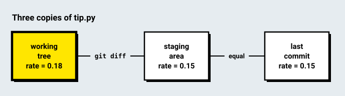
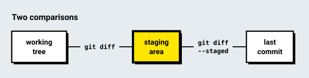
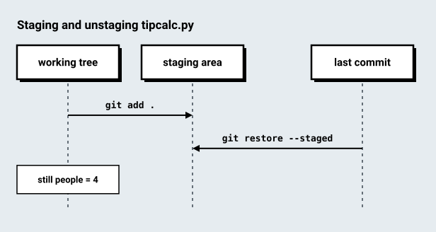

# Chapter 2: Recording changes well

<!-- contents -->
- [2.1 What did I change?](#21-what-did-i-change)
- [2.2 What am I about to commit?](#22-what-am-i-about-to-commit)
- [2.3 Staging part of a file](#23-staging-part-of-a-file)
- [2.4 Removing and renaming files](#24-removing-and-renaming-files)
- [2.5 Telling Git what to ignore](#25-telling-git-what-to-ignore)
- [2.6 Taking a file out of the staging area](#26-taking-a-file-out-of-the-staging-area)
- [2.7 Throwing away an edit](#27-throwing-away-an-edit)
- [2.8 Writing a good commit message](#28-writing-a-good-commit-message)
- [2.9 How big should a commit be?](#29-how-big-should-a-commit-be)
- [2.10 Line endings and whitespace](#210-line-endings-and-whitespace)
- [2.11 Practice: recording changes](#211-practice-recording-changes)
<!-- /contents -->

## 2.1 What did I change?

### The question

In §1.9 you edited `README.md`, and `git status` told you it was *modified*. That's all it told you. It didn't say which lines changed, or how. With one file and one edit you can remember. Come back after lunch to three edited files and you can't, and you're about to commit them (§1.7) without knowing what goes into the history.

You need a project with some history to try this on. This chapter starts a fresh one in its own folder, `tipcalc2`, so that your chapter 1 repository in `~/tipcalc` stays as it is. Type this session; its `cd ~` takes you back to your home folder from `shopping`, where chapter 1 ended.

<!-- code: id=setup -->
```console
$ git --version
git version 2.43.0
$ cd ~
$ mkdir tipcalc2
$ cd tipcalc2
$ git init --quiet --initial-branch=main
$ git config user.name "Sam Rivera"
$ git config user.email "sam@example.com"
$ printf '# Wroks out a tip.\nbill = 47.50\nrate = 0.15\ntip = bill * rate\nprint("Tip:", tip)\n' > tip.py
$ printf '# tipcalc\n\nAdds a tip of 15 percent to a bill.\n' > README.md
$ printf 'To do: split the bill between people.\n' > notes.txt
$ git add tip.py README.md notes.txt
$ git commit -m "Add tip calculator"
[main (root-commit) 64e5696] Add tip calculator
 3 files changed, 9 insertions(+)
 create mode 100644 README.md
 create mode 100644 notes.txt
 create mode 100644 tip.py
```

The first line checks your Git: every session in this chapter ran on the version shown, and output can differ a little in other versions. Here's what the rest is doing.

- `git init --quiet --initial-branch=main` makes the repository (§1.5). `--quiet` stops it printing its usual messages, and `--initial-branch=main` names the line of history `main`, the name `git status` prints on its first line. Chapter 4 explains what that name is for.
- `git config user.name` without `--global` sets your name for this one repository only. The book's commits are made by "Sam Rivera". You can leave out these two lines, and your commits will carry the name you gave in §1.4.
- `printf` prints the text in quotes, turning each `\n` into the end of a line, and `>` sends that text into a file instead of onto the screen, replacing whatever the file held. Three `printf` lines make three files: `tip.py` (a five-line Python program), `README.md` and `notes.txt`. You could type the same lines into an editor instead.
- In the commit's report, `create mode 100644` means Git recorded an ordinary file, not a program you can run by name; §12.4 says more about modes.

The typo in the first line of `tip.py` ("Wroks") is on purpose. You'll fix it in §2.3.

Your commit hash won't match the one printed here. A hash is worked out from the commit's content, its author and its time (§1.8), so yours differs. Everything else matches.

Now change the tip rate from 15 to 18 percent, in the program and in the README. Then ask yourself the lunch-break question: what exactly did you change?

### The picture

Think of every file Git tracks as having three copies laid side by side, one in each of the three areas of §1.11. The copy in your **working tree** is the one you edit. The copy in the **staging area** is the one the next commit will take. The copy in the **last commit** is the one already saved. Right after a commit, all three copies are the same. An edit changes only the first.

That's the picture for this whole chapter. Every command in it either compares two of the three copies or copies one over another.

<!-- fig: id=three-copies
title: Three copies of tip.py
dir: right
box wt: working tree\nrate = 0.18
box st: staging area\nrate = 0.15
box lc: last commit\nrate = 0.15
wt -- st: `git diff`
st -- lc: equal
hot: wt
-->


*Figure 2.1a: After your edit, the working-tree copy differs from the staging-area copy, and `git diff` compares exactly those two.*

The picture has one weak spot. Git doesn't keep three full copies of a file that hasn't changed; it stores each distinct version once and points to it. You'll see how in chapter 12. For everything you do in this chapter, three copies is the right way to think.

### The idea

<!-- teaches: git-diff = git diff -->
**`git diff`** shows, line by line, how each file in your working tree differs from its copy in the staging area.

Since `git add` copies a file into the staging area (§1.7), a file you haven't added since your last commit has the same copy there as in the last commit. So right now, `git diff` answers "what have I changed since my last commit?" §2.2 shows the case where those two answers part ways.

The output is a **diff**: a list of differences, written so that a person and a program can both read it. Each changed file gets a block that starts with a few header lines:

- `diff --git a/tip.py b/tip.py` names the file. The `a/` side is the old copy (the staging area) and the `b/` side is the new one (the working tree).
- `index ef0be52..f34e995 100644` gives short ids for the old and new contents, then the file's mode. You can skip this line for now.
- `--- a/tip.py` and `+++ b/tip.py` say that lines marked `-` come from the old copy and lines marked `+` from the new.

<!-- teaches: diff-hunk = hunk, hunks -->
After the headers come one or more **hunks**. A hunk is one block of a diff: a header line between `@@` marks that says where the block sits in the old and new copies, then the lines that changed, with a few unchanged lines around them for context.

The header `@@ -1,5 +1,5 @@` reads like this: in the old copy, this block starts at line 1 and covers 5 lines; in the new copy, it also starts at line 1 and covers 5 lines. Inside the hunk, a line starting with a space is the same in both copies. A line starting with `-` is only in the old copy, and one starting with `+` is only in the new. Git has no symbol for "changed": a changed line shows up as the old line removed and the new line added.

By default Git shows three unchanged lines on each side of a change; that's Git's choice, not something the file decides. When two changes in a file sit far enough apart, each gets its own hunk. When they're close, as yours will be in §2.3, their context lines overlap and Git joins them into one.

### The code

This session, like every one after it, carries on in `tipcalc2`, where the last one ended. If you open a new terminal, type `cd ~/tipcalc2` first.

<!-- code: id=first-diff -->
```console
$ sed -i 's/0.15/0.18/' tip.py
$ sed -i 's/15 percent/18 percent/' README.md
$ python3 tip.py
Tip: 8.549999999999999
$ git status
On branch main
Changes not staged for commit:
  (use "git add <file>..." to update what will be committed)
  (use "git restore <file>..." to discard changes in working directory)
        modified:   README.md
        modified:   tip.py

no changes added to commit (use "git add" and/or "git commit -a")
$ git diff
diff --git a/README.md b/README.md
index e5e46c4..473723a 100644
--- a/README.md
+++ b/README.md
@@ -1,3 +1,3 @@
 # tipcalc

-Adds a tip of 15 percent to a bill.
+Adds a tip of 18 percent to a bill.
diff --git a/tip.py b/tip.py
index ef0be52..f34e995 100644
--- a/tip.py
+++ b/tip.py
@@ -1,5 +1,5 @@
 # Wroks out a tip.
 bill = 47.50
-rate = 0.15
+rate = 0.18
 tip = bill * rate
 print("Tip:", tip)
```

What to notice:

- `sed -i 's/0.15/0.18/' tip.py` edits a file without opening it. The part in quotes means *substitute*: find `0.15` and put `0.18` in its place, on each line where it occurs. `-i` means change the file itself rather than print the result. You could make the same edit in your editor.
- `python3 tip.py` prints `8.549999999999999`, not `8.55`. That's how Python's numbers work, not a Git matter, and §2.8 fixes it.
- `git status` names both files as modified, as in §1.9. `git diff` shows what that word meant: two blocks, one per file, each with one hunk.
- In `README.md` the hunk's first line is the title and its second is blank; both are context. In `tip.py` the hunk shows the two lines above the change and the two below. The file has only five lines, so that's all the context there is.

When a diff is longer than your terminal window, Git shows it one screen at a time. Press the space bar for the next screen and `q` to get back to the prompt.

### The trace

Each row is one command from the session, and the columns are the copies of the line that changed.

| Step | Command | `rate` line: working tree | `rate` line: staging area | README line 3: working tree | `git diff` would show |
|---|---|---|---|---|---|
| 1 | `git commit` (setup) | `rate = 0.15` | `rate = 0.15` | `...tip of 15 percent...` | nothing |
| 2 | `sed ... tip.py` | `rate = 0.18` | `rate = 0.15` | `...tip of 15 percent...` | one hunk in `tip.py` |
| 3 | `sed ... README.md` | `rate = 0.18` | `rate = 0.15` | `...tip of 18 percent...` | that hunk, and one in `README.md` |

`git diff` is the only command in the table that reads all of this without changing it. At no point did the staging-area column move: `sed` touches only your working tree.

### What goes wrong

**"I made a new file and `git diff` shows nothing, so Git must have lost it."** `git diff` compares working-tree copies with staging-area copies, and an untracked file (§1.6) has no copy in the staging area to compare with. Watch what happens with a new file:

<!-- code: id=diff-untracked -->
```console
$ printf 'Ideas for later\n' > draft.txt
$ git diff
diff --git a/README.md b/README.md
index e5e46c4..473723a 100644
--- a/README.md
+++ b/README.md
@@ -1,3 +1,3 @@
 # tipcalc

-Adds a tip of 15 percent to a bill.
+Adds a tip of 18 percent to a bill.
diff --git a/tip.py b/tip.py
index ef0be52..f34e995 100644
--- a/tip.py
+++ b/tip.py
@@ -1,5 +1,5 @@
 # Wroks out a tip.
 bill = 47.50
-rate = 0.15
+rate = 0.18
 tip = bill * rate
 print("Tip:", tip)
$ git status
On branch main
Changes not staged for commit:
  (use "git add <file>..." to update what will be committed)
  (use "git restore <file>..." to discard changes in working directory)
        modified:   README.md
        modified:   tip.py

Untracked files:
  (use "git add <file>..." to include in what will be committed)
        draft.txt

no changes added to commit (use "git add" and/or "git commit -a")
$ rm draft.txt
```

`git diff` repeats your two edits and says nothing at all about `draft.txt`; only `git status` mentions it. `rm draft.txt` deletes the file, so the project is as you left it. To see a new file's contents in a diff, `git add` it first and use the command in §2.2.

**"The `-` line is the new one."** It's the other way round: `-` is the old copy (the `a/` side) and `+` is the new one. Read the `---` and `+++` header lines if you lose track.

**"The hunk header says line 1, so my change is on line 1."** The numbers say where the *hunk* starts, context included. Your change in `tip.py` is on line 3; the hunk starts two lines earlier.

**"`git diff` printed nothing, so I have nothing to commit."** It can also mean you've already added everything. `git status` settles it, and §2.2 shows how to see what you've staged.

### Remember

- `git diff` compares your working tree with the staging area, file by file and line by line.
- A diff is made of hunks. Each starts with `@@ -old-start,count +new-start,count @@`.
- `-` lines are the old copy, `+` lines the new one, and a space starts an unchanged context line.
- A changed line appears as a removal followed by an addition.
- Untracked files never appear in `git diff`.

**Check yourself**

1. In `@@ -4,6 +4,7 @@`, how many lines does the new copy's part of the hunk have, and why might it be one more than the old?

<details>
<summary>Answer</summary>

Seven. One more line in the new copy means one line more was added than removed inside that hunk, for example a single `+` line with no matching `-` line.

</details>

2. You change `bill = 47.50` to `bill = 60` in `tip.py` and run `git diff`. Write the two lines of the hunk that start with `-` or `+`.

<details>
<summary>Answer</summary>

```text
-bill = 47.50
+bill = 60
```

The old line comes first with `-`, then the new line with `+`.

</details>

3. A friend says: "I created `todo.txt`, ran `git diff`, and saw nothing. Git is broken." What's the real reason, and what would show the file in `git status`?

<details>
<summary>Answer</summary>

`todo.txt` is untracked, so it has no copy in the staging area for `git diff` to compare with. `git status` lists it under "Untracked files".

</details>

4. Explain why `git diff` shows a changed line as two lines rather than one.

<details>
<summary>Answer</summary>

A diff only knows two kinds of line besides context: lines only in the old copy (`-`) and lines only in the new copy (`+`). A changed line is in neither copy unchanged, so it appears as the old line removed and the new line added.

</details>

## 2.2 What am I about to commit?

### The question

At the end of §2.1 you had two edited files, and `git diff` showed both. Now stage one of them with `git add tip.py` (§1.7) and run `git diff` again. The `tip.py` hunk is gone. Your edit hasn't vanished: it's still in the file. It has moved out of the comparison `git diff` makes.

That leaves a real gap. A commit records what's in the staging area, not what's on your screen. So the copy that matters most at the moment you type `git commit` is the one `git diff` doesn't show. How do you read what you're about to commit?

### The picture

The three copies of §2.1 sit side by side, and there are two gaps between neighbours. `git diff` looks across the first gap. This section's command looks across the second.

<!-- fig: id=two-gaps
title: Two comparisons
dir: right
box wt: working tree
box st: staging area
box lc: last commit
wt -- st: `git diff`
st -- lc: `git diff --staged`
hot: st
-->


*Figure 2.2a: `git diff` compares the working tree with the staging area; `git diff --staged` compares the staging area with the last commit.*

### The idea

<!-- teaches: diff-staged = git diff --staged, --staged -->
**`git diff --staged`** shows how each file's copy in the staging area differs from its copy in the last commit, which is exactly what `git commit` would record if you ran it now.

Its output has the same shape as §2.1's: a block per file, hunks inside, `-` for the old copy and `+` for the new. Only the two copies being compared have moved one step to the right. Here, the `a/` side is the last commit and the `b/` side is the staging area.

You'll also meet `git diff --cached`. It's an older name for the same option, and both work in every current version of Git.

The two commands split your work cleanly between them:

- `git diff` answers "what have I changed but not staged?"
- `git diff --staged` answers "what have I staged but not committed?"

Taken together they account for every change since your last commit. A change appears in at most one of them, unless you edit a file again after staging it. Then the same file shows up in both, and "What goes wrong" below is about just that.

The habit worth forming is short. Before every `git commit`, run `git diff --staged` and read it. It's the last moment you can see the commit before it's made. Later sessions in this chapter leave it out where the session has only just shown the same change; in your own work, run it every time.

### The code

<!-- code: id=staged -->
```console
$ git add tip.py
$ git diff
diff --git a/README.md b/README.md
index e5e46c4..473723a 100644
--- a/README.md
+++ b/README.md
@@ -1,3 +1,3 @@
 # tipcalc

-Adds a tip of 15 percent to a bill.
+Adds a tip of 18 percent to a bill.
$ git diff --staged
diff --git a/tip.py b/tip.py
index ef0be52..f34e995 100644
--- a/tip.py
+++ b/tip.py
@@ -1,5 +1,5 @@
 # Wroks out a tip.
 bill = 47.50
-rate = 0.15
+rate = 0.18
 tip = bill * rate
 print("Tip:", tip)
$ git add README.md
$ git diff
$ git commit -m "Raise the default tip to 18 percent"
[main 3b08d4d] Raise the default tip to 18 percent
 2 files changed, 2 insertions(+), 2 deletions(-)
```

What to notice:

- After `git add tip.py`, plain `git diff` shows only `README.md`. The `tip.py` change hasn't gone; it has crossed the first gap.
- `git diff --staged` shows the `tip.py` hunk, and only that. `README.md` is still unstaged, so its staging-area copy equals its last-commit copy and there's nothing to show.
- After `git add README.md`, `git diff` prints nothing at all. Both edits are in the staging area now. This empty output is what §2.1's last mistake warned about: silence from `git diff` doesn't mean nothing will be committed.
- The commit's report says `2 files changed, 2 insertions(+), 2 deletions(-)`. Those are the two changed lines from §2.1, each counted once as a removal and once as an addition.

The commit message says what the change does, in a few words, and starts with a verb. §2.8 explains why that shape works.

### The trace

The columns follow the `rate` line of `tip.py` and the changed line of `README.md`, each in the staging area and the last commit. Working-tree copies don't move in this session; they already hold the new text from §2.1.

| Step | Command | `rate`: staging area | `rate`: last commit | README: staging area | README: last commit |
|---|---|---|---|---|---|
| 0 | (start) | `0.15` | `0.15` | `15 percent` | `15 percent` |
| 1 | `git add tip.py` | `0.18` | `0.15` | `15 percent` | `15 percent` |
| 2 | `git add README.md` | `0.18` | `0.15` | `18 percent` | `15 percent` |
| 3 | `git commit` | `0.18` | `0.18` | `18 percent` | `18 percent` |

After step 1, `git diff --staged` shows the `rate` columns differing. After step 2 it shows both pairs differing. After step 3 all copies agree, so both kinds of diff print nothing.

### What goes wrong

**"I added the file, so my later edits will go in too."** `git add` copies the file into the staging area *as it is at that moment*. Edit it again and the staging area keeps the older copy. Try it with the notes file: add a to-do line, stage it, then add a second line.

<!-- code: id=restage -->
```console
$ printf 'To do: fix the typo in the comment.\n' >> notes.txt
$ git add notes.txt
$ printf 'It says Wroks.\n' >> notes.txt
$ git status
On branch main
Changes to be committed:
  (use "git restore --staged <file>..." to unstage)
        modified:   notes.txt

Changes not staged for commit:
  (use "git add <file>..." to update what will be committed)
  (use "git restore <file>..." to discard changes in working directory)
        modified:   notes.txt
$ git diff --staged
diff --git a/notes.txt b/notes.txt
index 055f68a..5d32432 100644
--- a/notes.txt
+++ b/notes.txt
@@ -1 +1,2 @@
 To do: split the bill between people.
+To do: fix the typo in the comment.
$ git diff
diff --git a/notes.txt b/notes.txt
index 5d32432..adb2e9e 100644
--- a/notes.txt
+++ b/notes.txt
@@ -1,2 +1,3 @@
 To do: split the bill between people.
 To do: fix the typo in the comment.
+It says Wroks.
$ git add notes.txt
$ git commit -m "Note the typo in tip.py"
[main 621af9a] Note the typo in tip.py
 1 file changed, 2 insertions(+)
```

`git status` lists `notes.txt` twice, once as staged and once as not staged. `git diff --staged` shows only the first new line, and `git diff` shows only the second. Committing straight after the second edit would have left `It says Wroks.` behind. Running `git add notes.txt` again put the whole file in the staging area, and the commit took both lines.

Look at the hunk header `@@ -1 +1,2 @@`. When a side of a hunk has exactly one line, Git leaves out the `,1`.

**"`git diff --staged` printed nothing, so my commit failed."** If nothing is staged, there's nothing between the staging area and the last commit to show. That's also what you'll see straight after any commit.

**"I'll check with `git diff` before I commit."** Not after you've staged everything: then `git diff` is empty however much you're about to commit. Use `git diff --staged` for that check.

### Remember

- `git diff --staged` compares the staging area with the last commit: it shows what the next commit will record.
- `git diff --cached` means the same thing.
- `git diff` and `git diff --staged` together show every change since the last commit.
- `git add` stages a file as it is at that moment. Edit it again, and you need to add it again.
- Read `git diff --staged` before each `git commit`.

**Check yourself**

1. You edit `README.md`, run `git add README.md`, then edit it again. Which command shows the first edit, and which shows the second?

<details>
<summary>Answer</summary>

`git diff --staged` shows the first edit (staged, not committed). `git diff` shows the second (in the working tree, not staged).

</details>

2. Right after a `git commit`, with no new edits, what do `git diff` and `git diff --staged` each print?

<details>
<summary>Answer</summary>

Nothing, both of them. All three copies of every tracked file are the same.

</details>

3. Find the fault: "Before committing I ran `git add tip.py` and `git add README.md`, then `git diff` to review my changes. It was empty, so I didn't commit."

<details>
<summary>Answer</summary>

After both files were added, every change was in the staging area, and plain `git diff` only shows changes that are *not* staged. The review should have been `git diff --staged`, which would have shown both edits waiting to be committed.

</details>

4. Write the command you'd type to see the changes that the next commit will contain, using the older spelling of the option.

<details>
<summary>Answer</summary>

```console
$ git diff --cached
```

</details>

## 2.3 Staging part of a file

### The question

Your notes file from §2.2 lists two jobs: split the bill between people, and fix the typo "Wroks" in the first line of `tip.py`. Say you do both in one sitting. They're unrelated, so you'd like two commits, one per job, each with a message that describes it.

With two files, §2.2 showed the way: `git add` one, commit, then the other. Here both changes are in the same file. `git add tip.py` copies the whole file into the staging area, typo fix and new feature together. How do you stage *part* of a file?

### The picture

Back to the three copies. Plain `git add` lays the whole working-tree copy over the staging-area copy. What you want is to carry across only some of the changed lines, so that the staging-area copy ends up as a blend: the last commit plus the hunks you picked.

That blend is a version of `tip.py` that never sat on your disk. Keep that in mind; it matters in "What goes wrong".

### The idea

<!-- teaches: git-add-patch = git add --patch, --patch -->
**`git add --patch`** goes through the unstaged hunks of a file one at a time, shows each one, and asks whether to copy that hunk into the staging area.

You can write it `git add -p` too. For each hunk it prints the hunk, then a prompt such as `(1/2) Stage this hunk [y,n,q,a,d,s,e,?]?`. The `1/2` means "hunk 1 of 2". You answer with one letter and Enter:

- `y` stages this hunk; `n` leaves it unstaged.
- `s` splits this hunk into smaller ones, if it has unchanged lines between its changes.
- `q` stops, leaving this hunk and the rest unstaged.
- `?` prints what every letter means, including the ones for moving between hunks and `e`, which lets you edit a hunk by hand.

The `s` answer matters for small files. In §2.1 you saw that changes close together share one hunk, because their context lines overlap. `s` cuts such a hunk at the unchanged lines between its changes, so you can answer for each part on its own.

<!-- teaches: partial-staging = partial staging -->
**Partial staging** is putting some of a file's changes into the staging area while the rest stay only in the working tree. Afterwards, `git status` lists the same file twice, once as staged and once as not staged, just as `notes.txt` was in §2.2.

`git diff` and `git diff --staged` (§2.2) are how you check the result: one shows what you left behind, the other what you picked.

### The code

First make both changes: fix the typo with `sed` (§2.1), and add three lines that split the bill. `>>` works like `>` from §2.1 but adds to the end of the file instead of replacing it. Then stage with `--patch`:

<!-- code: id=patch stdin="s\nn\ny\n" -->
```console
$ sed -i 's/Wroks/Works/' tip.py
$ printf 'people = 3\nshare = (bill + tip) / people\nprint("Each:", share)\n' >> tip.py
$ git add --patch tip.py
diff --git a/tip.py b/tip.py
index f34e995..5b5faad 100644
--- a/tip.py
+++ b/tip.py
@@ -1,5 +1,8 @@
-# Wroks out a tip.
+# Works out a tip.
 bill = 47.50
 rate = 0.18
 tip = bill * rate
 print("Tip:", tip)
+people = 3
+share = (bill + tip) / people
+print("Each:", share)
(1/1) Stage this hunk [y,n,q,a,d,s,e,?]? s
Split into 2 hunks.
@@ -1,5 +1,5 @@
-# Wroks out a tip.
+# Works out a tip.
 bill = 47.50
 rate = 0.18
 tip = bill * rate
 print("Tip:", tip)
(1/2) Stage this hunk [y,n,q,a,d,j,J,g,/,e,?]? n
@@ -2,4 +2,7 @@
 bill = 47.50
 rate = 0.18
 tip = bill * rate
 print("Tip:", tip)
+people = 3
+share = (bill + tip) / people
+print("Each:", share)
(2/2) Stage this hunk [y,n,q,a,d,K,g,/,e,?]? y
```

You type a letter after each prompt that ends in `?`, and press Enter; the letter stays on the screen after the prompt. Here the answers were `s`, then `n`, then `y`.

- The first prompt shows one hunk holding both changes. The file is short, so the typo on line 1 and the new lines 6 to 8 share their context.
- `s` prints `Split into 2 hunks.` and shows the first: the typo fix alone. `n` leaves it unstaged.
- The second hunk is the bill split. `y` stages it. The prompts then end, because there are no more hunks.

Now check what you picked, and commit each job separately:

<!-- code: id=patch2 -->
```console
$ git diff --staged
diff --git a/tip.py b/tip.py
index f34e995..b81877e 100644
--- a/tip.py
+++ b/tip.py
@@ -3,3 +3,6 @@ bill = 47.50
 rate = 0.18
 tip = bill * rate
 print("Tip:", tip)
+people = 3
+share = (bill + tip) / people
+print("Each:", share)
$ git diff
diff --git a/tip.py b/tip.py
index b81877e..5b5faad 100644
--- a/tip.py
+++ b/tip.py
@@ -1,4 +1,4 @@
-# Wroks out a tip.
+# Works out a tip.
 bill = 47.50
 rate = 0.18
 tip = bill * rate
$ git commit -m "Split the bill between people"
[main cae5a0d] Split the bill between people
 1 file changed, 3 insertions(+)
$ git add tip.py
$ git commit -m "Fix a typo in a comment"
[main e82188b] Fix a typo in a comment
 1 file changed, 1 insertion(+), 1 deletion(-)
```

- `git diff --staged` shows only the three new lines. The header `@@ -3,3 +3,6 @@ bill = 47.50` has text after the second `@@`: Git adds a nearby line from above the hunk to help you see where you are. In larger programs it's usually the first line of the function the hunk is in.
- `git diff` shows only the typo fix: that's what `n` left behind.
- The first commit takes the split. Then a plain `git add tip.py` stages the rest, the typo fix, and the second commit takes that.

### The trace

The columns are the first line of `tip.py` and its lines 6 to 8, in the staging area and the last commit. Both are already in their new form in the working tree before `git add --patch` starts.

| Step | Command | Line 1: staging area | Line 1: last commit | Lines 6 to 8: staging area | Lines 6 to 8: last commit |
|---|---|---|---|---|---|
| 0 | (edits made) | `# Wroks out a tip.` | `# Wroks out a tip.` | absent | absent |
| 1 | `git add --patch` (`s`, `n`, `y`) | `# Wroks out a tip.` | `# Wroks out a tip.` | the split | absent |
| 2 | `git commit -m "Split the bill..."` | `# Wroks out a tip.` | `# Wroks out a tip.` | the split | the split |
| 3 | `git add tip.py` | `# Works out a tip.` | `# Wroks out a tip.` | the split | the split |
| 4 | `git commit -m "Fix a typo..."` | `# Works out a tip.` | `# Works out a tip.` | the split | the split |

After step 1, the staging-area copy is the blend from "The picture": old first line, new last lines. No file on your disk ever held exactly that.

### What goes wrong

**"I tested my program, so the commit I made with `--patch` works."** You tested the working-tree copy. The commit holds the blend, which you never ran. Here the difference is a comment, so it's harmless. If the hunk you left behind had defined a variable that a staged hunk used, the commit would hold a program that fails. After a partial stage, ask whether the staged hunks make sense on their own; the hunk lists from `git diff --staged` and `git diff` are what you judge that by.

**"`s` won't split my hunk."** When a hunk has no unchanged line between its changes, `s` is missing from the list of letters in the prompt, and typing it anyway prints `Sorry, cannot split this hunk`. Lines added (or changed) in one unbroken run can't be split with `s`. For those, `e` lets you edit the hunk by hand, and `?` explains how.

**"I answered `q` too early, and now half my changes aren't staged."** That's all `q` does: nothing staged so far is lost, and nothing unstaged is lost either. Run `git add --patch` again and it offers the hunks that are still unstaged.

**"I committed after `git add --patch` and forgot the rest."** The commit is fine, but the leftover changes are still sitting unstaged. Run `git status` after each commit when you've staged in parts.

### Remember

- `git add --patch` (or `-p`) offers a file's unstaged hunks one at a time: `y` to stage, `n` to skip, `s` to split, `q` to quit.
- Partial staging leaves a file both staged and not staged.
- Check the result with `git diff --staged` (what you picked) and `git diff` (what you left).
- The staged blend never existed on disk, so judge whether it stands on its own before you commit it.

**Check yourself**

1. A file's only hunk adds three lines next to each other, and you want to stage just the first. Will `s` help? What will?

<details>
<summary>Answer</summary>

No: the three lines have no unchanged line between them, so `s` can't split the hunk. Use `e` to edit the hunk, keeping only the line you want; `?` at the prompt describes how.

</details>

2. After `git add --patch tip.py` you answer `y` to every hunk. What do `git diff` and `git diff --staged` each show for `tip.py`?

<details>
<summary>Answer</summary>

`git diff` shows nothing for `tip.py`: every change is staged. `git diff --staged` shows all of them. The result is the same as `git add tip.py`.

</details>

3. Find the fault. A learner edits `tip.py` to add `people = 3` near the top and `share = (bill + tip) / people` near the bottom, stages only the second hunk with `git add --patch`, and commits. What's wrong with that commit?

<details>
<summary>Answer</summary>

The committed `tip.py` uses `people` but never sets it, because the hunk defining it was left unstaged. Running that version would stop with an error about `people` not being defined. The two hunks belong in the same commit.

</details>

4. Write the command that stages parts of `README.md` interactively, using the short form of the option.

<details>
<summary>Answer</summary>

```console
$ git add -p README.md
```

</details>

## 2.4 Removing and renaming files

### The question

Both jobs in `notes.txt` are done (§2.3), so the file has nothing left to say. And `tip.py` is a poor name for a program that now splits bills too; `tipcalc.py` matches the project.

Deleting and renaming are things you already do with files. But Git tracks three copies of each one (§2.1), and deleting the file from your folder touches only the first. What must you tell Git so the next commit records that a file is gone, or now has another name?

### The picture

In the three-copies picture, removing a file means taking it off the desk *and* out of the box being packed for the next commit. The last commit still has it, and always will: a commit, once made, doesn't change. After the next commit, the file is simply absent from the newest one.

Renaming is the same with a twist: the copy leaves the desk and the box under its old name and comes back under the new one, with the same contents.

### The idea

<!-- teaches: git-rm = git rm -->
**`git rm`** deletes a file from your working tree and from the staging area, so that the next commit records it as removed.

Every earlier commit keeps the file. You can still see it in your history, and chapter 3 shows you how to look at old versions.

<!-- teaches: git-mv = git mv -->
**`git mv old new`** renames a file in your working tree and in the staging area in one step; it does what `mv old new` followed by `git add old new` would do.

Here `mv` is the ordinary shell command that renames (moves) a file. `git add` given the old name stages the fact that the old file is gone, and given the new name stages the new file.

Notice what that says. Git doesn't record "renamed" anywhere. The staging area simply ends up without `tip.py` and with a `tipcalc.py` holding the same lines. Yet `git status` will say `renamed:`. That's the third idea.

<!-- teaches: rename-detection = rename detection -->
**Rename detection** is Git working out, whenever it compares two versions, that a file missing under one name and new under another is the same file renamed, because their contents are similar enough.

"Similar enough" by default means at least half the content is the same; that threshold is Git's default, and options can change it. The diff reports the score as a `similarity index`. A pure rename scores `100%`. If you rename a file and also change some of its lines, the score drops, and below the threshold Git reports a deletion and a new file instead.

Because detection happens at comparison time, it works however the rename was done: with `git mv`, or with `mv` and `git add` afterwards, or in a file manager.

### The code

<!-- code: id=rm-mv -->
```console
$ git rm notes.txt
rm 'notes.txt'
$ ls
README.md  tip.py
$ git status
On branch main
Changes to be committed:
  (use "git restore --staged <file>..." to unstage)
        deleted:    notes.txt
$ git commit -m "Remove the finished to-do note"
[main 8d657f6] Remove the finished to-do note
 1 file changed, 3 deletions(-)
 delete mode 100644 notes.txt
$ git mv tip.py tipcalc.py
$ git status
On branch main
Changes to be committed:
  (use "git restore --staged <file>..." to unstage)
        renamed:    tip.py -> tipcalc.py
$ git diff --staged
diff --git a/tip.py b/tipcalc.py
similarity index 100%
rename from tip.py
rename to tipcalc.py
$ git commit -m "Rename tip.py to tipcalc.py"
[main ff4e3e5] Rename tip.py to tipcalc.py
 1 file changed, 0 insertions(+), 0 deletions(-)
 rename tip.py => tipcalc.py (100%)
```

What to notice:

- `git rm notes.txt` prints `rm 'notes.txt'`, and `ls`, which lists the folder, confirms the file is gone from your disk.
- `git status` puts `deleted: notes.txt` under "Changes to be committed": the removal is already staged. There's no separate `git add` to do.
- The commit report says `delete mode 100644 notes.txt`, the mirror of the `create mode` line you saw in §2.1.
- After `git mv`, `git status` shows `renamed: tip.py -> tipcalc.py`, again already staged.
- `git diff --staged` has no hunks at all. It prints `similarity index 100%` and the two names: the contents didn't change, only the name.
- The commit report sums it up: `rename tip.py => tipcalc.py (100%)`, with `0 insertions(+), 0 deletions(-)`.

From here on, the program is `tipcalc.py`.

### The trace

| Step | Command | `notes.txt`: working tree, staging area, last commit | Program's name: working tree, staging area, last commit |
|---|---|---|---|
| 0 | (start) | present, present, present | `tip.py`, `tip.py`, `tip.py` |
| 1 | `git rm notes.txt` | gone, gone, present | `tip.py`, `tip.py`, `tip.py` |
| 2 | `git commit` | gone, gone, gone | `tip.py`, `tip.py`, `tip.py` |
| 3 | `git mv tip.py tipcalc.py` | gone, gone, gone | `tipcalc.py`, `tipcalc.py`, `tip.py` |
| 4 | `git commit` | gone, gone, gone | `tipcalc.py`, `tipcalc.py`, `tipcalc.py` |

"Gone" in the last-commit column means gone from the *newest* commit. The commits before it still hold `notes.txt` and `tip.py`.

### What goes wrong

**"I renamed the file with `mv`, and now Git thinks I deleted it."** Plain `mv` changes only the working tree, so the staging area still has the old name. Watch it happen with `README.md`, then repair it, then put the name back:

<!-- code: id=plain-mv -->
```console
$ mv README.md readme.md
$ git status
On branch main
Changes not staged for commit:
  (use "git add/rm <file>..." to update what will be committed)
  (use "git restore <file>..." to discard changes in working directory)
        deleted:    README.md

Untracked files:
  (use "git add <file>..." to include in what will be committed)
        readme.md

no changes added to commit (use "git add" and/or "git commit -a")
$ git add README.md readme.md
$ git status
On branch main
Changes to be committed:
  (use "git restore --staged <file>..." to unstage)
        renamed:    README.md -> readme.md
$ git mv readme.md README.md
$ git status
On branch main
nothing to commit, working tree clean
```

After `mv`, `git status` shows two unconnected facts: `README.md` deleted (not staged) and `readme.md` untracked. `git add README.md readme.md` stages both, and now `git status` sees the pair and reports `renamed: README.md -> readme.md`. That's rename detection at work: the commands differ from `git mv`, the staging area ends up the same. Finally `git mv readme.md README.md` puts the old name back, which leaves nothing to commit.

**"I deleted the file with `rm`, so it's gone from Git."** Only from the working tree. `git status` will list it as `deleted:` under "Changes not staged for commit". Stage the removal with `git rm` on the name (or `git add` on it), then commit.

**"`git rm` refused to delete my file."** It can refuse when the file has changes that aren't committed, so that those changes aren't lost by accident. Its message names the file and mentions `-f`, which forces the removal and throws the changes away. Commit the changes first, or be sure you don't want them.

**"After `git rm`, the file is erased from the project's history."** No commit changes once it's made. `git rm` makes the *next* commit lack the file; every earlier commit still has it. That also means a password committed by mistake isn't removed by `git rm`; chapter 10 deals with that.

### Remember

- `git rm file` deletes the file and stages the deletion.
- `git mv old new` renames the file and stages the rename.
- Git stores no renames. It detects them when it compares versions, by how similar the contents are.
- A rename done with `mv` becomes a staged rename once you `git add` both names.
- Removing or renaming affects the next commit only; earlier commits keep the file as it was.

**Check yourself**

1. You run `rm notes.txt` (not `git rm`). Under which heading of `git status` does `notes.txt` appear, and what single command stages the removal?

<details>
<summary>Answer</summary>

Under "Changes not staged for commit", as `deleted: notes.txt`. Either `git rm notes.txt` or `git add notes.txt` stages the removal.

</details>

2. You `git mv` a 10-line file and also rewrite 8 of its lines before staging the edit. Will `git status` say `renamed:`? Explain.

<details>
<summary>Answer</summary>

Probably not. Only 2 of 10 lines are the same, well under the default threshold of half, so Git reports the old file deleted and the new one as a new file.

</details>

3. Write the commands to rename `README.md` to `README.txt` and commit it with a message in the style of this chapter.

<details>
<summary>Answer</summary>

```console
$ git mv README.md README.txt
$ git commit -m "Rename README.md to README.txt"
```

</details>

4. Explain why Git can show a rename it never stored.

<details>
<summary>Answer</summary>

When Git compares two versions, it notices a file that disappeared under one name and a file that appeared under another. If their contents are similar enough, it reports the pair as a rename. The rename is a conclusion drawn at comparison time, not a record.

</details>

## 2.5 Telling Git what to ignore

### The question

You run your program and save its output in a file, `run.log`, to compare with later. You copy `tipcalc.py` into a `scratch` folder to try ideas on. Neither belongs in the project's history: the log changes every time you run the program, and the scratch folder is yours alone.

Now `git status` (§1.6) lists them as untracked every single time, and the real news, a file you forgot to add, gets lost among them. Worse, a careless `git add` of everything would commit them. How do you tell Git, once, to stop looking at certain files?

### The picture

So far, every file in your working tree was either tracked (it has three copies) or untracked (only the working-tree copy, which `git status` reports). Ignored files are a third kind: they have only a working-tree copy, like untracked files, but Git looks straight past them, as if they weren't on the desk at all.

### The idea

<!-- teaches: gitignore = .gitignore -->
A **`.gitignore`** file is a text file of patterns: untracked files whose names match one of them are left out of `git status` and refused by `git add`.

You put it in the top folder of the project and commit it like any other file, so everyone who works on the project ignores the same things. The name starts with a dot, and plain `ls` hides names that start with a dot; `ls -a` shows them.

<!-- teaches: ignore-pattern = ignore pattern, ignore patterns -->
An **ignore pattern** is one line of a `.gitignore` file: a name, perhaps with wildcards, that matches the files or folders to ignore.

The rules you need first:

- A plain name, like `run.log`, matches a file or folder of that name in any folder of the project.
- `*` matches any run of characters within one name. `*.log` matches `run.log`, `test.log` and `.log`, but `*` never matches across a `/`.
- A pattern ending in `/` matches folders only. `scratch/` ignores the folder and everything inside it.
- A pattern starting with `/` matches only in the folder the `.gitignore` is in. `/run.log` ignores `run.log` at the top, but not `docs/run.log`.
- Blank lines are skipped, and a line starting with `#` is a comment.

Python projects nearly always ignore `__pycache__/`: when one Python file imports another, Python saves a compiled copy of the imported file in a folder of that name, and it has no place in history.

Ignoring only affects *untracked* files. A file that's already tracked stays tracked even if a pattern matches it; "What goes wrong" shows what to do about that.

When you can't tell why a file is ignored, `git check-ignore -v` followed by the name tells you. `-v` (verbose) makes it print which line of which file matched.

### The code

`python3 tipcalc.py > run.log` uses `>` from §2.1 to send the program's output into `run.log` instead of to the screen. `mkdir` makes a folder and `cp` copies a file.

<!-- code: id=ignore exit=1 -->
```console
$ python3 tipcalc.py > run.log
$ mkdir scratch
$ cp tipcalc.py scratch/try.py
$ git status
On branch main
Untracked files:
  (use "git add <file>..." to include in what will be committed)
        run.log
        scratch/

nothing added to commit but untracked files present (use "git add" to track)
$ printf '*.log\nscratch/\n' > .gitignore
$ git status
On branch main
Untracked files:
  (use "git add <file>..." to include in what will be committed)
        .gitignore

nothing added to commit but untracked files present (use "git add" to track)
$ git add .gitignore
$ git commit -m "Ignore log files and the scratch folder"
[main bb1696f] Ignore log files and the scratch folder
 1 file changed, 2 insertions(+)
 create mode 100644 .gitignore
$ git check-ignore -v run.log
.gitignore:1:*.log      run.log
$ git add run.log
The following paths are ignored by one of your .gitignore files:
run.log
hint: Use -f if you really want to add them.
hint: Turn this message off by running
hint: "git config advice.addIgnoredFile false"
```

What to notice:

- The first `git status` lists `run.log` and `scratch/` as untracked. For a folder with only untracked files, it names the folder rather than every file inside.
- The `printf` writes a two-line `.gitignore`: `*.log` and `scratch/`.
- The second `git status` lists only `.gitignore` itself. The other two are still on your disk; Git just stopped mentioning them.
- `git check-ignore -v run.log` prints `.gitignore:1:*.log` and the file name: the match came from line 1 of `.gitignore`, the pattern `*.log`.
- `git add run.log` refuses and stops with a non-zero exit code. (Every command ends by handing the shell a number, its exit code, which the screen doesn't show: 0 means it succeeded, anything else that it failed.) The hints mention `-f`, which forces Git to add an ignored file. You rarely want that.

`run.log` and the `scratch` folder stay in your project folder for the rest of the chapter, ignored.

### The trace

| Step | Command | `run.log` | `scratch/` | `.gitignore` |
|---|---|---|---|---|
| 1 | `python3 tipcalc.py > run.log` | untracked | (none) | (none) |
| 2 | `mkdir scratch`, `cp ...` | untracked | untracked | (none) |
| 3 | `printf ... > .gitignore` | ignored | ignored | untracked |
| 4 | `git add .gitignore` | ignored | ignored | staged |
| 5 | `git commit` | ignored | ignored | committed |

Step 3 changes two other files' columns without touching those files. Ignoring is about how Git *looks* at the working tree; the files themselves don't change.

### What goes wrong

**"I added `tipcalc.py` to `.gitignore`, but Git still shows my edits to it."** The file is tracked, and patterns don't apply to tracked files. To stop tracking a file but keep it on your disk, run `git rm --cached` on it: `--cached` makes `git rm` (§2.4) remove the file from the staging area only. Commit that, and the pattern takes over from then on. Earlier commits still contain the file.

**"I ignored `*.log` and lost my log files."** Nothing was deleted. Ignored files stay on your disk exactly as they were; `ls` will show them.

**"My pattern `scratch` should only match the folder."** Without the trailing `/` it matches a file named `scratch` too. Write `scratch/` when you mean a folder.

**"I put `.gitignore` in my home folder and it does nothing."** A `.gitignore` works for the folder it's in and the folders below it, inside a repository. Put it in the project's top folder and commit it.

### Remember

- `.gitignore` holds one pattern per line; matching untracked files vanish from `git status` and are refused by `git add`.
- `*` matches within a name, a trailing `/` means folders only, a leading `/` means this folder only, and `#` starts a comment.
- Commit `.gitignore`, so everyone ignores the same files.
- Patterns never affect tracked files; `git rm --cached` stops tracking a file without deleting it.
- `git check-ignore -v name` tells you which pattern matched.

**Check yourself**

1. Which of these does the pattern `*.log` ignore: `run.log`, `logs/today.log`, `log.txt`?

<details>
<summary>Answer</summary>

`run.log` and `logs/today.log`. A pattern with no `/` in it matches names in any folder, and `today.log` ends in `.log`. `log.txt` doesn't end in `.log`, so it isn't ignored.

</details>

2. Write a `.gitignore` line that ignores a folder named `build` at the top of the project only, but not a folder `docs/build`.

<details>
<summary>Answer</summary>

```text
/build/
```

The leading `/` ties it to the project's top folder, and the trailing `/` limits it to folders.

</details>

3. Find the fault. "I committed `secrets.txt` yesterday. Today I added `secrets.txt` to `.gitignore` and committed that, so it's safe now."

<details>
<summary>Answer</summary>

The file is tracked, so the pattern has no effect: changes to it still show up and can be committed. It needs `git rm --cached secrets.txt` and a commit. Even then, yesterday's commit still holds the file; chapter 10 covers what to do about a secret that was committed.

</details>

4. You run `git add notes.log` in this project. What does Git do, and why?

<details>
<summary>Answer</summary>

It refuses with `The following paths are ignored by one of your .gitignore files:` and the name, because `notes.log` matches `*.log`. The hint mentions `-f` to add it anyway.

</details>

## 2.6 Taking a file out of the staging area

### The question

You add a line to `README.md` saying how to run the program. While you're at it, you change `people = 3` to `people = 4` in `tipcalc.py`, just to see what the program prints for four people. That second edit is an experiment, not something to keep.

Then, in a hurry, you stage everything with one command, and `git status` shows both files under "Changes to be committed". You want the README line in the next commit and the experiment out of it, without losing the experiment from your file just yet. `git add` (§1.7) only moves changes *into* the staging area. What moves one back out?

### The picture

In the three-copies picture, `git add` copies a file from the working tree across to the staging area, left to right. Unstaging is the reverse journey one step further along: the last commit's copy is laid back over the staging-area copy, right to left, and the working tree isn't touched.

<!-- fig: id=unstage-arrow
title: Staging and unstaging tipcalc.py
kind: sequence
actor wt: working tree
actor st: staging area
actor lc: last commit
wt -> st: `git add .`
lc -> st: `git restore --staged`
note over wt: still people = 4
-->


*Figure 2.6a: Read from top to bottom. `git add .` fills the staging-area copy of `tipcalc.py` from the working tree; `git restore --staged` then fills it from the last commit, and the working tree keeps the experiment.*

### The idea

<!-- teaches: restore-staged = git restore --staged -->
**`git restore --staged`** followed by a file name copies the file's version in the last commit over its copy in the staging area, which undoes a `git add` of that file and leaves your working tree as it was.

After it, the change you'd staged is back where it was before the `git add`: in your working tree only, shown by `git diff` (§2.1) and not by `git diff --staged` (§2.2).

You've been told about this command already. Since your first commit in §1.7, every `git status` you've run with something staged has printed the hint `(use "git restore --staged <file>..." to unstage)`. Git's hints are often the exact command you need.

It's a safe command. It changes only the staging area, and the staging-area copy it replaces was made from your working tree, which still has everything. The worst it can do is make you run `git add` again.

You'll see two other ways of doing this in older guides and answers online. `git reset` followed by the file name has the same effect here, and §10.2 explains the rest of what `git reset` does. `git rm --cached` from §2.5 is *not* the same: it stages the file's removal, so the next commit would lack it.

### The code

`git add .` stages every change in the current folder and the folders inside it; `.` is the shell's name for the current folder. Ignored files (§2.5) are skipped, which is one reason to keep `.gitignore` up to date before you use it.

<!-- code: id=unstage -->
```console
$ printf '\nRun it with: python3 tipcalc.py\n' >> README.md
$ sed -i 's/people = 3/people = 4/' tipcalc.py
$ git add .
$ git status
On branch main
Changes to be committed:
  (use "git restore --staged <file>..." to unstage)
        modified:   README.md
        modified:   tipcalc.py
$ git restore --staged tipcalc.py
$ git status
On branch main
Changes to be committed:
  (use "git restore --staged <file>..." to unstage)
        modified:   README.md

Changes not staged for commit:
  (use "git add <file>..." to update what will be committed)
  (use "git restore <file>..." to discard changes in working directory)
        modified:   tipcalc.py
$ git diff
diff --git a/tipcalc.py b/tipcalc.py
index 5b5faad..083187a 100644
--- a/tipcalc.py
+++ b/tipcalc.py
@@ -3,6 +3,6 @@ bill = 47.50
 rate = 0.18
 tip = bill * rate
 print("Tip:", tip)
-people = 3
+people = 4
 share = (bill + tip) / people
 print("Each:", share)
$ git commit -m "Say how to run the program"
[main fd052cf] Say how to run the program
 1 file changed, 2 insertions(+)
```

What to notice:

- The `printf` starts with `\n`, so it adds a blank line and then the instruction to the end of `README.md`. The `sed` makes the experiment.
- After `git add .`, `git status` lists both files under "Changes to be committed". `run.log` and `scratch/` were not staged, because they're ignored.
- `git restore --staged tipcalc.py` prints nothing. The next `git status` has `README.md` still staged, and `tipcalc.py` moved down to "Changes not staged for commit".
- `git diff` proves the experiment is still in your file: `-people = 3`, `+people = 4`.
- The commit report says `1 file changed`: only `README.md` went in.

The experiment is still sitting in `tipcalc.py`. §2.7 deals with it.

### The trace

| Step | Command | `people`: working tree | `people`: staging area | `people`: last commit | README line: staging area |
|---|---|---|---|---|---|
| 1 | `printf ... >> README.md`, `sed ...` | `4` | `3` | `3` | absent |
| 2 | `git add .` | `4` | `4` | `3` | present |
| 3 | `git restore --staged tipcalc.py` | `4` | `3` | `3` | present |
| 4 | `git commit -m "Say how..."` | `4` | `3` | `3` | present, and now committed |

Step 3 moved one value, in one column, back to what the last commit holds. Nothing else changed: that's how narrow `git restore --staged` is.

### What goes wrong

**"I unstaged `tipcalc.py`, so my experiment is gone."** It isn't: `git restore --staged` never touches the working tree, as `git diff` showed. Throwing an edit away is a different command, and §2.7 shows why it deserves more care.

**"I ran `git restore --staged` on a new file and now it's untracked."** That's what it does. A new file has no copy in the last commit, so there's nothing to lay over the staging area, and the file leaves it altogether. It's back to how it was before you added it, still on your disk.

**"I typed `git restore --staged` with no file name."** Git stops with `fatal: you must specify path(s) to restore`. Name the files, or use `.` for all of them: `git restore --staged .` unstages everything in the current folder.

**"I used `git add .` and it staged a log file."** It would, without `.gitignore`. `git add .` takes everything that isn't ignored, which is why it's worth reading `git status` straight after, and unstaging anything that slipped in.

### Remember

- `git restore --staged file` copies the last commit's version of the file into the staging area, undoing a `git add`.
- It leaves the working tree alone, so no edit is lost.
- `git status` prints this command as a hint whenever something is staged.
- `git add .` stages every change in the current folder except ignored files.
- Run `git status` after `git add .`, and unstage anything that doesn't belong in the commit.

**Check yourself**

1. You've staged `a.py` and `b.py`. Write the command that leaves only `a.py` staged.

<details>
<summary>Answer</summary>

```console
$ git restore --staged b.py
```

</details>

2. After step 3 of the trace, what do `git diff` and `git diff --staged` each show?

<details>
<summary>Answer</summary>

`git diff` shows the `people` change in `tipcalc.py` (working tree against staging area). `git diff --staged` shows the new lines in `README.md` (staging area against last commit).

</details>

3. Find the fault: "To keep `tipcalc.py` out of my commit, I ran `git rm --cached tipcalc.py`."

<details>
<summary>Answer</summary>

`git rm --cached` stages the file's *removal*. The next commit would no longer contain `tipcalc.py` at all, and the file would show as untracked. The right command is `git restore --staged tipcalc.py`, which only undoes the staging.

</details>

4. Explain why `git restore --staged` can never lose work you've typed.

<details>
<summary>Answer</summary>

It only writes into the staging area, and the copy it overwrites there came from your working tree, which it doesn't touch. Anything you typed is still in the working-tree file.

</details>

## 2.7 Throwing away an edit

### The question

At the end of §2.6 the experiment was still in `tipcalc.py`: `people = 4`, unstaged. You've seen what it prints; now you want the file back as it was. With one line, you could edit it back by hand. With twenty changed lines across a file, you'd be guessing, and one slip would leave a change you didn't mean.

Git has the version you want: the staging area holds `people = 3`. How do you get that copy back onto your desk?

### The picture

Each command so far has copied leftward or rightward between neighbours: `git add` from the working tree to the staging area, `git commit` from the staging area to a new commit, `git restore --staged` from the last commit back to the staging area. This section adds the last arrow, from the staging area back to the working tree.

<!-- fig: id=copy-map
title: Every copying command so far
kind: sequence
actor wt: working tree
actor st: staging area
actor lc: last commit
wt -> st: `git add`
st -> lc: `git commit`
lc -> st: `git restore --staged`
st -> wt: `git restore`
-->


*Figure 2.7a: The four ways a copy of a file moves between the areas, in the order this book met them.*

Here the desk picture has a hard edge. Laying a copy over the desk copy destroys what was on the desk. If that version was never added or committed, Git never had it, and there's nothing to get it back from.

### The idea

<!-- teaches: restore-worktree = git restore -->
**`git restore`** followed by a file name copies the file's staging-area copy over its working-tree copy, throwing away every change to it that you haven't staged.

That's the other hint `git status` has been printing since §1.9: `(use "git restore <file>..." to discard changes in working directory)`. "Discard" is the right word.

Two things follow from the definition, and both are easy to get wrong.

First, it restores from the **staging area**, not from the last commit. If you've staged a change, `git restore` keeps the staged version. Usually nothing is staged, so the two are the same, but not always; "What goes wrong" runs the case where they differ.

Second, it can't be undone. Changes you've staged or committed are kept by Git and can be found again. A change that only ever existed in your working tree is gone once `git restore` overwrites it. Before running it, look at `git diff` (§2.1): that's the exact list of what you're about to lose.

You'll see `git checkout -- tipcalc.py` in older guides. For a file name, it does the same as `git restore tipcalc.py`. `git restore` was added to Git in version 2.23 precisely so that this job had a command of its own; `git checkout` does several other jobs as well, which makes it easy to run the wrong one.

### The code

<!-- code: id=discard -->
```console
$ git diff
diff --git a/tipcalc.py b/tipcalc.py
index 5b5faad..083187a 100644
--- a/tipcalc.py
+++ b/tipcalc.py
@@ -3,6 +3,6 @@ bill = 47.50
 rate = 0.18
 tip = bill * rate
 print("Tip:", tip)
-people = 3
+people = 4
 share = (bill + tip) / people
 print("Each:", share)
$ git restore tipcalc.py
$ git diff
$ python3 tipcalc.py
Tip: 8.549999999999999
Each: 18.683333333333334
$ git status
On branch main
nothing to commit, working tree clean
```

What to notice:

- The first `git diff` is the list of what will be thrown away: one changed line, `people = 3` becoming `people = 4`. Reading it first is the habit.
- `git restore tipcalc.py` prints nothing, and asks no question. There's no "are you sure?".
- The second `git diff` prints nothing: the working-tree copy matches the staging area again.
- `python3 tipcalc.py` runs the restored file and splits the bill three ways again. It still prints the long `8.549999999999999`; §2.8 deals with that.
- `git status` says `nothing to commit, working tree clean`, apart from what's ignored (§2.5), which it doesn't mention.

### The trace

| Step | Command | `people`: working tree | `people`: staging area | `git diff` shows |
|---|---|---|---|---|
| 0 | (from §2.6) | `4` | `3` | the `people` hunk |
| 1 | `git restore tipcalc.py` | `3` | `3` | nothing |
| 2 | `python3 tipcalc.py` | `3` | `3` | nothing; the output divides by 3 |

Step 1 is the only one that changes a copy. The value `4` exists nowhere now, not even inside Git.

### What goes wrong

**"`git restore` will take my file back to the last commit."** Only if nothing is staged. Here's the case where it isn't: change the rate to 0.20 and stage that, then change it again to 0.25, then restore. `grep rate tipcalc.py` prints the lines of the file that contain `rate`.

<!-- code: id=restore-from-stage -->
```console
$ sed -i 's/rate = 0.18/rate = 0.20/' tipcalc.py
$ git add tipcalc.py
$ sed -i 's/rate = 0.20/rate = 0.25/' tipcalc.py
$ git restore tipcalc.py
$ grep rate tipcalc.py
rate = 0.20
tip = bill * rate
$ git restore --staged tipcalc.py
$ git restore tipcalc.py
$ grep rate tipcalc.py
rate = 0.18
tip = bill * rate
```

The first `git restore` brought back `rate = 0.20`, the staged version, not the committed `0.18`. To get all the way back to the last commit, the session first unstaged (§2.6), which put `0.18` in the staging area, then restored again. Read the order of those two commands as following Figure 2.7a: last commit to staging area, staging area to working tree.

**"I restored the wrong file. Where's the undo?"** There isn't one in Git for this. If your editor still has the file open, its own undo may have the old text; otherwise it's gone. That's why you read `git diff` first.

**"I ran `git restore .` to tidy up and lost an afternoon's work."** `.` means every file in the current folder (§2.6), so every unstaged change in all of them was thrown away. Name single files unless you're certain about all of them.

**"`git restore` deleted my new file."** It didn't: a file that has never been added has no staging-area copy, so `git restore` refuses with an error that the path doesn't match any file Git knows. Untracked files are left alone.

### Remember

- `git restore file` copies the staging-area copy over the working-tree copy, throwing away unstaged changes.
- It restores from the staging area, which is the last commit only when nothing is staged.
- Unstaged changes it overwrites can't be recovered by Git.
- Read `git diff` before `git restore`: it lists exactly what will be lost.
- To go back to the last commit for a staged file: `git restore --staged`, then `git restore`.

**Check yourself**

1. You change `bill = 47.50` to `bill = 60`, stage it, change it to `bill = 75`, and run `git restore tipcalc.py`. What does the `bill` line say now?

<details>
<summary>Answer</summary>

`bill = 60`, the staged version. `git restore` copies from the staging area, not from the last commit.

</details>

2. Write the two commands that put `README.md` back exactly as it is in the last commit, when it has both staged and unstaged changes.

<details>
<summary>Answer</summary>

```console
$ git restore --staged README.md
$ git restore README.md
```

The first puts the committed copy into the staging area; the second copies that onto the working tree.

</details>

3. Find the fault: "Before restoring I always run `git diff --staged` to see what I'm about to lose."

<details>
<summary>Answer</summary>

`git restore` throws away the changes between the working tree and the staging area, and those are shown by plain `git diff`, not `git diff --staged`. The staged changes it doesn't touch.

</details>

4. Explain why Git can bring back a version you once staged but not one you only ever saved in your editor.

<details>
<summary>Answer</summary>

Staging copies the file into Git's own storage, so that version exists inside Git. A version that was only in your working tree was never copied anywhere Git keeps; once `git restore` overwrites it, no copy exists.

</details>

## 2.8 Writing a good commit message

### The question

Since §2.1 your program has printed `Tip: 8.549999999999999`. It's time to make it print money: `8.55`. That's a one-line fix to each `print`, and you know how to stage and check it (§2.2). The new question is the message.

So far your messages have been a short phrase: "Raise the default tip to 18 percent", "Fix a typo in a comment". That says *what* changed. But six months from now, someone reading `git log` (§1.8) will see `round(tip, 2)` and wonder why it's there: was it a bug? a style choice? Can they remove it? The diff can't say. What should a message hold, and how should it be laid out?

### The picture

A commit message is like a letter in an envelope. The subject line is what's written on the outside, and it's all most people read: `git log` in chapter 3 will show long lists of nothing but subject lines. The body is the letter inside, for the reader who needs the reason.

Where the picture stops being true: a letter's envelope says who it's for, but a subject line says what the commit *does*.

### The idea

A message has a fixed shape, which Git and the tools around it rely on: one line, then a blank line, then any number of paragraphs.

<!-- teaches: subject-line = subject line -->
The **subject line** is the first line of a commit message: a short summary of the change, about 50 characters or fewer, that tools show on its own.

Fifty is a convention of the Git project and the book *Pro Git*, not a limit Git enforces: Git accepts a subject of any length. Short subjects fit in one-line listings without being cut off.

<!-- teaches: message-body = body, message body -->
The **body** of a commit message is everything after the blank line that follows the subject line: it explains why the change was made and how things differ from before.

The diff already shows *what* changed, line by line. The body says what the diff can't: the problem, the reason for this fix, anything a later reader might trip over. Not every commit needs one. "Fix a typo in a comment" needs no explanation.

<!-- teaches: imperative-mood = imperative mood, imperative -->
The **imperative mood** is the form of a verb that gives an instruction: "Fix bug", not "Fixed bug" or "Fixes bug".

Write the subject in the imperative. A test that works: the subject should complete the sentence "If applied, this commit will ...". "If applied, this commit will *round money amounts to whole cents*" reads well; "...will *rounded money amounts*" doesn't. The messages Git writes for you use this form too, such as the one it writes when it merges (chapter 5), so your subjects will match them.

To write a body without an editor, give `-m` twice. Git makes the first `-m` the subject, puts a blank line after it, and makes each later `-m` a paragraph of its own. Without any `-m`, Git opens a text editor for the message; chapter 16 shows how to choose which.

### The code

`sed` (§2.1) makes the two edits: each wraps a value in `round(..., 2)`, Python's way of rounding a number to two decimal places.

<!-- code: id=message -->
```console
$ sed -i 's/, tip)/, round(tip, 2))/' tipcalc.py
$ sed -i 's/, share)/, round(share, 2))/' tipcalc.py
$ python3 tipcalc.py
Tip: 8.55
Each: 18.68
$ git add tipcalc.py
$ git commit -m "Round money amounts to whole cents" -m "Floating-point sums can print long tails, such as 8.549999999999999 for 18 percent of 47.50. Round the tip and each share to two decimal places so the output reads like money."
[main fd2cbeb] Round money amounts to whole cents
 1 file changed, 2 insertions(+), 2 deletions(-)
$ git log -1
commit fd2cbeb852829d4ec1ede91e07acd8e88baf65f8 (HEAD -> main)
Author: Sam Rivera <sam@example.com>
Date:   Mon Jan 5 10:00:00 2026 +0000

    Round money amounts to whole cents

    Floating-point sums can print long tails, such as 8.549999999999999 for 18 percent of 47.50. Round the tip and each share to two decimal places so the output reads like money.
```

What to notice:

- `python3 tipcalc.py` now prints `Tip: 8.55` and `Each: 18.68`. Checking the program runs before staging it is part of the job.
- The commit command has two `-m` options. The first, `"Round money amounts to whole cents"`, is 34 characters and starts with a verb in the imperative.
- The second `-m` is the body. It names the problem (a long tail of digits) with a real example, then says what the change does.
- `git log -1` shows one commit, the newest; the `-1` says how many. `(HEAD -> main)` marks the newest commit on `main`, and §3.4 explains it.
- In the log, Git indents every line of the message by four spaces. You can see the subject, the blank line, then the body.
- The body prints as one long line, which your terminal wraps wherever its edge falls. Many projects ask for body lines broken at about 72 characters. That's easy to do in an editor and awkward with `-m`, so for longer bodies you'll want the editor of chapter 16.

### The trace

| Step | Command | Tip `print`: working tree | Tip `print`: last commit | Program prints |
|---|---|---|---|---|
| 0 | (start) | `print("Tip:", tip)` | `print("Tip:", tip)` | `Tip: 8.549999999999999` |
| 1 | first `sed` | `print("Tip:", round(tip, 2))` | `print("Tip:", tip)` | `Tip: 8.55` |
| 2 | second `sed` | unchanged; the `Each:` line now rounds too | `print("Tip:", tip)` | `Each: 18.68` as well |
| 3 | `git add`, `git commit` | `print("Tip:", round(tip, 2))` | `print("Tip:", round(tip, 2))` | `Tip: 8.55` |

Step 3 is where the message attaches. It belongs to the commit, not to any file: the commit records the staging area's snapshot together with your words about it.

### What goes wrong

**"Fixed stuff."** It's past tense, and it says nothing a later reader can use. Name what the commit does, in the imperative: "Round money amounts to whole cents".

**"Round the tip and each share to two places so that output looks like money and doesn't show floating-point tails."** That's a body squeezed into the subject: 113 characters that tools will cut off. Keep the subject to the *what*, and put the *why* in the body.

**"I left out `-m` and now my terminal is in a strange program."** That's the text editor Git opened for the message. If it's Vim, press Esc, type `:q!` and Enter to leave without saving; the commit is cancelled, since the message is empty. Then commit again with `-m`.

**"The body repeats the diff: 'Change print("Tip:", tip) to print("Tip:", round(tip, 2)).'"** The diff already says that. Use the body for what the reader can't see: why the change was needed.

### Remember

- A commit message is a subject line, a blank line, then a body.
- Keep the subject to about 50 characters or fewer, and write it in the imperative: it should complete "If applied, this commit will ...".
- The body says why the change was made and how things differ from before, not which lines changed.
- `git commit -m "subject" -m "body"` writes both; each `-m` becomes a paragraph.
- Git doesn't enforce any of this; the readers of your history depend on it.

**Check yourself**

1. Rewrite these subjects in the imperative: "Added a README", "Fixes the rounding", "Changing the rate to 18 percent".

<details>
<summary>Answer</summary>

"Add a README", "Fix the rounding", "Change the rate to 18 percent".

</details>

2. Write a commit command for the change in §2.3 that split the bill, with a subject and a one-sentence body saying why.

<details>
<summary>Answer</summary>

One good answer:

```console
$ git commit -m "Split the bill between people" -m "Diners usually share the bill, so print what each person pays as well as the tip."
```

</details>

3. Find the fault: `git commit -m "Round money amounts to whole cents because Python prints floating-point numbers with long tails"`.

<details>
<summary>Answer</summary>

The subject holds the reason too, and runs to 95 characters. Put "Round money amounts to whole cents" in the first `-m` and the reason in a second `-m`.

</details>

4. In `git log -1` above, how many spaces does Git put before each line of the message, and what separates the subject from the body?

<details>
<summary>Answer</summary>

Four spaces, and one blank line.

</details>

## 2.9 How big should a commit be?

### The question

You now have the tools to choose exactly what goes into a commit: whole files (§2.2), single hunks (§2.3), removals and renames (§2.4). Choosing is the hard part. Commit after every line, and the history is a blur of fragments, many of which leave the program broken. Commit once at the end of the day, and one commit holds a bug fix, a new feature and a typo, under a message that can't describe all three (§2.8).

Here's a real case. You decide `rate` is a vague name and change it to `tip_rate` throughout `tipcalc.py`. While you're there, you add a line to the README saying where the rate is set. Is that one commit or two? And is the rename itself one commit, though it changes several lines?

### The picture

Keep the box-packing picture from §2.4: the staging area is the box being packed for the next commit, and the message is its label. A good box holds one kind of thing, and its label says truthfully what. You can pack one box with a whole room's books; size isn't the rule. Mixing the kitchen knives in with the books is.

### The idea

<!-- teaches: atomic-commit = atomic commit, atomic commits -->
An **atomic commit** is a commit that makes one logically separate change, complete in itself: the project works before it and after it, and the change can be understood, or taken back, as a whole.

"Atomic" here means "not to be split further", as in the old meaning of atom. It doesn't mean small. Renaming a variable is one change whether it touches two lines or two hundred, and splitting it would leave commits in between where the program uses both names and fails.

Three questions decide what belongs together:

1. **Can I describe it in one subject line without "and"?** "Rename rate to tip_rate" passes. "Rename rate and update README" joins two things.
2. **Does the project work after it?** A commit that leaves the program unable to run makes trouble for anyone who later goes back to that point.
3. **Would someone want to undo this part without that part?** If yes, they belong in different commits.

Why it pays, as promises to keep: chapter 7's reviewers read one commit at a time, and a commit that does one thing is quick to check. Chapter 10 undoes a commit with one command, which is only useful if the commit holds just the thing you want gone. Chapter 15 searches history automatically for the commit that brought in a bug, and that search needs commits after which the program runs.

The trade-offs are real. Splitting work costs time, and splitting too far gives commits that only make sense together. A project's own rules can also differ: some teams squash a whole feature into one commit when it's merged (chapter 7). Within your own work, aim for one change per commit, and judge "one change" by meaning, not by line count.

### The code

`sed`'s `g` at the end (after the last `/`) means "every match on the line", not just the first, so every `rate` in the file becomes `tip_rate`.

<!-- code: id=atomic -->
```console
$ sed -i 's/rate/tip_rate/g' tipcalc.py
$ printf '\nThe tip rate is set near the top of tipcalc.py.\n' >> README.md
$ git diff
diff --git a/README.md b/README.md
index 5adc894..042c0ba 100644
--- a/README.md
+++ b/README.md
@@ -3,3 +3,5 @@
 Adds a tip of 18 percent to a bill.

 Run it with: python3 tipcalc.py
+
+The tip rate is set near the top of tipcalc.py.
diff --git a/tipcalc.py b/tipcalc.py
index cef2d25..8e518c7 100644
--- a/tipcalc.py
+++ b/tipcalc.py
@@ -1,7 +1,7 @@
 # Works out a tip.
 bill = 47.50
-rate = 0.18
-tip = bill * rate
+tip_rate = 0.18
+tip = bill * tip_rate
 print("Tip:", round(tip, 2))
 people = 3
 share = (bill + tip) / people
$ python3 tipcalc.py
Tip: 8.55
Each: 18.68
$ git add tipcalc.py
$ git commit -m "Rename rate to tip_rate"
[main 09d5c13] Rename rate to tip_rate
 1 file changed, 2 insertions(+), 2 deletions(-)
$ git add README.md
$ git commit -m "Say where to change the tip rate"
[main 79e4692] Say where to change the tip rate
 1 file changed, 2 insertions(+)
$ git log --format='%h %s'
79e4692 Say where to change the tip rate
09d5c13 Rename rate to tip_rate
fd2cbeb Round money amounts to whole cents
fd052cf Say how to run the program
bb1696f Ignore log files and the scratch folder
ff4e3e5 Rename tip.py to tipcalc.py
8d657f6 Remove the finished to-do note
e82188b Fix a typo in a comment
cae5a0d Split the bill between people
621af9a Note the typo in tip.py
3b08d4d Raise the default tip to 18 percent
64e5696 Add tip calculator
```

What to notice:

- `git diff` shows two files: the README addition and the rename in `tipcalc.py`. That's the whole working tree mixed together. Your job is to split it by meaning.
- The `tipcalc.py` hunk changes two lines, because `rate` appears on two lines. It's one change, so it's one commit.
- `python3 tipcalc.py` runs before the commit, to check the rename didn't break anything. That's question 2 answered by trying it, not by guessing.
- Each `git add` picks one file, and each commit gets a message that describes only that file's change.
- `git log --format='%h %s'` prints one line per commit: `--format` chooses what to show, `%h` stands for the short hash and `%s` for the subject. Chapter 3 shows shorter ways to get a list like this. Read down the subjects: each one is a single change, and the history reads like a list of steps.

### The trace

| Step | Command | `tipcalc.py`: staging area vs last commit | `README.md`: staging area vs last commit | Commits on `main` |
|---|---|---|---|---|
| 0 | `sed`, `printf` (edits made) | same | same | 10 |
| 1 | `git add tipcalc.py` | rename staged | same | 10 |
| 2 | `git commit -m "Rename rate..."` | same | same | 11 |
| 3 | `git add README.md` | same | note staged | 11 |
| 4 | `git commit -m "Say where..."` | same | same | 12 |

At no point were both changes in the staging area together. That's what keeps each commit atomic: you decide at `git add` time, not at `git commit` time.

### What goes wrong

**"I'll stage everything with `git add .` and commit; I can split it later."** Splitting a commit after it's made is possible (chapter 8) but much more work than staging in parts now. Read `git diff` before staging, and stage one change at a time.

**"A rename across forty files is too big for one commit."** Size isn't the test. Committed in halves, the first half leaves the code using a name the rest doesn't know, and the program stops working until the second half. One logical change, one commit.

**"Each commit should be one line, to be safe."** Then most commits are half a change, many leave the program broken, and the history says nothing a reader can use. A commit is the smallest step that is complete.

**"I fixed a bug I found while building a feature, so it's part of the feature."** Someone may want the fix without the feature, or the feature undone without losing the fix. Stage the fix's hunks on their own with `git add --patch` (§2.3) and commit them first.

### Remember

- An atomic commit makes one logically separate change, and the project works after it.
- Atomic means indivisible, not small: a change touching many lines can be one commit.
- Test a subject for "and": two things joined usually means two commits.
- Decide what goes together when you stage, using `git diff`, `git add` by file and `git add --patch`.
- Reviewing, undoing and searching history all work better on atomic commits.

**Check yourself**

1. One diff holds: a fix for a wrong total, a new option to choose the currency, and spelling fixes in three comments. How many commits would you make, and which first?

<details>
<summary>Answer</summary>

Three: the fix, the spelling corrections, and the feature. The fix can go first, so it can be kept or reused on its own; the order of the other two matters less, as long as each leaves the program working.

</details>

2. Find the fault: a learner commits "Rename people to diners" with only the line `diners = 3` changed, and the use of `people` two lines later in a second commit.

<details>
<summary>Answer</summary>

After the first commit the program sets `diners` but still uses `people`, which no longer exists, so that version fails when run. Both lines belong to one change and one commit.

</details>

3. Write the `git log` command from this section that lists each commit as its short hash and subject.

<details>
<summary>Answer</summary>

```console
$ git log --format='%h %s'
```

</details>

4. Explain to a friend, in two or three sentences, why "atomic" doesn't mean "small".

<details>
<summary>Answer</summary>

Atomic means the commit makes one complete change that can't usefully be split. A rename across many lines is one such change, and splitting it would leave broken steps in between. A tiny commit that does half a job isn't atomic at all.

</details>

## 2.10 Line endings and whitespace

### The question

Two kinds of change are invisible in a diff. One is a space at the end of a line: you can't see it, but `git diff` (§2.1) counts the line as changed, and it can sneak into a commit along with real work. The other is subtler. Text files mark the end of each line with an invisible character, and not every system uses the same one. Open a project on Windows that was written on Linux, save one file, and a diff can claim that every line changed, though you see no difference at all.

You've made twelve commits in this chapter without once checking for either. How do you catch what you can't see, before it goes into history?

### The picture

Think again of the three copies of a file. A line ending is part of each copy, like the paper a letter is printed on: you never read it, but two copies on different paper aren't the same copy. Git can be told to swap the paper on the way into the staging area, so that every committed copy is on the same kind.

### The idea

<!-- teaches: line-endings = line ending, line endings -->
A **line ending** is the invisible character, or pair of characters, that marks the end of each line of a text file: LF on Linux and macOS, and by tradition CR followed by LF (written CRLF) on Windows.

LF ("line feed") is the character `printf` writes for `\n`; CR ("carriage return") is the one it writes for `\r`. Both names come from typewriters and early printers. Most editors today can read either kind, which is exactly why a file can change from one to the other without you noticing.

<!-- teaches: autocrlf = core.autocrlf -->
**`core.autocrlf`** is the Git setting that says whether to convert line endings as files move between the working tree and the staging area: `true` turns CRLF into LF when you add a file and LF into CRLF when Git writes one into your working tree; `input` makes only the first of those conversions; `false` makes none.

`false` is Git's own default. The Git for Windows installer offers `true` as its recommended choice, and on Linux or macOS `input` is the usual choice when you might receive files from Windows. Either way, the committed copies all use LF. You set it with `git config`, as in §1.4: with `--global` for all your repositories, without it for this one.

The trouble with a personal setting is that it's personal: a teammate without it can still commit CRLF. §16.5 shows how a project can fix line endings for everyone with a file called `.gitattributes`.

<!-- teaches: whitespace-errors = whitespace errors, whitespace error -->
**Whitespace errors** are spaces and tabs that serve no purpose and that Git can flag: by default, spaces or tabs at the end of a line, a space before a tab in the indentation at the start of a line, and blank lines added at the end of a file.

`git diff --check` looks for them in the changes `git diff` would show, and `git diff --staged --check` in the changes you've staged. Each problem is printed with its file and line number. When it finds one, it ends with a non-zero exit code, which makes it easy for a script to stop on it. Run it before every commit; it's part of the routine from here on.

### The code

First a whitespace error. The `printf` adds a line to the end of the program with three spaces before the `\n`:

<!-- code: id=ws exit=2 -->
```console
$ printf 'print("Thanks!")   \n' >> tipcalc.py
$ git diff
diff --git a/tipcalc.py b/tipcalc.py
index 8e518c7..f94da7c 100644
--- a/tipcalc.py
+++ b/tipcalc.py
@@ -6,3 +6,4 @@ print("Tip:", round(tip, 2))
 people = 3
 share = (bill + tip) / people
 print("Each:", round(share, 2))
+print("Thanks!")
$ git diff --check
tipcalc.py:9: trailing whitespace.
+print("Thanks!")
```

- `git diff` shows the new line, and on this page the three spaces are invisible. On a colour terminal, `git diff` marks trailing spaces with a red block, which is easy to miss in a long diff.
- `git diff --check` names it: `tipcalc.py:9: trailing whitespace.`, then the line. Its exit code here is 2, not 0.

Now fix it and commit, then try line endings. In `sed 's/ *$//'`, ` *` means "any number of spaces", `$` means "the end of the line", and the empty space between the last two slashes means "replace with nothing". `od -c` prints every character of a file, invisible ones too: `\r` is CR and `\n` is LF. The numbers down its left side count characters in base 8 (octal), so `0000014` means 12.

<!-- code: id=crlf -->
```console
$ sed -i 's/ *$//' tipcalc.py
$ git diff --check
$ git add tipcalc.py
$ git commit -m "Thank the user at the end"
[main abf248d] Thank the user at the end
 1 file changed, 1 insertion(+)
$ git config core.autocrlf input
$ printf 'Sam Rivera\r\n' > AUTHORS
$ od -c AUTHORS
0000000   S   a   m       R   i   v   e   r   a  \r  \n
0000014
$ git add AUTHORS
warning: in the working copy of 'AUTHORS', CRLF will be replaced by LF the next time Git touches it
$ git diff --staged --check
$ git commit -m "List the authors"
[main 5611eb5] List the authors
 1 file changed, 1 insertion(+)
 create mode 100644 AUTHORS
$ git ls-files --eol
i/lf    w/lf    attr/                   .gitignore
i/lf    w/crlf  attr/                   AUTHORS
i/lf    w/lf    attr/                   README.md
i/lf    w/lf    attr/                   tipcalc.py
$ git status
On branch main
nothing to commit, working tree clean
```

What to notice:

- The second `git diff --check` prints nothing: no whitespace errors left, so the fix is committed on its own.
- `od -c AUTHORS` shows the file ends in `\r  \n`: a CRLF line ending, as a Windows editor might save it.
- `git add AUTHORS` prints a warning. With `core.autocrlf` set to `input`, Git converts the line ending to LF as the file goes into the staging area, and says so. "The next time Git touches it" means the working-tree copy keeps CRLF until Git writes the file again.
- `git ls-files --eol` lists each tracked file with the line endings of two copies: `i/` is the staging area (Git calls it the index) and `w/` is the working tree. For `AUTHORS`, the staging area has `lf` and the working tree `crlf`, exactly as the warning said.
- `git status` reports a clean working tree, though the two copies of `AUTHORS` differ in their line endings: Git compares them after converting.

### The trace

| Step | Command | `AUTHORS`: working tree | `AUTHORS`: staging area | `AUTHORS`: last commit |
|---|---|---|---|---|
| 1 | `git config core.autocrlf input` | (none) | (none) | (none) |
| 2 | `printf 'Sam Rivera\r\n' > AUTHORS` | CRLF | (none) | (none) |
| 3 | `git add AUTHORS` | CRLF | LF | (none) |
| 4 | `git commit -m "List the authors"` | CRLF | LF | LF |

Step 1 changes no copy, only the rule for step 3. Step 3 is the one place a conversion happens, on the way from the first copy to the second.

### What goes wrong

**"Every line of the file shows as changed, but I changed one word."** Your editor most likely saved the file with different line endings. `git ls-files --eol` shows which ending each copy has. Save with the project's ending, or set `core.autocrlf` as above.

**"I set `core.autocrlf`, so the files I committed with CRLF last week are fixed now."** They aren't. In the Git version used here, a file whose committed copy already has CRLF is left alone: it doesn't show as modified, and adding it again keeps CRLF. The setting only converts files whose committed copy has none, so agree on one setting with the project before anyone commits CRLF. §16.5 shows a way to set line endings for the whole project.

**"`git diff --check` passed, so the commit is clean."** Plain `git diff --check` only looks at unstaged changes. After `git add`, use `git diff --staged --check`.

**"Trailing spaces don't matter; Python ignores them."** Python does. People reading diffs don't: a line whose only change is a trailing space shows up as changed, and hides the real changes among noise.

### Remember

- A line ending is LF on Linux and macOS, CRLF by tradition on Windows.
- `core.autocrlf`: `true` converts both ways, `input` converts to LF when adding, `false` (Git's default) never converts.
- `git ls-files --eol` shows the line endings of the staging-area (`i/`) and working-tree (`w/`) copies.
- Whitespace errors are trailing spaces or tabs, a space before a tab in indentation, and blank lines added at the end of a file.
- Run `git diff --check` (or `git diff --staged --check`) before every commit.

**Check yourself**

1. With `core.autocrlf` set to `true`, you add a file whose lines end in CRLF. What line endings does the staging-area copy have, and what will Git write into your working tree the next time it writes the file?

<details>
<summary>Answer</summary>

The staging-area copy has LF. When Git next writes the file into the working tree, it converts LF back to CRLF.

</details>

2. Write the command that checks the changes you've already staged for whitespace errors.

<details>
<summary>Answer</summary>

```console
$ git diff --staged --check
```

</details>

3. `od -c notes.txt` prints `0000000   o   k  \r  \n`. What line ending does the file use, and how many characters does it hold?

<details>
<summary>Answer</summary>

CRLF (`\r` then `\n`). Four characters: `o`, `k`, CR and LF.

</details>

4. Find the fault: "Our team agreed no trailing spaces, so I set `core.autocrlf` to `input`."

<details>
<summary>Answer</summary>

`core.autocrlf` only converts line endings; it does nothing about trailing spaces. The check for those is `git diff --check` before each commit.

</details>

5. Explain why `git status` can say "working tree clean" when the working-tree and staging-area copies of `AUTHORS` have different line endings.

<details>
<summary>Answer</summary>

With `core.autocrlf` set, Git converts the working-tree copy the same way it would when adding it, and compares the result. After conversion the two copies are equal, so there's nothing to report.

</details>

## 2.11 Practice: recording changes

These exercises continue in `~/tipcalc2`, where §2.10 left it: fourteen commits, a clean working tree, and the ignored `run.log` and `scratch/`. Do them in order, since later ones build on the state earlier ones leave. Each session carries on in `tipcalc2`, as in the rest of the chapter. Before each commit, run `git diff --staged --check` (§2.10).

**1.** Without running them, say what each of these prints in `~/tipcalc2` right now.

<!-- code: id=p-clean answer -->
```console
$ git diff
$ git diff --staged
$ git status
```

<details>
<summary>Answer</summary>

```console
$ git diff
$ git diff --staged
$ git status
On branch main
nothing to commit, working tree clean
```

Both diffs print nothing, because all three copies of every tracked file agree after §2.10's last commit. `git status` says the working tree is clean; ignored files aren't mentioned.

</details>

**2.** A hunk header reads `@@ -12,7 +12,9 @@`. How many lines does the hunk cover in the old copy and in the new, and what's the smallest number of `+` lines it can contain?

<details>
<summary>Answer</summary>

Seven in the old copy, nine in the new. The new side has two more lines, so the hunk has at least two `+` lines (more if it also has `-` lines, one extra `+` for each).

</details>

**3.** Find what's wrong with this commit message, and rewrite it: `updated stuff and fixed the rounding bug in the share calculation and readme`.

<details>
<summary>Answer</summary>

It's in the past tense, "stuff" says nothing, it's far over 50 characters, and the "and"s show it mixes changes (§2.9). It should be at least two commits, for example "Fix rounding of each share" and "Explain the share in the README", each with a body if the reason isn't obvious.

</details>

**4.** Change `bill = 47.50` to `bill = 60` in `tipcalc.py`, look at exactly what you changed, then throw the change away and confirm that nothing is left. Write the commands.

<details>
<summary>Answer</summary>

<!-- code: id=p-bill -->
```console
$ sed -i 's/bill = 47.50/bill = 60/' tipcalc.py
$ git diff
diff --git a/tipcalc.py b/tipcalc.py
index 2f3dcd5..4e5a28a 100644
--- a/tipcalc.py
+++ b/tipcalc.py
@@ -1,5 +1,5 @@
 # Works out a tip.
-bill = 47.50
+bill = 60
 tip_rate = 0.18
 tip = bill * tip_rate
 print("Tip:", round(tip, 2))
$ git restore tipcalc.py
$ git diff
```

The last `git diff` prints nothing: the working-tree copy matches the staging area again. Reading the diff before `git restore` (§2.7) told you exactly what would be lost.

</details>

**5.** Predict what `git status` reports at the end of this session.

<!-- code: id=p-twice answer -->
```console
$ printf 'Made by Sam.\n' >> README.md
$ git add README.md
$ printf 'Made in 2026.\n' >> README.md
$ git status
```

<details>
<summary>Answer</summary>

```console
$ printf 'Made by Sam.\n' >> README.md
$ git add README.md
$ printf 'Made in 2026.\n' >> README.md
$ git status
On branch main
Changes to be committed:
  (use "git restore --staged <file>..." to unstage)
        modified:   README.md

Changes not staged for commit:
  (use "git add <file>..." to update what will be committed)
  (use "git restore <file>..." to discard changes in working directory)
        modified:   README.md
```

`README.md` appears twice: the first new line is staged, and the second was added after `git add`, so it's only in the working tree (§2.2). Now put `README.md` back as it is in the last commit:

<!-- code: id=p-twice-fix -->
```console
$ git restore --staged README.md
$ git restore README.md
$ git status
On branch main
nothing to commit, working tree clean
```

Unstage first, then restore: the order of Figure 2.7a.

</details>

**6.** You delete `AUTHORS` with plain `rm` by mistake. Predict what `git status` says, and whether `git restore AUTHORS` can bring the file back.

<!-- code: id=p-rm answer -->
```console
$ rm AUTHORS
$ git status
$ git restore AUTHORS
$ git status
```

<details>
<summary>Answer</summary>

```console
$ rm AUTHORS
$ git status
On branch main
Changes not staged for commit:
  (use "git add/rm <file>..." to update what will be committed)
  (use "git restore <file>..." to discard changes in working directory)
        deleted:    AUTHORS

no changes added to commit (use "git add" and/or "git commit -a")
$ git restore AUTHORS
$ git status
On branch main
nothing to commit, working tree clean
```

`git status` shows `deleted: AUTHORS` as an unstaged change. `git restore` copies the staging-area copy over the working tree (§2.7), and the staging area still has `AUTHORS`, so the file comes back. Its line ending is LF now: Git wrote the file from its LF copy, and `core.autocrlf` is `input`, which never converts to CRLF.

</details>

**7.** Your editor leaves files ending in `.tmp` lying around. Make Git ignore them for everyone who works on the project, and commit the change. Use `touch test.tmp`, which creates an empty file of that name, to check it works, then delete the test file. Write the commands.

<details>
<summary>Answer</summary>

<!-- code: id=p-tmp -->
```console
$ touch test.tmp
$ printf '*.tmp\n' >> .gitignore
$ git status
On branch main
Changes not staged for commit:
  (use "git add <file>..." to update what will be committed)
  (use "git restore <file>..." to discard changes in working directory)
        modified:   .gitignore

no changes added to commit (use "git add" and/or "git commit -a")
$ git diff --check
$ git add .gitignore
$ git commit -m "Ignore temporary files"
[main 2a2cbbb] Ignore temporary files
 1 file changed, 1 insertion(+)
$ rm test.tmp
```

`>>` adds the pattern to the end of `.gitignore` rather than replacing the file (§2.3). `git status` lists only `.gitignore` as modified: `test.tmp` is already invisible to it. The commit shares the pattern with everyone (§2.5).

</details>

**8.** Make two unrelated changes in `tipcalc.py`: change the comment on line 1 to `# Works out a tip and splits the bill.`, and change `Thanks!` to `Thanks for using tipcalc!`. Commit them as two commits, the comment first, checking whitespace before each. Write the commands.

<details>
<summary>Answer</summary>

<!-- code: id=p-patch stdin=y\nn\n -->
```console
$ sed -i 's/# Works out a tip./# Works out a tip and splits the bill./' tipcalc.py
$ sed -i 's/Thanks!/Thanks for using tipcalc!/' tipcalc.py
$ git add --patch tipcalc.py
diff --git a/tipcalc.py b/tipcalc.py
index 2f3dcd5..2097295 100644
--- a/tipcalc.py
+++ b/tipcalc.py
@@ -1,4 +1,4 @@
-# Works out a tip.
+# Works out a tip and splits the bill.
 bill = 47.50
 tip_rate = 0.18
 tip = bill * tip_rate
(1/2) Stage this hunk [y,n,q,a,d,j,J,g,/,e,?]? y
@@ -6,4 +6,4 @@ print("Tip:", round(tip, 2))
 people = 3
 share = (bill + tip) / people
 print("Each:", round(share, 2))
-print("Thanks!")
+print("Thanks for using tipcalc!")
(2/2) Stage this hunk [y,n,q,a,d,K,g,/,e,?]? n
```

The answers typed were `y` for the first hunk and `n` for the second. The file is nine lines long, so the two changes are far enough apart to get a hunk each, and no `s` was needed (§2.3).

<!-- code: id=p-patch2 -->
```console
$ git diff --staged --check
$ git commit -m "Say in the comment that it splits the bill"
[main b475f8f] Say in the comment that it splits the bill
 1 file changed, 1 insertion(+), 1 deletion(-)
$ git add tipcalc.py
$ git diff --staged --check
$ git commit -m "Name the program in the closing message"
[main 16bce50] Name the program in the closing message
 1 file changed, 1 insertion(+), 1 deletion(-)
$ git log --format='%h %s' -3
16bce50 Name the program in the closing message
b475f8f Say in the comment that it splits the bill
2a2cbbb Ignore temporary files
$ git status
On branch main
nothing to commit, working tree clean
```

`git log --format='%h %s' -3` shows the last three commits; `-3` works like `-1` in §2.8.

</details>

**9.** One working tree holds: a fix so that `people = 0` no longer crashes the program, a new line in the README describing that fix, and a renamed variable that has nothing to do with it. How many commits would you make, and which changes go together? Say why.

<details>
<summary>Answer</summary>

Two. The fix and its README line are one change: someone undoing the fix would want the description gone too. The rename is separate, since it would be undone or reviewed on its own (§2.9). A reasonable alternative puts the README line in its own commit, but it shouldn't share a commit with the rename.

</details>

**10.** A teammate on Windows with `core.autocrlf` set to `false` edits `README.md`, and their editor saves it with CRLF line endings. Without running anything, say what `git diff` shows them for `README.md`, and what `git diff --check` reports.

<details>
<summary>Answer</summary>

`git diff` shows every line of the file as removed and added again, since each line now ends in CR LF instead of LF. `git diff --check` reports trailing whitespace on those lines, because by default Git counts a CR at the end of a line as trailing whitespace.

</details>

**11.** You rename `tipcalc.py` to `tip_calculator.py` with `git mv`, and in the same commit rewrite nearly every line of it. A reviewer complains that the history shows a deleted file and a new one, not a rename. Explain why, and say what you should have done.

<details>
<summary>Answer</summary>

Git stores no renames; it detects them by comparing contents (§2.4). With nearly every line changed, the two files are less than half alike, so Git reports a deletion and an addition. Commit the rename on its own first (similarity 100%), then the rewrite as a second commit.

</details>

**12.** Explain to someone who has finished chapter 1, in three or four sentences and using the three copies of a file, the difference between `git diff` and `git diff --staged`.

<details>
<summary>Answer</summary>

Every tracked file has a copy in your working tree, one in the staging area and one in the last commit. `git diff` compares the first two, so it shows what you've changed but not yet staged. `git diff --staged` compares the last two, so it shows what the next commit will record. Together they cover everything since the last commit.

</details>

**13.** Teach a friend why `git restore --staged` is safe and `git restore` is not. Write the explanation you'd give, with one example of each going wrong or not.

<details>
<summary>Answer</summary>

`git restore --staged file` only overwrites the staging-area copy, and that copy came from your working tree, which it doesn't touch, so your typing survives. `git restore file` overwrites the working-tree copy, and an edit you never staged or committed exists nowhere else, so Git can't bring it back. For example, unstaging a half-finished change keeps it in the file; restoring the file deletes it for good. Read `git diff` before `git restore`.

</details>

**14.** A friend says: "I'll write commit messages properly later; for now `wip` is fine for every commit." Write the case you'd make, in a short paragraph, for atomic commits with real subject lines and bodies, drawing on what this chapter showed.

<details>
<summary>Answer</summary>

One good answer: a history is read far more often than it's written, and `wip` tells a reader nothing. An atomic commit with a subject in the imperative, under about 50 characters, shows in one line what each step did, and a body records why, which the diff can't. Commits that each do one complete thing can be reviewed, undone or searched one at a time; a pile of `wip` commits mixes changes, so you can't take one back without the others. Writing it now takes a minute; reconstructing it later, from diffs alone, takes far longer.

</details>

This chapter gave you control over what goes into each commit. You can see changes with `git diff` and `git diff --staged`, stage them by file or by hunk, remove and rename files, keep files out of Git's sight, unstage a change or throw it away, and check for invisible whitespace and line-ending problems before they land. You also know what a commit should hold and how to write its message. `~/tipcalc2` is left with a clean working tree, two ignored items (`run.log` and `scratch/`), and `core.autocrlf` set to `input` for that repository only; you can keep it or delete the folder, as nothing outside it depends on it. What you can't do yet is look back. Your history now holds seventeen commits, and so far you've only listed them. Chapter 3 opens the history up: shorter and filtered logs, the full contents of any one commit, and the changes between any two points in time.
