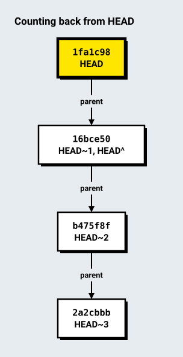

# Chapter 3: Exploring history

<!-- contents -->
- [3.1 Shaping the log](#31-shaping-the-log)
- [3.2 Searching the log](#32-searching-the-log)
- [3.3 Seeing one commit whole](#33-seeing-one-commit-whole)
- [3.4 Naming commits without their hash](#34-naming-commits-without-their-hash)
- [3.5 Comparing two commits](#35-comparing-two-commits)
- [3.6 The history of one file](#36-the-history-of-one-file)
- [3.7 Who wrote this line?](#37-who-wrote-this-line)
- [3.8 Reading an old version of a file](#38-reading-an-old-version-of-a-file)
- [3.9 Marking versions with tags](#39-marking-versions-with-tags)
- [3.10 Finding the commit that added a piece of code](#310-finding-the-commit-that-added-a-piece-of-code)
- [3.11 Practice: exploring history](#311-practice-exploring-history)
<!-- /contents -->

## 3.1 Shaping the log

### The question

By the end of chapter 2 your `~/tipcalc2` repository held seventeen commits. You've met one way to look at them: `git log` from §1.8, which prints each commit as a block of five lines or more, the full hash, the author, the date, a blank line and the message, indented. Seventeen commits make well over eighty lines. The two commit messages with a body from §2.8 make it longer still.

That's fine when you want every detail of the last commit or two. It's poor when you want an overview. Suppose a friend asks, "What has tipcalc been through?" You'd like one line per commit, newest first, so that the whole story of the project fits on one screen. Or you only care about the last three things you did before lunch. Scrolling past eighty lines to find three messages is not reading history. It's digging.

So the question for this section is: how do you make `git log` print as much as you need and no more?

### The picture

Go back to the photo album of §1.2. Every commit is a page, and a page is never painted over. Plain `git log` is like flipping through the album page by page, reading every caption in full. What you want now is the album's **contents page**: one short line per page, with its number and its caption, so you can see the whole album at a glance. That picture carries the whole chapter: you'll browse the album, hold one page up close, count pages back from the newest, and lay two pages side by side.

The picture stops being true in one place. An album's contents page is printed once. Git's "contents page" is worked out fresh every time you ask, from the commits themselves, so you can ask for it in a different shape each time.

### The idea

Three options reshape what `git log` prints. Each is something you add after `git log`, and you can combine them freely.

<!-- teaches: log-oneline = git log --oneline -->
The option **`git log --oneline`** prints each commit on a single line: a short form of its hash, then the subject line of its message. The short hash is the first seven characters of the full forty-character hash from §1.8. Git uses seven in a small repository like yours, and prints more once a repository grows big enough that seven might not tell two of its stored objects apart. Anywhere Git asks for a commit, you can type this short form instead of the full hash.

<!-- teaches: log-limit = git log -n, -n -->
The option **`git log -n`**, written with a number in place of `n`, limits the log to that many commits, counting from the newest. So `git log -3` shows the three most recent commits. It's a short way to write `git log --max-count=3`, and `git log -n 3` means the same too.

<!-- teaches: log-graph = git log --graph -->
The option **`git log --graph`** draws the shape of the history in the left margin, one `*` for each commit, with lines joining each commit to the one it was made after. In your repository every commit was made straight after the one before, so the drawing is a single straight column of stars. That will change. Chapter 4 lets history split into separate lines of work, and then `--graph` is how you see the split (§4.7 draws one).

Two more things you'll notice on screen.

The first is a label in brackets after the newest hash: `(HEAD -> main)`. For now, read it as "you are here": it marks the commit your working tree was last built from. §3.4 says what `HEAD` is, and chapter 4 explains `main`.

The second is the **pager**, a program that shows long output one screen at a time. When the log is longer than your terminal window, Git hands it to a pager (usually one called `less`) instead of letting it scroll away. Press Space for the next screen, `b` to go back, and `q` to quit and get your prompt back. The listings in this book show the whole output at once, as if your window were tall enough. If your log stops with a `:` at the bottom of the screen, that's the pager waiting for you, not Git hanging.

### The code

Open a terminal. A new one starts in your home folder, so go into the repository from chapter 2 first. Then ask for the contents page, a shorter contents page, the last two commits in full, and the graph of the last five.

<!-- code: id=shape-log -->
```console
$ cd tipcalc2
$ git log --oneline
16bce50 (HEAD -> main) Name the program in the closing message
b475f8f Say in the comment that it splits the bill
2a2cbbb Ignore temporary files
5611eb5 List the authors
abf248d Thank the user at the end
79e4692 Say where to change the tip rate
09d5c13 Rename rate to tip_rate
fd2cbeb Round money amounts to whole cents
fd052cf Say how to run the program
bb1696f Ignore log files and the scratch folder
ff4e3e5 Rename tip.py to tipcalc.py
8d657f6 Remove the finished to-do note
e82188b Fix a typo in a comment
cae5a0d Split the bill between people
621af9a Note the typo in tip.py
3b08d4d Raise the default tip to 18 percent
64e5696 Add tip calculator
$ git log --oneline -3
16bce50 (HEAD -> main) Name the program in the closing message
b475f8f Say in the comment that it splits the bill
2a2cbbb Ignore temporary files
$ git log -2
commit 16bce50e9dba41999e514b80d8e43c93ad0766c6 (HEAD -> main)
Author: Sam Rivera <sam@example.com>
Date:   Mon Jan 5 10:00:00 2026 +0000

    Name the program in the closing message

commit b475f8f1331bc96c0d60695f3bdb0c156b8a655f
Author: Sam Rivera <sam@example.com>
Date:   Mon Jan 5 10:00:00 2026 +0000

    Say in the comment that it splits the bill
$ git log --oneline --graph -5
* 16bce50 (HEAD -> main) Name the program in the closing message
* b475f8f Say in the comment that it splits the bill
* 2a2cbbb Ignore temporary files
* 5611eb5 List the authors
* abf248d Thank the user at the end
```

The sessions in this chapter ran on Git 2.43.0. Your hashes, your dates and your name will differ from the ones here: a hash is worked out from the commit's content, its author and its time, so no two people get the same ones. The messages and the order should match exactly.

What to notice:

- `git log --oneline` prints seventeen lines, one per commit, newest at the top. The oldest commit, `Add tip calculator`, is at the bottom, as it was in the long form.
- `git log --oneline -3` shows the same first three lines and stops. The limit counts from the top, the newest end, never from the oldest.
- `git log -2` keeps the full long form and only limits the count. The full hash in its first line begins with the same seven characters (`16bce50`) that `--oneline` printed.
- `git log --oneline --graph -5` combines all three options. Order doesn't matter: `--graph -5 --oneline` prints the same thing.

### The trace

Each command asks the same seventeen pages for a different contents page. Here's what changed from one to the next.

| Step | Command | Commits shown | Lines per commit | Hash shown |
|---|---|---|---|---|
| 1 | `git log --oneline` | 17 | 1 | 7 characters |
| 2 | `git log --oneline -3` | 3 | 1 | 7 characters |
| 3 | `git log -2` | 2 | 5 (or more with a body) | 40 characters |
| 4 | `git log --oneline --graph -5` | 5 | 1, with a `*` in front | 7 characters |

Nothing in the repository changed at any step. Every one of these commands only reads. Almost every command in this chapter is like that: exploring history is safe.

### What goes wrong

**"I typed `git log -oneline` and got an error."** Long option names take two dashes. With one dash Git doesn't recognise the word as an option at all, and stops before printing anything:

<!-- code: id=one-dash exit=128 -->
```console
$ git log -oneline
fatal: unrecognized argument: -oneline
```

Put right: `--oneline`, two dashes. Single-dash options are one letter or a number, like `-3`.

**"`-3` gave me the three oldest commits."** It can't: the log always starts at the newest. If you want the oldest first, add `--reverse`, which turns the list upside down after the count is applied. So `git log --oneline --reverse -3` shows the three newest commits with the oldest of them on top, not the three oldest commits.

**"Git froze after `git log`."** It's waiting in the pager. Press `q`.

**"My short hashes are eight characters, not seven."** That's allowed. Git lengthens the short hash when a repository grows big enough that seven characters could match two commits. Any unique beginning works when you type it back.

### Remember

- `git log --oneline` is the contents page: short hash and subject line, one line per commit.
- `git log -n` (for example `-3`) limits the log to the newest `n` commits.
- `git log --graph` draws the shape of history; for now, a straight column of stars.
- Options combine in any order, and none of them changes the repository.
- In a pager, Space moves on and `q` quits.

**Check yourself**

1. You want the subject lines of the five newest commits, and nothing else. Write the command.

<details>
<summary>Answer</summary>

`git log --oneline -5`. Any order of the two options works.

</details>

2. Predict how many lines this prints in `~/tipcalc2` right now, and what the first word of the last line is.

<!-- code: id=predict-reverse answer -->
```console
$ git log --oneline --reverse -3
```

<details>
<summary>Answer</summary>

```console
$ git log --oneline --reverse -3
2a2cbbb Ignore temporary files
b475f8f Say in the comment that it splits the bill
16bce50 (HEAD -> main) Name the program in the closing message
```

Three lines. `--reverse` turns the three newest commits upside down, so the last line is the newest commit, `16bce50`, and the line after its hash starts with `(HEAD`, the "you are here" label that §3.4 explains.

</details>

3. A friend says, "I ran `git log -1` and it showed one line." What did they leave out, if they wanted one line? What did they actually see?

<details>
<summary>Answer</summary>

`-1` only limits the count, so they saw the newest commit in the long form: its full hash, author, date and message, five lines or more. One line needs `--oneline` as well: `git log --oneline -1`.

</details>

4. Why is it safe to run every command in this section as often as you like?

<details>
<summary>Answer</summary>

They only read the repository. `git log` and its options print what is already recorded and change no file, no staging area and no commit.

</details>

## 3.2 Searching the log

### The question

Every commit in `~/tipcalc2` so far is yours. Real projects aren't like that. Say your friend Jo Park tries tipcalc, wants to see the bill's total before it's split, and sends you the one line that does it. You add the line, check it, and commit it. But the change is Jo's work, and the history should say so.

`git commit` has an option for exactly this: `--author="Name <email>"` records someone else as the commit's author, while you're still the one who made the commit. The rest is the edit-stage-commit cycle of §1.9, with the `git diff --check` from §2.10 before staging. Rewrite `tipcalc.py` with Jo's line added after the tip is printed:

<!-- code: id=jo-commit -->
```console
$ cat > tipcalc.py <<'END'
# Works out a tip and splits the bill.
bill = 47.50
tip_rate = 0.18
tip = bill * tip_rate
print("Tip:", round(tip, 2))
print("Total:", round(bill + tip, 2))
people = 3
share = (bill + tip) / people
print("Each:", round(share, 2))
print("Thanks for using tipcalc!")
END
$ python3 tipcalc.py
Tip: 8.55
Total: 56.05
Each: 18.68
Thanks for using tipcalc!
$ git diff --check
$ git add tipcalc.py
$ git commit --author="Jo Park <jo@example.com>" -m "Show the total with the tip"
[main 1fa1c98] Show the total with the tip
 Author: Jo Park <jo@example.com>
 1 file changed, 1 insertion(+)
```

On Windows the Python command may be `python` or `py` rather than `python3`; use whichever ran your programs in chapter 2. Git's reply has an extra line, `Author: Jo Park <jo@example.com>`, because the author isn't you. Your repository now holds eighteen commits by two people.

Now picture this history after a year: hundreds of commits, half a dozen authors. With the tools of §3.1 you can shorten the log and cut it off after `n` commits, but you can't ask it a question. Which commits did Jo make? Which ones mention the tip? What happened since the first of January? This section's question: how do you make `git log` show only the commits that match what you're looking for?

### The picture

In the album, you'd run a finger down the contents page and stop only at the lines that matter: pages taken by Jo, pages whose caption mentions the tip, pages from after New Year. Git does the finger's work. Unlike your finger, it also reads the small print: a caption's whole text, not just its first line.

### The idea

Three kinds of filter narrow the log. Each keeps the newest-first order of §3.1, and each combines with `--oneline` and `-n`.

<!-- teaches: log-author = git log --author -->
The option **`git log --author=TEXT`** shows only commits whose author's name or email contains `TEXT`. `--author=Jo` matches `Jo Park <jo@example.com>`; so would `--author=Park` or `--author=example.com`. The match is on part of the text, and it's case-sensitive: `--author=jo` still finds Jo's commit, but only because the email is written in lower case.

<!-- teaches: log-grep = git log --grep -->
The option **`git log --grep=TEXT`** shows only commits whose message contains `TEXT`, anywhere in it: the subject line or the body of §2.8. The name comes from `grep`, an old Unix program that searches text for a pattern. The search is case-sensitive unless you add `-i` (short for `--regexp-ignore-case`), which makes `rename` match `Rename`.

<!-- teaches: log-since = git log --since, --until -->
The options **`git log --since=DATE`** and **`--until=DATE`** show only commits made on or after, or on or before, a date. A date can be written `2026-01-01` (year, month, day), or in words Git understands, such as `yesterday` or `"2 weeks ago"` in quotes. Strictly, Git compares the date a commit was recorded, which for every commit you've made so far is the same moment as the `Date:` line that `git log` prints.

When you give filters of different kinds together, a commit must pass all of them. `--grep=tip --author=Jo` means "Jo's commits that mention the tip", not "Jo's commits, plus any commit mentioning the tip".

### The code

Before you run this session, guess how many commit messages in `~/tipcalc2` contain the word `tip` in lower case. Count from the contents page you printed in §3.1, plus Jo's commit, then see whether Git agrees. Where the session says `--author=Sam`, type your own first name, the one you set in §1.4.

<!-- code: id=search-log -->
```console
$ git log --oneline --author=Jo
1fa1c98 (HEAD -> main) Show the total with the tip
$ git log --oneline --author=Sam -2
16bce50 Name the program in the closing message
b475f8f Say in the comment that it splits the bill
$ git log --oneline --grep=tip
1fa1c98 (HEAD -> main) Show the total with the tip
79e4692 Say where to change the tip rate
09d5c13 Rename rate to tip_rate
fd2cbeb Round money amounts to whole cents
ff4e3e5 Rename tip.py to tipcalc.py
621af9a Note the typo in tip.py
3b08d4d Raise the default tip to 18 percent
64e5696 Add tip calculator
$ git log --oneline --grep=tip --author=Jo
1fa1c98 (HEAD -> main) Show the total with the tip
$ git log --oneline --since=2026-01-01 -2
1fa1c98 (HEAD -> main) Show the total with the tip
16bce50 Name the program in the closing message
$ git log --oneline --until=2025-12-31
```

Your own dates are the days you really made your commits, and they won't be 5 January 2026. Choose a `--since` date a little before your first commit and an `--until` date before it, and you'll see the same pattern: everything, then nothing.

What to notice:

- `--author=Jo` finds only the commit you just made. `--author=Sam` finds the rest; with `-2` it stops after two.
- `--grep=tip` finds eight commits. One of them, `Round money amounts to whole cents`, has no `tip` in its subject line. It's there because the body you wrote in §2.8 mentions the tip. Your contents-page count was probably seven.
- `Note the typo in tip.py` and `Rename tip.py to tipcalc.py` match too: `--grep` looks for the letters, not the word, so `tip.py` counts.
- `--grep=tip --author=Jo` keeps only commits passing both filters: one.
- `--until=2025-12-31` prints nothing at all and says nothing about it. An empty answer from a filter isn't an error.

### The trace

| Step | Filter | Commits shown | Newest shown |
|---|---|---|---|
| 1 | author contains `Jo` | 1 | `1fa1c98` |
| 2 | author contains `Sam`, at most 2 | 2 | `16bce50` |
| 3 | message contains `tip` | 8 | `1fa1c98` |
| 4 | message contains `tip` and author contains `Jo` | 1 | `1fa1c98` |
| 5 | made on or after 1 January 2026, at most 2 | 2 | `1fa1c98` |
| 6 | made on or before 31 December 2025 | 0 | none |

The newest commit shown is the first one, from the top, that passes every filter. That's why `1fa1c98` keeps coming back: it's the newest commit, so whenever it passes it leads.

### What goes wrong

**"I searched for `rename` and Git found nothing, but I know I renamed things."** The search is case-sensitive, and both messages say `Rename`:

<!-- code: id=grep-case -->
```console
$ git log --oneline --grep=rename
$ git log --oneline -i --grep=rename
09d5c13 Rename rate to tip_rate
ff4e3e5 Rename tip.py to tipcalc.py
```

Put right: add `-i` when you don't know the case.

**"I tried to credit Kim with `--author=Kim` and the commit failed."** On its own, a name isn't an author. Git then hunts the history for an existing author whose name contains `Kim`, finds none, and refuses:

<!-- code: id=bad-author exit=128 -->
```console
$ git commit --author=Kim -m "Test"
fatal: --author 'Kim' is not 'Name <email>' and matches no existing author
```

Put right: give the full form, `--author="Kim Lee <kim@example.com>"`, with the quotes so the shell keeps it as one piece. Nothing was committed, and the staging area is as it was.

**"`--grep` missed a commit whose message obviously matches."** Look for a typo in the message itself; `--grep` only finds what was written. This is one more reason for the clear subject lines of §2.8.

**"I thought `--grep` and `--author` together would show both sets."** They show the commits in both sets at once. Run the two searches one after the other to see each set.

### Remember

- `--author=TEXT` keeps commits whose author contains `TEXT`; `git commit --author="Name <email>"` records someone else's work as theirs.
- `--grep=TEXT` searches the whole message, body included; `-i` ignores case.
- `--since` and `--until` take a date such as `2026-01-01` or words such as `yesterday`.
- Filters of different kinds must all match.
- An empty result is a real answer, not an error.

**Check yourself**

1. Write a command that lists, one line each, the commits whose message mentions `README` in any case.

<details>
<summary>Answer</summary>

`git log --oneline -i --grep=readme`. Without `-i` you'd have to guess the case used in each message.

</details>

2. Predict what this prints in `~/tipcalc2`.

<!-- code: id=predict-total answer -->
```console
$ git log --oneline --grep=total --author=Sam
```

<details>
<summary>Answer</summary>

```console
$ git log --oneline --grep=total --author=Sam
```

Nothing. `Show the total with the tip` matches `--grep=total`, but its author is Jo, not Sam, and both filters must match. No commit by Sam mentions `total`.

</details>

3. Why did `Round money amounts to whole cents` turn up in a search for `tip`?

<details>
<summary>Answer</summary>

`--grep` searches the whole message, and that commit's body, written in §2.8, mentions the tip.

</details>

4. A teammate commits a fix you wrote on their laptop. Which option should they use, and what will `git log --author` then show for that commit?

<details>
<summary>Answer</summary>

`git commit --author="Your Name <you@example.com>"`. The commit's author is then you, so `git log --author=` with part of your name finds it, and a search for their name doesn't.

</details>

## 3.3 Seeing one commit whole

### The question

In §3.2 a search for `tip` turned up `Round money amounts to whole cents`, and you had to take on trust that its body mentioned the tip. The contents page from §3.1 shows only subject lines. The long `git log` of §1.8 shows the whole message, but still not what the commit changed. Meanwhile `git diff` from §2.1 shows changes, but only the ones you haven't committed yet.

So you can see what a commit says, or what your current edits change, but not what an old commit did. When you find a suspicious commit in a search, you want to open it and read everything: who, when, why, and exactly which lines went in and out. How do you see one commit whole?

### The picture

This is holding one page of the album up to the light: the photo, the caption, the date written on the back. The picture stops being true in one way that matters. A page in the album is a whole snapshot, and Git does store each commit as a whole snapshot (§1.2). But when you hold a commit up, Git doesn't show you the whole snapshot. It shows what changed since the page before, worked out on the spot by comparing the two. That's far more useful to read, and it's the only part of the picture this chapter has to correct.

### The idea

<!-- teaches: git-show = git show -->
The command **`git show`** prints one commit in full: its hash, author, date and whole message, as `git log` prints them, followed by the diff between that commit's snapshot and the snapshot of the commit made just before it. With no argument it shows the newest commit. Given a hash, full or short, it shows that commit.

The diff part is in the same format as `git diff` in §2.1: a `diff --git` line naming the file, `---` for the old version and `+++` for the new, then hunks starting `@@`, with `-` on removed lines and `+` on added ones. Two lines in the header are worth a word. The `index 2097295..61dc7b8` line gives short IDs for the file's stored contents before and after, and the `100644` after them means "an ordinary file, not a program you can run directly". You can skim past both.

A commit that touches three files shows three `diff --git` sections, one after the other. A commit that only renamed a file, with no edits, shows no hunks at all, only the rename: the same rename detection as §2.4, now applied to a commit you made long ago.

### The code

First look at the newest commit, Jo's. Then find the rounding commit's hash with a search from §3.2 and open it. On your machine, use the hash your own search prints, not `fd2cbeb`: that one exists only in the repository this book was written with.

<!-- code: id=show-commits -->
```console
$ git show
commit 1fa1c98ed0ae121131fb285955708fb4e6bfbe2a (HEAD -> main)
Author: Jo Park <jo@example.com>
Date:   Mon Jan 5 10:00:00 2026 +0000

    Show the total with the tip

diff --git a/tipcalc.py b/tipcalc.py
index 2097295..61dc7b8 100644
--- a/tipcalc.py
+++ b/tipcalc.py
@@ -3,6 +3,7 @@ bill = 47.50
 tip_rate = 0.18
 tip = bill * tip_rate
 print("Tip:", round(tip, 2))
+print("Total:", round(bill + tip, 2))
 people = 3
 share = (bill + tip) / people
 print("Each:", round(share, 2))
$ git log --oneline --grep=Round
fd2cbeb Round money amounts to whole cents
$ git show fd2cbeb
commit fd2cbeb852829d4ec1ede91e07acd8e88baf65f8
Author: Sam Rivera <sam@example.com>
Date:   Mon Jan 5 10:00:00 2026 +0000

    Round money amounts to whole cents

    Floating-point sums can print long tails, such as 8.549999999999999 for 18 percent of 47.50. Round the tip and each share to two decimal places so the output reads like money.

diff --git a/tipcalc.py b/tipcalc.py
index 5b5faad..cef2d25 100644
--- a/tipcalc.py
+++ b/tipcalc.py
@@ -2,7 +2,7 @@
 bill = 47.50
 rate = 0.18
 tip = bill * rate
-print("Tip:", tip)
+print("Tip:", round(tip, 2))
 people = 3
 share = (bill + tip) / people
-print("Each:", share)
+print("Each:", round(share, 2))
```

What to notice:

- With no argument, `git show` opened Jo's commit, the newest. The `Author:` line is Jo's, as `--author` set it in §3.2.
- The hunk shows three unchanged lines above and below the added line, for context, just as `git diff` does. Only the line starting `+` is new.
- `git show fd2cbeb` prints the body you wrote in §2.8, which is where the word `tip` came from. Below it, two `print` lines change from printing raw numbers to printing `round(...)` of them.
- The line `rate = 0.18` appears in the rounding commit's context. That's correct for that moment in history: `tip_rate` came one commit later. `git show` displays the project as it was, not as it is.

### The trace

| Step | Command | Commit shown | Message shown | Change shown |
|---|---|---|---|---|
| 1 | `git show` | `1fa1c98`, the newest | subject only; it has no body | 1 line added to `tipcalc.py` |
| 2 | `git log --oneline --grep=Round` | none opened; one hash found | subject of `fd2cbeb` | nothing |
| 3 | `git show fd2cbeb` | `fd2cbeb`, eight commits back | subject and two-sentence body | 2 lines replaced in `tipcalc.py` |

Step 2 is the bridge: searching gave you a hash, and the hash opened the page. You'll use that pair of moves often.

### What goes wrong

**"`git show` showed me nothing I changed today."** It shows commits, never uncommitted work. Your edits in the working tree are what `git diff` shows (§2.1), and what's staged is what `git diff --staged` shows (§2.2).

**"I typed a hash from the book and Git said it doesn't know it."** Hashes differ from machine to machine, so a hash copied from these pages, or mistyped, gets this:

<!-- code: id=show-bad exit=128 -->
```console
$ git show 9999999
fatal: ambiguous argument '9999999': unknown revision or path not in the working tree.
Use '--' to separate paths from revisions, like this:
'git <command> [<revision>...] -- [<file>...]'
```

Put right: copy the hash from your own `git log --oneline`. The two lines of advice below the error are about something else. Git couldn't tell whether `9999999` was meant as a commit or a file name, and `--` is how you tell it that everything after is a file name. You don't need it here; §3.6 does.

**"I expected to see the whole file."** `git show` with a commit shows the change, not the file. Seeing a file as it was in an old commit is a different request, and §3.8 answers it.

**"The diff of the first commit is all `+` lines and says `/dev/null`."** That's right. `/dev/null` is the name Unix systems give to an empty, bottomless file. Here it stands for "no file at all", because before the first commit there was nothing to compare with.

### Remember

- `git show` prints the newest commit; `git show HASH` prints any commit.
- It prints the full message and the diff against the commit before it.
- Git stores snapshots but shows changes, worked out when you ask.
- A search (§3.2) finds the hash; `git show` opens it.
- Hashes are yours alone: take them from your own log.

**Check yourself**

1. You want to read the message and changes of the commit `Say where to change the tip rate`. Write the two commands you'd use, in order.

<details>
<summary>Answer</summary>

`git log --oneline --grep="Say where"` to find its hash, then `git show` followed by that hash.

</details>

2. Before running it, predict what `git show` prints below the message for the commit `Rename tip.py to tipcalc.py`. Will there be any `+` or `-` lines?

<!-- code: id=predict-rename answer -->
```console
$ git show ff4e3e5
```

<details>
<summary>Answer</summary>

```console
$ git show ff4e3e5
commit ff4e3e5f9172adf84c56e60fced316689fff2f56
Author: Sam Rivera <sam@example.com>
Date:   Mon Jan 5 10:00:00 2026 +0000

    Rename tip.py to tipcalc.py

diff --git a/tip.py b/tipcalc.py
similarity index 100%
rename from tip.py
rename to tipcalc.py
```

No `+` or `-` lines. The file was only renamed, not edited, so Git reports the rename and a similarity index of 100%, the rename detection of §2.4, and has no hunk to show.

</details>

3. In `git show fd2cbeb`, the context lines say `rate`, but today's file says `tip_rate`. Is Git showing something out of date by mistake?

<details>
<summary>Answer</summary>

No. `git show` shows that commit's change against the commit before it, both as they were then. The rename to `tip_rate` came in a later commit, so at that point the variable was still `rate`.

</details>

4. You've edited `README.md` but not committed. You run `git show`. Will your edit appear? Why?

<details>
<summary>Answer</summary>

No. `git show` with no argument shows the newest commit, and your edit isn't in any commit yet. `git diff` shows it.

</details>

## 3.4 Naming commits without their hash

### The question

In §3.3 you opened an old commit in two moves: search for it, then copy its hash into `git show`. That works, but look at what it costs. Every hash is seven characters of noise like `16bce50`, different on every machine, easy to mistype, and impossible to remember. And very often the commit you want isn't hidden at all. It's "the one before the last", or "three commits ago". You know exactly where it is on the contents page of §3.1; you just can't say so to Git without looking up its hash first.

People don't talk about photos by serial number. They say "the last photo" or "two before that". Can you talk to Git the same way, naming a commit by where it sits rather than by its hash?

### The picture

Back to the album. You don't need page numbers to find your way: there's a bookmark at the newest page, and from there you count back, one page, two pages, three. Git gives you exactly that: a bookmark called `HEAD`, and a way to count back from it.

<!-- fig: id=head-ancestry
title: Counting back from HEAD
dir: down
hot: c0
box c0: `1fa1c98`\nHEAD
box c1: `16bce50`\nHEAD~1, HEAD^
box c2: `b475f8f`\nHEAD~2
box c3: `2a2cbbb`\nHEAD~3
c0 -> c1: parent
c1 -> c2: parent
c2 -> c3: parent
-->

*Figure 3.4a: The four newest commits of `~/tipcalc2`, newest at the top. Each arrow points from a commit to its parent, the commit it was made on top of. Counting back from `HEAD` follows the arrows.*

The picture stops being true at the end of the album. A real album lets you count back past the first page into the cover. Git doesn't: count back further than the oldest commit and it says there's no such commit.

### The idea

<!-- teaches: revision = revision, revisions -->
A **revision** is any expression Git accepts as the name of a commit. A full hash is a revision, and so is a short hash from §3.1. Everywhere Git's help pages (§1.10) write `<revision>` or `<commit>`, you may write any revision. This section adds two more kinds, and §3.9 adds a third.

<!-- teaches: head = HEAD -->
**`HEAD`** is Git's name for the commit you are on: the one your working tree and staging area were last filled from, and the one your next commit will be made on top of. That's what the `(HEAD -> main)` label in §3.1 was marking. Right now `HEAD` is Jo's commit from §3.2. When you commit again, `HEAD` moves to the new commit by itself. Always type it in capitals. On some computers `head` happens to work and on others it doesn't, so don't come to rely on it.

> **Simplified here.** `HEAD` doesn't point at a commit directly. It points at `main`, and `main` points at the commit; that's what the arrow in `(HEAD -> main)` says. Chapter 4 shows why the difference matters, starting at §4.4.

Every commit except the first was made on top of exactly one earlier commit, and that commit is its **parent**. The first commit has no parent, which is why its diff in §3.3 compared against nothing.

<!-- teaches: ancestry-ref = ancestry reference, HEAD~n, HEAD^ -->
An **ancestry reference** names a commit by counting parents back from a revision: `REV~n` means "follow the parent `n` times, starting at `REV`", and `REV^` means the same as `REV~1`. So `HEAD~1` and `HEAD^` are the commit before the newest, `HEAD~3` is three before it, and `HEAD~0` is `HEAD` itself. The starting point can be any revision, a hash included, and you can chain them: `HEAD~2~1` is `HEAD~3`.

A revision isn't only for `git show`. `git log` takes one too and starts its listing there instead of at `HEAD`. So `git log --oneline HEAD~15` lists the commit fifteen back and everything older.

### The code

Before running this, take your contents page from §3.1, with Jo's commit from §3.2 now on top, and predict the subject line each `git log` command will print. Count `HEAD` itself as zero.

<!-- code: id=name-back -->
```console
$ git log --oneline -1 HEAD
1fa1c98 (HEAD -> main) Show the total with the tip
$ git log --oneline -1 HEAD~1
16bce50 Name the program in the closing message
$ git log --oneline -1 HEAD^
16bce50 Name the program in the closing message
$ git log --oneline -1 HEAD~3
2a2cbbb Ignore temporary files
$ git log --oneline -1 HEAD~2~1
2a2cbbb Ignore temporary files
$ git log --oneline HEAD~15
621af9a Note the typo in tip.py
3b08d4d Raise the default tip to 18 percent
64e5696 Add tip calculator
$ git show HEAD~1
commit 16bce50e9dba41999e514b80d8e43c93ad0766c6
Author: Sam Rivera <sam@example.com>
Date:   Mon Jan 5 10:00:00 2026 +0000

    Name the program in the closing message

diff --git a/tipcalc.py b/tipcalc.py
index 7a868f1..2097295 100644
--- a/tipcalc.py
+++ b/tipcalc.py
@@ -6,4 +6,4 @@ print("Tip:", round(tip, 2))
 people = 3
 share = (bill + tip) / people
 print("Each:", round(share, 2))
-print("Thanks!")
+print("Thanks for using tipcalc!")
```

These names are the same on every machine, so your subject lines should match the book's exactly, whatever your hashes are.

What to notice:

- `HEAD~1` and `HEAD^` print the same commit, as promised.
- `HEAD~2~1` lands on the same commit as `HEAD~3`. Counting back is just adding.
- `git log --oneline HEAD~15` prints three commits, not one. The count of `HEAD~15` chooses where the list starts. There are eighteen commits, numbered `HEAD` to `HEAD~17`, so from `HEAD~15` there are three left: `HEAD~15`, `HEAD~16` and `HEAD~17`.
- `git show HEAD~1` opens the commit before Jo's without any hash. Its `index` line ends with `2097295`, the very ID Jo's diff in §3.3 began from: the two pages meet.

### The trace

Follow `HEAD~3` the way Git works it out, one parent at a time.

| Step | Now at | Steps left | What Git does |
|---|---|---|---|
| 1 | `1fa1c98` (`HEAD`) | 3 | reads its parent |
| 2 | `16bce50` | 2 | reads its parent |
| 3 | `b475f8f` | 1 | reads its parent |
| 4 | `2a2cbbb` | 0 | stops: this is `HEAD~3` |

Each commit records its parent's hash inside itself, so Git never searches. It just follows the arrows of Figure 3.4a.

### What goes wrong

**"`HEAD~18` failed, but I have eighteen commits."** The newest is `HEAD~0`, so eighteen commits run from `HEAD~0` to `HEAD~17`:

<!-- code: id=too-far exit=128 -->
```console
$ git show HEAD~18
fatal: ambiguous argument 'HEAD~18': unknown revision or path not in the working tree.
Use '--' to separate paths from revisions, like this:
'git <command> [<revision>...] -- [<file>...]'
```

Put right: count `HEAD` as zero. The oldest commit here is `HEAD~17`. As in §3.3, the advice about `--` below the error is for when a name could also be a file; it doesn't apply.

**"I wrote `HEAD-1`."** Git reads that as a name it has never heard of and fails the same way. It's a tilde, `~`, usually top left on the keyboard, held with Shift.

**"`HEAD^` gave my shell a fit."** In Bash, the shell of Git Bash and most Linux terminals, `HEAD^` is fine. Some other shells treat `^` as special: zsh, the shell a Mac terminal starts with, does when certain settings are on, and so does the Windows Command Prompt. If yours complains, use `HEAD~1`, or put quotes round it: `'HEAD^'`.

**"After my next commit, `HEAD~1` meant a different commit."** That's right and expected. Ancestry references count from where you are now, and `HEAD` moves forward with every commit. To name one commit for good, use its hash, or the tags of §3.9.

### Remember

- A revision is any name for a commit: a hash, a short hash, `HEAD`, `HEAD~n`.
- `HEAD` is the commit you're on, the newest one so far in this book; your next commit goes on top of it.
- A commit's parent is the commit it was made on top of. `REV~n` follows parents back `n` times; `REV^` is `REV~1`.
- `HEAD` is `HEAD~0`, so with `k` commits the oldest is `HEAD~(k-1)`.
- `git log REV` starts the listing at `REV`.

**Check yourself**

1. Write a command that opens the commit made just before the newest one, without typing a hash.

<details>
<summary>Answer</summary>

`git show HEAD~1`, or `git show HEAD^`.

</details>

2. Predict what this prints.

<!-- code: id=predict-back answer -->
```console
$ git log --oneline -2 HEAD~6
```

<details>
<summary>Answer</summary>

```console
$ git log --oneline -2 HEAD~6
79e4692 Say where to change the tip rate
09d5c13 Rename rate to tip_rate
```

`HEAD~6` is `Say where to change the tip rate`, and `-2` adds one older commit, `Rename rate to tip_rate`. The listing starts at the revision and runs back.

</details>

3. Without running anything, which revision names the very first commit, `Add tip calculator`, in your repository right now? Will that name still be right after one more commit?

<details>
<summary>Answer</summary>

`HEAD~17`: eighteen commits, counted from zero. After one more commit it becomes `HEAD~18`, because `HEAD` moves forward and the count starts from it.

</details>

4. Explain to a friend why `HEAD~2~1` and `HEAD~3` are the same commit.

<details>
<summary>Answer</summary>

`HEAD~2` follows the parent twice from `HEAD`; the extra `~1` follows it once more from there. Three parents back in total, which is exactly what `HEAD~3` asks for.

</details>

## 3.5 Comparing two commits

### The question

With §3.3 you can open one commit and see what it changed. With §3.4 you can name any commit without a hash. Now try a question that needs more than one page: "What has `tipcalc.py` gained over the last two commits?"

You could run `git show HEAD~1` and `git show HEAD`, read both diffs, and add them up in your head. For two commits that's bearable. For "everything since the README first said how to run the program", that's nine commits, some touching files you don't care about, some undoing what others did. Adding diffs by hand is how mistakes get made.

What you really want is to put two snapshots side by side and have Git say what's different between them, however many commits lie in between. And sometimes you don't even want the lines, only a summary: which files changed, and by how much?

### The picture

Take two pages out of the album and lay them side by side. You don't care what happened on the pages between; you only compare the two photos in front of you. That's the whole idea, and it fits the album well, because each commit really is a whole snapshot (§1.2): any two can be compared directly.

### The idea

<!-- teaches: diff-between-commits = git diff A B -->
The command **`git diff A B`**, where `A` and `B` are any two revisions, shows the changes that turn the snapshot of `A` into the snapshot of `B`. Lines only in `B` are marked `+`; lines only in `A` are marked `-`. The format is exactly that of §2.1 and §3.3. Only the two snapshots matter: Git doesn't look at the commits in between at all, so a line added in one commit and removed in a later one leaves no trace in the diff.

The order matters. `git diff HEAD~2 HEAD` reads "from two commits ago to now", the direction history went. Swap the two and every `+` becomes a `-`: you'd be reading the change needed to go back.

This fills the last gap in the picture from chapter 2. There, `git diff` compared the working tree with the staging area (§2.1), and `git diff --staged` the staging area with the last commit (§2.2). Now `git diff A B` compares two commits. Every form of `git diff` compares two copies; they differ only in which two.

<!-- teaches: diff-stat = git diff --stat, --stat -->
The option **`--stat`** replaces the line-by-line diff with a summary: one row per changed file, giving the number of changed lines and a little bar of `+` and `-` signs, then a total. A changed line counts as one insertion and one deletion, because Git sees it as an old line taken out and a new one put in. `--stat` works with every `git diff` above, and with `git show` and `git log` too.

### The code

Before you run this, use what you saw in §3.3 and §3.4 to predict it: `HEAD~1` changed the closing message, and `HEAD` added the total. How many `+` lines and how many `-` lines will `git diff HEAD~2 HEAD` show?

<!-- code: id=diff-two -->
```console
$ git diff HEAD~2 HEAD
diff --git a/tipcalc.py b/tipcalc.py
index 7a868f1..61dc7b8 100644
--- a/tipcalc.py
+++ b/tipcalc.py
@@ -3,7 +3,8 @@ bill = 47.50
 tip_rate = 0.18
 tip = bill * tip_rate
 print("Tip:", round(tip, 2))
+print("Total:", round(bill + tip, 2))
 people = 3
 share = (bill + tip) / people
 print("Each:", round(share, 2))
-print("Thanks!")
+print("Thanks for using tipcalc!")
$ git diff --stat HEAD~2 HEAD
 tipcalc.py | 3 ++-
 1 file changed, 2 insertions(+), 1 deletion(-)
$ git diff --stat HEAD~17 HEAD
 .gitignore |  3 +++
 AUTHORS    |  1 +
 README.md  |  6 +++++-
 notes.txt  |  1 -
 tip.py     |  5 -----
 tipcalc.py | 10 ++++++++++
 6 files changed, 19 insertions(+), 7 deletions(-)
```

What to notice:

- The first diff holds both changes in one hunk: the added total line and the replaced closing line. Git doesn't say which commit made which. If you need that, it's `git show` on each.
- `--stat` for the same pair says `3 ++-`: three changed lines, two in and one out. One of the two insertions and the one deletion are the replaced closing line.
- `HEAD~17` is the very first commit, so the last command summarises the project's whole life in seven lines. Six files are listed, though the working tree has only four tracked files: `notes.txt` was removed in chapter 2, and so was `tip.py`, in a way.
- The rename of §2.4 has gone missing. Between those two snapshots, `tipcalc.py` gained so many lines that Git no longer judges it the same file as the old five-line `tip.py`, so it reports `tip.py` as deleted and `tipcalc.py` as new. §3.6 shows how to follow a file across its rename anyway.

### The trace

Here's what `tipcalc.py` looks like at each commit from `HEAD~2` to `HEAD`. `git diff HEAD~2 HEAD` compares only the first row with the last.

| Step | Commit | Lines in file | Last line printed | Has `Total:` line |
|---|---|---|---|---|
| 1 | `HEAD~2` (`b475f8f`) | 9 | `Thanks!` | no |
| 2 | `HEAD~1` (`16bce50`) | 9 | `Thanks for using tipcalc!` | no |
| 3 | `HEAD` (`1fa1c98`) | 10 | `Thanks for using tipcalc!` | yes |

From row 1 to row 3: one line added, one line replaced. That's two `+` and one `-`, which is what `--stat` counted.

### What goes wrong

**"I compared `HEAD` with `HEAD~1` and everything was backwards."** It isn't wrong, it's the other direction. With the newer commit first, Git shows how to get from new to old, so Jo's line appears as a removal. Check yourself question 2 runs it. Put right: older revision first.

**"`git diff` with two revisions printed nothing."** That means the two snapshots are identical, as when both names point at the same commit:

<!-- code: id=diff-same -->
```console
$ git diff HEAD~0 HEAD
$ git diff --stat HEAD~6 HEAD~3
 .gitignore | 1 +
 AUTHORS    | 1 +
 tipcalc.py | 1 +
 3 files changed, 3 insertions(+)
```

The first command compares `HEAD` with itself. The second shows that an empty diff only means "no difference", not "an error": three commits back, the files did differ, and `--stat` lists them.

**"I expected the diff to show me a line that was added and later deleted."** It can't. Only the two end snapshots are compared. To see every step, read the commits one at a time, or use `git log --patch`, which §3.6 introduces.

**"`--stat` says one insertion and one deletion, but I only changed one line."** A changed line is counted as both, as the idea above says.

### Remember

- `git diff A B` shows what turns snapshot `A` into snapshot `B`; put the older one first.
- Only the two snapshots count; the commits between them are ignored.
- `--stat` gives a per-file summary of changed lines, with a total.
- No output means the two snapshots are the same.
- Every `git diff` compares two copies: working tree, staging area, or any commit.

**Check yourself**

1. Write a command that shows, as a summary, which files changed between the third-newest commit and the newest.

<details>
<summary>Answer</summary>

`git diff --stat HEAD~2 HEAD`. ("Third-newest" is `HEAD~2`, counting `HEAD` as the first.)

</details>

2. Predict what this prints: which line, and with which sign?

<!-- code: id=diff-reverse answer -->
```console
$ git diff HEAD HEAD~1
```

<details>
<summary>Answer</summary>

```console
$ git diff HEAD HEAD~1
diff --git a/tipcalc.py b/tipcalc.py
index 61dc7b8..2097295 100644
--- a/tipcalc.py
+++ b/tipcalc.py
@@ -3,7 +3,6 @@ bill = 47.50
 tip_rate = 0.18
 tip = bill * tip_rate
 print("Tip:", round(tip, 2))
-print("Total:", round(bill + tip, 2))
 people = 3
 share = (bill + tip) / people
 print("Each:", round(share, 2))
```

Jo's total line, marked `-`. Going from `HEAD` back to `HEAD~1` means taking that line out.

</details>

3. A teammate says "`git diff --stat HEAD~17 HEAD` proves we deleted `tip.py` and wrote `tipcalc.py` from scratch." Are they right?

<details>
<summary>Answer</summary>

No. The file was renamed in one commit and then edited in others. Comparing only the two end snapshots, the files differ too much for Git's rename detection to pair them, so it reports a delete and an add. `git show` of the rename commit shows the rename itself.

</details>

4. Explain how `git diff A B` relates to `git diff` and `git diff --staged` from chapter 2.

<details>
<summary>Answer</summary>

All three compare two copies of the files. `git diff` compares the working tree with the staging area, `git diff --staged` compares the staging area with the last commit, and `git diff A B` compares any two commits.

</details>

## 3.6 The history of one file

### The question

Two things in §3.5 were left hanging. Comparing the first commit with the newest, Git lost track of the rename from §2.4 and reported `tip.py` deleted and `tipcalc.py` new. And a diff between two snapshots hides every step in between.

Both point at the same everyday question. You open `tipcalc.py`, look at a line, and wonder how the file got this way. You don't care about `.gitignore` or `AUTHORS`. You want the file's own story: every commit that touched it, from its first version, under whatever name it had then, and ideally what each of those commits did to it, without typing `git show` eighteen times. How do you get the history of one file?

### The picture

Imagine the album has one person who appears in some photos and not others, and partway through they changed their name. You want only the pages they appear on, all the way back, and you want to recognise them under their old name too. That's this section: one file followed through the album, even across a change of name.

### The idea

Give `git log` a file name and it lists only the commits that changed that file. Write the name after two dashes, `git log -- README.md`. The `--` is the separator that Git's error messages in §3.3 and §3.4 kept offering: everything after it is a file name, never a revision. Often Git can guess without it, but not for a file that no longer exists in your working tree, and a habit of writing it costs nothing.

That listing has a blind spot. It looks for the file under the name you gave, so a file that was renamed seems to begin at its rename.

<!-- teaches: log-follow = git log --follow, --follow -->
The option **`git log --follow -- FILE`** lists the commits that changed one file and keeps going past renames: when it reaches the commit where the file got its present name, it carries on under the old name. It works on one file at a time. Git spots each rename with the same similarity test as in §2.4, comparing one commit with its parent, where a renamed file has barely changed.

<!-- teaches: log-patch = git log --patch, -p -->
The option **`git log --patch`**, or `-p` for short, prints each commit's diff under its log entry, the same diff `git show` prints. With a file name it shows only that file's part of each diff. `git log -p -- FILE` is the file's whole story, page after page, with every change.

These combine with everything from §3.1 to §3.4: `-n`, `--oneline`, `--author`, a starting revision.

### The code

`tipcalc.py` has been called that since the rename commit. Before running this, look at the full contents page and predict which commits the plain file listing will stop at, and how many more `--follow` will find.

<!-- code: id=file-history -->
```console
$ git log --oneline -- README.md
79e4692 Say where to change the tip rate
fd052cf Say how to run the program
3b08d4d Raise the default tip to 18 percent
64e5696 Add tip calculator
$ git log --oneline -- tipcalc.py
1fa1c98 (HEAD -> main) Show the total with the tip
16bce50 Name the program in the closing message
b475f8f Say in the comment that it splits the bill
abf248d Thank the user at the end
09d5c13 Rename rate to tip_rate
fd2cbeb Round money amounts to whole cents
ff4e3e5 Rename tip.py to tipcalc.py
$ git log --oneline --follow -- tipcalc.py
1fa1c98 (HEAD -> main) Show the total with the tip
16bce50 Name the program in the closing message
b475f8f Say in the comment that it splits the bill
abf248d Thank the user at the end
09d5c13 Rename rate to tip_rate
fd2cbeb Round money amounts to whole cents
ff4e3e5 Rename tip.py to tipcalc.py
e82188b Fix a typo in a comment
cae5a0d Split the bill between people
3b08d4d Raise the default tip to 18 percent
64e5696 Add tip calculator
$ git log --patch -1 -- README.md
commit 79e46925ab869690a658fc4db8a22cf40b547d4b
Author: Sam Rivera <sam@example.com>
Date:   Mon Jan 5 10:00:00 2026 +0000

    Say where to change the tip rate

diff --git a/README.md b/README.md
index 5adc894..042c0ba 100644
--- a/README.md
+++ b/README.md
@@ -3,3 +3,5 @@
 Adds a tip of 18 percent to a bill.

 Run it with: python3 tipcalc.py
+
+The tip rate is set near the top of tipcalc.py.
```

What to notice:

- `README.md` was changed by four of the eighteen commits, and the listing skips the rest.
- Without `--follow`, `tipcalc.py`'s history starts at `Rename tip.py to tipcalc.py`: seven commits. As far as that name goes, the file was born there.
- With `--follow`, four older commits appear, made when the file was `tip.py`, back to `Add tip calculator`. Eleven in all. `Note the typo in tip.py` isn't among them: despite its subject, that commit changed `notes.txt`.
- `git log --patch -1 -- README.md` is the newest README change with its diff. Drop the `-1` and you get all four.

### The trace

How `--follow` walks back through the rename, a few commits either side of it:

| Step | Commit | Name Git is looking for | Commit changed that file? |
|---|---|---|---|
| 1 | `fd2cbeb` Round money amounts | `tipcalc.py` | yes, listed |
| 2 | `ff4e3e5` Rename tip.py to tipcalc.py | `tipcalc.py`, then `tip.py` from here on | yes, listed |
| 3 | `8d657f6` Remove the finished to-do note | `tip.py` | no, skipped |
| 4 | `e82188b` Fix a typo in a comment | `tip.py` | yes, listed |

At step 2, the plain listing would have stopped looking. `--follow` notices that this commit's `tipcalc.py` came from `tip.py`, and switches names.

### What goes wrong

**"I asked for the history of a file I deleted, and Git refused."** With no `--`, Git checks whether the name is a file in your working tree, and `notes.txt` was removed in §2.4:

<!-- code: id=gone-bad exit=128 -->
```console
$ git log --oneline notes.txt
fatal: ambiguous argument 'notes.txt': unknown revision or path not in the working tree.
Use '--' to separate paths from revisions, like this:
'git <command> [<revision>...] -- [<file>...]'
```

Put right: add the separator. The history is still there.

<!-- code: id=gone-good -->
```console
$ git log --oneline -- notes.txt
8d657f6 Remove the finished to-do note
621af9a Note the typo in tip.py
64e5696 Add tip calculator
```

**"`--follow` refused two files."** It follows one file at a time:

<!-- code: id=follow-two exit=128 -->
```console
$ git log --follow -- README.md AUTHORS
fatal: --follow requires exactly one pathspec
```

Put right: one `git log --follow` per file. Without `--follow`, `git log -- README.md AUTHORS` with two names is fine.

**"`--follow` missed a rename."** It can happen when one commit both renamed a file and changed most of its lines: the old and new versions no longer look similar enough to pair up. That's the case for keeping a rename in its own commit, as §2.4 did with `git mv`.

**"`git log -p` went on for pages."** It shows every diff, so on a long history it will. Add `-n` or a file name, and remember `q` from §3.1 to leave the pager.

### Remember

- `git log -- FILE` lists only the commits that changed `FILE`; `--` means "file names follow".
- Use `--` always for files that no longer exist, and as a habit otherwise.
- `--follow` carries one file's history back across renames.
- `--patch` (`-p`) adds each commit's diff; with a file name, just that file's part.
- All of these combine with `--oneline`, `-n` and the filters of §3.2.

**Check yourself**

1. Write a command that shows every change ever made to `.gitignore`, diffs included.

<details>
<summary>Answer</summary>

`git log -p -- .gitignore`. It was never renamed, so `--follow` isn't needed, though it does no harm.

</details>

2. Predict what this prints. Would the answer change without `--follow`?

<!-- code: id=predict-follow answer -->
```console
$ git log --oneline --follow -- AUTHORS
```

<details>
<summary>Answer</summary>

```console
$ git log --oneline --follow -- AUTHORS
5611eb5 List the authors
```

One commit, `List the authors`. `AUTHORS` was added once and never changed or renamed, so `--follow` has nothing to follow and the answer would be the same without it.

</details>

3. Find the fault: `git log --oneline tip.py` fails, but the file obviously had a history. What should be typed instead, and why?

<details>
<summary>Answer</summary>

`git log --oneline -- tip.py`. `tip.py` no longer exists in the working tree, so without `--` Git can't tell whether it's meant as a file or a revision, and stops.

</details>

4. Explain to someone why `git log -- tipcalc.py` and `git log --follow -- tipcalc.py` give different counts.

<details>
<summary>Answer</summary>

The plain form looks only for changes to a file named `tipcalc.py`, and before the rename there was none, so it stops at the rename. `--follow` notices the rename and keeps going under the old name `tip.py`, adding the four commits made before it.

</details>

## 3.7 Who wrote this line?

### The question

Look at line 6 of `tipcalc.py`, the one that prints the total. Suppose you'd forgotten §3.2 and wanted to know where it came from. With §3.6 you could list every commit that touched `tipcalc.py`, eleven of them, and page through `git log -p` until you found the one that added it. That works for one line in a short history. It doesn't work when the question is about every line, or when the file has three hundred commits behind it.

The question usually arrives line-first. You're reading code, you see something odd, `round(..., 2)` say, or a variable named `tip_rate`, and you want to know who wrote that exact line, when, and in which commit, so you can read the commit message (§3.3) and find out why. How do you go from a line in today's file straight to the commit that put it there?

### The picture

In album terms you're holding today's page, pointing at one detail in the photo, and asking: "On which page did this first appear?" Git turns back through the pages for you, and stops at the page where that detail changed last.

### The idea

<!-- teaches: git-blame = git blame -->
The command **`git blame FILE`** prints every line of `FILE` as it is now in your working tree, each labelled with the commit that last changed that line, that commit's author and date, and the line number. "Last changed" matters: if a line was written in one commit and edited in another, blame names the edit.

Each row reads from left to right:

- the start of the commit's hash, here eight characters, one more than §3.1's seven, so there's room for the marker below;
- the file's name in that commit, shown only when some lines come from before a rename;
- in brackets, the author, the date, and the line number;
- the line itself.

A `^` in front of a hash marks the very first commit, beyond which there's nothing to look back to.

Blame follows a file back across renames on its own, as `git log --follow` does in §3.6, which is why some of `tipcalc.py`'s lines name `tip.py`.

The option `-L START,END` limits blame to the lines from `START` to `END`, counting from 1. On a big file that's the difference between one screen and twenty.

The name sounds like an accusation, but the command is mostly used to find a reason. Its answer is a hash, and the hash is the way into the commit message, where the why was written down. That's one more argument for the message bodies of §2.8.

### The code

Before you run it, predict: of the ten lines of `tipcalc.py`, which one will name Jo, and which will carry the `^` of the first commit? Then narrow it to the two `print` lines in the middle.

<!-- code: id=blame-file -->
```console
$ git blame tipcalc.py
b475f8f1 tipcalc.py (Sam Rivera 2026-01-05 10:00:00 +0000  1) # Works out a tip and splits the bill.
^64e5696 tip.py     (Sam Rivera 2026-01-05 10:00:00 +0000  2) bill = 47.50
09d5c13a tipcalc.py (Sam Rivera 2026-01-05 10:00:00 +0000  3) tip_rate = 0.18
09d5c13a tipcalc.py (Sam Rivera 2026-01-05 10:00:00 +0000  4) tip = bill * tip_rate
fd2cbeb8 tipcalc.py (Sam Rivera 2026-01-05 10:00:00 +0000  5) print("Tip:", round(tip, 2))
1fa1c98e tipcalc.py (Jo Park    2026-01-05 10:00:00 +0000  6) print("Total:", round(bill + tip, 2))
cae5a0d5 tip.py     (Sam Rivera 2026-01-05 10:00:00 +0000  7) people = 3
cae5a0d5 tip.py     (Sam Rivera 2026-01-05 10:00:00 +0000  8) share = (bill + tip) / people
fd2cbeb8 tipcalc.py (Sam Rivera 2026-01-05 10:00:00 +0000  9) print("Each:", round(share, 2))
16bce50e tipcalc.py (Sam Rivera 2026-01-05 10:00:00 +0000 10) print("Thanks for using tipcalc!")
$ git blame -L 5,6 tipcalc.py
fd2cbeb8 (Sam Rivera 2026-01-05 10:00:00 +0000 5) print("Tip:", round(tip, 2))
1fa1c98e (Jo Park    2026-01-05 10:00:00 +0000 6) print("Total:", round(bill + tip, 2))
```

The longer rows are wider than 80 columns, so on a narrow terminal each of them wraps onto a second line. Widen the window and they straighten out.

What to notice:

- Only line 6 names Jo Park, with the hash of Jo's commit from §3.2.
- Line 2, `bill = 47.50`, is the only line still exactly as it was in the first commit, so it alone carries `^64e5696`. It also says `tip.py`, the file's name back then.
- Lines 3 and 4 name `09d5c13`, the rename of `rate` to `tip_rate`. Both lines were first written earlier, but that commit changed them last.
- Lines 5 and 9 share `fd2cbeb`, the rounding commit: one commit changed both.
- With `-L 5,6` the file-name column disappears, because neither of those lines comes from before the rename.

### The trace

To label every line, Git starts with all ten lines unexplained and walks back through the commits, newest first. Each commit that changed some of those lines claims them. Commits that leave no line in today's file, like `abf248d`, whose `Thanks!` was later replaced, are left out here.

| Step | Commit | Lines it claims | Unexplained lines left | File name followed |
|---|---|---|---|---|
| 1 | `1fa1c98` | 6 | 1–5, 7–10 | `tipcalc.py` |
| 2 | `16bce50` | 10 | 1–5, 7–9 | `tipcalc.py` |
| 3 | `b475f8f` | 1 | 2–5, 7–9 | `tipcalc.py` |
| 4 | `09d5c13` | 3, 4 | 2, 5, 7–9 | `tipcalc.py` |
| 5 | `fd2cbeb` | 5, 9 | 2, 7, 8 | `tipcalc.py` |
| 6 | `ff4e3e5` | none: only a rename | 2, 7, 8 | `tip.py` from here back |
| 7 | `cae5a0d` | 7, 8 | 2 | `tip.py` |
| 8 | `64e5696` | 2 | none | `tip.py` |

The last row is the first commit, so it gets the `^`.

### What goes wrong

**"Blame says the line was by me, but I only fixed its spacing."** Blame names the last commit that changed the line at all, however small the change. Line 3 is the same story: the value `0.18` came from `3b08d4d`, but `09d5c13` renamed the variable, so blame names the rename. Put right: blame the line, then run `git blame` again from the parent of the commit it named, `git blame 09d5c13~1 -- tipcalc.py`, to look one step further back. In `~/tipcalc2` that names `3b08d4d`, where the line still read `rate = 0.18`.

**"Blame shows a row of zeros and `Not Committed Yet`."** That line exists only in your working tree. Blame reads the working tree's version of the file, so an uncommitted line has no commit to name:

<!-- code: id=blame-uncommitted varies -->
```console
$ printf 'Ask Jo about rounding.\n' >> README.md
$ git blame -L 6,8 README.md
79e46925 (Sam Rivera        2026-01-05 10:00:00 +0000 6)
79e46925 (Sam Rivera        2026-01-05 10:00:00 +0000 7) The tip rate is set near the top of tipcalc.py.
00000000 (Not Committed Yet 2026-11-17 08:27:16 +0000 8) Ask Jo about rounding.
$ git restore README.md
$ git status --short
```

The date beside `Not Committed Yet` is simply the time you ran blame, so yours will differ. `git restore` (§2.7) threw the experiment away, and `git status --short` printing nothing shows the working tree is clean again.

**"Blame refused a file."** It can only label lines of a file Git has in `HEAD`. An ignored file, such as `run.log` from §2.5, has no history at all:

<!-- code: id=blame-new exit=128 -->
```console
$ git blame run.log
fatal: no such path 'run.log' in HEAD
```

**"I blamed and then blamed the person."** The command's name invites that. The commit message is the better next step: it says why, and the person who wrote it may have had a reason you can't see from one line.

### Remember

- `git blame FILE` labels each line with the commit, author and date that last changed it.
- `-L START,END` limits it to a range of lines.
- `^` marks lines unchanged since the first commit; a file-name column appears when lines predate a rename.
- Blame finds a hash; `git show` on that hash finds the reason.
- Uncommitted lines show as `Not Committed Yet`.

**Check yourself**

1. Write a command that shows who last changed lines 7 and 8 of `tipcalc.py`, and nothing more.

<details>
<summary>Answer</summary>

`git blame -L 7,8 tipcalc.py`.

</details>

2. Predict how many of these three rows start with `^`, and why.

<!-- code: id=predict-blame answer -->
```console
$ git blame -L 1,3 README.md
```

<details>
<summary>Answer</summary>

```console
$ git blame -L 1,3 README.md
^64e5696 (Sam Rivera 2026-01-05 10:00:00 +0000 1) # tipcalc
^64e5696 (Sam Rivera 2026-01-05 10:00:00 +0000 2)
3b08d4dd (Sam Rivera 2026-01-05 10:00:00 +0000 3) Adds a tip of 18 percent to a bill.
```

Two. The heading and the blank line below it are unchanged since the first commit. Line 3 was changed when the tip went up to 18 percent, so it names that commit.

</details>

3. Blame says line 9 of `tipcalc.py` came from `fd2cbeb`. Which command shows why that change was made, and what will you read there?

<details>
<summary>Answer</summary>

`git show fd2cbeb` (your own hash on your machine). Its body, written in §2.8, says floating-point sums can print long tails, so amounts are rounded to two places.

</details>

4. A teammate says, "Blame shows when each line was first written." Correct them in one sentence.

<details>
<summary>Answer</summary>

Blame shows the commit that last changed each line, which is only the first one if the line was never edited afterwards.

</details>

## 3.8 Reading an old version of a file

### The question

Everything you've looked at so far in this chapter has been about changes: what a commit changed (§3.3), what changed between two commits (§3.5), which commit changed each line (§3.7). Sometimes you don't want changes at all. You want the file itself, whole, as it stood back then.

Here's a real reason. The very first `tip.py` printed the tip without rounding, at 15 percent. What did its output actually look like? The diffs of §3.6 show you the lines that changed, scattered across eleven commits, and you'd have to rebuild the old file in your head from them. You'd rather just see that first version in one piece, and better still, run it, without disturbing today's `tipcalc.py`. How do you read a file as it was in an old commit?

### The picture

This is the photo itself, not the caption and not a comparison: take an old page out of the album and look at what was in the picture that day. And because the album is never painted over (§1.2), every old page is still there, complete, to look at whenever you like.

### The idea

<!-- teaches: show-at-revision = git show REV:path -->
The command **`git show REV:PATH`** prints the contents of the file at `PATH` as it was in the commit `REV`, exactly as stored, with no diff around it. `REV` is any revision from §3.4, and `PATH` is the file's name in that commit, written from the top folder of the repository. There's a colon between them and no spaces.

Two things follow from "as it was in that commit". The name is the old name: in the first commit there's no `tipcalc.py`, only `tip.py`. And nothing on your disk changes. Git writes the old contents to your screen and leaves your working tree, your staging area and `HEAD` alone.

If you want the old version as a file you can run, send the output into one with `>`, the shell's redirection: `command > name` makes a file called `name` and puts into it whatever `command` would have printed, so nothing appears on the screen. If a file called `name` already exists, `>` replaces its contents without asking. Give it a new name so it doesn't overwrite today's file, and remove it when you're done.

### The code

Before you run it, predict what the very first version prints. You know the bill was `47.50` and the rate `0.15`, and that rounding only came later, in §2.8.

<!-- code: id=old-file -->
```console
$ git show HEAD~17:tip.py
# Wroks out a tip.
bill = 47.50
rate = 0.15
tip = bill * rate
print("Tip:", tip)
$ git show HEAD~17:tip.py > old-tip.py
$ python3 old-tip.py
Tip: 7.125
$ python3 tipcalc.py
Tip: 8.55
Total: 56.05
Each: 18.68
Thanks for using tipcalc!
$ rm old-tip.py
$ git status --short
```

What to notice:

- `git show HEAD~17:tip.py` prints five lines, typo and all: `Wroks`, fixed later in §2.3.
- Redirected into `old-tip.py`, the old version runs and prints `Tip: 7.125`. That's 15 percent of 47.50 with nothing rounded, three decimal places in a money amount. The rounding commit's message was right to complain.
- Today's `tipcalc.py` still prints today's output. The old version and the new one sat side by side in the folder without touching each other.
- `rm old-tip.py` deletes the copy, and `git status --short` printing nothing shows the working tree is clean. While it existed, `old-tip.py` was an untracked file (§1.6) that you never meant to commit.

### The trace

| Step | Command | Extra file in the folder | `Tip:` printed |
|---|---|---|---|
| 1 | `git show HEAD~17:tip.py` | none: printed to the screen | none: only shown, not run |
| 2 | `git show HEAD~17:tip.py > old-tip.py` | `old-tip.py`, untracked | none |
| 3 | `python3 old-tip.py` | `old-tip.py` | `7.125` |
| 4 | `python3 tipcalc.py` | `old-tip.py` | `8.55` |
| 5 | `rm old-tip.py` | none | none |

Git itself changed nothing at any step. Only the shell's `>` and `rm` touched the folder.

### What goes wrong

**"Git says the file exists on disk but not in that commit."** You used today's name for an old commit:

<!-- code: id=old-wrong-name exit=128 -->
```console
$ git show HEAD~17:tipcalc.py
fatal: path 'tipcalc.py' exists on disk, but not in 'HEAD~17'
```

Put right: use the name the file had then. When you're not sure what that was, `git log --follow` from §3.6 leads you to the rename commit, and `git show` on that commit names both the old and the new name. Here you already know the answer: before `ff4e3e5` the file was `tip.py`. Notice how helpful the error is. It doesn't just say "not found": it tells you the name is fine today and wrong only for that commit.

**"I put a space instead of a colon."** Then Git reads two separate arguments, a commit and a file in the working tree, and `tip.py` isn't in your working tree any more:

<!-- code: id=old-space exit=128 -->
```console
$ git show HEAD~17 tip.py
fatal: ambiguous argument 'tip.py': unknown revision or path not in the working tree.
Use '--' to separate paths from revisions, like this:
'git <command> [<revision>...] -- [<file>...]'
```

Put right: `HEAD~17:tip.py`, one word with a colon in it. Even when the space version runs, as it would for a file that still exists, it does something else: it shows that commit's change to the file, as in §3.3, not the file itself.

**"I redirected the old version into `tipcalc.py` itself."** Then today's file is overwritten in your working tree, and `git status` shows it as modified. Nothing is lost from history, and `git restore tipcalc.py` (§2.7) brings today's version back. To bring an old version back on purpose, there's a command for that in §10.6.

**"I forgot to remove the copy."** It sits there as an untracked file and turns up in every `git status`. Delete it, or keep it outside the repository's folder.

### Remember

- `git show REV:PATH` prints a file as it was in commit `REV`.
- Use the file's name at that time, written from the repository's top folder, with a colon and no spaces.
- It only prints; your working tree, staging area and `HEAD` don't change.
- `> newname` saves the output as a file you can run; remove it afterwards.
- `git show REV PATH`, with a space, means something different: that commit's change.

**Check yourself**

1. Write a command that prints `.gitignore` as it was three commits before the newest.

<details>
<summary>Answer</summary>

`git show HEAD~3:.gitignore`.

</details>

2. Predict what this prints: the README one commit after the first.

<!-- code: id=predict-old answer -->
```console
$ git show HEAD~16:README.md
```

<details>
<summary>Answer</summary>

```console
$ git show HEAD~16:README.md
# tipcalc

Adds a tip of 18 percent to a bill.
```

Three lines: the heading, a blank line, and the description with the tip raised to 18 percent, the change made by `Raise the default tip to 18 percent`. The usage lines came later.

</details>

3. Find the fault: `git show HEAD~17 : tip.py`.

<details>
<summary>Answer</summary>

The spaces. Git sees three separate arguments, `HEAD~17`, `:` and `tip.py`, instead of one `HEAD~17:tip.py`. It stops at the second: `:` on its own is neither a commit nor a file, and Git says so with the same "ambiguous argument" error as the space mistake above. Write it with no spaces.

</details>

4. A friend worries that `git show HEAD~17:tip.py` has "rolled back" their project. Explain why it hasn't.

<details>
<summary>Answer</summary>

It only prints the old contents to the screen. The working tree, the staging area and `HEAD` are untouched; `git status` will show nothing changed.

</details>

## 3.9 Marking versions with tags

### The question

Some commits matter more than others. `Split the bill between people` was the moment tipcalc first did something a calculator on your phone doesn't. Jo's total line from §3.2 finished what you'd call the first real version, the one you'd give to friends.

How would you name those commits a month from now? A hash works, but nobody remembers `cae5a0d`. An ancestry reference from §3.4 is worse: `HEAD~14` is right today and wrong after your next commit, because `HEAD` moves and the count moves with it. What you want is a name you choose yourself, like `v1.0`, fixed to one commit for good, usable anywhere a revision is. How do you give a commit a permanent name?

### The picture

Stick a label on a page of the album. The label says "first split" or "version 1.0", and it stays on that page however many pages you add after it. `HEAD` from §3.4 is a bookmark that moves on to the newest page each time you commit; a tag is a sticky label that never moves.

You can stick on a plain label with only a name written on it, or a label with a note on the back: who stuck it on, when, and why. Git has both kinds.

### The idea

<!-- teaches: tag = tag, tags, git tag -->
A **tag** is a name attached to one commit for good: it stays on that commit when new commits are made. `git tag` with no arguments lists your tags, in alphabetical order. A tag's name is a revision, so `git show v1.0`, `git diff first-split v1.0` and `v1.0~1` all work, and `git log` shows tags in its brackets, as `tag: v1.0`.

<!-- teaches: lightweight-tag = lightweight tag -->
A **lightweight tag** is a tag that is only a name for a commit, with nothing else recorded. `git tag NAME REV` makes one on `REV`; leave `REV` out and it goes on `HEAD`. It's the plain label, good for private bookmarks like "the commit where I started the split".

<!-- teaches: annotated-tag = annotated tag, git tag -a -->
An **annotated tag** is a tag stored in the repository with its own tagger, date and message, as well as the commit it names. `git tag -a NAME -m "MESSAGE"` makes one, on `HEAD` unless you add a revision after the name. The `-a` is for annotated, and `-m` works as it does for `git commit`; without `-m`, Git opens your editor for the message, again as `git commit` does. Annotated tags are the usual choice for releases, the versions other people will use, because they record who made the release, when, and what it was.

### The code

Mark two pages. First check which commit is fourteen back, so the label goes where you mean it to. Then put a lightweight tag on it, an annotated tag on `HEAD`, and look at the results.

<!-- code: id=make-tags -->
```console
$ git log --oneline -1 HEAD~14
cae5a0d Split the bill between people
$ git tag first-split HEAD~14
$ git tag -a v1.0 -m "First release: tip, total and split"
$ git tag
first-split
v1.0
$ git log --oneline -2
1fa1c98 (HEAD -> main, tag: v1.0) Show the total with the tip
16bce50 Name the program in the closing message
$ git show v1.0 --stat
tag v1.0
Tagger: Sam Rivera <sam@example.com>
Date:   Mon Jan 5 10:00:00 2026 +0000

First release: tip, total and split

commit 1fa1c98ed0ae121131fb285955708fb4e6bfbe2a (HEAD -> main, tag: v1.0)
Author: Jo Park <jo@example.com>
Date:   Mon Jan 5 10:00:00 2026 +0000

    Show the total with the tip

 tipcalc.py | 1 +
 1 file changed, 1 insertion(+)
$ git show first-split --stat
commit cae5a0d54908d8f7a8cdbfd49c69a1533141504d (tag: first-split)
Author: Sam Rivera <sam@example.com>
Date:   Mon Jan 5 10:00:00 2026 +0000

    Split the bill between people

 tip.py | 3 +++
 1 file changed, 3 insertions(+)
$ git diff --stat first-split v1.0
 .gitignore |  3 +++
 AUTHORS    |  1 +
 README.md  |  4 ++++
 notes.txt  |  3 ---
 tip.py     |  8 --------
 tipcalc.py | 10 ++++++++++
 6 files changed, 18 insertions(+), 11 deletions(-)
```

What to notice:

- `git tag` with no arguments only lists, and both tags are there. Making them printed nothing at all.
- `git log --oneline -2` shows `tag: v1.0` in the brackets beside `HEAD -> main`. `HEAD` will move on with your next commit; the tag won't.
- `git show v1.0` starts with the tag's own record, `tag v1.0`, `Tagger:`, `Date:` and its message, and only then the commit it names. That top part is the "note on the back" an annotated tag carries. `--stat` from §3.5 kept the diff short.
- `git show first-split` goes straight to the commit. A lightweight tag has no record of its own to show.
- `git diff --stat first-split v1.0` compares the two labelled pages. Neither name will ever need counting or looking up.

### The trace

| Step | Command | Tags in the repository | `HEAD` is at |
|---|---|---|---|
| 1 | `git log --oneline -1 HEAD~14` | none | `1fa1c98` |
| 2 | `git tag first-split HEAD~14` | `first-split` on `cae5a0d` | `1fa1c98` |
| 3 | `git tag -a v1.0 -m "..."` | `first-split`; `v1.0` on `1fa1c98`, with tagger, date and message | `1fa1c98` |
| 4 | next commit, in some later chapter | unchanged | the new commit |

Row 4 is the point of tags. After your next commit, `HEAD~14` means a different commit, but `first-split` doesn't.

### What goes wrong

**"I tried to tag the next release `v1.0` too."** A tag name can be used only once in a repository:

<!-- code: id=tag-again exit=128 -->
```console
$ git tag v1.0
fatal: tag 'v1.0' already exists
```

Put right: choose the next name, say `v1.1`. Moving an existing tag is possible but confusing for anyone who already saw the old one; leave it.

**"My tag went on the wrong commit."** Leaving out the revision tags `HEAD`, whatever that happens to be. Check first with `git log --oneline -1 REV`, as the session did, then tag the same `REV`.

**"`git tag -a v1.1` dropped me into an editor."** You left out `-m`, so Git asked for the message the way `git commit` does. Write a line, save and close, or quit without saving to cancel.

**"I made a lightweight tag for a release."** It works, but `git show` will have no tagger, date or message to show for it, so nobody can tell later who released what, or when. Use `-a` for anything other people will rely on.

### Remember

- A tag is a permanent name for one commit; it never moves.
- `git tag NAME REV` makes a lightweight tag: just a name.
- `git tag -a NAME -m "MESSAGE"` makes an annotated tag, with tagger, date and message: use it for releases.
- `git tag` lists tags; a tag name is a revision anywhere.
- Each tag name can be used once.

**Check yourself**

1. Write a command that puts an annotated tag `v0.9` on the commit `Round money amounts to whole cents`, with a message, using an ancestry reference.

<details>
<summary>Answer</summary>

That commit is `HEAD~8` now, so `git tag -a v0.9 -m "Beta: rounded amounts" HEAD~8`. Check it first with `git log --oneline -1 HEAD~8`. (Don't actually make it if you want your repository to match the rest of the book.)

</details>

2. Predict what this prints.

<!-- code: id=predict-tag answer -->
```console
$ git log --oneline -1 v1.0~1
```

<details>
<summary>Answer</summary>

```console
$ git log --oneline -1 v1.0~1
16bce50 Name the program in the closing message
```

The commit before `v1.0`, which is the one before Jo's: `Name the program in the closing message`. A tag name works with `~` like any revision.

</details>

3. You run `git show first-split` and see no `Tagger:` line. Is the tag broken?

<details>
<summary>Answer</summary>

No. `first-split` is a lightweight tag, just a name for the commit, so there's no tagger, date or message to show. Only annotated tags have them.

</details>

4. Explain to a teammate why `v1.0` is a better name for a release than `HEAD~0` was at the time.

<details>
<summary>Answer</summary>

`HEAD~0` is counted from `HEAD`, which moves with every commit, so a week later it names a different commit. A tag stays on the commit it was made on, so `v1.0` always means that release.

</details>

## 3.10 Finding the commit that added a piece of code

### The question

You now have two ways to hunt for a commit. `--grep` from §3.2 searches what people wrote about their changes. `git blame` from §3.7 starts from a line that's still in today's file. Neither handles this one: "When did `round(` come into the code?" Or worse: "There used to be a line printing `Thanks!`. When did it go?"

`--grep=round` finds only the commit whose message says so, and a message can say anything, or nothing about the detail you care about. Blame can't help with a line that's gone, because there's no line left to point at. What you want is a search of the changes themselves: the commits whose diffs put a piece of text into the code or took it out. How do you search history by what the code says rather than by what the messages say?

### The picture

Instead of reading the captions, you go through the album comparing each page with the page before it, watching for one detail, say a red umbrella. Every page where an umbrella appears or disappears, you mark. Pages where the same umbrella just sits there, or moves a little, you pass by. That last part, passing by when the count doesn't change, is what makes this search precise, and also what will surprise you.

### The idea

<!-- teaches: pickaxe-search = pickaxe, git log -S -->
The option **`git log -S TEXT`**, called the **pickaxe**, lists the commits that changed how many times `TEXT` appears in the files: commits that added it where it wasn't, or removed it, anywhere in the project. Put `TEXT` in single quotes, so that the shell passes characters like `(` and `!` to Git untouched.

Here's how Git decides, commit by commit. It counts the occurrences of `TEXT` in each file the commit changed, once in the parent's version and once in the commit's own version. If the two counts differ for any file, the commit is listed. If they're the same, it isn't, even if the line holding `TEXT` was edited in other ways. So the pickaxe answers "when did this text arrive or leave?", which is exactly what the two questions above asked.

A close relative, `git log -G TEXT`, lists commits whose diff has any added or removed line containing `TEXT`, whether or not the count changed. It catches edits that `-S` passes by, at the price of more results.

Both combine with everything you already know: `--oneline`, `-p` to see the diffs (§3.6), a file name after `--`, and `--follow` to carry a file's search across its rename.

### The code

Before running these, predict. `round(` came in with the rounding commit; did anything later add more? And the closing line went from `print("Thanks!")` in `abf248d` to `print("Thanks for using tipcalc!")` in `16bce50`. Which of those two commits will `-S 'Thanks'` list, and which will `-S 'Thanks!'` list?

<!-- code: id=pickaxe -->
```console
$ git log --oneline -S 'round('
1fa1c98 (HEAD -> main, tag: v1.0) Show the total with the tip
fd2cbeb Round money amounts to whole cents
$ git log --oneline -S 'Thanks'
abf248d Thank the user at the end
$ git log --oneline -S 'Thanks!'
16bce50 Name the program in the closing message
abf248d Thank the user at the end
$ git log --oneline -S 'people' --follow -- tipcalc.py
cae5a0d (tag: first-split) Split the bill between people
```

What to notice:

- `round(` has two commits: the rounding commit, which added it twice, and Jo's, whose total line added a third.
- `-S 'Thanks'` lists only `abf248d`. The later commit changed the closing line, but `Thanks` appears once before and once after, so the count is the same and the pickaxe passes it by.
- `-S 'Thanks!'`, with the `!`, lists both: `abf248d` brought `Thanks!` in and `16bce50` took it out. Choosing exact text is how you find when something disappeared.
- `-S 'people' --follow -- tipcalc.py` finds the commit that brought `people` into the program, and only that one. "What goes wrong" below shows what happens without the file name or without `--follow`.

### The trace

Here's the count Git takes for the closing line, commit by commit, in `tipcalc.py` (called `tip.py` before the rename).

| Step | Commit | `Thanks` before → after | Listed for `Thanks`? | `Thanks!` before → after | Listed for `Thanks!`? |
|---|---|---|---|---|---|
| 1 | `abf248d` Thank the user at the end | 0 → 1 | yes | 0 → 1 | yes |
| 2 | `16bce50` Name the program | 1 → 1 | no | 1 → 0 | yes |
| 3 | `1fa1c98` Show the total | 1 → 1 | no | 0 → 0 | no |

Only a change in the count lists a commit. Step 2 is the whole lesson in one row.

### What goes wrong

**"`-S 'rate'` missed the commit that renamed `rate` to `tip_rate`."** Renaming `rate` to `tip_rate` keeps the letters `rate` in both lines, so the count didn't change:

<!-- code: id=pickaxe-rate -->
```console
$ git log --oneline -S 'rate'
79e4692 Say where to change the tip rate
64e5696 Add tip calculator
$ git log --oneline -G 'rate'
79e4692 Say where to change the tip rate
09d5c13 Rename rate to tip_rate
3b08d4d Raise the default tip to 18 percent
64e5696 Add tip calculator
```

Put right: when you want every commit that touched lines containing the text, not just ones that added or removed it, use `-G`. It lists four commits, including the rename `09d5c13` and the rate raise `3b08d4d`, whose `0.15` became `0.18` on a line containing `rate`.

**"`-S 'people'` listed a commit that never touched the program."** The pickaxe searches every file, and the word was in `notes.txt`, which `Remove the finished to-do note` deleted. With only a file name, the search starts and ends with that name:

<!-- code: id=pickaxe-people -->
```console
$ git log --oneline -S 'people'
8d657f6 Remove the finished to-do note
cae5a0d (tag: first-split) Split the bill between people
64e5696 Add tip calculator
$ git log --oneline -S 'people' -- tipcalc.py
ff4e3e5 Rename tip.py to tipcalc.py
```

From `tipcalc.py`'s point of view, `people` arrived at the rename, the commit where the name `tipcalc.py` first appeared. Put right: name the file and add `--follow`, as in the session above.

**"I left off the quotes and my shell did something odd."** Characters like `(`, `!` and spaces mean something to the shell before Git ever sees them. Put right: always quote the text, `-S 'round('`.

**"I expected `-S` to search messages."** That's `--grep` (§3.2). `-S` and `-G` search the changes, `--grep` the messages.

### Remember

- `git log -S 'TEXT'` lists commits that changed how often `TEXT` appears: where it arrived or left.
- An edit that leaves the count unchanged isn't listed; choose exact text to find a removal.
- `git log -G 'TEXT'` lists commits whose added or removed lines contain `TEXT`.
- Add `-- FILE` to search one file, `--follow` to cross its renames, and `-p` to see the diffs.
- Quote the text; `--grep` searches messages, `-S` and `-G` search code.

**Check yourself**

1. Write a command that finds the commit that first put `tip_rate` into the code, and shows its diff.

<details>
<summary>Answer</summary>

`git log -p -S 'tip_rate'`. It lists one commit, `Rename rate to tip_rate`, which took the count from zero to two.

</details>

2. Predict which commits this lists.

<!-- code: id=predict-pickaxe answer -->
```console
$ git log --oneline -S '0.15'
```

<details>
<summary>Answer</summary>

```console
$ git log --oneline -S '0.15'
3b08d4d Raise the default tip to 18 percent
64e5696 Add tip calculator
```

Two: the first commit added `0.15` and `Raise the default tip to 18 percent` removed it.

</details>

3. Why does `git log -S 'Thanks'` miss `Name the program in the closing message`, though that commit changed the line holding `Thanks`?

<details>
<summary>Answer</summary>

`-S` lists a commit only when the number of times the text appears changes. That line held `Thanks` once before and once after, so the count stayed at one.

</details>

4. A teammate wants every commit that edited a line mentioning `share`. Should they use `-S` or `-G`? Explain the difference to them in two sentences.

<details>
<summary>Answer</summary>

`-G`. `-S 'share'` would list only commits that added or removed an occurrence of `share`, while `-G 'share'` lists every commit whose diff added or removed a line containing it, including edits that leave the count the same.

</details>

## 3.11 Practice: exploring history

Work in `~/tipcalc2`, where §3.10 left you. Every exercise only reads history, so you can run anything as often as you like, and your repository will still match the book afterwards. Where an answer shows a session, your hashes will differ from the book's; the subject lines and counts should match.

1. Print the subject lines of the four newest commits, one line each.

<details>
<summary>Answer</summary>

<!-- code: id=ex-newest -->
```console
$ git log --oneline -4
1fa1c98 (HEAD -> main, tag: v1.0) Show the total with the tip
16bce50 Name the program in the closing message
b475f8f Say in the comment that it splits the bill
2a2cbbb Ignore temporary files
```

`--oneline` from §3.1 for one line each, `-4` for the count.

</details>

2. List the commits by Jo Park, one line each, searching by surname.

<details>
<summary>Answer</summary>

<!-- code: id=ex-jo -->
```console
$ git log --oneline --author=Park
1fa1c98 (HEAD -> main, tag: v1.0) Show the total with the tip
```

`--author` matches part of the name or email (§3.2), so `Park` is enough.

</details>

3. Find the commit whose message mentions "authors", without knowing whether it was written with a capital.

<details>
<summary>Answer</summary>

<!-- code: id=ex-authors -->
```console
$ git log --oneline -i --grep=authors
5611eb5 List the authors
```

`-i` makes `--grep` ignore case.

</details>

4. Without a hash, print the one-line entry for the commit five before the newest. Before running it, use your answer to exercise 1 and the contents page of §3.1 to predict its subject.

<details>
<summary>Answer</summary>

<!-- code: id=ex-thank -->
```console
$ git log --oneline -1 HEAD~5
abf248d Thank the user at the end
```

`HEAD~5` counts five parents back from `HEAD` (§3.4): past the four newest commits of exercise 1 and one more.

</details>

5. Which commits ever changed `.gitignore`?

<details>
<summary>Answer</summary>

<!-- code: id=ex-gitignore -->
```console
$ git log --oneline -- .gitignore
2a2cbbb Ignore temporary files
bb1696f Ignore log files and the scratch folder
```

A file name after `--` limits the log to commits that changed that file (§3.6).

</details>

6. Who last changed the line `people = 3` in `tipcalc.py`, and under what file name was it written? Show only that line.

<details>
<summary>Answer</summary>

<!-- code: id=ex-people -->
```console
$ git blame -L 7,7 tipcalc.py
cae5a0d5 tip.py (Sam Rivera 2026-01-05 10:00:00 +0000 7) people = 3
```

`-L 7,7` limits blame to line 7 (§3.7). The `tip.py` column shows the line dates from before the rename.

</details>

7. Print `README.md` as it was at the commit you tagged `first-split`.

<details>
<summary>Answer</summary>

<!-- code: id=ex-readme-split -->
```console
$ git show first-split:README.md
# tipcalc

Adds a tip of 18 percent to a bill.
```

A tag is a revision (§3.9), so it goes before the colon as any revision would (§3.8). The usage lines hadn't been written yet.

</details>

8. Show a per-file summary of everything that changed in the three commits up to and including `v1.0`. Name both ends from the tag, not from `HEAD`.

<details>
<summary>Answer</summary>

<!-- code: id=ex-stat-range -->
```console
$ git diff --stat v1.0~3 v1.0
 tipcalc.py | 5 +++--
 1 file changed, 3 insertions(+), 2 deletions(-)
```

`v1.0~3` is three commits before the tag, so the diff covers the three commits after it (§3.5). Three insertions and two deletions: two lines replaced and Jo's line added.

</details>

9. Sam's commits that changed `README.md` and were made on or after 1 January 2026, one line each. On your machine, use your own first name and a date just before your own first commit.

<details>
<summary>Answer</summary>

<!-- code: id=ex-combined -->
```console
$ git log --oneline --author=Sam --since=2026-01-01 -- README.md
79e4692 Say where to change the tip rate
fd052cf Say how to run the program
3b08d4d Raise the default tip to 18 percent
64e5696 Add tip calculator
```

Filters of different kinds must all match (§3.2), and the file name narrows the search further (§3.6).

</details>

10. Find the commit that first brought the word `share` into the program, without being misled by other files or by the rename.

<details>
<summary>Answer</summary>

<!-- code: id=ex-share -->
```console
$ git log --oneline -S 'share' --follow -- tipcalc.py
cae5a0d (tag: first-split) Split the bill between people
```

The pickaxe finds where the count of `share` changed (§3.10). The file name keeps out other files, and `--follow` carries the search back across the rename.

</details>

11. List every commit that changed the program under either of its names, oldest first, without using `--follow`.

<details>
<summary>Answer</summary>

<!-- code: id=ex-tags-log -->
```console
$ git log --oneline --reverse -- tipcalc.py tip.py
64e5696 Add tip calculator
3b08d4d Raise the default tip to 18 percent
cae5a0d (tag: first-split) Split the bill between people
e82188b Fix a typo in a comment
ff4e3e5 Rename tip.py to tipcalc.py
fd2cbeb Round money amounts to whole cents
09d5c13 Rename rate to tip_rate
abf248d Thank the user at the end
b475f8f Say in the comment that it splits the bill
16bce50 Name the program in the closing message
1fa1c98 (HEAD -> main, tag: v1.0) Show the total with the tip
```

Two file names after `--` are fine without `--follow`, and `--reverse` from §3.1 puts the oldest on top. Eleven commits, the same eleven `--follow` found in §3.6.

</details>

12. Find the fault. Someone wants to read the whole of `tipcalc.py` as it was three commits ago and types `git show HEAD~3 tipcalc.py`. What do they get, and what should they type?

<details>
<summary>Answer</summary>

With a space, Git reads a revision and a file name, and shows that commit's change to `tipcalc.py`, as in §3.3; `HEAD~3` only changed `.gitignore`, so Git has nothing to show for `tipcalc.py` and prints nothing at all, which looks like an error but isn't. For the file itself they want `git show HEAD~3:tipcalc.py`, with a colon and no space (§3.8).

</details>

13. Find the fault. Someone wants the commit that removed `print("Thanks!")` and runs `git log --oneline -S 'Thanks'`. They get only `Thank the user at the end`. Why, and what's the fix?

<details>
<summary>Answer</summary>

The commit that changed the line kept one `Thanks` in it, so the count of `Thanks` didn't change and `-S` passed it by (§3.10). Search for text that really disappeared: `git log --oneline -S 'Thanks!'` lists `Name the program in the closing message` as well.

</details>

14. Explain to a friend, in three sentences, the difference between `git show v1.0`, `git show v1.0:tipcalc.py` and `git diff v1.0~1 v1.0`.

<details>
<summary>Answer</summary>

`git show v1.0` prints the tag's record and the commit it names, with that commit's message and its diff against its parent. `git show v1.0:tipcalc.py` prints the whole file as it was in that commit, with no message and no diff. `git diff v1.0~1 v1.0` prints only the diff between the commit before and the tagged commit, which here is the same diff `git show v1.0` ends with, but without any message.

</details>

15. Teach it. A newcomer to a project finds a strange line in a file and asks you, "Why is this here?" Write the three steps you'd tell them, naming the command for each and what to look for in its output.

<details>
<summary>Answer</summary>

First, `git blame -L N,N FILE` on the line's number, to get the hash of the commit that last changed it (§3.7). Second, `git show HASH`, to read that commit's message and see the line arrive in its diff (§3.3); the message body should say why. Third, if that commit only edited an older line, say a rename, run `git blame` again from its parent, `git blame HASH~1 -- FILE`, and repeat until you reach the commit that really introduced the idea. If the line is gone from the file, start with `git log -S 'TEXT'` (§3.10) instead of blame.

</details>

This chapter opened up the history you'd only been listing. You can shape the log to one line per commit, limit it, and draw it; filter it by author, message and date; open any commit whole; name commits by counting back from `HEAD` or by tags you set yourself; compare any two snapshots; follow one file across a rename; ask which commit last changed each line; read any file as it was; and find the commit where a piece of code arrived or left. `~/tipcalc2` now holds eighteen commits, the last by Jo Park, with a lightweight tag `first-split` and an annotated tag `v1.0`; its working tree is clean, and nothing else in your home folder changed. One thing has stayed simple all along: the history is a single line, each commit with one parent, and `--graph` has drawn nothing but a straight column of stars. Chapter 4 changes that. It introduces branches, separate lines of work that grow side by side from the same commit, and shows what `main` in `(HEAD -> main)` has meant from the start.
